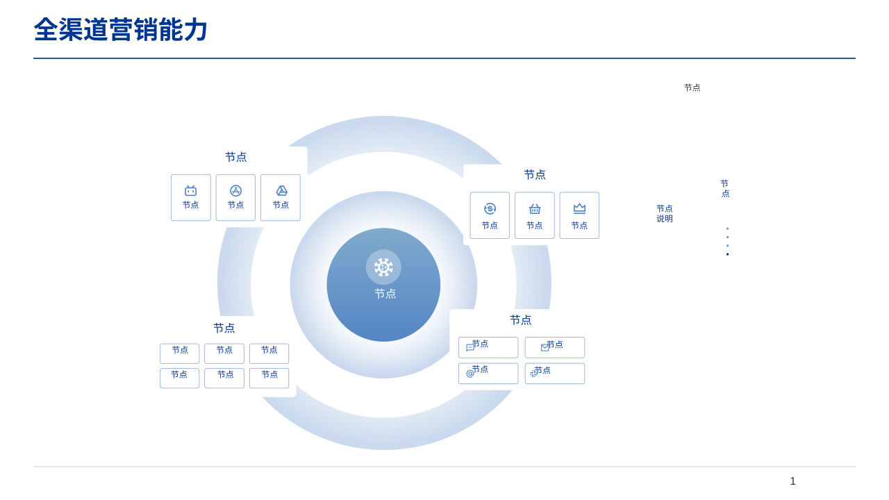

# 全渠道营销能力

来源为圆形逻辑图PPT模版.pptx#22。

## 结构与适用场景

中心自动化个性营销；3不完整圆环；四象限分别渠道/行为/转化/触达模块

全渠道营销能力分组

实际图不是裁图方法，按实际结构登记；通道、行为、工具类型要独立

固定节点、圆弧、扇区、分面和连接表达定性关系。数量比较、趋势或占比使用数据驱动图表，源页中已登记的微图槽可接收实际数据。

## 预览



## 调用

将下列完整page对象放入schema_version=1、template_id=business-blue-v1的pages数组，替换各节点内容。nodes键对应原文本框或已明确拆分的语义分段，字段角色及source_ref、segment见下表。

```json
{
  "id": "circular-22",
  "family": "source-circular",
  "variant": "page-22",
  "content": {
    "title": "全渠道营销能力",
    "nodes": {
      "shape_232": "节点",
      "shape_233": "节点",
      "shape_234": "节点说明",
      "shape_240": "节点",
      "shape_242": "节点",
      "shape_243": "节点",
      "shape_244": "节点",
      "shape_245": "节点",
      "shape_246": "节点",
      "shape_247": "节点",
      "shape_248": "节点",
      "shape_249": "节点",
      "shape_250": "节点",
      "shape_251": "节点",
      "shape_252": "节点",
      "shape_253": "节点",
      "shape_254": "节点",
      "shape_255": "节点",
      "shape_256": "节点",
      "shape_257": "节点",
      "shape_258": "节点",
      "shape_259": "节点",
      "shape_260": "节点",
      "shape_261": "节点"
    }
  },
  "config": {
    "show_source": true,
    "show_page_number": true
  }
}
```

config支持show_source、show_page_number、image_fit与image_position。image_fit可选contain或cover，image_position为xMin/xMid/xMax与YMin/YMid/YMax组合的九个焦点，默认为xMidYMid。字体、颜色、全局区和固定字阶取自tokens，节点数与连接结构由variant确定。

## 字段合同

每个业务节点required=true、min=1，max按具体框体登记。字符按规范化后的Unicode码点计数，空格标点换行均计入。build会以实际字体测量宽高，字符数通过后仍可能需要调整文字。

| 字段 | 节点角色与源标签 | 最短/最长 | 字阶 | 框体px | 原框引用 | 分段 | 旋转° | 垂直锚点 |
|---|---|---|---|---|---|---|---|---|
| nodes.shape_232 | 上右节点，源标签“UI/UX 2020” | 1/13 | diagramMicro | [984.7564, 120, 75.0262, 20.373] | slide:232 |  | 0.0 | t |
| nodes.shape_233 | 上右节点，源标签“首页设计” | 1/12 | diagramMicro | [1033.9778, 258.1968, 21.4577, 62.4896] | slide:233 |  | 0.0 | t |
| nodes.shape_234 | 中右节点，源标签“Home Page Design” | 1/60 | diagramMicro | [944.9226, 294.2889, 30.5637, 179.3128] | slide:234 |  | 0.0 | t |
| nodes.shape_240 | 上左节点，源标签“不同渠道” | 1/16 | caption | [278.4693, 217.9973, 122.297, 27.1668] | slide:240 |  | 0.0 | t |
| nodes.shape_242 | 中左节点，源标签“微信” | 1/9 | diagramMicro | [249.1332, 288.9624, 50.6341, 23.0973] | slide:242 |  | 0.0 | t |
| nodes.shape_243 | 中左节点，源标签“APP” | 1/9 | diagramMicro | [314.0191, 288.9624, 50.6341, 23.0973] | slide:243 |  | 0.0 | t |
| nodes.shape_244 | 中左节点，源标签“官网” | 1/9 | diagramMicro | [378.905, 288.9624, 50.6341, 23.0973] | slide:244 |  | 0.0 | t |
| nodes.shape_245 | 中左节点，源标签“不同行为” | 1/16 | caption | [261.4932, 464.3401, 122.297, 27.1668] | slide:245 |  | 0.0 | t |
| nodes.shape_246 | 下左节点，源标签“关注” | 1/9 | diagramMicro | [233.8808, 497.7627, 50.6341, 23.0973] | slide:246 |  | 0.0 | t |
| nodes.shape_247 | 下左节点，源标签“收藏” | 1/9 | diagramMicro | [297.7661, 497.7627, 50.6341, 23.0973] | slide:247 |  | 0.0 | t |
| nodes.shape_248 | 下左节点，源标签“注册” | 1/9 | diagramMicro | [362.2316, 497.7627, 50.6341, 23.0973] | slide:248 |  | 0.0 | t |
| nodes.shape_249 | 下左节点，源标签“评论” | 1/9 | diagramMicro | [232.4598, 533.077, 50.6341, 23.0973] | slide:249 |  | 0.0 | t |
| nodes.shape_250 | 下左节点，源标签“加购物车” | 1/13 | diagramMicro | [287.5333, 533.077, 74.3535, 23.0973] | slide:250 |  | 0.0 | t |
| nodes.shape_251 | 下左节点，源标签“咨询” | 1/9 | diagramMicro | [363.0304, 533.077, 50.6341, 23.0973] | slide:251 |  | 0.0 | t |
| nodes.shape_252 | 上中节点，源标签“不同行为” | 1/16 | caption | [708.9681, 243.3312, 122.297, 27.1668] | slide:252 |  | 0.0 | t |
| nodes.shape_253 | 中中节点，源标签“不同行为” | 1/16 | caption | [688.4774, 452.6276, 122.297, 27.1668] | slide:253 |  | 0.0 | t |
| nodes.shape_254 | 中中节点，源标签“优惠券” | 1/12 | diagramMicro | [672.3421, 318.5591, 65.3988, 23.0973] | slide:254 |  | 0.0 | t |
| nodes.shape_255 | 中中节点，源标签“商品活动” | 1/14 | diagramMicro | [731.4852, 318.5591, 76.052, 23.0973] | slide:255 |  | 0.0 | t |
| nodes.shape_256 | 中中节点，源标签“商品链接” | 1/13 | diagramMicro | [797.1278, 318.5591, 74.1685, 23.0973] | slide:256 |  | 0.0 | t |
| nodes.shape_257 | 下中节点，源标签“官方短信” | 1/14 | diagramMicro | [679.1947, 488.7995, 78.0279, 23.0973] | slide:257 |  | 0.0 | t |
| nodes.shape_258 | 下中节点，源标签“社交媒体” | 1/14 | diagramMicro | [679.2284, 525.434, 80.5167, 23.0973] | slide:258 |  | 0.0 | t |
| nodes.shape_259 | 下中节点，源标签“邮件” | 1/9 | diagramMicro | [786.8194, 489.8926, 50.5584, 23.0973] | slide:259 |  | 0.0 | t |
| nodes.shape_260 | 下中节点，源标签“APP PUSH” | 1/14 | diagramMicro | [769.1622, 527.0988, 78.709, 23.0973] | slide:260 |  | 0.0 | t |
| nodes.shape_261 | 中中节点，源标签“全流程自动化 / 个性营销” | 1/32 | caption | [493.601, 414.7319, 122.297, 56.0153] | slide:261 |  | 0.0 | t |

全局title必填、2至32码点，使用统一标题框。section_name可选0至24码点，source可选0至64码点。所有可编辑文本通过独立原生carrier导出，页码为派生文字。

## 来源处理

原生PPTX源件保存于用户材料目录，分发包仅含用户资产衍生的几何、字段和说明。原始逐框文字、源框与标准化框在page-catalog.json的variant.fields中。

源标题引用为`slide:235`，原文为“封面图不同裁剪方案”。模板默认标题依据真实结构设置。

密集全景中的diagramCompact为14px、diagramMicro为12px。适用于体系概览或附录局部标签，现场关键结论用统一标题与正常正文字阶表达。

源画布边界裁切已烘焙为可编辑Bezier几何，3D顶面、侧面与前面通过tokens配色的相对明暗保留。

