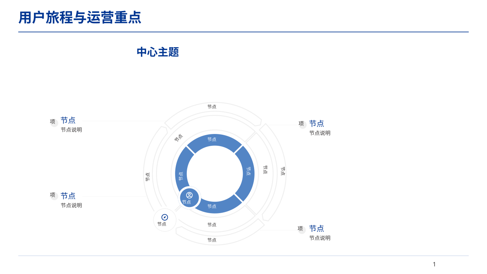

# 用户旅程与运营重点

来源为圆形逻辑图PPT模版.pptx#23。

## 结构与适用场景

中心用户服务；4环扇区与外弧；四周发现/决策/使用/留存4问题

用户旅程与运营重点

保留4阶段与用户状态/服务动作同心层，不能当4等份占比

固定节点、圆弧、扇区、分面和连接表达定性关系。数量比较、趋势或占比使用数据驱动图表，源页中已登记的微图槽可接收实际数据。

## 预览



## 调用

将下列完整page对象放入schema_version=1、template_id=business-blue-v1的pages数组，替换各节点内容。nodes键对应原文本框或已明确拆分的语义分段，字段角色及source_ref、segment见下表。

```json
{
  "id": "circular-23",
  "family": "source-circular",
  "variant": "page-23",
  "content": {
    "title": "用户旅程与运营重点",
    "nodes": {
      "shape_57": "中心主题",
      "shape_58": "节点",
      "shape_59": "节点说明",
      "shape_60": "节点",
      "shape_61": "节点说明",
      "shape_62": "节点",
      "shape_63": "节点说明",
      "shape_64": "节点",
      "shape_65": "节点说明",
      "shape_66": "节点",
      "shape_67": "节点",
      "shape_68": "节点",
      "shape_69": "节点",
      "shape_70": "节点",
      "shape_71": "节点",
      "shape_72": "节点",
      "shape_73": "节点",
      "shape_74": "节点",
      "shape_75": "节点",
      "shape_78": "节点",
      "shape_79": "节点",
      "shape_80": "节点",
      "shape_81": "项",
      "shape_82": "项",
      "shape_83": "项",
      "shape_84": "项"
    }
  },
  "config": {
    "show_source": true,
    "show_page_number": true
  }
}
```

config支持show_source、show_page_number、image_fit与image_position。image_fit可选contain或cover，image_position为xMin/xMid/xMax与YMin/YMid/YMax组合的九个焦点，默认为xMidYMid。字体、颜色、全局区和固定字阶取自tokens，节点数与连接结构由variant确定。

## 字段合同

每个业务节点required=true、min=1，max按具体框体登记。字符按规范化后的Unicode码点计数，空格标点换行均计入。build会以实际字体测量宽高，字符数通过后仍可能需要调整文字。

| 字段 | 节点角色与源标签 | 最短/最长 | 字阶 | 框体px | 原框引用 | 分段 | 旋转° | 垂直锚点 |
|---|---|---|---|---|---|---|---|---|
| nodes.shape_57 | 上中节点，源标签“Prototype” | 1/325 | heading | [358.3229, 120, 822.7344, 201.2387] | slide:57 |  | 0.0 | t |
| nodes.shape_58 | 中左节点，源标签“决策” | 1/5 | compactBody | [158.7052, 304.7305, 53.2957, 30.3206] | slide:58 |  | 0.0 | t |
| nodes.shape_59 | 中左节点，源标签“我们如何让用户使用服务？如何向他们传递我们的服务价值和优点” | 1/132 | diagramCompact | [159.3536, 332.722, 212.4661, 80.5023] | slide:59 |  | 0.0 | t |
| nodes.shape_60 | 下左节点，源标签“发现” | 1/5 | compactBody | [158.7052, 503.4098, 53.2957, 30.3206] | slide:60 |  | 0.0 | t |
| nodes.shape_61 | 下左节点，源标签“我们如何让用户注意到我们的产品或服务？” | 1/99 | diagramCompact | [159.3536, 531.4013, 212.4661, 55.693] | slide:61 |  | 0.0 | t |
| nodes.shape_62 | 中中节点，源标签“使用” | 1/5 | compactBody | [811.9888, 313.3216, 53.2957, 30.3206] | slide:62 |  | 0.0 | t |
| nodes.shape_63 | 中中节点，源标签“我们如何让用户使用更便捷、体验更顺畅” | 1/43 | diagramCompact | [812.6372, 341.3131, 271.1451, 30.8837] | slide:63 |  | 0.0 | t |
| nodes.shape_64 | 下中节点，源标签“留存” | 1/5 | compactBody | [811.9888, 589.1333, 53.2957, 30.3206] | slide:64 |  | 0.0 | t |
| nodes.shape_65 | 下中节点，源标签“我们如何让用户使用更便捷、体验更顺畅” | 1/44 | diagramCompact | [812.6372, 617.1163, 278.2176, 30.8837] | slide:65 |  | 0.0 | t |
| nodes.shape_66 | 上中节点，源标签“2.提供吸引并转化” | 1/22 | diagramMicro | [504.8924, 272.7462, 119.397, 19.298] | slide:66 |  | 0.0 | t |
| nodes.shape_67 | 中左节点，源标签“1.触达用户” | 1/22 | diagramMicro | [330.549, 447.6443, 119.397, 19.298] | slide:67 |  | -90.0 | t |
| nodes.shape_68 | 下中节点，源标签“4.奖励忠诚用户” | 1/22 | diagramMicro | [504.8924, 623.1992, 119.397, 19.298] | slide:68 |  | 0.0 | t |
| nodes.shape_69 | 中中节点，源标签“3.可用的好服务” | 1/22 | diagramMicro | [681.8295, 447.6528, 119.397, 19.298] | slide:69 |  | 90.0 | t |
| nodes.shape_70 | 下中节点，源标签“使用后” | 1/22 | diagramMicro | [504.8924, 583.0846, 119.397, 19.298] | slide:70 |  | 0.0 | t |
| nodes.shape_71 | 中中节点，源标签“使用前” | 1/22 | diagramMicro | [416.5339, 349.1224, 119.397, 19.298] | slide:71 |  | -45.0 | t |
| nodes.shape_72 | 中中节点，源标签“使用中” | 1/22 | diagramMicro | [635.4272, 443.6601, 119.397, 19.298] | slide:72 |  | 90.0 | t |
| nodes.shape_73 | 下中节点，源标签“重复使用” | 1/10 | diagramMicro | [535.87, 534.6859, 57.4419, 19.298] | slide:73 |  | 0.0 | t |
| nodes.shape_74 | 中中节点，源标签“考虑用” | 1/22 | diagramMicro | [504.8924, 358.7684, 119.397, 19.298] | slide:74 |  | 0.0 | t |
| nodes.shape_75 | 中中节点，源标签“使用服务” | 1/22 | diagramMicro | [591.3881, 447.6443, 119.397, 19.298] | slide:75 |  | 90.0 | t |
| nodes.shape_78 | 中中节点，源标签“感兴趣” | 1/22 | diagramMicro | [417.774, 445.8441, 119.397, 19.298] | slide:78 |  | -90.0 | t |
| nodes.shape_79 | 下中节点，源标签“用户” | 1/10 | diagramMicro | [469.0435, 523.4074, 57.4419, 19.298] | slide:79 |  | 0.0 | t |
| nodes.shape_80 | 下左节点，源标签“服务” | 1/10 | diagramMicro | [404.2048, 581.0455, 57.4419, 19.298] | slide:80 |  | 0.0 | t |
| nodes.shape_81 | 中左节点，源标签“1” | 1/4 | diagramCompact | [131.0037, 311.2143, 25.5857, 24.8093] | slide:81 |  | 0.0 | t |
| nodes.shape_82 | 下左节点，源标签“3” | 1/4 | diagramCompact | [131.0037, 503.7766, 25.5857, 24.8093] | slide:82 |  | 0.0 | t |
| nodes.shape_83 | 中中节点，源标签“2” | 1/4 | diagramCompact | [784.5604, 316.3502, 25.5857, 24.8093] | slide:83 |  | 0.0 | t |
| nodes.shape_84 | 下中节点，源标签“4” | 1/4 | diagramCompact | [782.0009, 592.307, 25.5857, 24.8093] | slide:84 |  | 0.0 | t |

全局title必填、2至32码点，使用统一标题框。section_name可选0至24码点，source可选0至64码点。所有可编辑文本通过独立原生carrier导出，页码为派生文字。

## 来源处理

原生PPTX源件保存于用户材料目录，分发包仅含用户资产衍生的几何、字段和说明。原始逐框文字、源框与标准化框在page-catalog.json的variant.fields中。

源标题引用为`slide:55`，原文为“覆盖用户的全生命周期”。模板默认标题依据真实结构设置。

密集全景中的diagramCompact为14px、diagramMicro为12px。适用于体系概览或附录局部标签，现场关键结论用统一标题与正常正文字阶表达。

源画布边界裁切已烘焙为可编辑Bezier几何，3D顶面、侧面与前面通过tokens配色的相对明暗保留。

