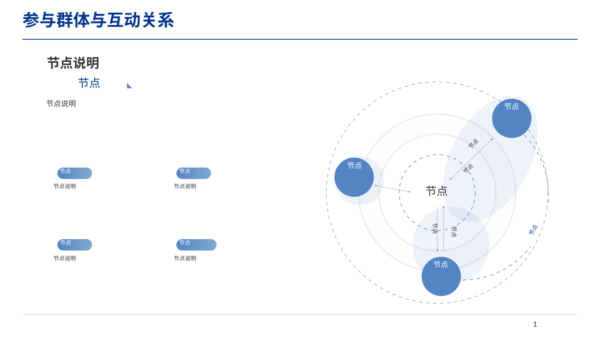

# 参与群体与互动关系

来源为圆形逻辑图PPT模版.pptx#24。

## 结构与适用场景

右雷达式同心圈；中心主播，3外围人群节点和透明辐射区；左4类画像说明

利益相关者与互动强弱

节点半径源无量化标尺，不能宣称实际关系强度；左4类与图3点差异需整理

固定节点、圆弧、扇区、分面和连接表达定性关系。数量比较、趋势或占比使用数据驱动图表，源页中已登记的微图槽可接收实际数据。

## 预览



## 调用

将下列完整page对象放入schema_version=1、template_id=business-blue-v1的pages数组，替换各节点内容。nodes键对应原文本框或已明确拆分的语义分段，字段角色及source_ref、segment见下表。

```json
{
  "id": "circular-24",
  "family": "source-circular",
  "variant": "page-24",
  "content": {
    "title": "参与群体与互动关系",
    "nodes": {
      "shape_63": "节点说明",
      "shape_65": "节点",
      "shape_66": "节点说明",
      "shape_67": "节点",
      "shape_68": "节点",
      "shape_69": "节点",
      "shape_70": "节点",
      "shape_71": "节点说明",
      "shape_72": "节点说明",
      "shape_73": "节点说明",
      "shape_74": "节点说明",
      "shape_75": "节点",
      "shape_76": "节点",
      "shape_77": "节点",
      "shape_78": "节点",
      "shape_79": "节点",
      "shape_80": "节点",
      "shape_81": "节点",
      "shape_82": "节点",
      "shape_83": "节点"
    }
  },
  "config": {
    "show_source": true,
    "show_page_number": true
  }
}
```

config支持show_source、show_page_number、image_fit与image_position。image_fit可选contain或cover，image_position为xMin/xMid/xMax与YMin/YMid/YMax组合的九个焦点，默认为xMidYMid。字体、颜色、全局区和固定字阶取自tokens，节点数与连接结构由variant确定。

## 字段合同

每个业务节点required=true、min=1，max按具体框体登记。字符按规范化后的Unicode码点计数，空格标点换行均计入。build会以实际字体测量宽高，字符数通过后仍可能需要调整文字。

| 字段 | 节点角色与源标签 | 最短/最长 | 字阶 | 框体px | 原框引用 | 分段 | 旋转° | 垂直锚点 |
|---|---|---|---|---|---|---|---|---|
| nodes.shape_63 | 上左节点，源标签“Stakeholder map” | 1/23 | heading | [99.7105, 120, 291.1348, 51.2204] | slide:63 |  | 0.0 | t |
| nodes.shape_65 | 上左节点，源标签“相关地图” | 1/10 | body | [166.0835, 164.861, 108.4739, 36.1611] | slide:65 |  | 0.0 | t |
| nodes.shape_66 | 上左节点，源标签“通过点而研究的数据调研分析。进行商业设险，通过调售智些分类价爆桶这样的硬件取利洞” | 1/261 | caption | [98.0973, 213.0136, 633.3781, 60.8714] | slide:66 |  | 0.0 | t |
| nodes.shape_67 | 中左节点，源标签“资深主播” | 1/11 | diagramMicro | [127.1716, 359.3456, 63.2772, 22.5937] | slide:67 |  | 0.0 | t |
| nodes.shape_68 | 中左节点，源标签“活跃用户” | 1/11 | diagramMicro | [381.8936, 359.3456, 63.2772, 22.5937] | slide:68 |  | 0.0 | t |
| nodes.shape_69 | 下左节点，源标签“观望大佬” | 1/11 | diagramMicro | [127.6845, 512.1303, 63.2772, 22.5937] | slide:69 |  | 0.0 | t |
| nodes.shape_70 | 下左节点，源标签“潜水小透明” | 1/13 | diagramMicro | [381.8936, 512.1303, 74.5694, 22.5937] | slide:70 |  | 0.0 | t |
| nodes.shape_71 | 中左节点，源标签“热爱使用直播的方式与观众分享交流，就是目前知乎观众层次不一，有时聊不起来” | 1/152 | diagramMicro | [113.912, 391.7301, 209.3108, 66.5408] | slide:71 |  | 0.0 | t |
| nodes.shape_72 | 中中节点，源标签“获得反馈经常在直播间评论，偶尔和主播消费内容连麦，感觉在知乎直播能学到东给予反馈” | 1/200 | diagramMicro | [370.4709, 391.7301, 217.1342, 86.1226] | slide:72 |  | 0.0 | t |
| nodes.shape_73 | 下左节点，源标签“不知道知乎还能直播呢,目前在知乎已经输出了一些高质量回答” | 1/117 | diagramMicro | [113.912, 545.727, 210.9426, 46.9497] | slide:73 |  | 0.0 | t |
| nodes.shape_74 | 下中节点，源标签“极少进行内容输出的潜水群众，偶尔看直播，但对直播不是很感兴趣” | 1/152 | diagramMicro | [370.4709, 545.727, 209.3108, 66.5408] | slide:74 |  | 0.0 | t |
| nodes.shape_75 | 中右节点，源标签“资深主播” | 1/12 | body | [862.4869, 395.5719, 137.6601, 36.1611] | slide:75 |  | 0.0 | t |
| nodes.shape_76 | 中中节点，源标签“观望 / 大佬” | 1/21 | caption | [729.4706, 345.4798, 53.2345, 62.1209] | slide:76 |  | 0.0 | t |
| nodes.shape_77 | 上右节点，源标签“潜水 / 小透明” | 1/27 | caption | [1055.8899, 219.2051, 70.8022, 62.1209] | slide:77 |  | 0.0 | t |
| nodes.shape_78 | 下右节点，源标签“活跃 / 观众” | 1/21 | caption | [913.5768, 556.8887, 53.2345, 62.1209] | slide:78 |  | 0.0 | t |
| nodes.shape_79 | 中右节点，源标签“消费内容” | 1/13 | diagramMicro | [976.453, 299.2201, 75.2874, 23.7033] | slide:79 |  | -45.0 | t |
| nodes.shape_80 | 中右节点，源标签“生产内容” | 1/13 | diagramMicro | [965.3194, 352.5479, 75.2874, 23.7033] | slide:80 |  | -45.0 | t |
| nodes.shape_81 | 下右节点，源标签“获得反馈” | 1/13 | diagramMicro | [925.1207, 483.2331, 75.2874, 23.7033] | slide:81 |  | 90.0 | t |
| nodes.shape_82 | 下右节点，源标签“给予反馈” | 1/13 | diagramMicro | [884.4092, 476.0438, 75.2874, 23.7033] | slide:82 |  | 90.0 | t |
| nodes.shape_83 | 下右节点，源标签“消费内容” | 1/13 | diagramMicro | [1106.6153, 481.4112, 75.2874, 27.3679] | slide:83 |  | -59.2701 | t |

全局title必填、2至32码点，使用统一标题框。section_name可选0至24码点，source可选0至64码点。所有可编辑文本通过独立原生carrier导出，页码为派生文字。

## 来源处理

原生PPTX源件保存于用户材料目录，分发包仅含用户资产衍生的几何、字段和说明。原始逐框文字、源框与标准化框在page-catalog.json的variant.fields中。

源标题引用为`slide:62`，原文为“02”。模板默认标题依据真实结构设置。

密集全景中的diagramCompact为14px、diagramMicro为12px。适用于体系概览或附录局部标签，现场关键结论用统一标题与正常正文字阶表达。

源画布边界裁切已烘焙为可编辑Bezier几何，3D顶面、侧面与前面通过tokens配色的相对明暗保留。

