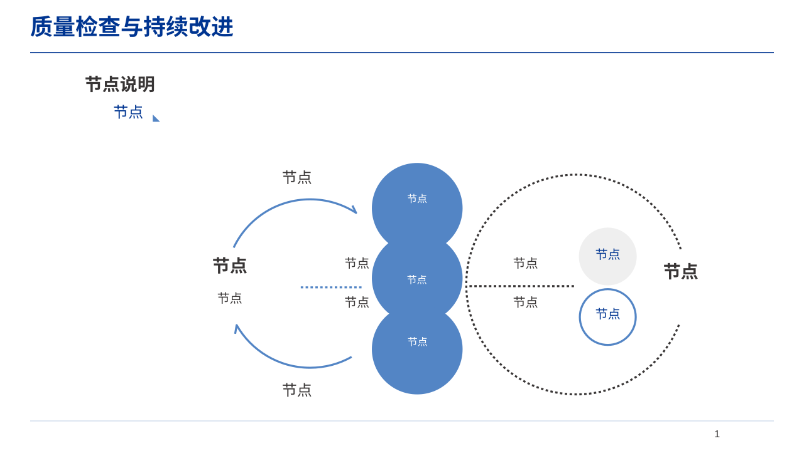

# 质量检查与持续改进

来源为圆形逻辑图PPT模版.pptx#25。

## 结构与适用场景

左精细化迭代双弧，中央3堆叠圈细节/标准/把握，右设计走查与修改反馈虚圆

质量检查与迭代机制

箭头表示检查回路；中央3圈是要素，不作3步骤因果

固定节点、圆弧、扇区、分面和连接表达定性关系。数量比较、趋势或占比使用数据驱动图表，源页中已登记的微图槽可接收实际数据。

## 预览



## 调用

将下列完整page对象放入schema_version=1、template_id=business-blue-v1的pages数组，替换各节点内容。nodes键对应原文本框或已明确拆分的语义分段，字段角色及source_ref、segment见下表。

```json
{
  "id": "circular-25",
  "family": "source-circular",
  "variant": "page-25",
  "content": {
    "title": "质量检查与持续改进",
    "nodes": {
      "shape_37": "节点说明",
      "shape_39": "节点",
      "shape_40": "节点",
      "shape_41": "节点",
      "shape_42": "节点",
      "shape_43": "节点",
      "shape_44": "节点",
      "shape_45": "节点",
      "shape_46": "节点",
      "shape_47": "节点",
      "shape_48": "节点",
      "shape_49": "节点",
      "shape_50": "节点",
      "shape_16": "节点",
      "shape_26": "节点",
      "shape_27": "节点"
    }
  },
  "config": {
    "show_source": true,
    "show_page_number": true
  }
}
```

config支持show_source、show_page_number、image_fit与image_position。image_fit可选contain或cover，image_position为xMin/xMid/xMax与YMin/YMid/YMax组合的九个焦点，默认为xMidYMid。字体、颜色、全局区和固定字阶取自tokens，节点数与连接结构由variant确定。

## 字段合同

每个业务节点required=true、min=1，max按具体框体登记。字符按规范化后的Unicode码点计数，空格标点换行均计入。build会以实际字体测量宽高，字符数通过后仍可能需要调整文字。

| 字段 | 节点角色与源标签 | 最短/最长 | 字阶 | 框体px | 原框引用 | 分段 | 旋转° | 垂直锚点 |
|---|---|---|---|---|---|---|---|---|
| nodes.shape_37 | 上左节点，源标签“Cost Thinking” | 1/19 | heading | [134.7589, 120, 246.6431, 53.1298] | slide:37 |  | 0.0 | t |
| nodes.shape_39 | 上左节点，源标签“思维” | 1/6 | body | [180.1702, 166.5333, 65.6361, 37.5091] | slide:39 |  | 0.0 | t |
| nodes.shape_40 | 中左节点，源标签“设计精细化” | 1/15 | heading | [265.3056, 409.6944, 201.0673, 53.1298] | slide:40 |  | 0.0 | t |
| nodes.shape_41 | 中左节点，源标签“细节决定一切精细度” | 1/22 | compactBody | [262.578, 465.7453, 206.271, 34.3753] | slide:41 |  | 0.0 | t |
| nodes.shape_42 | 下中节点，源标签“设计是否精心化” | 1/16 | body | [381.3052, 610.4909, 182.8351, 37.5091] | slide:42 |  | 0.0 | t |
| nodes.shape_43 | 上中节点，源标签“细节上的处理” | 1/14 | body | [393.028, 270.9552, 159.3895, 37.5091] | slide:43 |  | 0.0 | t |
| nodes.shape_44 | 中中节点，源标签“是否精细” | 1/11 | compactBody | [486.085, 409.8588, 102.0909, 34.3753] | slide:44 |  | 0.0 | t |
| nodes.shape_45 | 中中节点，源标签“是否粗糙” | 1/11 | compactBody | [486.085, 472.274, 102.0909, 34.3753] | slide:45 |  | 0.0 | t |
| nodes.shape_46 | 中中节点，源标签“高要求/质标准” | 1/17 | compactBody | [760.033, 409.8588, 153.2089, 34.3753] | slide:46 |  | 0.0 | t |
| nodes.shape_47 | 中中节点，源标签“设计走查” | 1/11 | compactBody | [785.5968, 472.274, 102.0909, 34.3753] | slide:47 |  | 0.0 | t |
| nodes.shape_48 | 中右节点，源标签“设计师 / 自我修养” | 1/18 | heading | [1022.3065, 419.0282, 122.9347, 82.5722] | slide:48 |  | 0.0 | t |
| nodes.shape_49 | 中右节点，源标签“迭代” | 1/6 | compactBody | [940.0147, 395.7953, 55.219, 31.2511] | slide:49 |  | 0.0 | t |
| nodes.shape_50 | 下右节点，源标签“修改” | 1/6 | compactBody | [940.0147, 490.8835, 55.219, 31.2511] | slide:50 |  | 0.0 | t |
| nodes.shape_16 | 中中节点，源标签“细节处理” | 1/12 | caption | [642.2343, 308.9673, 43.8057, 48.5258] | slide:16 |  | 0 | t |
| nodes.shape_26 | 下中节点，源标签“把握程度” | 1/12 | caption | [642.95, 537.3685, 43.5543, 48.3227] | slide:26 |  | 0 | t |
| nodes.shape_27 | 中中节点，源标签“标准化” | 1/9 | caption | [630.3567, 438.3437, 66.642, 21.5982] | slide:27 |  | 0 | t |

全局title必填、2至32码点，使用统一标题框。section_name可选0至24码点，source可选0至64码点。所有可编辑文本通过独立原生carrier导出，页码为派生文字。

## 来源处理

原生PPTX源件保存于用户材料目录，分发包仅含用户资产衍生的几何、字段和说明。原始逐框文字、源框与标准化框在page-catalog.json的variant.fields中。

源标题引用为`slide:36`，原文为“02”。模板默认标题依据真实结构设置。

密集全景中的diagramCompact为14px、diagramMicro为12px。适用于体系概览或附录局部标签，现场关键结论用统一标题与正常正文字阶表达。

源画布边界裁切已烘焙为可编辑Bezier几何，3D顶面、侧面与前面通过tokens配色的相对明暗保留。

