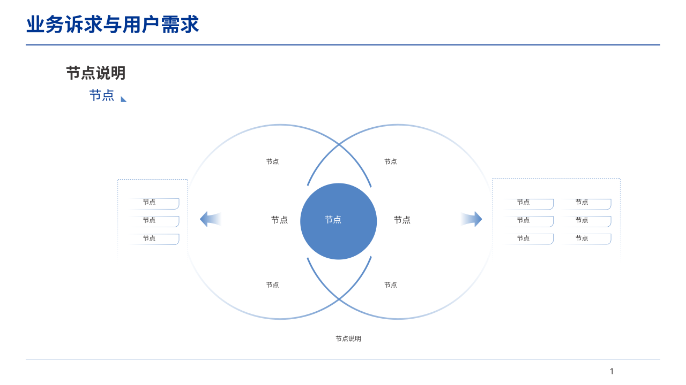

# 业务诉求与用户需求

来源为圆形逻辑图PPT模版.pptx#26。

## 结构与适用场景

两相交大圆业务诉求/用户需求，交集PC端；左右各指标组，向外箭头

业务与用户共同目标

实际是Venn重叠关系，不能改为线性流程；源医疗指标跨域例文需替换

固定节点、圆弧、扇区、分面和连接表达定性关系。数量比较、趋势或占比使用数据驱动图表，源页中已登记的微图槽可接收实际数据。

## 预览



## 调用

将下列完整page对象放入schema_version=1、template_id=business-blue-v1的pages数组，替换各节点内容。nodes键对应原文本框或已明确拆分的语义分段，字段角色及source_ref、segment见下表。

```json
{
  "id": "circular-26",
  "family": "source-circular",
  "variant": "page-26",
  "content": {
    "title": "业务诉求与用户需求",
    "nodes": {
      "shape_61": "节点说明",
      "shape_63": "节点",
      "shape_64": "节点",
      "shape_65": "节点",
      "shape_66": "节点",
      "shape_67": "节点",
      "shape_68": "节点",
      "shape_69": "节点",
      "shape_70": "节点",
      "shape_71": "节点",
      "shape_72": "节点",
      "shape_73": "节点",
      "shape_74": "节点",
      "shape_75": "节点",
      "shape_76": "节点",
      "shape_77": "节点",
      "shape_78": "节点",
      "shape_79": "节点",
      "shape_80": "节点说明"
    }
  },
  "config": {
    "show_source": true,
    "show_page_number": true
  }
}
```

config支持show_source、show_page_number、image_fit与image_position。image_fit可选contain或cover，image_position为xMin/xMid/xMax与YMin/YMid/YMax组合的九个焦点，默认为xMidYMid。字体、颜色、全局区和固定字阶取自tokens，节点数与连接结构由variant确定。

## 字段合同

每个业务节点required=true、min=1，max按具体框体登记。字符按规范化后的Unicode码点计数，空格标点换行均计入。build会以实际字体测量宽高，字符数通过后仍可能需要调整文字。

| 字段 | 节点角色与源标签 | 最短/最长 | 字阶 | 框体px | 原框引用 | 分段 | 旋转° | 垂直锚点 |
|---|---|---|---|---|---|---|---|---|
| nodes.shape_61 | 上左节点，源标签“Cost Thinking” | 1/18 | heading | [122.4288, 120, 234.8222, 50.5835] | slide:61 |  | 0.0 | t |
| nodes.shape_63 | 上左节点，源标签“思维” | 1/5 | body | [165.6638, 164.3031, 62.4903, 35.7114] | slide:63 |  | 0.0 | t |
| nodes.shape_64 | 中中节点，源标签“业务诉求” | 1/10 | caption | [480.8688, 401.2065, 77.3624, 26.7789] | slide:64 |  | 0.0 | t |
| nodes.shape_65 | 中中节点，源标签“用户需求” | 1/10 | caption | [709.7145, 401.2065, 77.3624, 26.7789] | slide:65 |  | 0.0 | t |
| nodes.shape_66 | 中中节点，源标签“PC端” | 1/7 | caption | [606.8624, 400.5895, 51.1728, 26.7789] | slide:66 |  | 0.0 | t |
| nodes.shape_67 | 中左节点，源标签“客户满意度” | 1/11 | diagramMicro | [255.4948, 370.2836, 61.2472, 19.3383] | slide:67 |  | 0.0 | t |
| nodes.shape_68 | 中左节点，源标签“持续项目合作” | 1/12 | diagramMicro | [251.1575, 404.1072, 69.9218, 19.3383] | slide:68 |  | 0.0 | t |
| nodes.shape_69 | 中左节点，源标签“尾款回款时效” | 1/12 | diagramMicro | [251.1575, 437.9216, 69.9218, 19.3383] | slide:69 |  | 0.0 | t |
| nodes.shape_70 | 中右节点，源标签“平均住院日缩短” | 1/14 | diagramMicro | [944.8959, 370.2836, 78.6056, 19.3383] | slide:70 |  | 0.0 | t |
| nodes.shape_71 | 中右节点，源标签“医护工作时效提高” | 1/16 | diagramMicro | [940.5586, 404.1072, 87.2802, 19.3383] | slide:71 |  | 0.0 | t |
| nodes.shape_72 | 中右节点，源标签“不良事故/纠纷减少” | 1/16 | diagramMicro | [939.0115, 437.9216, 90.3835, 19.3383] | slide:72 |  | 0.0 | t |
| nodes.shape_73 | 中右节点，源标签“患者状态即时响应” | 1/16 | diagramMicro | [1049.7647, 370.2836, 87.2802, 19.3383] | slide:73 |  | 0.0 | t |
| nodes.shape_74 | 中右节点，源标签“地图服务效率提升” | 1/16 | diagramMicro | [1049.7647, 404.1072, 87.2802, 19.3383] | slide:74 |  | 0.0 | t |
| nodes.shape_75 | 中右节点，源标签“事件分析精准” | 1/12 | diagramMicro | [1058.4393, 437.9216, 69.9218, 19.3383] | slide:75 |  | 0.0 | t |
| nodes.shape_76 | 下中节点，源标签“绩效考核” | 1/12 | diagramMicro | [702.9369, 525.2018, 67.4446, 23.8045] | slide:76 |  | 0.0 | t |
| nodes.shape_77 | 中中节点，源标签“工作提效” | 1/12 | diagramMicro | [702.9369, 294.5512, 67.4446, 23.8045] | slide:77 |  | 0.0 | t |
| nodes.shape_78 | 下中节点，源标签“业务增长” | 1/12 | diagramMicro | [482.5356, 525.2018, 67.4446, 23.8045] | slide:78 |  | 0.0 | t |
| nodes.shape_79 | 中中节点，源标签“客满度” | 1/10 | diagramMicro | [488.733, 294.5512, 55.0497, 23.8045] | slide:79 |  | 0.0 | t |
| nodes.shape_80 | 下中节点，源标签“医护绩效考核=平均住院日+不良事故发生率+...” | 1/45 | diagramMicro | [533.8465, 625.6873, 247.9907, 22.3127] | slide:80 |  | 0.0 | t |

全局title必填、2至32码点，使用统一标题框。section_name可选0至24码点，source可选0至64码点。所有可编辑文本通过独立原生carrier导出，页码为派生文字。

## 来源处理

原生PPTX源件保存于用户材料目录，分发包仅含用户资产衍生的几何、字段和说明。原始逐框文字、源框与标准化框在page-catalog.json的variant.fields中。

源标题引用为`slide:60`，原文为“02”。模板默认标题依据真实结构设置。

密集全景中的diagramCompact为14px、diagramMicro为12px。适用于体系概览或附录局部标签，现场关键结论用统一标题与正常正文字阶表达。

源画布边界裁切已烘焙为可编辑Bezier几何，3D顶面、侧面与前面通过tokens配色的相对明暗保留。

