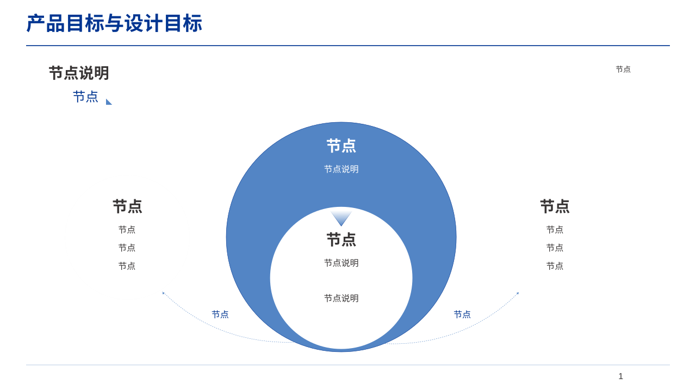

# 产品目标与设计目标

来源为圆形逻辑图PPT模版.pptx#27。

## 结构与适用场景

主产品目标大圆包住设计目标小圆，左右业务/用户需求圈，由虚线满足弧连到中心

目标包含与双侧需求对齐

保留包含关系与左右来源，若改目标体系需有事实支持

固定节点、圆弧、扇区、分面和连接表达定性关系。数量比较、趋势或占比使用数据驱动图表，源页中已登记的微图槽可接收实际数据。

## 预览



## 调用

将下列完整page对象放入schema_version=1、template_id=business-blue-v1的pages数组，替换各节点内容。nodes键对应原文本框或已明确拆分的语义分段，字段角色及source_ref、segment见下表。

```json
{
  "id": "circular-27",
  "family": "source-circular",
  "variant": "page-27",
  "content": {
    "title": "产品目标与设计目标",
    "nodes": {
      "shape_42": "节点说明",
      "shape_44": "节点",
      "shape_45": "节点",
      "shape_46": "节点",
      "shape_47": "节点",
      "shape_48": "节点",
      "shape_49": "节点",
      "shape_50": "节点",
      "shape_51": "节点",
      "shape_52": "节点",
      "shape_53": "节点",
      "shape_54": "节点",
      "shape_55": "节点说明",
      "shape_56": "节点说明",
      "shape_57": "节点",
      "shape_58": "节点说明",
      "shape_59": "节点",
      "shape_60": "节点"
    }
  },
  "config": {
    "show_source": true,
    "show_page_number": true
  }
}
```

config支持show_source、show_page_number、image_fit与image_position。image_fit可选contain或cover，image_position为xMin/xMid/xMax与YMin/YMid/YMax组合的九个焦点，默认为xMidYMid。字体、颜色、全局区和固定字阶取自tokens，节点数与连接结构由variant确定。

## 字段合同

每个业务节点required=true、min=1，max按具体框体登记。字符按规范化后的Unicode码点计数，空格标点换行均计入。build会以实际字体测量宽高，字符数通过后仍可能需要调整文字。

| 字段 | 节点角色与源标签 | 最短/最长 | 字阶 | 框体px | 原框引用 | 分段 | 旋转° | 垂直锚点 |
|---|---|---|---|---|---|---|---|---|
| nodes.shape_42 | 上左节点，源标签“Cost Thinking” | 1/19 | heading | [88.6727, 120, 241.9059, 52.1094] | slide:42 |  | 0.0 | t |
| nodes.shape_44 | 上左节点，源标签“思维” | 1/5 | body | [133.2118, 165.6396, 64.3754, 36.7887] | slide:44 |  | 0.0 | t |
| nodes.shape_45 | 上右节点，源标签“UI/UX 2022” | 1/14 | diagramCompact | [1100.9304, 120.4079, 90.3969, 24.5226] | slide:45 |  | 0.0 | t |
| nodes.shape_46 | 中左节点，源标签“业务诉求” | 1/9 | heading | [173.9279, 365.691, 120.5735, 39.8528] | slide:46 |  | 0.0 | t |
| nodes.shape_47 | 中左节点，源标签“业务行业破局” | 1/15 | caption | [178.0735, 414.7268, 110.3565, 31.5806] | slide:47 |  | 0.0 | t |
| nodes.shape_48 | 中左节点，源标签“产品内容ROI升级” | 1/18 | caption | [165.4565, 448.0529, 135.5812, 31.5806] | slide:48 |  | 0.0 | t |
| nodes.shape_49 | 下左节点，源标签“产品数据增长” | 1/15 | caption | [178.0735, 481.6067, 110.3565, 31.5806] | slide:49 |  | 0.0 | t |
| nodes.shape_50 | 中右节点，源标签“用户需求” | 1/9 | heading | [960.0463, 365.691, 120.5735, 39.8528] | slide:50 |  | 0.0 | t |
| nodes.shape_51 | 中右节点，源标签“不同场景下用户诉求满足” | 1/25 | caption | [926.834, 414.7268, 186.9885, 31.5806] | slide:51 |  | 0.0 | t |
| nodes.shape_52 | 中右节点，源标签“提升产品用户价值” | 1/19 | caption | [949.8293, 448.0529, 141.0074, 31.5806] | slide:52 |  | 0.0 | t |
| nodes.shape_53 | 下右节点，源标签“互动模式多样化” | 1/17 | caption | [957.4944, 481.6067, 125.6772, 31.5806] | slide:53 |  | 0.0 | t |
| nodes.shape_54 | 中中节点，源标签“设计目标” | 1/10 | heading | [562.1917, 426.8506, 130.7905, 42.917] | slide:54 |  | 0.0 | t |
| nodes.shape_55 | 下中节点，源标签“通过设计手段实现 / 产品体验&用户价值提升” | 1/87 | caption | [522.5191, 475.8958, 210.1356, 63.1991] | slide:55 |  | 0.0 | t |
| nodes.shape_56 | 下中节点，源标签“通过设计手段实现 / 提升产品转化数据增长” | 1/81 | caption | [528.9889, 540.9827, 197.2055, 63.1991] | slide:56 |  | 0.0 | t |
| nodes.shape_57 | 上中节点，源标签“产品目标” | 1/10 | heading | [562.1917, 254.1107, 130.7905, 42.917] | slide:57 |  | 0.0 | t |
| nodes.shape_58 | 中中节点，源标签“产品&用户价值提升 / 产品数据增长” | 1/72 | caption | [540.4012, 303.1465, 174.3715, 63.1991] | slide:58 |  | 0.0 | t |
| nodes.shape_59 | 下左节点，源标签“满足” | 1/7 | caption | [377.736, 570.8273, 54.1585, 30.6509] | slide:59 |  | 0.0 | t |
| nodes.shape_60 | 下中节点，源标签“满足” | 1/7 | caption | [822.9852, 570.8273, 54.1585, 30.6509] | slide:60 |  | 0.0 | t |

全局title必填、2至32码点，使用统一标题框。section_name可选0至24码点，source可选0至64码点。所有可编辑文本通过独立原生carrier导出，页码为派生文字。

## 来源处理

原生PPTX源件保存于用户材料目录，分发包仅含用户资产衍生的几何、字段和说明。原始逐框文字、源框与标准化框在page-catalog.json的variant.fields中。

源标题引用为`slide:41`，原文为“02”。模板默认标题依据真实结构设置。

密集全景中的diagramCompact为14px、diagramMicro为12px。适用于体系概览或附录局部标签，现场关键结论用统一标题与正常正文字阶表达。

源画布边界裁切已烘焙为可编辑Bezier几何，3D顶面、侧面与前面通过tokens配色的相对明暗保留。

