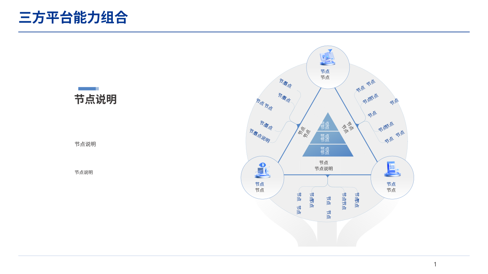

# 三方平台能力组合

来源为圆形逻辑图PPT模版.pptx#28。

## 结构与适用场景

右中心3层三角塔，外围云图/高德/API3大圈，3类行业框与循环关系，左说明

三方平台能力组合

标题吉祥物与实际位置服务图不符，按实际三方三层结构；多环弧与竖排字需测量

固定节点、圆弧、扇区、分面和连接表达定性关系。数量比较、趋势或占比使用数据驱动图表，源页中已登记的微图槽可接收实际数据。

## 预览



## 调用

将下列完整page对象放入schema_version=1、template_id=business-blue-v1的pages数组，替换各节点内容。nodes键对应原文本框或已明确拆分的语义分段，字段角色及source_ref、segment见下表。

```json
{
  "id": "circular-28",
  "family": "source-circular",
  "variant": "page-28",
  "content": {
    "title": "三方平台能力组合",
    "nodes": {
      "shape_100": "节点说明",
      "shape_101": "节点说明",
      "shape_102": "节点说明",
      "shape_103": "节点",
      "shape_104": "节点",
      "shape_105": "节点",
      "shape_106": "节点",
      "shape_107": "节点",
      "shape_108": "节点",
      "shape_109": "节点",
      "shape_110": "节点说明",
      "shape_111": "节点",
      "shape_112": "节点",
      "shape_113": "节点",
      "shape_114": "节点",
      "shape_115": "节点",
      "shape_116": "节点",
      "shape_117": "节点",
      "shape_118": "节点",
      "shape_119": "节点",
      "shape_120": "节点",
      "shape_123": "节点",
      "shape_124": "节点",
      "shape_126": "节点",
      "shape_127": "节点",
      "shape_129": "节点",
      "shape_130": "节点",
      "shape_133": "节点",
      "shape_134": "节点",
      "shape_135": "节点",
      "shape_136": "节点",
      "shape_138": "节点",
      "shape_139": "节点",
      "shape_140": "节点",
      "shape_141": "节点",
      "shape_142": "节点",
      "shape_143": "节点",
      "shape_144": "节点",
      "shape_145": "节点",
      "shape_147": "节点",
      "shape_148": "节点",
      "shape_151": "节点",
      "shape_152": "节点",
      "shape_154": "节点说明",
      "shape_155": "节点",
      "shape_156": "节点",
      "shape_157": "节点",
      "shape_158": "节点",
      "shape_159": "节点",
      "shape_160": "节点",
      "shape_161": "节点"
    }
  },
  "config": {
    "show_source": true,
    "show_page_number": true
  }
}
```

config支持show_source、show_page_number、image_fit与image_position。image_fit可选contain或cover，image_position为xMin/xMid/xMax与YMin/YMid/YMax组合的九个焦点，默认为xMidYMid。字体、颜色、全局区和固定字阶取自tokens，节点数与连接结构由variant确定。

## 字段合同

每个业务节点required=true、min=1，max按具体框体登记。字符按规范化后的Unicode码点计数，空格标点换行均计入。build会以实际字体测量宽高，字符数通过后仍可能需要调整文字。

| 字段 | 节点角色与源标签 | 最短/最长 | 字阶 | 框体px | 原框引用 | 分段 | 旋转° | 垂直锚点 |
|---|---|---|---|---|---|---|---|---|
| nodes.shape_100 | 上左节点，源标签“How to integrate / mascots into / interface ” | 1/72 | heading | [194.286, 244.5064, 305.9374, 117.5768] | slide:100 |  | 0.0 | t |
| nodes.shape_101 | 中左节点，源标签“吉祥物作为有形的拟人化形象，能够更直观地为品牌代言，表现出产品的性格和气质。在应” | 1/265 | diagramMicro | [195.5312, 445.3031, 288.8034, 76.8159] | slide:101 |  | 0.0 | t |
| nodes.shape_102 | 中左节点，源标签“如何将吉祥物融入在界面设计中?” | 1/32 | diagramCompact | [195.5312, 370.4925, 205.6482, 23.5137] | slide:102 |  | 0.0 | t |
| nodes.shape_103 | 上中节点，源标签“快捷的位置云计算” | 1/12 | diagramMicro | [826.416, 195.8213, 67.9295, 15.6785] | slide:103 |  | 0.0 | t |
| nodes.shape_104 | 上中节点，源标签“云图” | 1/8 | diagramMicro | [838.3912, 180.159, 43.9791, 20.902] | slide:104 |  | 0.0 | t |
| nodes.shape_105 | 下中节点，源标签“权威的位置大数据” | 1/12 | diagramMicro | [654.8174, 491.9425, 67.9295, 15.6785] | slide:105 |  | 0.0 | t |
| nodes.shape_106 | 下中节点，源标签“高德位置” | 1/13 | diagramMicro | [652.6423, 476.2801, 72.2878, 20.902] | slide:106 |  | 0.0 | t |
| nodes.shape_107 | 下右节点，源标签“专业、易用的地图开发工具” | 1/17 | diagramMicro | [986.8479, 491.9425, 94.0631, 15.6785] | slide:107 |  | 0.0 | t |
| nodes.shape_108 | 下右节点，源标签“API/SDK” | 1/15 | diagramMicro | [991.4003, 476.2801, 84.9422, 20.902] | slide:108 |  | 0.0 | t |
| nodes.shape_109 | 中中节点，源标签“社交” | 1/4 | diagramMicro | [652.3122, 340.4719, 26.5621, 15.0] | slide:109 |  | 30.0 | t |
| nodes.shape_110 | 中中节点，源标签“Social Contact” | 1/9 | diagramMicro | [661.5504, 353.5376, 53.1, 15.0] | slide:110 |  | 30.0 | t |
| nodes.shape_111 | 中中节点，源标签“物流” | 1/4 | diagramMicro | [679.7568, 319.3637, 26.5621, 15.0] | slide:111 |  | 30.0 | t |
| nodes.shape_112 | 中中节点，源标签“Logistics” | 1/7 | diagramMicro | [690.9633, 328.4542, 38.133, 15.0] | slide:112 |  | 30.0 | t |
| nodes.shape_113 | 上中节点，源标签“游戏” | 1/4 | diagramMicro | [727.3169, 246.6595, 26.5621, 15.0] | slide:113 |  | 30.0 | t |
| nodes.shape_114 | 上中节点，源标签“Game” | 1/5 | diagramMicro | [738.4158, 254.6028, 31.1872, 15.0] | slide:114 |  | 30.0 | t |
| nodes.shape_115 | 上中节点，源标签“电商” | 1/4 | diagramMicro | [730.5108, 208.8984, 26.5621, 15.0] | slide:115 |  | 30.0 | t |
| nodes.shape_116 | 上中节点，源标签“E-commerce” | 1/8 | diagramMicro | [740.4731, 220.6371, 48.0625, 15.0] | slide:116 |  | 30.0 | t |
| nodes.shape_117 | 上中节点，源标签“企业” | 1/6 | diagramMicro | [667.4339, 263.5068, 37.4457, 20.902] | slide:117 |  | 30.0 | t |
| nodes.shape_118 | 中中节点，源标签“CUMPANY” | 1/13 | diagramMicro | [687.3125, 285.5498, 72.967, 20.902] | slide:118 |  | 30.0 | t |
| nodes.shape_119 | 中右节点，源标签“开发者” | 1/5 | diagramMicro | [1036.7843, 342.1032, 32.0039, 15.0] | slide:119 |  | -30.0 | t |
| nodes.shape_120 | 中右节点，源标签“Developers” | 1/8 | diagramMicro | [1007.2188, 355.4539, 44.6583, 15.0] | slide:120 |  | -30.0 | t |
| nodes.shape_123 | 中右节点，源标签“司机” | 1/4 | diagramMicro | [1008.9533, 320.6453, 26.5621, 15.0] | slide:123 |  | -30.0 | t |
| nodes.shape_124 | 中右节点，源标签“Driver” | 1/5 | diagramMicro | [991.4468, 328.8262, 31.0498, 15.0] | slide:124 |  | -30.0 | t |
| nodes.shape_126 | 上右节点，源标签“玩家” | 1/4 | diagramMicro | [968.264, 246.615, 26.5621, 15.0] | slide:126 |  | -30.0 | t |
| nodes.shape_127 | 上右节点，源标签“Player” | 1/5 | diagramMicro | [950.3468, 254.802, 31.8665, 15.0] | slide:127 |  | -30.0 | t |
| nodes.shape_129 | 上右节点，源标签“消费者” | 1/5 | diagramMicro | [959.8714, 208.2414, 32.0039, 15.0] | slide:129 |  | -30.0 | t |
| nodes.shape_130 | 上右节点，源标签“Consumer” | 1/7 | diagramMicro | [932.4592, 221.9672, 42.0789, 15.0] | slide:130 |  | -30.0 | t |
| nodes.shape_133 | 上右节点，源标签“用户” | 1/6 | diagramMicro | [1022.6052, 255.9939, 37.4457, 20.902] | slide:133 |  | -30.0 | t |
| nodes.shape_134 | 上右节点，源标签“CUSTOMER” | 1/14 | diagramMicro | [962.2446, 279.0002, 77.5921, 20.902] | slide:134 |  | -30.0 | t |
| nodes.shape_135 | 下右节点，源标签“工具” | 1/4 | diagramMicro | [922.7997, 527.5928, 26.5621, 15.0] | slide:135 |  | 90.0 | t |
| nodes.shape_136 | 下右节点，源标签“Tools” | 1/5 | diagramMicro | [921.9466, 512.1528, 29.2871, 15.0] | slide:136 |  | 90.0 | t |
| nodes.shape_138 | 下右节点，源标签“服务” | 1/4 | diagramMicro | [889.4454, 533.6653, 26.5621, 15.0] | slide:138 |  | 90.0 | t |
| nodes.shape_139 | 下右节点，源标签“Service” | 1/6 | diagramMicro | [885.6329, 514.8131, 34.3165, 15.0] | slide:139 |  | 90.0 | t |
| nodes.shape_140 | 下中节点，源标签“数据” | 1/4 | diagramMicro | [804.5194, 527.892, 26.5621, 15.0] | slide:140 |  | 90.0 | t |
| nodes.shape_141 | 下中节点，源标签“Dato” | 1/5 | diagramMicro | [803.6987, 511.6838, 28.3329, 15.0] | slide:141 |  | 90.0 | t |
| nodes.shape_142 | 下中节点，源标签“技术” | 1/4 | diagramMicro | [770.5506, 545.2604, 26.5621, 15.0] | slide:142 |  | 90.0 | t |
| nodes.shape_143 | 下中节点，源标签“Technologe” | 1/8 | diagramMicro | [761.8179, 520.3883, 45.6125, 15.0] | slide:143 |  | 90.0 | t |
| nodes.shape_144 | 下右节点，源标签“高德” | 1/6 | diagramMicro | [840.5743, 559.9933, 37.4457, 20.902] | slide:144 |  | 90.0 | t |
| nodes.shape_145 | 下中节点，源标签“AMAP” | 1/9 | diagramMicro | [834.6555, 529.0405, 48.8792, 20.902] | slide:145 |  | 90.0 | t |
| nodes.shape_147 | 中中节点，源标签“将真实世界映射在地图” | 1/14 | diagramMicro | [768.4119, 337.2055, 80.9963, 15.6785] | slide:147 |  | -60.0 | t |
| nodes.shape_148 | 中中节点，源标签“地理渲染” | 1/10 | diagramMicro | [767.9953, 328.072, 59.221, 20.902] | slide:148 |  | -60.0 | t |
| nodes.shape_151 | 中右节点，源标签“在地图上还原真实世界” | 1/14 | diagramMicro | [868.2928, 337.9079, 80.9963, 15.6785] | slide:151 |  | 60.0 | t |
| nodes.shape_152 | 中右节点，源标签“数据可视化” | 1/12 | diagramMicro | [885.0367, 328.7709, 70.1127, 20.902] | slide:152 |  | 60.0 | t |
| nodes.shape_154 | 中中节点，源标签“道路 / 建筑 / 水系 绿地 ···” | 1/17 | diagramMicro | [810.0421, 435.5192, 93.5132, 15.6785] | slide:154 |  | 0.0 | t |
| nodes.shape_155 | 中中节点，源标签“真实世界” | 1/10 | diagramMicro | [827.1841, 419.8568, 59.221, 20.902] | slide:155 |  | 0.0 | t |
| nodes.shape_156 | 中中节点，源标签“发挥数据的价值” | 1/8 | diagramMicro | [836.6931, 327.0589, 46.1623, 15.0] | slide:156 |  | 0.0 | t |
| nodes.shape_157 | 中右节点，源标签“应用” | 1/5 | diagramMicro | [844.3181, 317.2955, 30.9204, 16.9804] | slide:157 |  | 0.0 | t |
| nodes.shape_158 | 中中节点，源标签“经过分析处理的数据” | 1/10 | diagramMicro | [832.3429, 359.8714, 54.8708, 15.0] | slide:158 |  | 0.0 | t |
| nodes.shape_159 | 中右节点，源标签“处理” | 1/5 | diagramMicro | [844.3181, 350.108, 30.9204, 16.9804] | slide:159 |  | 0.0 | t |
| nodes.shape_160 | 中中节点，源标签“对世界的抽象记录” | 1/9 | diagramMicro | [834.518, 393.7108, 50.5125, 15.0] | slide:160 |  | 0.0 | t |
| nodes.shape_161 | 中右节点，源标签“采集” | 1/5 | diagramMicro | [844.3181, 383.9474, 30.9204, 16.9804] | slide:161 |  | 0.0 | t |

## 保留的原装饰

本页保留用户原模板的结构图标或装饰图片，逐项身份见source-field-coverage.json中本页retained_source_images。其中图片内固化的字形随整图编辑，可在PowerPoint中原生替换整图；nodes字段控制已登记的可编辑文字。参数图片替换使用本页image_slots列出的槽位。


全局title必填、2至32码点，使用统一标题框。section_name可选0至24码点，source可选0至64码点。所有可编辑文本通过独立原生carrier导出，页码为派生文字。

## 来源处理

原生PPTX源件保存于用户材料目录，分发包仅含用户资产衍生的几何、字段和说明。原始逐框文字、源框与标准化框在page-catalog.json的variant.fields中。

源标题引用为`None`，原文为“无独立源标题”。模板默认标题依据真实结构设置。

密集全景中的diagramCompact为14px、diagramMicro为12px。适用于体系概览或附录局部标签，现场关键结论用统一标题与正常正文字阶表达。

源画布边界裁切已烘焙为可编辑Bezier几何，3D顶面、侧面与前面通过tokens配色的相对明暗保留。

