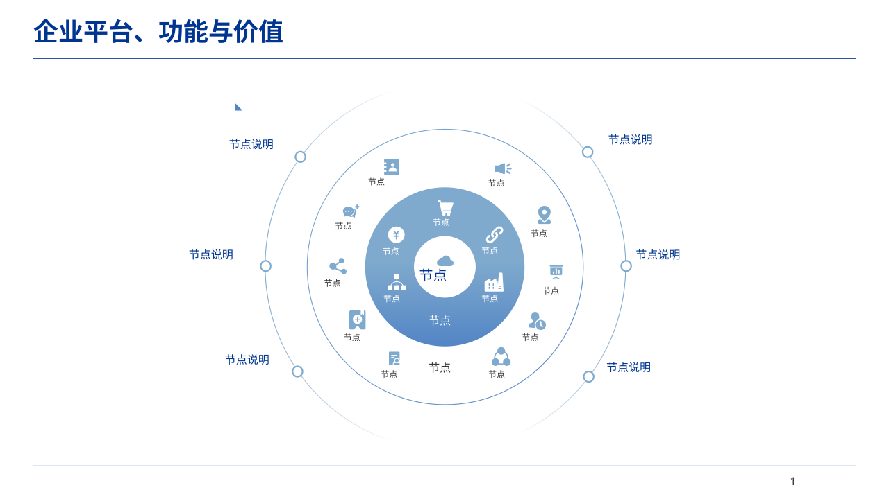

# 企业平台、功能与价值

来源为圆形逻辑图PPT模版.pptx#29。

## 结构与适用场景

中心Cloud；内环企业管理5域；中环12协作功能图标；外圈6收益说明

企业平台-功能-价值

每圈角色独立，能选模块数量才适配材料；源财务品牌例文不可照抄

固定节点、圆弧、扇区、分面和连接表达定性关系。数量比较、趋势或占比使用数据驱动图表，源页中已登记的微图槽可接收实际数据。

## 预览



## 调用

将下列完整page对象放入schema_version=1、template_id=business-blue-v1的pages数组，替换各节点内容。nodes键对应原文本框或已明确拆分的语义分段，字段角色及source_ref、segment见下表。

```json
{
  "id": "circular-29",
  "family": "source-circular",
  "variant": "page-29",
  "content": {
    "title": "企业平台、功能与价值",
    "nodes": {
      "shape_46": "节点",
      "shape_47": "节点",
      "shape_48": "节点",
      "shape_49": "节点",
      "shape_50": "节点",
      "shape_51": "节点",
      "shape_52": "节点",
      "shape_53": "节点",
      "shape_54": "节点",
      "shape_55": "节点",
      "shape_56": "节点",
      "shape_57": "节点",
      "shape_58": "节点",
      "shape_59": "节点",
      "shape_60": "节点",
      "shape_61": "节点",
      "shape_62": "节点",
      "shape_63": "节点说明",
      "shape_64": "节点说明",
      "shape_65": "节点说明",
      "shape_66": "节点说明",
      "shape_67": "节点说明",
      "shape_2": "节点",
      "shape_69": "节点说明"
    }
  },
  "config": {
    "show_source": true,
    "show_page_number": true
  }
}
```

config支持show_source、show_page_number、image_fit与image_position。image_fit可选contain或cover，image_position为xMin/xMid/xMax与YMin/YMid/YMax组合的九个焦点，默认为xMidYMid。字体、颜色、全局区和固定字阶取自tokens，节点数与连接结构由variant确定。

## 字段合同

每个业务节点required=true、min=1，max按具体框体登记。字符按规范化后的Unicode码点计数，空格标点换行均计入。build会以实际字体测量宽高，字符数通过后仍可能需要调整文字。

| 字段 | 节点角色与源标签 | 最短/最长 | 字阶 | 框体px | 原框引用 | 分段 | 旋转° | 垂直锚点 |
|---|---|---|---|---|---|---|---|---|
| nodes.shape_46 | 上中节点，源标签“企业通讯录” | 1/12 | diagramMicro | [530.009, 254.5261, 66.3422, 20.1009] | slide:46 |  | 0.0 | t |
| nodes.shape_47 | 中中节点，源标签“及时沟通” | 1/10 | diagramMicro | [474.0118, 318.4044, 56.2959, 20.1009] | slide:47 |  | 0.0 | t |
| nodes.shape_48 | 中中节点，源标签“分享协作” | 1/10 | diagramMicro | [458.2496, 400.9485, 56.2959, 20.1009] | slide:48 |  | 0.0 | t |
| nodes.shape_49 | 下中节点，源标签“报表订阅” | 1/10 | diagramMicro | [486.4556, 479.2119, 56.2959, 20.1009] | slide:49 |  | 0.0 | t |
| nodes.shape_50 | 下中节点，源标签“业务审批” | 1/10 | diagramMicro | [539.9641, 532.3056, 56.2959, 20.1009] | slide:50 |  | 0.0 | t |
| nodes.shape_51 | 下中节点，源标签“任务协同” | 1/10 | diagramMicro | [694.6823, 532.3056, 56.2959, 20.1009] | slide:51 |  | 0.0 | t |
| nodes.shape_52 | 下中节点，源标签“请假统计” | 1/10 | diagramMicro | [743.2133, 479.2119, 56.2959, 20.1009] | slide:52 |  | 0.0 | t |
| nodes.shape_53 | 中中节点，源标签“业务请示” | 1/10 | diagramMicro | [772.6637, 411.8161, 56.2959, 20.1009] | slide:53 |  | 0.0 | t |
| nodes.shape_54 | 中中节点，源标签“外勤签到” | 1/10 | diagramMicro | [755.6571, 329.272, 56.2959, 20.1009] | slide:54 |  | 0.0 | t |
| nodes.shape_55 | 上中节点，源标签“通知公告” | 1/10 | diagramMicro | [694.2675, 256.2682, 56.2959, 20.1009] | slide:55 |  | 0.0 | t |
| nodes.shape_56 | 下中节点，源标签“工作圈” | 1/8 | caption | [612.1051, 520.4922, 62.9907, 26.804] | slide:56 |  | 0.0 | t |
| nodes.shape_57 | 中中节点，源标签“企业管理” | 1/10 | caption | [604.2821, 452.3996, 78.6284, 26.804] | slide:57 |  | 0.0 | t |
| nodes.shape_58 | 中中节点，源标签“精细的 / 财务管理” | 1/20 | diagramMicro | [542.4528, 354.9312, 56.2959, 32.1714] | slide:58 |  | 0.0 | t |
| nodes.shape_59 | 中中节点，源标签“便捷的 / 分销管理” | 1/20 | diagramMicro | [543.6972, 423.364, 56.2959, 32.1714] | slide:59 |  | 0.0 | t |
| nodes.shape_60 | 中中节点，源标签“简单的 / 生产管理” | 1/20 | diagramMicro | [684.7853, 423.364, 56.2959, 32.1714] | slide:60 |  | 0.0 | t |
| nodes.shape_61 | 中中节点，源标签“流程灵活的 / 供应链管理” | 1/24 | diagramMicro | [679.758, 354.0933, 66.3422, 32.1714] | slide:61 |  | 0.0 | t |
| nodes.shape_62 | 中中节点，源标签“B2B电商通” | 1/12 | diagramMicro | [609.3094, 313.0287, 67.0474, 20.1009] | slide:62 |  | 0.0 | t |
| nodes.shape_63 | 上右节点，源标签“无缝对接各类主流电商平台商品、会员、订单、库存整合数据管理” | 1/66 | caption | [875.5658, 191.2036, 239.9917, 55.2838] | slide:63 |  | 0.0 | t |
| nodes.shape_64 | 下右节点，源标签“按需生产、按期交货轻松把我动态库存” | 1/60 | caption | [873.0771, 519.7207, 220.5047, 55.2838] | slide:64 |  | 0.0 | t |
| nodes.shape_65 | 上左节点，源标签“全新一代财务软件财务不用加班” | 1/48 | caption | [236.3263, 197.8403, 178.2288, 55.2838] | slide:65 |  | 0.0 | t |
| nodes.shape_66 | 中左节点，源标签“规范经销商管理统一管理门店助力企业规模化扩张” | 1/52 | caption | [164.4425, 357.1213, 192.1825, 55.2838] | slide:66 |  | 0.0 | t |
| nodes.shape_67 | 下左节点，源标签“个性工作台高效审批，智能代办一站式移动工作平台” | 1/56 | caption | [203.2672, 508.6623, 205.3398, 55.2838] | slide:67 |  | 0.0 | t |
| nodes.shape_2 | 中中节点，源标签“Cloud” | 1/7 | compactBody | [603.4608, 385.8085, 69.6937, 32.1714] | slide:2 |  | 0.0 | t |
| nodes.shape_69 | 中右节点，源标签“降低采购成本扩大销售、盘活资金” | 1/44 | caption | [915.3778, 357.1213, 164.0014, 55.2838] | slide:69 |  | 0.0 | t |

全局title必填、2至32码点，使用统一标题框。section_name可选0至24码点，source可选0至64码点。所有可编辑文本通过独立原生carrier导出，页码为派生文字。

## 来源处理

原生PPTX源件保存于用户材料目录，分发包仅含用户资产衍生的几何、字段和说明。原始逐框文字、源框与标准化框在page-catalog.json的variant.fields中。

源标题引用为`slide:6`，原文为“系统解决方案”。模板默认标题依据真实结构设置。

密集全景中的diagramCompact为14px、diagramMicro为12px。适用于体系概览或附录局部标签，现场关键结论用统一标题与正常正文字阶表达。

源画布边界裁切已烘焙为可编辑Bezier几何，3D顶面、侧面与前面通过tokens配色的相对明暗保留。

