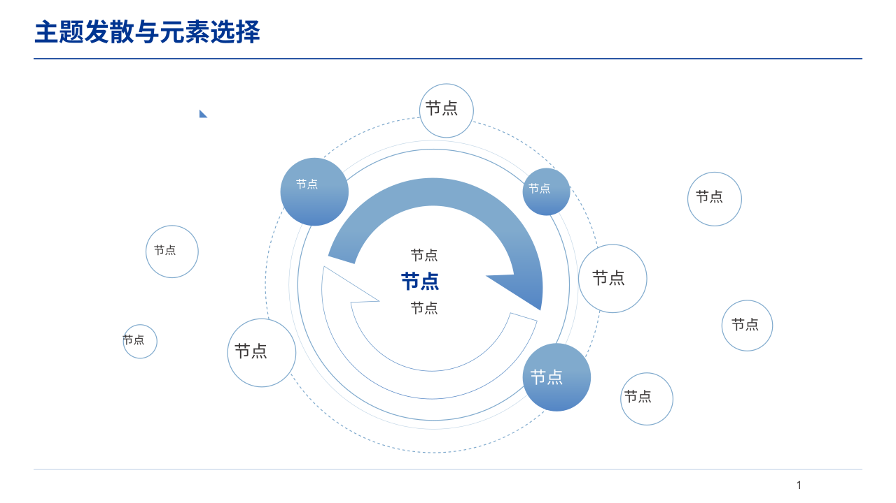

# 主题发散与元素选择

来源为圆形逻辑图PPT模版.pptx#31。

## 结构与适用场景

中心主题双向环箭头，周边11具象元素圈，部分在外环，连线稀疏

主题意象发散、元素选择

不是业务系统架构，不能仅按题头调用；节点大小非数据

固定节点、圆弧、扇区、分面和连接表达定性关系。数量比较、趋势或占比使用数据驱动图表，源页中已登记的微图槽可接收实际数据。

## 预览



## 调用

将下列完整page对象放入schema_version=1、template_id=business-blue-v1的pages数组，替换各节点内容。nodes键对应原文本框或已明确拆分的语义分段，字段角色及source_ref、segment见下表。

```json
{
  "id": "circular-31",
  "family": "source-circular",
  "variant": "page-31",
  "content": {
    "title": "主题发散与元素选择",
    "nodes": {
      "shape_36": "节点",
      "shape_37": "节点",
      "shape_38": "节点",
      "shape_39": "节点",
      "shape_40": "节点",
      "shape_41": "节点",
      "shape_42": "节点",
      "shape_43": "节点",
      "shape_44": "节点",
      "shape_45": "节点",
      "shape_46": "节点",
      "shape_47": "节点",
      "shape_48": "节点",
      "shape_49": "节点"
    }
  },
  "config": {
    "show_source": true,
    "show_page_number": true
  }
}
```

config支持show_source、show_page_number、image_fit与image_position。image_fit可选contain或cover，image_position为xMin/xMid/xMax与YMin/YMid/YMax组合的九个焦点，默认为xMidYMid。字体、颜色、全局区和固定字阶取自tokens，节点数与连接结构由variant确定。

## 字段合同

每个业务节点required=true、min=1，max按具体框体登记。字符按规范化后的Unicode码点计数，空格标点换行均计入。build会以实际字体测量宽高，字符数通过后仍可能需要调整文字。

| 字段 | 节点角色与源标签 | 最短/最长 | 字阶 | 框体px | 原框引用 | 分段 | 旋转° | 垂直锚点 |
|---|---|---|---|---|---|---|---|---|
| nodes.shape_36 | 上中节点，源标签“金属” | 1/7 | caption | [754.5031, 259.6902, 52.4217, 29.668] | slide:36 |  | 0.0 | t |
| nodes.shape_37 | 上中节点，源标签“电钻” | 1/5 | body | [606.6683, 140.954, 62.311, 35.6089] | slide:37 |  | 0.0 | t |
| nodes.shape_38 | 中右节点，源标签“皮尺” | 1/5 | body | [845.1874, 384.0459, 62.311, 35.6089] | slide:38 |  | 0.0 | t |
| nodes.shape_39 | 上右节点，源标签“钳子” | 1/6 | compactBody | [993.2427, 270.2682, 57.3618, 32.6339] | slide:39 |  | 0.0 | t |
| nodes.shape_40 | 中右节点，源标签“3D” | 1/5 | compactBody | [1044.3513, 453.2253, 46.3889, 32.6339] | slide:40 |  | 0.0 | t |
| nodes.shape_41 | 下右节点，源标签“机械” | 1/8 | compactBody | [887.6004, 556.2047, 72.9808, 32.6339] | slide:41 |  | 0.0 | t |
| nodes.shape_42 | 下中节点，源标签“螺母” | 1/7 | body | [755.4948, 526.1878, 81.6397, 35.6089] | slide:42 |  | 0.0 | t |
| nodes.shape_43 | 下左节点，源标签“安全帽” | 1/7 | body | [331.5118, 488.8067, 84.5597, 35.6089] | slide:43 |  | 0.0 | t |
| nodes.shape_44 | 中左节点，源标签“HUD” | 1/7 | caption | [217.2382, 348.033, 57.2057, 29.668] | slide:44 |  | 0.0 | t |
| nodes.shape_45 | 下左节点，源标签“光效” | 1/6 | caption | [177.1116, 476.3738, 47.4724, 26.7021] | slide:45 |  | 0.0 | t |
| nodes.shape_46 | 上中节点，源标签“数据表盘” | 1/14 | caption | [422.3614, 253.4829, 52.4217, 50.4383] | slide:46 |  | 0.0 | t |
| nodes.shape_47 | 中中节点，源标签“从所指倒推能指” | 1/17 | compactBody | [539.5274, 354.0566, 158.771, 32.6339] | slide:47 |  | 0.0 | t |
| nodes.shape_48 | 中中节点，源标签“具象元素发散” | 1/17 | compactBody | [539.5274, 429.7186, 158.771, 32.6339] | slide:48 |  | 0.0 | t |
| nodes.shape_49 | 中中节点，源标签“数字工业” | 1/12 | heading | [538.7928, 386.3782, 158.771, 44.5066] | slide:49 |  | 0.0 | t |

全局title必填、2至32码点，使用统一标题框。section_name可选0至24码点，source可选0至64码点。所有可编辑文本通过独立原生carrier导出，页码为派生文字。

## 来源处理

原生PPTX源件保存于用户材料目录，分发包仅含用户资产衍生的几何、字段和说明。原始逐框文字、源框与标准化框在page-catalog.json的variant.fields中。

源标题引用为`slide:9`，原文为“系统解决方案”。模板默认标题依据真实结构设置。

密集全景中的diagramCompact为14px、diagramMicro为12px。适用于体系概览或附录局部标签，现场关键结论用统一标题与正常正文字阶表达。

源画布边界裁切已烘焙为可编辑Bezier几何，3D顶面、侧面与前面通过tokens配色的相对明暗保留。

