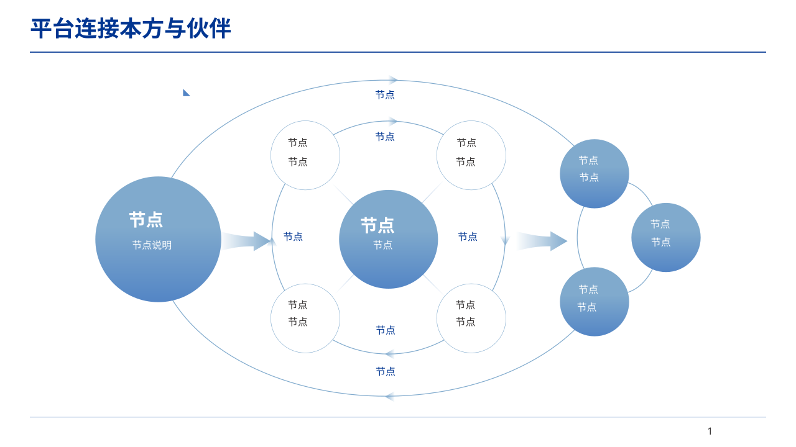

# 平台连接本方与伙伴

来源为圆形逻辑图PPT模版.pptx#32。

## 结构与适用场景

左发起者→中平台→右3拼购者；中环4行为圈用/想/拼/比；外2价值回流弧

平台连接本方与3伙伴

适合本公司—飞书—3互联组织的主结构；必须关闭或替换无依据行为/价值回路层

固定节点、圆弧、扇区、分面和连接表达定性关系。数量比较、趋势或占比使用数据驱动图表，源页中已登记的微图槽可接收实际数据。

## 预览



## 调用

将下列完整page对象放入schema_version=1、template_id=business-blue-v1的pages数组，替换各节点内容。nodes键对应原文本框或已明确拆分的语义分段，字段角色及source_ref、segment见下表。

```json
{
  "id": "circular-32",
  "family": "source-circular",
  "variant": "page-32",
  "content": {
    "title": "平台连接本方与伙伴",
    "nodes": {
      "shape_33": "节点",
      "shape_34": "节点",
      "shape_35": "节点",
      "shape_36": "节点",
      "shape_37": "节点",
      "shape_38": "节点",
      "shape_39": "节点",
      "shape_40": "节点",
      "shape_41": "节点",
      "shape_42": "节点",
      "shape_43": "节点",
      "shape_44": "节点",
      "shape_45": "节点",
      "shape_46": "节点",
      "shape_47": "节点",
      "shape_48": "节点说明",
      "shape_49": "节点",
      "shape_50": "节点",
      "shape_51": "节点",
      "shape_52": "节点",
      "shape_53": "节点",
      "shape_54": "节点",
      "shape_55": "节点",
      "shape_56": "节点"
    }
  },
  "config": {
    "show_source": true,
    "show_page_number": true
  }
}
```

config支持show_source、show_page_number、image_fit与image_position。image_fit可选contain或cover，image_position为xMin/xMid/xMax与YMin/YMid/YMax组合的九个焦点，默认为xMidYMid。字体、颜色、全局区和固定字阶取自tokens，节点数与连接结构由variant确定。

## 字段合同

每个业务节点required=true、min=1，max按具体框体登记。字符按规范化后的Unicode码点计数，空格标点换行均计入。build会以实际字体测量宽高，字符数通过后仍可能需要调整文字。

| 字段 | 节点角色与源标签 | 最短/最长 | 字阶 | 框体px | 原框引用 | 分段 | 旋转° | 垂直锚点 |
|---|---|---|---|---|---|---|---|---|
| nodes.shape_33 | 上中节点，源标签“品牌传递” | 1/12 | caption | [584.627, 142.6075, 89.5798, 34.3777] | slide:33 |  | 0.0 | t |
| nodes.shape_34 | 上中节点，源标签“价值度” | 1/12 | caption | [584.627, 210.051, 89.5798, 34.3777] | slide:34 |  | 0.0 | t |
| nodes.shape_35 | 中中节点，源标签“品质感” | 1/12 | caption | [436.8055, 371.1303, 89.5798, 34.3777] | slide:35 |  | 0.0 | t |
| nodes.shape_36 | 中中节点，源标签“效益比” | 1/12 | caption | [717.6664, 371.1303, 89.5798, 34.3777] | slide:36 |  | 0.0 | t |
| nodes.shape_37 | 下中节点，源标签“信任感” | 1/12 | caption | [585.5509, 521.7235, 89.5798, 34.3777] | slide:37 |  | 0.0 | t |
| nodes.shape_38 | 下中节点，源标签“价值认同” | 1/12 | caption | [585.5509, 588.2432, 89.5798, 34.3777] | slide:38 |  | 0.0 | t |
| nodes.shape_39 | 下中节点，源标签“比” | 1/12 | caption | [713.9708, 481.0726, 89.5798, 34.3777] | slide:39 |  | 0.0 | t |
| nodes.shape_40 | 下中节点，源标签“拼” | 1/12 | caption | [444.1965, 481.0726, 89.5798, 34.3777] | slide:40 |  | 0.0 | t |
| nodes.shape_41 | 上中节点，源标签“用” | 1/12 | caption | [444.1965, 219.6132, 89.5798, 34.3777] | slide:41 |  | 0.0 | t |
| nodes.shape_42 | 上中节点，源标签“想” | 1/12 | caption | [715.8186, 219.6132, 89.5798, 34.3777] | slide:42 |  | 0.0 | t |
| nodes.shape_43 | 上右节点，源标签“拼购者A” | 1/12 | caption | [911.6821, 248.2537, 89.5798, 34.3777] | slide:43 |  | 0.0 | t |
| nodes.shape_44 | 中右节点，源标签“拼购者B” | 1/12 | caption | [911.6821, 456.1277, 89.5798, 34.3777] | slide:44 |  | 0.0 | t |
| nodes.shape_45 | 中右节点，源标签“拼购者C” | 1/12 | caption | [1027.1677, 350.8048, 89.5798, 34.3777] | slide:45 |  | 0.0 | t |
| nodes.shape_46 | 中中节点，源标签“平台” | 1/7 | heading | [580.3217, 346.8044, 89.5798, 52.5506] | slide:46 |  | 0.0 | t |
| nodes.shape_47 | 中左节点，源标签“拼购发起者” | 1/14 | heading | [163.0308, 337.5101, 179.5015, 52.5506] | slide:47 |  | 0.0 | t |
| nodes.shape_48 | 中左节点，源标签“Originator of Shopping” | 1/48 | caption | [164.8785, 384.6283, 179.5015, 54.038] | slide:48 |  | 0.0 | t |
| nodes.shape_49 | 中中节点，源标签“Service” | 1/24 | caption | [536.2801, 384.6283, 179.5015, 30.7561] | slide:49 |  | 0.0 | t |
| nodes.shape_50 | 上右节点，源标签“User A” | 1/11 | caption | [915.9967, 275.6099, 83.4175, 30.7561] | slide:50 |  | 0.0 | t |
| nodes.shape_51 | 中右节点，源标签“User C” | 1/11 | caption | [1031.4822, 380.0088, 83.4175, 30.7561] | slide:51 |  | 0.0 | t |
| nodes.shape_52 | 下右节点，源标签“User B” | 1/11 | caption | [912.3011, 484.7311, 83.4175, 30.7561] | slide:52 |  | 0.0 | t |
| nodes.shape_53 | 上中节点，源标签“Use” | 1/11 | caption | [447.5872, 250.665, 83.4175, 30.7561] | slide:53 |  | 0.0 | t |
| nodes.shape_54 | 上中节点，源标签“Think” | 1/11 | caption | [717.3615, 250.665, 83.4175, 30.7561] | slide:54 |  | 0.0 | t |
| nodes.shape_55 | 下中节点，源标签“Group” | 1/11 | caption | [447.5872, 508.4288, 83.4175, 30.7561] | slide:55 |  | 0.0 | t |
| nodes.shape_56 | 下中节点，源标签“Compare” | 1/15 | caption | [704.4271, 508.4288, 109.2863, 30.7561] | slide:56 |  | 0.0 | t |

全局title必填、2至32码点，使用统一标题框。section_name可选0至24码点，source可选0至64码点。所有可编辑文本通过独立原生carrier导出，页码为派生文字。

## 来源处理

原生PPTX源件保存于用户材料目录，分发包仅含用户资产衍生的几何、字段和说明。原始逐框文字、源框与标准化框在page-catalog.json的variant.fields中。

源标题引用为`slide:6`，原文为“系统解决方案”。模板默认标题依据真实结构设置。

密集全景中的diagramCompact为14px、diagramMicro为12px。适用于体系概览或附录局部标签，现场关键结论用统一标题与正常正文字阶表达。

源画布边界裁切已烘焙为可编辑Bezier几何，3D顶面、侧面与前面通过tokens配色的相对明暗保留。

