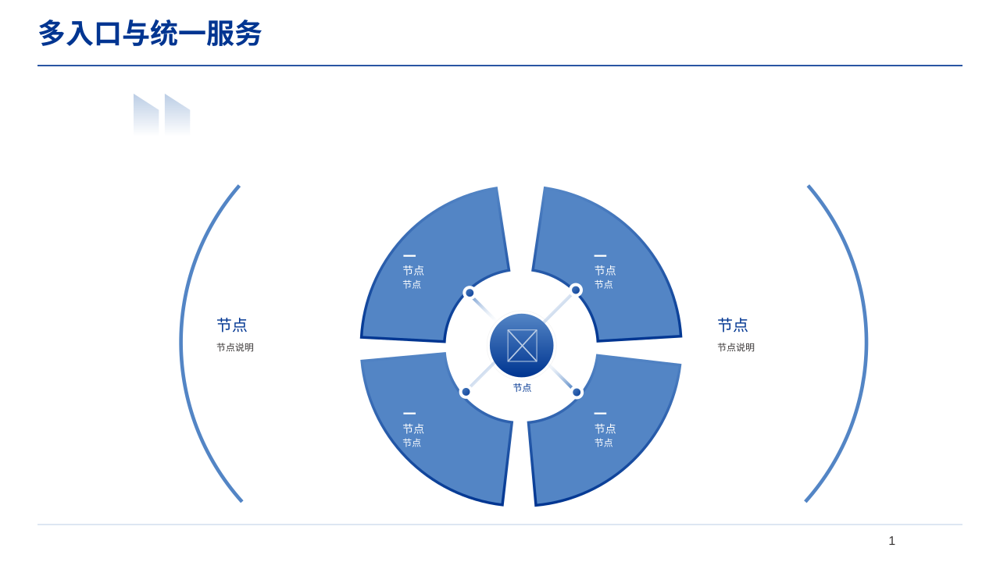

# 多入口与统一服务

来源为圆形逻辑图PPT模版.pptx#33。

## 结构与适用场景

实际中心百度会员+4环扇区入口；两翼卡券平台/车后服务；左右外弧

多入口聚合到统一服务平台

原标题与业务图完全不符；四扇区入口与两服务域分开，不能归为基因研究

固定节点、圆弧、扇区、分面和连接表达定性关系。数量比较、趋势或占比使用数据驱动图表，源页中已登记的微图槽可接收实际数据。

## 预览



## 调用

将下列完整page对象放入schema_version=1、template_id=business-blue-v1的pages数组，替换各节点内容。nodes键对应原文本框或已明确拆分的语义分段，字段角色及source_ref、segment见下表。

```json
{
  "id": "circular-33",
  "family": "source-circular",
  "variant": "page-33",
  "content": {
    "title": "多入口与统一服务",
    "nodes": {
      "shape_77": "节点",
      "shape_78": "节点",
      "shape_79": "节点",
      "shape_80": "节点",
      "shape_68": "节点",
      "shape_69": "节点说明",
      "shape_70": "节点",
      "shape_71": "节点说明",
      "shape_72": "节点",
      "shape_73": "节点",
      "shape_74": "节点",
      "shape_75": "节点",
      "shape_76": "节点"
    }
  },
  "config": {
    "show_source": true,
    "show_page_number": true
  }
}
```

config支持show_source、show_page_number、image_fit与image_position。image_fit可选contain或cover，image_position为xMin/xMid/xMax与YMin/YMid/YMax组合的九个焦点，默认为xMidYMid。字体、颜色、全局区和固定字阶取自tokens，节点数与连接结构由variant确定。

## 字段合同

每个业务节点required=true、min=1，max按具体框体登记。字符按规范化后的Unicode码点计数，空格标点换行均计入。build会以实际字体测量宽高，字符数通过后仍可能需要调整文字。

| 字段 | 节点角色与源标签 | 最短/最长 | 字阶 | 框体px | 原框引用 | 分段 | 旋转° | 垂直锚点 |
|---|---|---|---|---|---|---|---|---|
| nodes.shape_77 | 下中节点，源标签“实体会员卡” | 1/12 | diagramCompact | [515.1834, 542.2073, 75.9555, 17.5] | slide:77 |  | 0.0 | t |
| nodes.shape_78 | 下中节点，源标签“入口导流” | 1/9 | diagramMicro | [515.1834, 561.1357, 53.6055, 15.0] | slide:78 |  | 0.0 | t |
| nodes.shape_79 | 下中节点，源标签“易鑫集团” | 1/9 | diagramCompact | [760.661, 542.2073, 60.7662, 17.5] | slide:79 |  | 0.0 | t |
| nodes.shape_80 | 下中节点，源标签“入口导流” | 1/9 | diagramMicro | [760.661, 561.1357, 53.6055, 15.0] | slide:80 |  | 0.0 | t |
| nodes.shape_68 | 中左节点，源标签“卡券集合平台” | 1/13 | compactBody | [276.8664, 406.2489, 119.1975, 25.0] | slide:68 |  | 0.0 | t |
| nodes.shape_69 | 中左节点，源标签“提供多类型卡券服务，优惠券及代金券” | 1/54 | diagramMicro | [276.8664, 438.864, 148.5434, 42.2178] | slide:69 |  | 0.0 | t |
| nodes.shape_70 | 中右节点，源标签“车后服务” | 1/8 | compactBody | [918.0403, 406.2489, 79.4621, 25.0] | slide:70 |  | 0.0 | t |
| nodes.shape_71 | 中右节点，源标签“提供全面车后服务，以及汽车增值服务” | 1/54 | diagramMicro | [918.0403, 438.864, 148.5434, 42.2178] | slide:71 |  | 0.0 | t |
| nodes.shape_72 | 下中节点，源标签“百度会员” | 1/9 | diagramMicro | [642.7307, 490.6373, 51.4182, 15.0] | slide:72 |  | 0.0 | t |
| nodes.shape_73 | 中中节点，源标签“报价大全” | 1/9 | diagramCompact | [515.1834, 339.364, 60.7662, 17.5] | slide:73 |  | 0.0 | t |
| nodes.shape_74 | 中中节点，源标签“入口导流” | 1/9 | diagramMicro | [515.1834, 358.2925, 53.6055, 15.0] | slide:74 |  | 0.0 | t |
| nodes.shape_75 | 中中节点，源标签“群已使用” | 1/9 | diagramCompact | [760.661, 339.364, 60.7662, 17.5] | slide:75 |  | 0.0 | t |
| nodes.shape_76 | 中中节点，源标签“入口导流” | 1/9 | diagramMicro | [760.661, 358.2925, 53.6055, 15.0] | slide:76 |  | 0.0 | t |

## 可替换图片

在content.visuals提供下列槽位对象，省略时显示中性空槽。每项含path和可选alt，path为--assets目录下的相对本地路径，1至260码点，alt为0至200码点。原案例照片、界面或品牌保留来源引用，默认页使用空槽。

- `visuals.brand_mark`用于品牌标识，替换原矢量品牌或应用标识，框体为`[650.1084, 422.7286, 36.9492, 40.2475]`，源引用为`['slide:30']`。

```json
{
  "visuals": {
    "brand_mark": {
      "path": "assets/replacement.png",
      "alt": "品牌标识，替换原矢量品牌或应用标识"
    }
  }
}
```


全局title必填、2至32码点，使用统一标题框。section_name可选0至24码点，source可选0至64码点。所有可编辑文本通过独立原生carrier导出，页码为派生文字。

## 来源处理

原生PPTX源件保存于用户材料目录，分发包仅含用户资产衍生的几何、字段和说明。原始逐框文字、源框与标准化框在page-catalog.json的variant.fields中。

源标题引用为`slide:66`，原文为“人类基因组计划与人类遗传变异研究”。模板默认标题依据真实结构设置。

密集全景中的diagramCompact为14px、diagramMicro为12px。适用于体系概览或附录局部标签，现场关键结论用统一标题与正常正文字阶表达。

源画布边界裁切已烘焙为可编辑Bezier几何，3D顶面、侧面与前面通过tokens配色的相对明暗保留。

