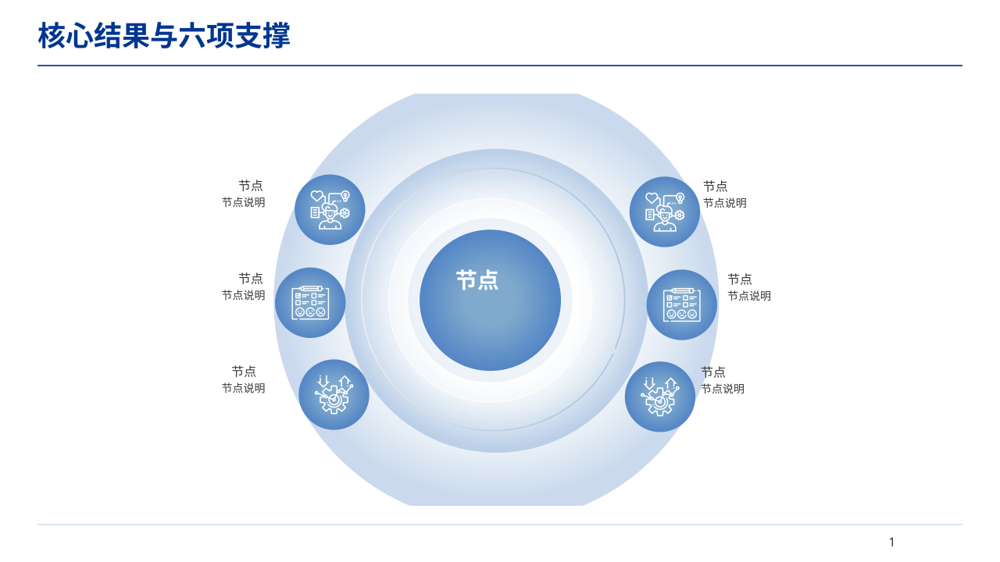

# 核心结果与六项支撑

来源为圆形逻辑图PPT模版.pptx#34。

## 结构与适用场景

中心结果，3重背景环；左右各3带图标的效益球及说明，共6项

核心结果与6支撑效果

无箭头无定量，宜结果清单；六条原文相同仅示例

固定节点、圆弧、扇区、分面和连接表达定性关系。数量比较、趋势或占比使用数据驱动图表，源页中已登记的微图槽可接收实际数据。

## 预览



## 调用

将下列完整page对象放入schema_version=1、template_id=business-blue-v1的pages数组，替换各节点内容。nodes键对应原文本框或已明确拆分的语义分段，字段角色及source_ref、segment见下表。

```json
{
  "id": "circular-34",
  "family": "source-circular",
  "variant": "page-34",
  "content": {
    "title": "核心结果与六项支撑",
    "nodes": {
      "shape_101": "节点",
      "shape_328": "节点说明",
      "shape_329": "节点",
      "shape_337": "节点说明",
      "shape_338": "节点",
      "shape_340": "节点说明",
      "shape_341": "节点",
      "shape_352": "节点说明",
      "shape_353": "节点",
      "shape_355": "节点说明",
      "shape_356": "节点",
      "shape_358": "节点说明",
      "shape_359": "节点"
    }
  },
  "config": {
    "show_source": true,
    "show_page_number": true
  }
}
```

config支持show_source、show_page_number、image_fit与image_position。image_fit可选contain或cover，image_position为xMin/xMid/xMax与YMin/YMid/YMax组合的九个焦点，默认为xMidYMid。字体、颜色、全局区和固定字阶取自tokens，节点数与连接结构由variant确定。

## 字段合同

每个业务节点required=true、min=1，max按具体框体登记。字符按规范化后的Unicode码点计数，空格标点换行均计入。build会以实际字体测量宽高，字符数通过后仍可能需要调整文字。

| 字段 | 节点角色与源标签 | 最短/最长 | 字阶 | 框体px | 原框引用 | 分段 | 旋转° | 垂直锚点 |
|---|---|---|---|---|---|---|---|---|
| nodes.shape_101 | 中中节点，源标签“预期 / 效果” | 1/26 | heading | [543.8563, 342.53, 170.324, 82.9327] | slide:101 |  | 0.0 | t |
| nodes.shape_328 | 上右节点，源标签“打造品牌新形象，提升品牌认知度，占领消费者心智” | 1/60 | diagramCompact | [899.7137, 251.8387, 132.242, 60.7053] | slide:328 |  | 0.0 | t |
| nodes.shape_329 | 上右节点，源标签“商业模型” | 1/19 | caption | [899.7137, 228.6433, 141.5553, 27.346] | slide:329 |  | 0.0 | t |
| nodes.shape_337 | 中右节点，源标签“打造品牌新形象，提升品牌认知度，占领消费者心智” | 1/60 | diagramCompact | [930.9977, 370.8733, 132.242, 60.7053] | slide:337 |  | 0.0 | t |
| nodes.shape_338 | 中右节点，源标签“商业模型” | 1/19 | caption | [930.9977, 347.678, 141.5553, 27.346] | slide:338 |  | 0.0 | t |
| nodes.shape_340 | 下右节点，源标签“打造品牌新形象，提升品牌认知度，占领消费者心智” | 1/60 | diagramCompact | [896.9563, 489.908, 132.242, 60.7053] | slide:340 |  | 0.0 | t |
| nodes.shape_341 | 中右节点，源标签“商业模型” | 1/19 | caption | [896.9563, 466.7127, 141.5553, 27.346] | slide:341 |  | 0.0 | t |
| nodes.shape_352 | 上左节点，源标签“打造品牌新形象，提升品牌认知度，占领消费者心智” | 1/60 | diagramCompact | [225.4503, 250.9513, 132.242, 60.7053] | slide:352 |  | 0.0 | t |
| nodes.shape_353 | 上左节点，源标签“商业模型” | 1/19 | caption | [216.1443, 227.7487, 141.5553, 27.346] | slide:353 |  | 0.0 | t |
| nodes.shape_355 | 中左节点，源标签“打造品牌新形象，提升品牌认知度，占领消费者心智” | 1/60 | diagramCompact | [225.4503, 369.986, 132.242, 60.7053] | slide:355 |  | 0.0 | t |
| nodes.shape_356 | 中左节点，源标签“商业模型” | 1/19 | caption | [216.1443, 346.7833, 141.5553, 27.346] | slide:356 |  | 0.0 | t |
| nodes.shape_358 | 下左节点，源标签“打造品牌新形象，提升品牌认知度，占领消费者心智” | 1/60 | diagramCompact | [225.4503, 489.0207, 132.242, 60.7053] | slide:358 |  | 0.0 | t |
| nodes.shape_359 | 中左节点，源标签“商业模型” | 1/19 | caption | [207.447, 465.818, 141.5553, 27.346] | slide:359 |  | 0.0 | t |

全局title必填、2至32码点，使用统一标题框。section_name可选0至24码点，source可选0至64码点。所有可编辑文本通过独立原生carrier导出，页码为派生文字。

## 来源处理

原生PPTX源件保存于用户材料目录，分发包仅含用户资产衍生的几何、字段和说明。原始逐框文字、源框与标准化框在page-catalog.json的variant.fields中。

源标题引用为`None`，原文为“无独立源标题”。模板默认标题依据真实结构设置。

密集全景中的diagramCompact为14px、diagramMicro为12px。适用于体系概览或附录局部标签，现场关键结论用统一标题与正常正文字阶表达。

源画布边界裁切已烘焙为可编辑Bezier几何，3D顶面、侧面与前面通过tokens配色的相对明暗保留。

