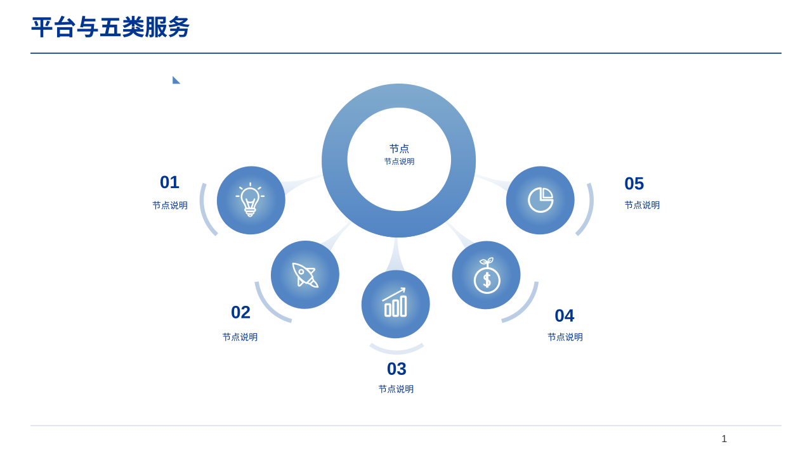

# 平台与五类服务

来源为圆形逻辑图PPT模版.pptx#35。

## 结构与适用场景

上中央大环主题，向下5条辐射连接5图标球；外围01–05标题说明

平台与5类服务/5支撑

可用于Copilot→HR/HS/IT/办公/AIGC五服务；员工入口另加参与者锚点，中心与5支撑关系保留

固定节点、圆弧、扇区、分面和连接表达定性关系。数量比较、趋势或占比使用数据驱动图表，源页中已登记的微图槽可接收实际数据。

## 预览



## 调用

将下列完整page对象放入schema_version=1、template_id=business-blue-v1的pages数组，替换各节点内容。nodes键对应原文本框或已明确拆分的语义分段，字段角色及source_ref、segment见下表。

```json
{
  "id": "circular-35",
  "family": "source-circular",
  "variant": "page-35",
  "content": {
    "title": "平台与五类服务",
    "nodes": {
      "shape_7": "01",
      "shape_8": "02",
      "shape_9": "04",
      "shape_11": "05",
      "shape_13": "03",
      "shape_80": "节点说明",
      "shape_81": "节点说明",
      "shape_82": "节点说明",
      "shape_83": "节点说明",
      "shape_84": "节点说明",
      "shape_85": "节点说明",
      "shape_86": "节点"
    }
  },
  "config": {
    "show_source": true,
    "show_page_number": true
  }
}
```

config支持show_source、show_page_number、image_fit与image_position。image_fit可选contain或cover，image_position为xMin/xMid/xMax与YMin/YMid/YMax组合的九个焦点，默认为xMidYMid。字体、颜色、全局区和固定字阶取自tokens，节点数与连接结构由variant确定。

## 字段合同

每个业务节点required=true、min=1，max按具体框体登记。字符按规范化后的Unicode码点计数，空格标点换行均计入。build会以实际字体测量宽高，字符数通过后仍可能需要调整文字。

| 字段 | 节点角色与源标签 | 最短/最长 | 字阶 | 框体px | 原框引用 | 分段 | 旋转° | 垂直锚点 |
|---|---|---|---|---|---|---|---|---|
| nodes.shape_7 | 服务编号，源编号“01”，最多1行，按实际字体宽度拒绝折行输入，输入格式 `^[0-9]{1,2}$` | 1/2 | heading | [238.7508, 272.3736, 57.3324, 40] | slide:7 |  | 0.0 | t |
| nodes.shape_8 | 服务编号，源编号“02”，最多1行，按实际字体宽度拒绝折行输入，输入格式 `^[0-9]{1,2}$` | 1/2 | heading | [343.9398, 477.7654, 71.1518, 40] | slide:8 |  | 0.0 | t |
| nodes.shape_9 | 服务编号，源编号“04”，最多1行，按实际字体宽度拒绝折行输入，输入格式 `^[0-9]{1,2}$` | 1/2 | heading | [862.795, 483.112, 54.1186, 40] | slide:9 |  | 0.0 | t |
| nodes.shape_11 | 服务编号，源编号“05”，最多1行，按实际字体宽度拒绝折行输入，输入格式 `^[0-9]{1,2}$` | 1/2 | heading | [984.2284, 274.5162, 60.293, 40] | slide:11 |  | 0.0 | t |
| nodes.shape_13 | 服务编号，源编号“03”，最多1行，按实际字体宽度拒绝折行输入，输入格式 `^[0-9]{1,2}$` | 1/2 | heading | [592.6304, 567.0509, 65.4644, 40] | slide:13 |  | 0.0 | t |
| nodes.shape_80 | 中右节点，源标签“请单击此处，添加段落文字内容” | 1/42 | diagramCompact | [984.2284, 316.6073, 132.5454, 40.9128] | slide:80 |  | 0.0 | t |
| nodes.shape_81 | 下右节点，源标签“请单击此处，添加段落文字内容” | 1/42 | diagramCompact | [862.795, 524.9695, 132.5454, 40.9128] | slide:81 |  | 0.0 | t |
| nodes.shape_82 | 下左节点，源标签“请单击此处，添加段落文字内容” | 1/42 | diagramCompact | [273.6352, 524.9695, 132.5454, 40.9128] | slide:82 |  | 0.0 | t |
| nodes.shape_83 | 中左节点，源标签“请单击此处，添加段落文字内容” | 1/42 | diagramCompact | [163.2262, 317.0943, 132.5454, 40.9128] | slide:83 |  | 0.0 | t |
| nodes.shape_84 | 下中节点，源标签“请单击此处，添加段落文字内容” | 1/42 | diagramCompact | [557.9017, 607.0872, 132.5454, 40.9128] | slide:84 |  | 0.0 | t |
| nodes.shape_85 | 上中节点，源标签“请单击此处，添加段落文字内容” | 1/27 | diagramMicro | [555.7105, 248.7862, 147.212, 20.4515] | slide:85 |  | 0.0 | t |
| nodes.shape_86 | 上中节点，源标签“标题文字” | 1/14 | caption | [577.8176, 226.718, 102.9978, 26.7525] | slide:86 |  | 0.0 | t |

全局title必填、2至32码点，使用统一标题框。section_name可选0至24码点，source可选0至64码点。所有可编辑文本通过独立原生carrier导出，页码为派生文字。

## 来源处理

原生PPTX源件保存于用户材料目录，分发包仅含用户资产衍生的几何、字段和说明。原始逐框文字、源框与标准化框在page-catalog.json的variant.fields中。

源标题引用为`slide:92`，原文为“系统解决方案”。模板默认标题依据真实结构设置。

密集全景中的diagramCompact为14px、diagramMicro为12px。适用于体系概览或附录局部标签，现场关键结论用统一标题与正常正文字阶表达。

源画布边界裁切已烘焙为可编辑Bezier几何，3D顶面、侧面与前面通过tokens配色的相对明暗保留。

