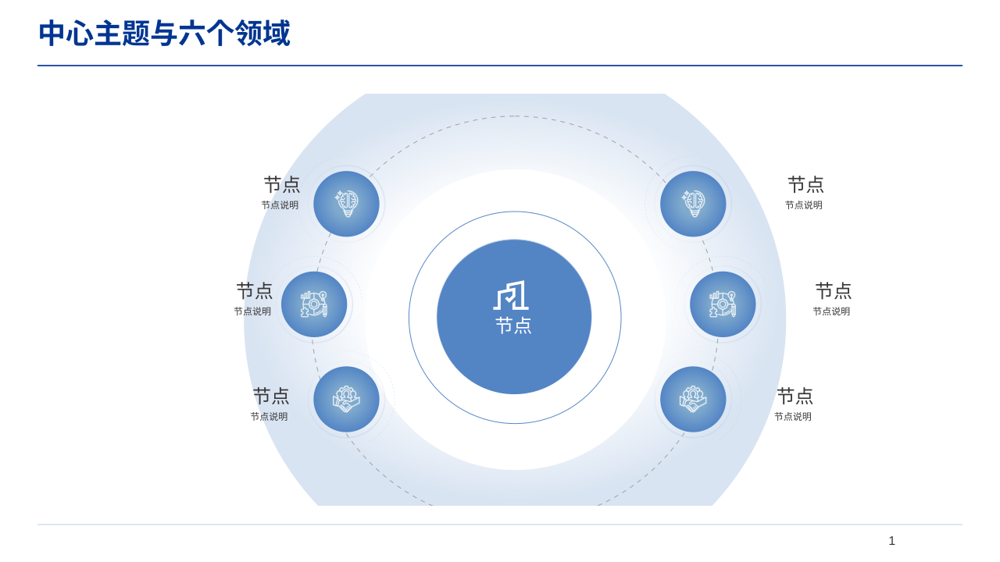

# 中心主题与六个领域

来源为圆形逻辑图PPT模版.pptx#36。

## 结构与适用场景

中心主题，两层圈；外环6卫星球，左右各3说明

一个主题的6领域或支撑

与circular34语义近重复、中心文字/图标形式不同；无因果箭头

固定节点、圆弧、扇区、分面和连接表达定性关系。数量比较、趋势或占比使用数据驱动图表，源页中已登记的微图槽可接收实际数据。

## 预览



## 调用

将下列完整page对象放入schema_version=1、template_id=business-blue-v1的pages数组，替换各节点内容。nodes键对应原文本框或已明确拆分的语义分段，字段角色及source_ref、segment见下表。

```json
{
  "id": "circular-36",
  "family": "source-circular",
  "variant": "page-36",
  "content": {
    "title": "中心主题与六个领域",
    "nodes": {
      "shape_144": "节点",
      "shape_145": "节点说明",
      "shape_147": "节点",
      "shape_148": "节点说明",
      "shape_150": "节点",
      "shape_151": "节点说明",
      "shape_219": "节点",
      "shape_220": "节点说明",
      "shape_217": "节点",
      "shape_218": "节点说明",
      "shape_215": "节点",
      "shape_216": "节点说明",
      "shape_256": "节点"
    }
  },
  "config": {
    "show_source": true,
    "show_page_number": true
  }
}
```

config支持show_source、show_page_number、image_fit与image_position。image_fit可选contain或cover，image_position为xMin/xMid/xMax与YMin/YMid/YMax组合的九个焦点，默认为xMidYMid。字体、颜色、全局区和固定字阶取自tokens，节点数与连接结构由variant确定。

## 字段合同

每个业务节点required=true、min=1，max按具体框体登记。字符按规范化后的Unicode码点计数，空格标点换行均计入。build会以实际字体测量宽高，字符数通过后仍可能需要调整文字。

| 字段 | 节点角色与源标签 | 最短/最长 | 字阶 | 框体px | 原框引用 | 分段 | 旋转° | 垂直锚点 |
|---|---|---|---|---|---|---|---|---|
| nodes.shape_144 | 上左节点，源标签“商业模型” | 1/18 | body | [189.0697, 224.2067, 195.8293, 35.5447] | slide:144 |  | 0.0 | t |
| nodes.shape_145 | 上左节点，源标签“Precise Innovation  / Planning Ability” | 1/44 | diagramMicro | [260.9803, 256.5687, 121.1687, 35.5447] | slide:145 |  | 0.0 | t |
| nodes.shape_147 | 中左节点，源标签“商业模型” | 1/18 | body | [153.965, 360.4087, 195.8293, 35.5447] | slide:147 |  | 0.0 | t |
| nodes.shape_148 | 中左节点，源标签“Precise Innovation  / Planning Ability” | 1/44 | diagramMicro | [225.8757, 392.7633, 121.1687, 35.5447] | slide:148 |  | 0.0 | t |
| nodes.shape_150 | 下左节点，源标签“商业模型” | 1/18 | body | [175.1803, 495.166, 195.8293, 35.5447] | slide:150 |  | 0.0 | t |
| nodes.shape_151 | 下左节点，源标签“Precise Innovation  / Planning Ability” | 1/44 | diagramMicro | [247.091, 527.528, 121.1687, 35.5447] | slide:151 |  | 0.0 | t |
| nodes.shape_219 | 上右节点，源标签“商业模型” | 1/18 | body | [859.6443, 224.2067, 195.8293, 35.5447] | slide:219 |  | 0.0 | t |
| nodes.shape_220 | 上右节点，源标签“Precise Innovation  / Planning Ability” | 1/44 | diagramMicro | [931.555, 256.5687, 121.1687, 35.5447] | slide:220 |  | 0.0 | t |
| nodes.shape_217 | 中右节点，源标签“商业模型” | 1/18 | body | [895.101, 360.4087, 195.8293, 35.5447] | slide:217 |  | 0.0 | t |
| nodes.shape_218 | 中右节点，源标签“Precise Innovation  / Planning Ability” | 1/44 | diagramMicro | [967.0117, 392.7633, 121.1687, 35.5447] | slide:218 |  | 0.0 | t |
| nodes.shape_215 | 下右节点，源标签“商业模型” | 1/18 | body | [845.755, 495.166, 195.8293, 35.5447] | slide:215 |  | 0.0 | t |
| nodes.shape_216 | 下右节点，源标签“Precise Innovation  / Planning Ability” | 1/44 | diagramMicro | [917.6657, 527.528, 121.1687, 35.5447] | slide:216 |  | 0.0 | t |
| nodes.shape_256 | 中中节点，源标签“国内产业” | 1/10 | body | [602.655, 404.768, 109.0027, 35.5447] | slide:256 |  | 0.0 | t |

## 保留的原装饰

本页保留用户原模板的结构图标或装饰图片，逐项身份见source-field-coverage.json中本页retained_source_images。其中图片内固化的字形随整图编辑，可在PowerPoint中原生替换整图；nodes字段控制已登记的可编辑文字。参数图片替换使用本页image_slots列出的槽位。


全局title必填、2至32码点，使用统一标题框。section_name可选0至24码点，source可选0至64码点。所有可编辑文本通过独立原生carrier导出，页码为派生文字。

## 来源处理

原生PPTX源件保存于用户材料目录，分发包仅含用户资产衍生的几何、字段和说明。原始逐框文字、源框与标准化框在page-catalog.json的variant.fields中。

源标题引用为`None`，原文为“无独立源标题”。模板默认标题依据真实结构设置。

密集全景中的diagramCompact为14px、diagramMicro为12px。适用于体系概览或附录局部标签，现场关键结论用统一标题与正常正文字阶表达。

源画布边界裁切已烘焙为可编辑Bezier几何，3D顶面、侧面与前面通过tokens配色的相对明暗保留。

