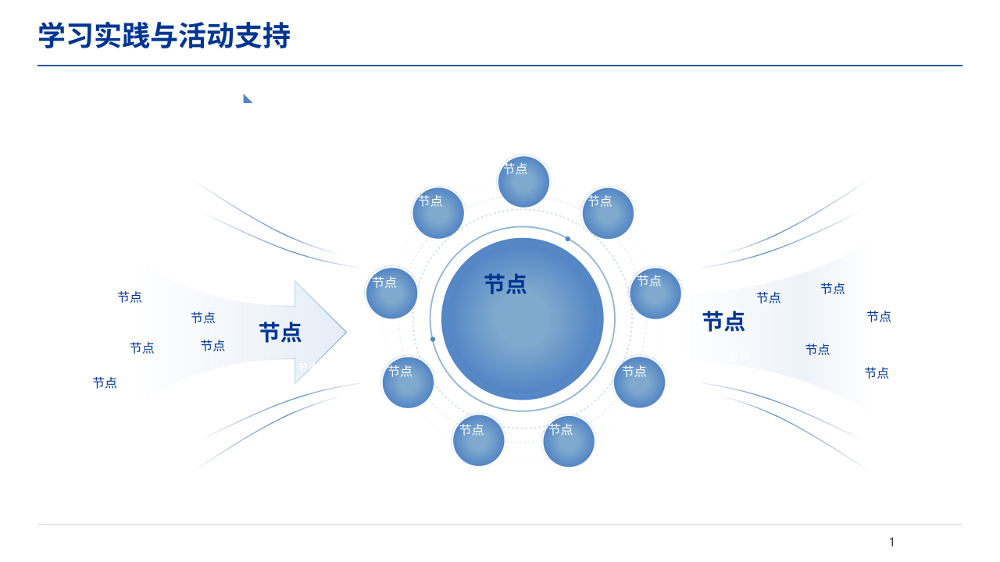

# 学习实践与活动支持

来源为圆形逻辑图PPT模版.pptx#38。

## 结构与适用场景

中心每日练习；外周9共创大赛卫星圈；两侧技能提升输入箭头与弧线

学习实践-活动支持关系

9圈原标签相同不是9个不同业务；去重应通过字段映射和可选节点，不保留重复装饰文字

固定节点、圆弧、扇区、分面和连接表达定性关系。数量比较、趋势或占比使用数据驱动图表，源页中已登记的微图槽可接收实际数据。

## 预览



## 调用

将下列完整page对象放入schema_version=1、template_id=business-blue-v1的pages数组，替换各节点内容。nodes键对应原文本框或已明确拆分的语义分段，字段角色及source_ref、segment见下表。

```json
{
  "id": "circular-38",
  "family": "source-circular",
  "variant": "page-38",
  "content": {
    "title": "学习实践与活动支持",
    "nodes": {
      "shape_53": "节点",
      "shape_54": "节点",
      "shape_55": "节点",
      "shape_56": "节点",
      "shape_57": "节点",
      "shape_58": "节点",
      "shape_59": "节点",
      "shape_60": "节点",
      "shape_61": "节点",
      "shape_62": "节点",
      "shape_63": "节点",
      "shape_64": "节点",
      "shape_65": "节点",
      "shape_66": "节点",
      "shape_67": "节点",
      "shape_68": "节点",
      "shape_69": "节点",
      "shape_70": "节点",
      "shape_71": "节点",
      "shape_72": "节点",
      "shape_73": "节点",
      "shape_74": "节点",
      "shape_75": "节点",
      "shape_76": "节点"
    }
  },
  "config": {
    "show_source": true,
    "show_page_number": true
  }
}
```

config支持show_source、show_page_number、image_fit与image_position。image_fit可选contain或cover，image_position为xMin/xMid/xMax与YMin/YMid/YMax组合的九个焦点，默认为xMidYMid。字体、颜色、全局区和固定字阶取自tokens，节点数与连接结构由variant确定。

## 字段合同

每个业务节点required=true、min=1，max按具体框体登记。字符按规范化后的Unicode码点计数，空格标点换行均计入。build会以实际字体测量宽高，字符数通过后仍可能需要调整文字。

| 字段 | 节点角色与源标签 | 最短/最长 | 字阶 | 框体px | 原框引用 | 分段 | 旋转° | 垂直锚点 |
|---|---|---|---|---|---|---|---|---|
| nodes.shape_53 | 上中节点，源标签“共创 / 大赛” | 1/18 | caption | [636.7795, 206.2524, 66.0959, 52.0299] | slide:53 |  | 0.0 | t |
| nodes.shape_54 | 上中节点，源标签“共创 / 大赛” | 1/18 | caption | [745.1018, 247.5032, 66.0959, 52.0299] | slide:54 |  | 0.0 | t |
| nodes.shape_55 | 中中节点，源标签“共创 / 大赛” | 1/18 | caption | [808.2329, 349.6023, 66.0959, 52.0299] | slide:55 |  | 0.0 | t |
| nodes.shape_56 | 中中节点，源标签“共创 / 大赛” | 1/18 | caption | [789.0899, 465.7201, 66.0959, 52.0299] | slide:56 |  | 0.0 | t |
| nodes.shape_57 | 下中节点，源标签“共创 / 大赛” | 1/18 | caption | [694.9189, 540.1893, 66.0959, 52.0299] | slide:57 |  | 0.0 | t |
| nodes.shape_58 | 下中节点，源标签“共创 / 大赛” | 1/18 | caption | [581.0365, 540.6818, 66.0959, 52.0299] | slide:58 |  | 0.0 | t |
| nodes.shape_59 | 中中节点，源标签“共创 / 大赛” | 1/18 | caption | [489.3377, 465.4359, 66.0959, 52.0299] | slide:59 |  | 0.0 | t |
| nodes.shape_60 | 中中节点，源标签“共创 / 大赛” | 1/18 | caption | [469.4085, 351.6577, 66.0959, 52.0299] | slide:60 |  | 0.0 | t |
| nodes.shape_61 | 上中节点，源标签“共创 / 大赛” | 1/18 | caption | [528.0215, 247.5032, 66.0959, 52.0299] | slide:61 |  | 0.0 | t |
| nodes.shape_62 | 中中节点，源标签“每日 / 练习” | 1/27 | heading | [604.8587, 347.6889, 120.3897, 131.6046] | slide:62 |  | 0.0 | t |
| nodes.shape_63 | 中右节点，源标签“技能提升” | 1/23 | diagramCompact | [879.5669, 447.8463, 149.3267, 26.0197] | slide:63 |  | 0.0 | t |
| nodes.shape_64 | 中右节点，源标签“技能提升” | 1/11 | heading | [869.8202, 395.4754, 149.3267, 39.792] | slide:64 |  | 0.0 | t |
| nodes.shape_65 | 中右节点，源标签“技能提升” | 1/20 | caption | [1001.6899, 359.8037, 149.3267, 30.6042] | slide:65 |  | 0.0 | t |
| nodes.shape_66 | 中右节点，源标签“技能提升” | 1/20 | caption | [1060.8712, 395.4754, 149.3267, 30.6042] | slide:66 |  | 0.0 | t |
| nodes.shape_67 | 中右节点，源标签“技能提升” | 1/20 | caption | [982.2912, 437.8817, 149.3267, 30.6042] | slide:67 |  | 0.0 | t |
| nodes.shape_68 | 中右节点，源标签“技能提升” | 1/20 | caption | [1057.9065, 467.8986, 149.3267, 30.6042] | slide:68 |  | 0.0 | t |
| nodes.shape_69 | 中右节点，源标签“技能提升” | 1/20 | caption | [919.5768, 371.3406, 149.3267, 30.6042] | slide:69 |  | 0.0 | t |
| nodes.shape_70 | 中左节点，源标签“技能提升” | 1/11 | heading | [302.2554, 409.513, 149.3267, 39.792] | slide:70 |  | 0.0 | t |
| nodes.shape_71 | 中左节点，源标签“技能提升” | 1/20 | caption | [195.6381, 397.0383, 149.3267, 30.6042] | slide:71 |  | 0.0 | t |
| nodes.shape_72 | 中左节点，源标签“技能提升” | 1/20 | caption | [208.037, 432.8521, 149.3267, 30.6042] | slide:72 |  | 0.0 | t |
| nodes.shape_73 | 中左节点，源标签“技能提升” | 1/20 | caption | [117.4748, 435.7032, 149.3267, 30.6042] | slide:73 |  | 0.0 | t |
| nodes.shape_74 | 下左节点，源标签“技能提升” | 1/20 | caption | [69.802, 480.307, 149.3267, 30.6042] | slide:74 |  | 0.0 | t |
| nodes.shape_75 | 中左节点，源标签“技能提升” | 1/20 | caption | [101.7417, 370.5829, 149.3267, 30.6042] | slide:75 |  | 0.0 | t |
| nodes.shape_76 | 中左节点，源标签“技能提升” | 1/23 | diagramCompact | [328.7961, 462.8216, 149.3267, 26.0197] | slide:76 |  | 0.0 | t |

全局title必填、2至32码点，使用统一标题框。section_name可选0至24码点，source可选0至64码点。所有可编辑文本通过独立原生carrier导出，页码为派生文字。

## 来源处理

原生PPTX源件保存于用户材料目录，分发包仅含用户资产衍生的几何、字段和说明。原始逐框文字、源框与标准化框在page-catalog.json的variant.fields中。

源标题引用为`slide:77`，原文为“系统解决方案”。模板默认标题依据真实结构设置。

密集全景中的diagramCompact为14px、diagramMicro为12px。适用于体系概览或附录局部标签，现场关键结论用统一标题与正常正文字阶表达。

源画布边界裁切已烘焙为可编辑Bezier几何，3D顶面、侧面与前面通过tokens配色的相对明暗保留。

