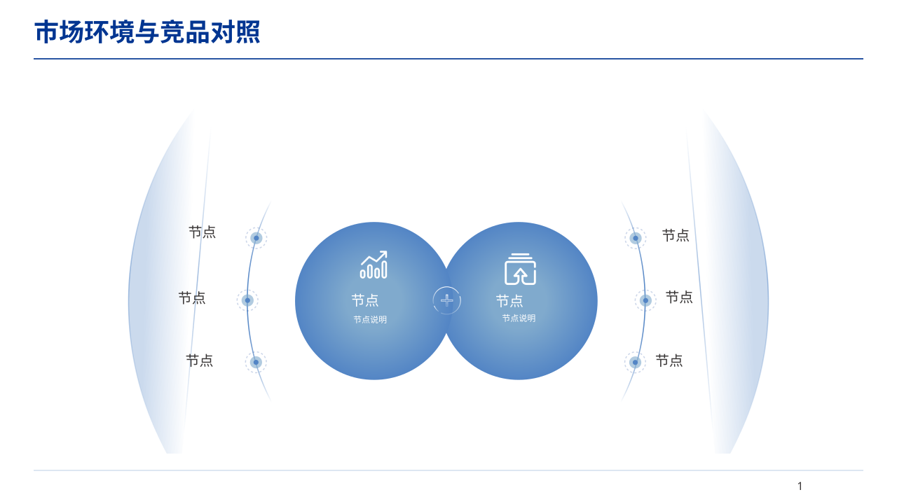

# 市场环境与竞品对照

来源为圆形逻辑图PPT模版.pptx#39。

## 结构与适用场景

中心2相交球市场环境/竞品分析；左右各3标签及括弧，两侧宽弧

内外部或市场-竞品对照分析

保留两主题交集及各3分析维度；原正文相同，需真实结论替换

固定节点、圆弧、扇区、分面和连接表达定性关系。数量比较、趋势或占比使用数据驱动图表，源页中已登记的微图槽可接收实际数据。

## 预览



## 调用

将下列完整page对象放入schema_version=1、template_id=business-blue-v1的pages数组，替换各节点内容。nodes键对应原文本框或已明确拆分的语义分段，字段角色及source_ref、segment见下表。

```json
{
  "id": "circular-39",
  "family": "source-circular",
  "variant": "page-39",
  "content": {
    "title": "市场环境与竞品对照",
    "nodes": {
      "shape_16": "节点",
      "shape_17": "节点说明",
      "shape_18": "节点",
      "shape_19": "节点说明",
      "shape_22": "节点",
      "shape_23": "节点",
      "shape_24": "节点",
      "shape_25": "节点",
      "shape_26": "节点",
      "shape_27": "节点"
    }
  },
  "config": {
    "show_source": true,
    "show_page_number": true
  }
}
```

config支持show_source、show_page_number、image_fit与image_position。image_fit可选contain或cover，image_position为xMin/xMid/xMax与YMin/YMid/YMax组合的九个焦点，默认为xMidYMid。字体、颜色、全局区和固定字阶取自tokens，节点数与连接结构由variant确定。

## 字段合同

每个业务节点required=true、min=1，max按具体框体登记。字符按规范化后的Unicode码点计数，空格标点换行均计入。build会以实际字体测量宽高，字符数通过后仍可能需要调整文字。

| 字段 | 节点角色与源标签 | 最短/最长 | 字阶 | 框体px | 原框引用 | 分段 | 旋转° | 垂直锚点 |
|---|---|---|---|---|---|---|---|---|
| nodes.shape_16 | 中中节点，源标签“市场环境” | 1/17 | compactBody | [453.674, 412.1542, 160.2491, 34.9361] | slide:16 |  | 0.0 | ctr |
| nodes.shape_17 | 中中节点，源标签“营销网络铺建到社会公众心里，把产品输送到消费者心里。” | 1/99 | diagramMicro | [446.16, 448.9262, 179.522, 45.324] | slide:17 |  | 0.0 | t |
| nodes.shape_18 | 中中节点，源标签“竞品分析” | 1/17 | compactBody | [659.8745, 413.107, 160.2491, 34.9361] | slide:18 |  | 0.0 | ctr |
| nodes.shape_19 | 中中节点，源标签“网络铺建到社会公众心里，把产品输送到消费者心里。” | 1/99 | diagramMicro | [658.7513, 446.8966, 178.7164, 45.324] | slide:19 |  | 0.0 | t |
| nodes.shape_22 | 中左节点，源标签“品牌定位” | 1/10 | compactBody | [256.4361, 320.2048, 90.1135, 30.0404] | slide:22 |  | 0.0 | t |
| nodes.shape_23 | 中左节点，源标签“品牌调性” | 1/10 | compactBody | [241.7954, 414.3232, 90.1135, 30.0404] | slide:23 |  | 0.0 | t |
| nodes.shape_24 | 下左节点，源标签“品牌态度” | 1/10 | compactBody | [252.4854, 503.8014, 90.1135, 30.0404] | slide:24 |  | 0.0 | t |
| nodes.shape_25 | 下右节点，源标签“生态布局” | 1/10 | compactBody | [922.8094, 503.8014, 90.1135, 30.0404] | slide:25 |  | 0.0 | t |
| nodes.shape_26 | 中右节点，源标签“产品调性” | 1/10 | compactBody | [932.1515, 324.9843, 90.1135, 30.0404] | slide:26 |  | 0.0 | t |
| nodes.shape_27 | 中右节点，源标签“目标人群” | 1/10 | compactBody | [937.1789, 413.138, 90.1135, 30.0404] | slide:27 |  | 0.0 | t |

## 保留的原装饰

本页保留用户原模板的结构图标或装饰图片，逐项身份见source-field-coverage.json中本页retained_source_images。其中图片内固化的字形随整图编辑，可在PowerPoint中原生替换整图；nodes字段控制已登记的可编辑文字。参数图片替换使用本页image_slots列出的槽位。


全局title必填、2至32码点，使用统一标题框。section_name可选0至24码点，source可选0至64码点。所有可编辑文本通过独立原生carrier导出，页码为派生文字。

## 来源处理

原生PPTX源件保存于用户材料目录，分发包仅含用户资产衍生的几何、字段和说明。原始逐框文字、源框与标准化框在page-catalog.json的variant.fields中。

源标题引用为`slide:125`，原文为“市场分析”。模板默认标题依据真实结构设置。

密集全景中的diagramCompact为14px、diagramMicro为12px。适用于体系概览或附录局部标签，现场关键结论用统一标题与正常正文字阶表达。

源画布边界裁切已烘焙为可编辑Bezier几何，3D顶面、侧面与前面通过tokens配色的相对明暗保留。

