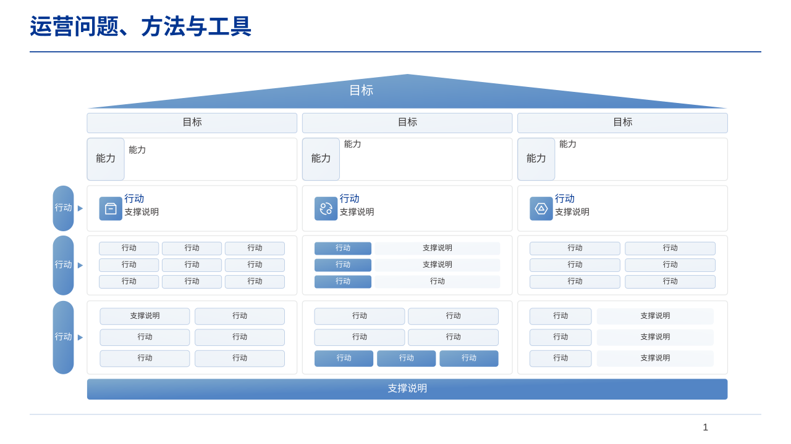

# 运营问题、方法与工具

来源为房子图战略图.pptx#1。

## 结构与适用场景

屋顶总方法；3列数据分析/用户画像/精细化营销；问题-解法-工具纵向3层；底部总价值

运营方法体系，分主题展示问题与落地工具

保留列主题与纵向角色，支持列内问题/方法/工具清单，不能仅3张说明卡

固定节点、圆弧、扇区、分面和连接表达定性关系。数量比较、趋势或占比使用数据驱动图表，源页中已登记的微图槽可接收实际数据。

## 预览



## 调用

将下列完整page对象放入schema_version=1、template_id=business-blue-v1的pages数组，替换各节点内容。nodes键对应原文本框或已明确拆分的语义分段，字段角色及source_ref、segment见下表。

```json
{
  "id": "house-01",
  "family": "source-house",
  "variant": "page-01",
  "content": {
    "title": "运营问题、方法与工具",
    "nodes": {
      "shape_44": "目标",
      "shape_170": "支撑说明",
      "shape_63": "能力",
      "shape_76": "行动",
      "shape_77": "行动",
      "shape_78": "行动",
      "shape_113": "行动",
      "shape_114": "支撑说明",
      "shape_123": "支撑说明",
      "shape_129": "支撑说明",
      "shape_120": "行动",
      "shape_128": "行动",
      "shape_131": "行动",
      "shape_132": "行动",
      "shape_239": "行动",
      "shape_240": "行动",
      "shape_241": "行动",
      "shape_236": "行动",
      "shape_237": "行动",
      "shape_238": "行动",
      "shape_233": "行动",
      "shape_234": "行动",
      "shape_235": "行动",
      "shape_275": "行动",
      "shape_276": "行动",
      "shape_281": "行动",
      "shape_266": "行动",
      "shape_267": "行动",
      "shape_274": "行动",
      "shape_296": "行动",
      "shape_298": "支撑说明",
      "shape_307": "行动",
      "shape_308": "支撑说明",
      "shape_332": "行动",
      "shape_329": "行动",
      "shape_333": "行动",
      "shape_330": "行动",
      "shape_364": "支撑说明",
      "shape_365": "行动",
      "shape_362": "支撑说明",
      "shape_363": "行动",
      "shape_369": "支撑说明",
      "shape_370": "行动",
      "shape_378": "支撑说明",
      "shape_386": "行动",
      "shape_389": "行动",
      "shape_390": "行动",
      "shape_392": "行动",
      "shape_393": "行动",
      "shape_403": "能力",
      "shape_406": "能力",
      "shape_409": "目标",
      "shape_410": "目标",
      "shape_411": "目标",
      "shape_423": "能力",
      "shape_427": "能力",
      "shape_430": "能力",
      "shape_334": "行动",
      "shape_442": "行动",
      "shape_443": "行动"
    }
  },
  "config": {
    "show_source": true,
    "show_page_number": true
  }
}
```

config支持show_source、show_page_number、image_fit与image_position。image_fit可选contain或cover，image_position为xMin/xMid/xMax与YMin/YMid/YMax组合的九个焦点，默认为xMidYMid。字体、颜色、全局区和固定字阶取自tokens，节点数与连接结构由variant确定。

## 字段合同

每个业务节点required=true、min=1，max按具体框体登记。字符按规范化后的Unicode码点计数，空格标点换行均计入。build会以实际字体测量宽高，字符数通过后仍可能需要调整文字。

| 字段 | 节点角色与源标签 | 最短/最长 | 字阶 | 框体px | 原框引用 | 分段 | 旋转° | 垂直锚点 |
|---|---|---|---|---|---|---|---|---|
| nodes.shape_44 | 上中节点，源标签“私域流量运营方法” | 1/19 | compactBody | [564.2774, 135.8949, 177.3785, 32.8815] | slide:44 |  | 0.0 | t |
| nodes.shape_170 | 下中节点，源标签“私域流量是通过精准的用户关系管理和优质内容运营，吸引、留住并转化目标用户，实现可” | 1/143 | caption | [140.917, 614.3599, 1036.5246, 33.6401] | slide:170 |  | 0.0 | ctr |
| nodes.shape_63 | 上左节点，源标签“业务把握” | 1/24 | caption | [140.917, 223.844, 60.184, 68.7513] | slide:63 |  | 0.0 | ctr |
| nodes.shape_76 | 中左节点，源标签“问题” | 1/20 | diagramCompact | [85.544, 300.9405, 33.8067, 74.0434] | slide:76 |  | 0.0 | ctr |
| nodes.shape_77 | 中左节点，源标签“解法” | 1/25 | diagramCompact | [85.544, 381.9044, 33.8067, 96.8958] | slide:77 |  | 0.0 | ctr |
| nodes.shape_78 | 下左节点，源标签“工具” | 1/35 | diagramCompact | [85.544, 487.8116, 33.8067, 118.9432] | slide:78 |  | 0.0 | ctr |
| nodes.shape_113 | 中中节点，源标签“流量转化” | 1/12 | caption | [549.4835, 313.6342, 87.6901, 29.8931] | slide:113 |  | 0.0 | t |
| nodes.shape_114 | 中中节点，源标签“如何将其转化为实际的商业价值是关键问题。” | 1/45 | diagramCompact | [549.4835, 336.3015, 285.0528, 26.4328] | slide:114 |  | 0.0 | t |
| nodes.shape_123 | 中中节点，源标签“用户画像+个性化营销=提高转化率。” | 1/37 | diagramMicro | [606.4108, 392.5719, 202.9602, 20.9187] | slide:123 |  | 0.0 | ctr |
| nodes.shape_129 | 中中节点，源标签“优化用户体验，促进流量转化。” | 1/37 | diagramMicro | [606.4108, 419.5692, 202.9602, 20.9187] | slide:129 |  | 0.0 | ctr |
| nodes.shape_120 | 中中节点，源标签“个性化营销策略” | 1/17 | diagramMicro | [508.9784, 392.5719, 92.0847, 20.9187] | slide:120 |  | 0.0 | ctr |
| nodes.shape_128 | 中中节点，源标签“强化用户体验” | 1/17 | diagramMicro | [508.9784, 419.5692, 92.0847, 20.9187] | slide:128 |  | 0.0 | ctr |
| nodes.shape_131 | 中中节点，源标签“营销渠道整合” | 1/17 | diagramMicro | [508.9784, 446.5756, 92.0847, 20.9187] | slide:131 |  | 0.0 | ctr |
| nodes.shape_132 | 中中节点，源标签“多渠道整合，提高转化率。” | 1/37 | diagramMicro | [606.4108, 446.5756, 202.9602, 20.9187] | slide:132 |  | 0.0 | ctr |
| nodes.shape_239 | 中左节点，源标签“SEO优化” | 1/17 | diagramMicro | [160.5867, 392.5719, 96.2759, 20.9187] | slide:239 |  | 0.0 | ctr |
| nodes.shape_240 | 中左节点，源标签“用户注册激励” | 1/17 | diagramMicro | [160.5867, 419.5692, 96.2759, 20.9187] | slide:240 |  | 0.0 | ctr |
| nodes.shape_241 | 中左节点，源标签“搜索引擎营销” | 1/17 | diagramMicro | [160.5867, 446.5756, 96.2759, 20.9187] | slide:241 |  | 0.0 | ctr |
| nodes.shape_236 | 中左节点，源标签“社交媒体推广” | 1/17 | diagramMicro | [262.4137, 392.5719, 96.2759, 20.9187] | slide:236 |  | 0.0 | ctr |
| nodes.shape_237 | 中左节点，源标签“个性化推荐” | 1/17 | diagramMicro | [262.4137, 419.5692, 96.2759, 20.9187] | slide:237 |  | 0.0 | ctr |
| nodes.shape_238 | 中左节点，源标签“社群运营” | 1/17 | diagramMicro | [262.4137, 446.5756, 96.2759, 20.9187] | slide:238 |  | 0.0 | ctr |
| nodes.shape_233 | 中左节点，源标签“内容营销” | 1/17 | diagramMicro | [364.2315, 392.5719, 96.2759, 20.9187] | slide:233 |  | 0.0 | ctr |
| nodes.shape_234 | 中左节点，源标签“精准广告投放” | 1/17 | diagramMicro | [364.2315, 419.5692, 96.2759, 20.9187] | slide:234 |  | 0.0 | ctr |
| nodes.shape_235 | 中左节点，源标签“电子邮件营销” | 1/17 | diagramMicro | [364.2315, 446.5756, 96.2759, 20.9187] | slide:235 |  | 0.0 | ctr |
| nodes.shape_275 | 中右节点，源标签“内容营销” | 1/26 | diagramMicro | [857.6014, 392.5719, 145.7646, 20.9187] | slide:275 |  | 0.0 | ctr |
| nodes.shape_276 | 中右节点，源标签“会员福利” | 1/26 | diagramMicro | [857.6014, 419.5692, 145.7646, 20.9187] | slide:276 |  | 0.0 | ctr |
| nodes.shape_281 | 中右节点，源标签“数据分析” | 1/26 | diagramMicro | [857.6014, 446.5756, 145.7646, 20.9187] | slide:281 |  | 0.0 | ctr |
| nodes.shape_266 | 中右节点，源标签“社交互动” | 1/26 | diagramMicro | [1011.7576, 392.5719, 145.7646, 20.9187] | slide:266 |  | 0.0 | ctr |
| nodes.shape_267 | 中右节点，源标签“用户反馈” | 1/26 | diagramMicro | [1011.7576, 419.5692, 145.7646, 20.9187] | slide:267 |  | 0.0 | ctr |
| nodes.shape_274 | 中右节点，源标签“持续更新” | 1/26 | diagramMicro | [1011.7576, 446.5756, 145.7646, 20.9187] | slide:274 |  | 0.0 | ctr |
| nodes.shape_296 | 中左节点，源标签“流量获取” | 1/12 | caption | [201.101, 313.6342, 87.6901, 29.8931] | slide:296 |  | 0.0 | t |
| nodes.shape_298 | 中左节点，源标签“私域流量运营需要解决如何获取流量的问题。” | 1/45 | diagramCompact | [201.101, 336.3015, 288.1985, 26.4328] | slide:298 |  | 0.0 | t |
| nodes.shape_307 | 中右节点，源标签“流量运营” | 1/12 | caption | [897.8752, 313.6342, 87.6901, 29.8931] | slide:307 |  | 0.0 | t |
| nodes.shape_308 | 中右节点，源标签“保持用户活跃度和忠诚度，是的长期挑战” | 1/47 | diagramCompact | [897.8752, 336.3015, 296.5808, 26.4328] | slide:308 |  | 0.0 | t |
| nodes.shape_332 | 下中节点，源标签“CRO工具” | 1/27 | diagramMicro | [508.9784, 499.8114, 145.9959, 26.5069] | slide:332 |  | 0.0 | ctr |
| nodes.shape_329 | 下中节点，源标签“营销自动化工具” | 1/27 | diagramMicro | [660.5995, 499.8114, 145.9959, 26.5069] | slide:329 |  | 0.0 | ctr |
| nodes.shape_333 | 下中节点，源标签“售后服务工具” | 1/27 | diagramMicro | [508.9784, 534.0344, 145.9959, 26.5069] | slide:333 |  | 0.0 | ctr |
| nodes.shape_330 | 下中节点，源标签“数据分析工具” | 1/27 | diagramMicro | [660.5995, 534.0344, 145.9959, 26.5069] | slide:330 |  | 0.0 | ctr |
| nodes.shape_364 | 下右节点，源标签“数据分析优化，提高转化和满意度。” | 1/35 | diagramMicro | [965.6643, 499.8114, 189.3136, 26.5069] | slide:364 |  | 0.0 | ctr |
| nodes.shape_365 | 下右节点，源标签“数据分析与优化” | 1/18 | diagramMicro | [857.3609, 499.8114, 99.6621, 26.5069] | slide:365 |  | 0.0 | ctr |
| nodes.shape_362 | 下右节点，源标签“多渠道覆盖，提升品牌曝光。” | 1/35 | diagramMicro | [965.6643, 534.0344, 189.3136, 26.5069] | slide:362 |  | 0.0 | ctr |
| nodes.shape_363 | 下右节点，源标签“多渠道推广策略” | 1/18 | diagramMicro | [857.3609, 534.0344, 99.6621, 26.5069] | slide:363 |  | 0.0 | ctr |
| nodes.shape_369 | 下右节点，源标签“积极互动，增强用户参与感和忠诚度” | 1/35 | diagramMicro | [965.6643, 568.2481, 189.3136, 26.5069] | slide:369 |  | 0.0 | ctr |
| nodes.shape_370 | 下右节点，源标签“用户参与与互动” | 1/18 | diagramMicro | [857.3609, 568.2481, 99.6621, 26.5069] | slide:370 |  | 0.0 | ctr |
| nodes.shape_378 | 下左节点，源标签“Google Analytics” | 1/26 | diagramMicro | [161.9837, 499.8114, 144.9319, 26.5069] | slide:378 |  | 0.0 | ctr |
| nodes.shape_386 | 下左节点，源标签“微信公众号” | 1/26 | diagramMicro | [315.5755, 499.8114, 144.9319, 26.5069] | slide:386 |  | 0.0 | ctr |
| nodes.shape_389 | 下左节点，源标签“社交媒体管理工具” | 1/26 | diagramMicro | [161.9837, 534.0344, 144.9319, 26.5069] | slide:389 |  | 0.0 | ctr |
| nodes.shape_390 | 下左节点，源标签“SEO优化工具” | 1/26 | diagramMicro | [315.5755, 534.0344, 144.9319, 26.5069] | slide:390 |  | 0.0 | ctr |
| nodes.shape_392 | 下左节点，源标签“广告投放平台” | 1/26 | diagramMicro | [161.9837, 568.2481, 144.9319, 26.5069] | slide:392 |  | 0.0 | ctr |
| nodes.shape_393 | 下左节点，源标签“电子邮件营销工具” | 1/26 | diagramMicro | [315.5755, 568.2481, 144.9319, 26.5069] | slide:393 |  | 0.0 | ctr |
| nodes.shape_403 | 上中节点，源标签“行业分析” | 1/24 | caption | [489.2995, 223.844, 60.184, 68.7513] | slide:403 |  | 0.0 | ctr |
| nodes.shape_406 | 上中节点，源标签“问题辨识” | 1/24 | caption | [837.6912, 223.844, 60.184, 68.7513] | slide:406 |  | 0.0 | ctr |
| nodes.shape_409 | 上左节点，源标签“数据分析洞察” | 1/47 | caption | [140.917, 183.4499, 339.7504, 32.0488] | slide:409 |  | 0.0 | ctr |
| nodes.shape_410 | 上中节点，源标签“用户画像构建” | 1/47 | caption | [489.2995, 183.4499, 339.7504, 32.0488] | slide:410 |  | 0.0 | ctr |
| nodes.shape_411 | 上中节点，源标签“精细化营销策略” | 1/47 | caption | [837.6912, 183.4499, 339.7504, 32.0488] | slide:411 |  | 0.0 | ctr |
| nodes.shape_423 | 上左节点，源标签“深入领会企业的商业模式、产品特点、市场需求等，确保对业务运作的全面理解。” | 1/86 | diagramCompact | [208.1695, 235.5847, 272.4979, 45.2698] | slide:423 |  | 0.0 | t |
| nodes.shape_427 | 上中节点，源标签“通过对行业市场、竞争态势、趋势变化等方面的观察和研究，获得对行业发展的深入 / 了解” | 1/129 | diagramCompact | [556.552, 226.1662, 272.4979, 64.0976] | slide:427 |  | 0.0 | t |
| nodes.shape_430 | 上右节点，源标签“通过分析数据、听取用户反馈、进行市场 / 调研等手段，准确发现企业在增长、运营、用户” | 1/129 | diagramCompact | [904.9437, 226.1662, 272.4979, 64.0976] | slide:430 |  | 0.0 | t |
| nodes.shape_334 | 下中节点，源标签“用户体验” | 1/17 | diagramMicro | [508.9784, 568.2481, 95.1749, 26.5069] | slide:334 |  | 0.0 | ctr |
| nodes.shape_442 | 下中节点，源标签“个性化推荐” | 1/17 | diagramMicro | [610.1948, 568.2481, 95.1749, 26.5069] | slide:442 |  | 0.0 | ctr |
| nodes.shape_443 | 下中节点，源标签“社交化分享” | 1/17 | diagramMicro | [711.4112, 568.2481, 95.1749, 26.5069] | slide:443 |  | 0.0 | ctr |

全局title必填、2至32码点，使用统一标题框。section_name可选0至24码点，source可选0至64码点。所有可编辑文本通过独立原生carrier导出，页码为派生文字。

## 来源处理

原生PPTX源件保存于用户材料目录，分发包仅含用户资产衍生的几何、字段和说明。原始逐框文字、源框与标准化框在page-catalog.json的variant.fields中。

源标题引用为`slide:7`，原文为“私域流量运营方法”。模板默认标题依据真实结构设置。

密集全景中的diagramCompact为14px、diagramMicro为12px。适用于体系概览或附录局部标签，现场关键结论用统一标题与正常正文字阶表达。

源画布边界裁切已烘焙为可编辑Bezier几何，3D顶面、侧面与前面通过tokens配色的相对明暗保留。

