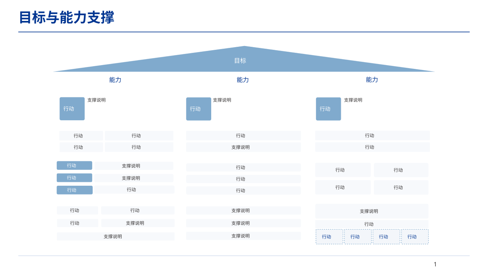

# 目标与能力支撑

来源为房子图战略图.pptx#2。

## 结构与适用场景

屋顶使命；3根能力支柱；每列分理解业务、方法/项目工具、底层行为规范；多级子模块

职能战略、能力建设、目标与支撑

使命/能力/子能力/做法/底层行为分开参数，避免将一柱合成一段

固定节点、圆弧、扇区、分面和连接表达定性关系。数量比较、趋势或占比使用数据驱动图表，源页中已登记的微图槽可接收实际数据。

## 预览



## 调用

将下列完整page对象放入schema_version=1、template_id=business-blue-v1的pages数组，替换各节点内容。nodes键对应原文本框或已明确拆分的语义分段，字段角色及source_ref、segment见下表。

```json
{
  "id": "house-02",
  "family": "source-house",
  "variant": "page-02",
  "content": {
    "title": "目标与能力支撑",
    "nodes": {
      "shape_20": "目标",
      "shape_21": "能力",
      "shape_22": "能力",
      "shape_23": "能力",
      "shape_24": "支撑说明",
      "shape_25": "支撑说明",
      "shape_26": "支撑说明",
      "shape_31": "行动",
      "shape_34": "行动",
      "shape_37": "行动",
      "shape_39": "支撑说明",
      "shape_40": "支撑说明",
      "shape_41": "行动",
      "shape_42": "行动",
      "shape_43": "行动",
      "shape_44": "行动",
      "shape_45": "行动",
      "shape_46": "行动",
      "shape_47": "行动",
      "shape_48": "行动",
      "shape_49": "行动",
      "shape_50": "行动",
      "shape_51": "支撑说明",
      "shape_52": "支撑说明",
      "shape_53": "行动",
      "shape_54": "支撑说明",
      "shape_55": "支撑说明",
      "shape_56": "支撑说明",
      "shape_57": "支撑说明",
      "shape_58": "行动",
      "shape_59": "行动",
      "shape_60": "行动",
      "shape_61": "行动",
      "shape_62": "行动",
      "shape_64": "行动",
      "shape_65": "行动",
      "shape_66": "行动",
      "shape_67": "行动",
      "shape_68": "行动",
      "shape_69": "行动",
      "shape_70": "行动",
      "shape_71": "支撑说明",
      "shape_72": "行动",
      "shape_73": "行动",
      "shape_3": "行动"
    }
  },
  "config": {
    "show_source": true,
    "show_page_number": true
  }
}
```

config支持show_source、show_page_number、image_fit与image_position。image_fit可选contain或cover，image_position为xMin/xMid/xMax与YMin/YMid/YMax组合的九个焦点，默认为xMidYMid。字体、颜色、全局区和固定字阶取自tokens，节点数与连接结构由variant确定。

## 字段合同

每个业务节点required=true、min=1，max按具体框体登记。字符按规范化后的Unicode码点计数，空格标点换行均计入。build会以实际字体测量宽高，字符数通过后仍可能需要调整文字。

| 字段 | 节点角色与源标签 | 最短/最长 | 字阶 | 框体px | 原框引用 | 分段 | 旋转° | 垂直锚点 |
|---|---|---|---|---|---|---|---|---|
| nodes.shape_20 | 上中节点，源标签“招聘使命:助力业务业绩提升” | 1/39 | caption | [498.948, 149.1332, 282.3973, 29.6098] | slide:20 |  | 0.0 | t |
| nodes.shape_21 | 上左节点，源标签“招聘交付力” | 1/19 | caption | [241.835, 199.5093, 141.8264, 31.9467] | slide:21 |  | 0.0 | t |
| nodes.shape_22 | 上中节点，源标签“业务理解力” | 1/19 | caption | [576.322, 199.5093, 141.8264, 31.9467] | slide:22 |  | 0.0 | t |
| nodes.shape_23 | 上右节点，源标签“规划运营力” | 1/19 | caption | [915.1987, 198.9869, 141.8264, 31.9467] | slide:23 |  | 0.0 | t |
| nodes.shape_24 | 上左节点，源标签“根据业务的发展核理真需求，设计多种职能模块复杂场景的人员结构及储备策略” | 1/168 | diagramMicro | [229.1241, 255.1365, 229.4552, 60.9333] | slide:24 |  | 0.0 | t |
| nodes.shape_25 | 上中节点，源标签“提出对人才架构的演进建议，推动人才结构持续升级，不唯KPI论，积极储备人才” | 1/172 | diagramMicro | [558.3142, 255.1365, 237.1074, 60.6767] | slide:25 |  | 0.0 | t |
| nodes.shape_26 | 上右节点，源标签“促进运营流程持续提效，并通过运营手段保证公司管理意志落地与招聘目标达成” | 1/164 | diagramMicro | [902.2679, 255.1365, 224.5982, 60.9333] | slide:26 |  | 0.0 | t |
| nodes.shape_31 | 中左节点，源标签“项目管理” | 1/16 | diagramMicro | [149.4132, 423.9975, 91.7711, 21.5636] | slide:31 |  | 0.0 | ctr |
| nodes.shape_34 | 中左节点，源标签“科学管理” | 1/16 | diagramMicro | [149.4132, 456.2924, 91.7711, 21.5636] | slide:34 |  | 0.0 | ctr |
| nodes.shape_37 | 下左节点，源标签“识别将才” | 1/17 | diagramMicro | [149.2757, 488.5873, 93.1916, 21.5636] | slide:37 |  | 0.0 | ctr |
| nodes.shape_39 | 中左节点，源标签“设计方案、协同BP看成本下测定” | 1/38 | diagramMicro | [247.8101, 424.9689, 207.0394, 21.4902] | slide:39 |  | 0.0 | ctr |
| nodes.shape_40 | 中左节点，源标签“整合资源、运用招聘漏斗正反排期” | 1/38 | diagramMicro | [247.1961, 457.2547, 207.855, 21.4902] | slide:40 |  | 0.0 | ctr |
| nodes.shape_41 | 下左节点，源标签“厘清关键岗位” | 1/39 | diagramMicro | [246.8845, 487.3868, 210.9526, 21.4902] | slide:41 |  | 0.0 | ctr |
| nodes.shape_42 | 中中节点，源标签“了解行业、迭代认知” | 1/55 | diagramMicro | [488.2075, 429.2211, 301.0924, 21.4902] | slide:42 |  | 0.0 | ctr |
| nodes.shape_43 | 中中节点，源标签“调研竞对/Mapping” | 1/55 | diagramMicro | [488.2075, 459.5182, 301.0924, 21.4902] | slide:43 |  | 0.0 | ctr |
| nodes.shape_44 | 下中节点，源标签“关键岗位人才画像” | 1/55 | diagramMicro | [488.2075, 489.8153, 301.0924, 21.4902] | slide:44 |  | 0.0 | ctr |
| nodes.shape_45 | 中中节点，源标签“识别真问题” | 1/54 | diagramMicro | [826.5802, 427.7457, 145.987, 37.4269] | slide:45 |  | 0.0 | ctr |
| nodes.shape_46 | 中右节点，源标签“分析潜在需求” | 1/52 | diagramMicro | [980.9433, 428.1214, 142.9169, 37.4269] | slide:46 |  | 0.0 | ctr |
| nodes.shape_47 | 中中节点，源标签“设计可落地的方案” | 1/54 | diagramMicro | [826.5802, 473.2463, 145.987, 37.9401] | slide:47 |  | 0.0 | ctr |
| nodes.shape_48 | 中右节点，源标签“如何持续的运营“信息”” | 1/52 | diagramMicro | [980.9433, 473.6221, 142.9169, 37.9401] | slide:48 |  | 0.0 | ctr |
| nodes.shape_49 | 下左节点，源标签“招聘漏斗” | 1/20 | diagramMicro | [149.2757, 541.9784, 108.0744, 21.4902] | slide:49 |  | 0.0 | ctr |
| nodes.shape_50 | 下左节点，源标签“岗位排期表” | 1/35 | diagramMicro | [265.2863, 541.9784, 192.5507, 21.4902] | slide:50 |  | 0.0 | ctr |
| nodes.shape_51 | 下左节点，源标签“人才储备-关键人才跟踪-人才分层打标签” | 1/57 | diagramMicro | [149.2757, 610.5731, 308.5613, 21.4902] | slide:51 |  | 0.0 | ctr |
| nodes.shape_52 | 下左节点，源标签“后链路保温-过程管理-关键动作” | 1/35 | diagramMicro | [265.5888, 575.3914, 192.5507, 21.4902] | slide:52 |  | 0.0 | ctr |
| nodes.shape_53 | 下左节点，源标签“流程圈定” | 1/20 | diagramMicro | [149.5782, 575.3914, 108.0744, 21.4902] | slide:53 |  | 0.0 | ctr |
| nodes.shape_54 | 下中节点，源标签“协同BP、厘清问题、识别关键组织缺失能力” | 1/55 | diagramMicro | [488.2075, 542.3633, 301.0924, 21.4902] | slide:54 |  | 0.0 | ctr |
| nodes.shape_55 | 下中节点，源标签“关注业务上下游链路、他人反馈” | 1/55 | diagramMicro | [488.2075, 575.6113, 301.0924, 21.4902] | slide:55 |  | 0.0 | ctr |
| nodes.shape_56 | 下中节点，源标签“长期主义:持续关注行业不同时期变化、串点成线” | 1/55 | diagramMicro | [488.2075, 608.9876, 301.0924, 21.4902] | slide:56 |  | 0.0 | ctr |
| nodes.shape_57 | 下中节点，源标签“学习并理解业务 / 参与业务周会，以简历为切入点简历沟通，陪伴面试、挤压水分” | 1/108 | diagramMicro | [827.0017, 535.5451, 296.8585, 38.7832] | slide:57 |  | 0.0 | ctr |
| nodes.shape_58 | 下中节点，源标签“调研方法论(简化)” | 1/54 | diagramMicro | [827.0017, 578.1865, 296.8585, 21.4902] | slide:58 |  | 0.0 | ctr |
| nodes.shape_59 | 下中节点，源标签“定位 / 行业先进” | 1/26 | diagramMicro | [828.6971, 602.6093, 70.8674, 38.7832] | slide:59 |  | 0.0 | ctr |
| nodes.shape_60 | 下右节点，源标签“分析 / 组织形态” | 1/26 | diagramMicro | [903.4685, 602.6093, 70.8674, 38.7832] | slide:60 |  | 0.0 | ctr |
| nodes.shape_61 | 下右节点，源标签“配套 / 问题框架” | 1/26 | diagramMicro | [978.2307, 602.6093, 70.8674, 38.7832] | slide:61 |  | 0.0 | ctr |
| nodes.shape_62 | 下右节点，源标签“协同作战车轮战” | 1/26 | diagramMicro | [1052.9929, 602.6093, 70.8674, 38.7832] | slide:62 |  | 0.0 | ctr |
| nodes.shape_64 | 上中节点，源标签“行业 / 洞察” | 1/30 | diagramCompact | [488.3083, 255.9246, 65.6896, 60.6584] | slide:64 |  | 0.0 | ctr |
| nodes.shape_65 | 上中节点，源标签“识别 / 问题” | 1/30 | diagramCompact | [828.7888, 255.9246, 65.6896, 60.6584] | slide:65 |  | 0.0 | ctr |
| nodes.shape_66 | 中左节点，源标签“招多少合适?” | 1/21 | diagramMicro | [155.6541, 344.14, 114.581, 25.1834] | slide:66 |  | 0.0 | ctr |
| nodes.shape_67 | 中左节点，源标签“经常刹车，速度如何提?” | 1/33 | diagramMicro | [275.2296, 343.8559, 179.6199, 25.1834] | slide:67 |  | 0.0 | ctr |
| nodes.shape_68 | 中左节点，源标签“招聘成功率低” | 1/21 | diagramMicro | [156.2131, 374.1988, 114.0128, 25.1834] | slide:68 |  | 0.0 | ctr |
| nodes.shape_69 | 中左节点，源标签“闭门造车，开源困难” | 1/33 | diagramMicro | [275.2296, 373.9055, 179.6199, 25.1834] | slide:69 |  | 0.0 | ctr |
| nodes.shape_70 | 中中节点，源标签“部门的价值是什么:懂业务” | 1/55 | diagramMicro | [488.2075, 343.7367, 301.0924, 25.1834] | slide:70 |  | 0.0 | ctr |
| nodes.shape_71 | 中中节点，源标签“offer的必要法:会适配” | 1/55 | diagramMicro | [488.2075, 374.1438, 301.0924, 25.1834] | slide:71 |  | 0.0 | ctr |
| nodes.shape_72 | 中中节点，源标签“招聘规划力” | 1/55 | diagramMicro | [826.5802, 343.4068, 301.0924, 25.1834] | slide:72 |  | 0.0 | ctr |
| nodes.shape_73 | 中中节点，源标签“招聘决策力” | 1/55 | diagramMicro | [826.5802, 373.8231, 301.0924, 25.1834] | slide:73 |  | 0.0 | ctr |
| nodes.shape_3 | 上左节点，源标签“理解 / 业务” | 1/30 | diagramCompact | [156.3872, 255.4114, 65.6896, 60.6584] | slide:3 |  | 0.0 | ctr |

全局title必填、2至32码点，使用统一标题框。section_name可选0至24码点，source可选0至64码点。所有可编辑文本通过独立原生carrier导出，页码为派生文字。

## 来源处理

原生PPTX源件保存于用户材料目录，分发包仅含用户资产衍生的几何、字段和说明。原始逐框文字、源框与标准化框在page-catalog.json的variant.fields中。

源标题引用为`slide:27`，原文为“战略屋/房型图”。模板默认标题依据真实结构设置。

密集全景中的diagramCompact为14px、diagramMicro为12px。适用于体系概览或附录局部标签，现场关键结论用统一标题与正常正文字阶表达。

源画布边界裁切已烘焙为可编辑Bezier几何，3D顶面、侧面与前面通过tokens配色的相对明暗保留。

