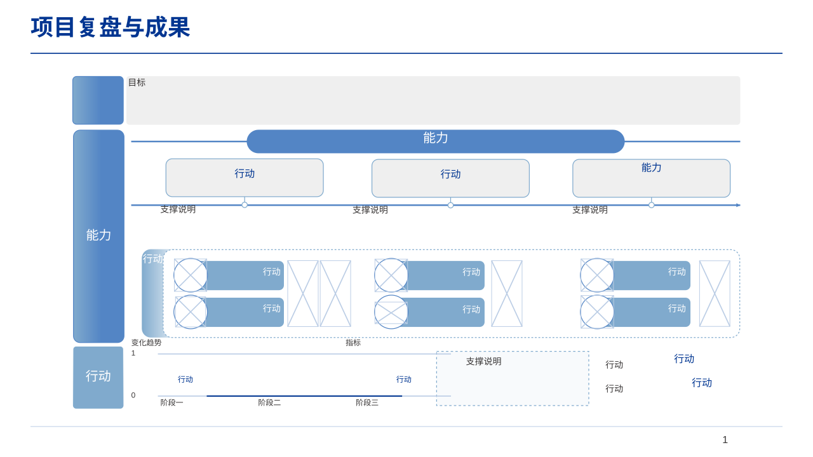

# 项目复盘与成果

来源为房子图战略图.pptx#3。

## 结构与适用场景

上方背景；中部3种达人策略+6个案例；下方项目成果指标与长尾效果

项目复盘，背景-行动-结果

区分策略、案例、指标；源图存在chart占位，不能当真实数据

固定节点、圆弧、扇区、分面和连接表达定性关系。数量比较、趋势或占比使用数据驱动图表，源页中已登记的微图槽可接收实际数据。

## 预览



## 调用

将下列完整page对象放入schema_version=1、template_id=business-blue-v1的pages数组，替换各节点内容。nodes键对应原文本框或已明确拆分的语义分段，字段角色及source_ref、segment见下表。

```json
{
  "id": "house-03",
  "family": "source-house",
  "variant": "page-03",
  "content": {
    "title": "项目复盘与成果",
    "nodes": {
      "shape_7": "目标",
      "shape_11": "能力",
      "shape_16": "能力",
      "shape_17": "行动",
      "shape_20": "行动",
      "shape_48": "支撑说明",
      "shape_22": "行动",
      "shape_49": "支撑说明",
      "shape_24": "能力",
      "shape_50": "支撑说明",
      "shape_55": "行动",
      "shape_101": "行动",
      "shape_102": "行动",
      "shape_107": "行动",
      "shape_108": "行动",
      "shape_109": "行动",
      "shape_110": "行动",
      "shape_131": "行动",
      "shape_132": "行动",
      "shape_134": "支撑说明",
      "shape_135": "行动",
      "shape_137": "行动",
      "shape_136": "行动",
      "shape_138": "行动"
    },
    "charts": {
      "chart_130": {
        "title": "变化趋势",
        "axis_title": "指标",
        "unit": "",
        "categories": [
          "阶段一",
          "阶段二",
          "阶段三"
        ],
        "series": [
          {
            "name": "指标",
            "values": [
              0,
              0,
              0
            ]
          }
        ],
        "chart_type": "line",
        "show_legend": false,
        "show_data_labels": false
      }
    }
  },
  "config": {
    "show_source": true,
    "show_page_number": true
  }
}
```

config支持show_source、show_page_number、image_fit与image_position。image_fit可选contain或cover，image_position为xMin/xMid/xMax与YMin/YMid/YMax组合的九个焦点，默认为xMidYMid。字体、颜色、全局区和固定字阶取自tokens，节点数与连接结构由variant确定。

## 字段合同

每个业务节点required=true、min=1，max按具体框体登记。字符按规范化后的Unicode码点计数，空格标点换行均计入。build会以实际字体测量宽高，字符数通过后仍可能需要调整文字。

| 字段 | 节点角色与源标签 | 最短/最长 | 字阶 | 框体px | 原框引用 | 分段 | 旋转° | 垂直锚点 |
|---|---|---|---|---|---|---|---|---|
| nodes.shape_7 | 上中节点，源标签“达人垂类数量增长，标签愈发精细化。品牌利用多圈层达人投放，全方位解析产品信息，多” | 1/608 | diagramCompact | [201.2214, 122.6033, 961.9843, 71.3363] | slide:7 |  | 0.0 | t |
| nodes.shape_11 | 上中节点，源标签“雪佛兰携手百度多垂类、多层级达人，助力“雪佛兰110周年”活动” | 1/66 | compactBody | [388.2986, 206.4837, 595.4267, 32.9259] | slide:11 |  | 0.0 | t |
| nodes.shape_16 | 上左节点，源标签“解法” | 1/96 | compactBody | [115.6826, 205.0477, 79.5724, 334.6508] | slide:16 |  | 0.0 | ctr |
| nodes.shape_17 | 下左节点，源标签“项目 / 成果” | 1/24 | compactBody | [114.8674, 545.3313, 79.5724, 98.4905] | slide:17 |  | 0.0 | ctr |
| nodes.shape_20 | 上左节点，源标签“汽车垂类头部达人深度定制” | 1/31 | caption | [271.0476, 265.0258, 228.2299, 29.9335] | slide:20 |  | 0.0 | t |
| nodes.shape_48 | 中左节点，源标签“邀请度星选平台汽车垂类的资深达人参与，对雪佛兰110周年的活动进行权威解读，形成” | 1/168 | diagramCompact | [252.2407, 322.2617, 265.8436, 68.5107] | slide:48 |  | 0.0 | t |
| nodes.shape_22 | 上中节点，源标签“跨界垂类达人多维度切入” | 1/31 | caption | [595.3685, 265.9986, 228.2299, 29.9335] | slide:22 |  | 0.0 | t |
| nodes.shape_49 | 中中节点，源标签“依据粉丝画像，邀请其他垂类的达人参与，如财经、文艺、电影、娱乐等，围绕雪佛兰11” | 1/196 | diagramCompact | [554.8643, 323.2344, 309.2291, 68.5107] | slide:49 |  | 0.0 | t |
| nodes.shape_24 | 上右节点，源标签“汽车垂类腰尾部达人 / 海量内容扩大影响力” | 1/62 | caption | [911.6571, 255.502, 228.2299, 50.8897] | slide:24 |  | 0.0 | t |
| nodes.shape_50 | 中右节点，源标签“启用征文模式，利用腰尾部达人的影响力，引起雪佛兰110周年活动的持续关注与讨论。” | 1/156 | diagramCompact | [900.8825, 323.2159, 249.7883, 68.5107] | slide:50 |  | 0.0 | t |
| nodes.shape_55 | 中左节点，源标签“部分达人实例” | 1/24 | caption | [223.2708, 399.3327, 34.5842, 125.728] | slide:55 |  | 0.0 | t |
| nodes.shape_101 | 中左节点，源标签“@玩越野的峰哥” | 1/34 | diagramCompact | [329.7009, 420.7984, 112.137, 41.9124] | slide:101 |  | 0.0 | t |
| nodes.shape_102 | 下左节点，源标签“@贞哥车友” | 1/17 | diagramCompact | [329.7009, 478.6272, 112.137, 25.4495] | slide:102 |  | 0.0 | t |
| nodes.shape_107 | 中中节点，源标签“@电影烂番茄” | 1/17 | diagramCompact | [644.0069, 421.2431, 112.137, 25.4495] | slide:107 |  | 0.0 | t |
| nodes.shape_108 | 下中节点，源标签“@湖南经视” | 1/17 | diagramCompact | [644.0069, 480.1929, 112.137, 25.4495] | slide:108 |  | 0.0 | t |
| nodes.shape_109 | 中右节点，源标签“@刀刀叨文艺” | 1/17 | diagramCompact | [967.707, 420.7984, 112.137, 25.4495] | slide:109 |  | 0.0 | t |
| nodes.shape_110 | 下右节点，源标签“@智电汽车” | 1/17 | diagramCompact | [967.707, 478.6272, 112.137, 25.4495] | slide:110 |  | 0.0 | t |
| nodes.shape_131 | 下左节点，源标签“提升160%” | 1/18 | diagramMicro | [266.6284, 591.4868, 50.5654, 32.9259] | slide:131 |  | 0.0 | t |
| nodes.shape_132 | 下中节点，源标签“提升430%” | 1/22 | diagramMicro | [605.9207, 591.4868, 59.8484, 32.9259] | slide:132 |  | 0.0 | t |
| nodes.shape_134 | 下中节点，源标签“投放停止后，优质内容会沉淀在平台中，在用户搜索场景中展现形成长尾效应。” | 1/116 | diagramCompact | [733.5386, 562.0073, 183.2973, 68.5107] | slide:134 |  | 0.0 | t |
| nodes.shape_135 | 下右节点，源标签“参与达人数量：” | 1/17 | diagramCompact | [953.1618, 567.3344, 112.137, 25.4495] | slide:135 |  | 0.0 | t |
| nodes.shape_137 | 下右节点，源标签“70+” | 1/8 | caption | [1047.1498, 556.8563, 60.08, 35.9276] | slide:137 |  | 0.0 | t |
| nodes.shape_136 | 下右节点，源标签“阅读目标达成率：” | 1/20 | diagramCompact | [953.1618, 605.0685, 127.5901, 25.4495] | slide:136 |  | 0.0 | t |
| nodes.shape_138 | 下右节点，源标签“204%” | 1/11 | caption | [1065.2896, 594.5904, 79.5724, 35.9276] | slide:138 |  | 0.0 | t |

## 可替换图片

在content.visuals提供下列槽位对象，省略时显示中性空槽。每项含path和可选alt，path为--assets目录下的相对本地路径，1至260码点，alt为0至200码点。原案例照片、界面或品牌保留来源引用，默认页使用空槽。

- `visuals.picture_90`用于案例照片或截图，框体为`[274.4847, 407.9764, 51.0842, 51.0842]`，源引用为`['slide:90']`。
- `visuals.picture_92`用于案例照片或截图，框体为`[276.2913, 467.6025, 47.4803, 47.4803]`，源引用为`['slide:92']`。
- `visuals.picture_94`用于案例照片或截图，框体为`[590.3101, 408.2451, 51.4363, 51.4363]`，源引用为`['slide:94']`。
- `visuals.picture_96`用于案例照片或截图，框体为`[590.3101, 475.9497, 50.936, 33.9264]`，源引用为`['slide:96']`。
- `visuals.picture_98`用于案例照片或截图，框体为`[914.7236, 407.9764, 51.0842, 51.0842]`，源引用为`['slide:98']`。
- `visuals.picture_100`用于案例照片或截图，框体为`[914.7236, 465.6291, 51.427, 51.427]`，源引用为`['slide:100']`。
- `visuals.picture_112`用于案例照片或截图，框体为`[452.9738, 410.5519, 48.0362, 103.9657]`，源引用为`['slide:112']`。
- `visuals.picture_114`用于案例照片或截图，框体为`[504.1228, 410.6538, 47.9436, 103.7619]`，源引用为`['slide:114']`。
- `visuals.picture_116`用于案例照片或截图，框体为`[774.0335, 410.6538, 47.9436, 103.7619]`，源引用为`['slide:116']`。
- `visuals.picture_118`用于案例照片或截图，框体为`[1101.3654, 410.8113, 47.7953, 103.4377]`，源引用为`['slide:118']`。

```json
{
  "visuals": {
    "picture_90": {
      "path": "assets/replacement.png",
      "alt": "案例照片或截图"
    },
    "picture_92": {
      "path": "assets/replacement.png",
      "alt": "案例照片或截图"
    },
    "picture_94": {
      "path": "assets/replacement.png",
      "alt": "案例照片或截图"
    },
    "picture_96": {
      "path": "assets/replacement.png",
      "alt": "案例照片或截图"
    },
    "picture_98": {
      "path": "assets/replacement.png",
      "alt": "案例照片或截图"
    },
    "picture_100": {
      "path": "assets/replacement.png",
      "alt": "案例照片或截图"
    },
    "picture_112": {
      "path": "assets/replacement.png",
      "alt": "案例照片或截图"
    },
    "picture_114": {
      "path": "assets/replacement.png",
      "alt": "案例照片或截图"
    },
    "picture_116": {
      "path": "assets/replacement.png",
      "alt": "案例照片或截图"
    },
    "picture_118": {
      "path": "assets/replacement.png",
      "alt": "案例照片或截图"
    }
  }
}
```


## 数据驱动概览微图

content.charts中的每个已登记槽位均需提供title、categories与series，可配置axis_title、unit、chart_type、show_legend和show_data_labels。chart_type支持line或column。类别与每组数值一一对应，每组至少一个已知数，缺值用null。默认零值用于结构占位。主要数据分析使用专门图表页，微图用于此页复盘关系中的结果概览。

开启数据标签时，SVG与原生图共用带字号留白的轴范围、绘图区和底部类目标签。数值、标题、单位及类别全部来自参数。

- `charts.chart_130`的原区域为`slide:130`，实际框体为`[206.5577, 533.6392, 517.4941, 114.3608]`。原日期轴区域改用数据驱动原生类目轴图表，类目按输入等距排列，日期间隔不编码为横向距离。

全局title必填、2至32码点，使用统一标题框。section_name可选0至24码点，source可选0至64码点。所有可编辑文本通过独立原生carrier导出，页码为派生文字。

## 来源处理

原生PPTX源件保存于用户材料目录，分发包仅含用户资产衍生的几何、字段和说明。原始逐框文字、源框与标准化框在page-catalog.json的variant.fields中。

源标题引用为`slide:3`，原文为“过往项目总结—垂类达人营销活动”。模板默认标题依据真实结构设置。

密集全景中的diagramCompact为14px、diagramMicro为12px。适用于体系概览或附录局部标签，现场关键结论用统一标题与正常正文字阶表达。

源画布边界裁切已烘焙为可编辑Bezier几何，3D顶面、侧面与前面通过tokens配色的相对明暗保留。

