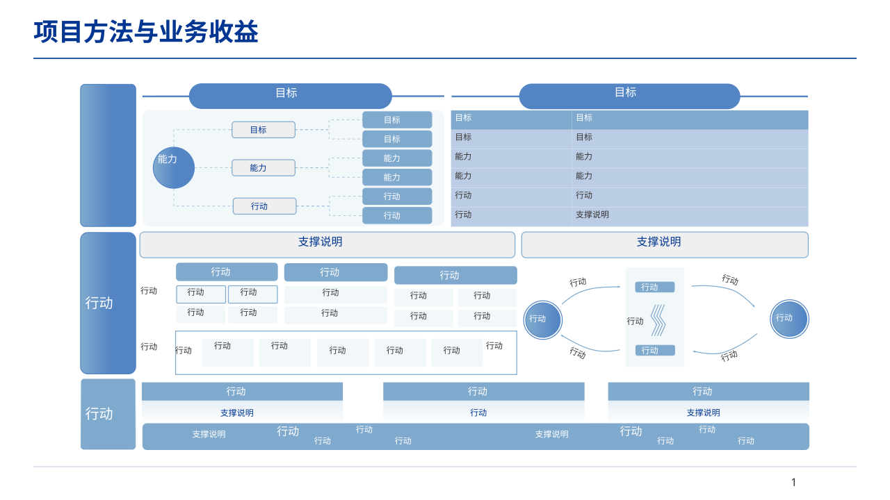

# 项目方法与业务收益

来源为房子图战略图.pptx#4。

## 结构与适用场景

背景双栏含树状筛选与维度表；中段私域矩阵和双向信息模型；底部3类收益与指标

复杂项目方法复盘

一页多图过密，可拆成筛选框架、运营机制、结果3页；保留双向箭头含义

固定节点、圆弧、扇区、分面和连接表达定性关系。数量比较、趋势或占比使用数据驱动图表，源页中已登记的微图槽可接收实际数据。

## 预览



## 调用

将下列完整page对象放入schema_version=1、template_id=business-blue-v1的pages数组，替换各节点内容。nodes键对应原文本框或已明确拆分的语义分段，字段角色及source_ref、segment见下表。

```json
{
  "id": "house-04",
  "family": "source-house",
  "variant": "page-04",
  "content": {
    "title": "项目方法与业务收益",
    "nodes": {
      "shape_6": "行动",
      "shape_7": "行动",
      "shape_11": "目标",
      "shape_15": "目标",
      "shape_18": "能力",
      "shape_19": "目标",
      "shape_20": "能力",
      "shape_21": "行动",
      "shape_22": "目标",
      "shape_23": "目标",
      "shape_24": "能力",
      "shape_25": "能力",
      "shape_26": "行动",
      "shape_27": "行动",
      "shape_70_cell_0_0": "目标",
      "shape_70_cell_0_1": "目标",
      "shape_70_cell_1_0": "目标",
      "shape_70_cell_1_1": "目标",
      "shape_70_cell_2_0": "能力",
      "shape_70_cell_2_1": "能力",
      "shape_70_cell_3_0": "能力",
      "shape_70_cell_3_1": "能力",
      "shape_70_cell_4_0": "行动",
      "shape_70_cell_4_1": "行动",
      "shape_70_cell_5_0": "行动",
      "shape_70_cell_5_1": "支撑说明",
      "shape_73": "支撑说明",
      "shape_77": "行动",
      "shape_74": "行动",
      "shape_79": "行动",
      "shape_81": "行动",
      "shape_85": "行动",
      "shape_86": "行动",
      "shape_75": "行动",
      "shape_89": "行动",
      "shape_91": "行动",
      "shape_76": "行动",
      "shape_93": "行动",
      "shape_95": "行动",
      "shape_97": "行动",
      "shape_99": "行动",
      "shape_115": "行动",
      "shape_117": "行动",
      "shape_119": "行动",
      "shape_121": "行动",
      "shape_123": "行动",
      "shape_125": "行动",
      "shape_127": "行动",
      "shape_133": "行动",
      "shape_141": "支撑说明",
      "shape_146": "行动",
      "shape_150": "行动",
      "shape_164": "行动",
      "shape_165": "行动",
      "shape_172": "行动",
      "shape_173": "行动",
      "shape_174": "行动",
      "shape_175": "行动",
      "shape_176": "行动",
      "shape_177": "行动",
      "shape_178": "支撑说明",
      "shape_181": "行动",
      "shape_182": "行动",
      "shape_184": "行动",
      "shape_185": "支撑说明",
      "shape_187": "支撑说明",
      "shape_188": "行动",
      "shape_189": "行动",
      "shape_190": "行动",
      "shape_191": "行动",
      "shape_192": "支撑说明",
      "shape_193": "行动",
      "shape_194": "行动",
      "shape_195": "行动",
      "shape_196": "行动"
    }
  },
  "config": {
    "show_source": true,
    "show_page_number": true
  }
}
```

config支持show_source、show_page_number、image_fit与image_position。image_fit可选contain或cover，image_position为xMin/xMid/xMax与YMin/YMid/YMax组合的九个焦点，默认为xMidYMid。字体、颜色、全局区和固定字阶取自tokens，节点数与连接结构由variant确定。

## 字段合同

每个业务节点required=true、min=1，max按具体框体登记。字符按规范化后的Unicode码点计数，空格标点换行均计入。build会以实际字体测量宽高，字符数通过后仍可能需要调整文字。

| 字段 | 节点角色与源标签 | 最短/最长 | 字阶 | 框体px | 原框引用 | 分段 | 旋转° | 垂直锚点 |
|---|---|---|---|---|---|---|---|---|
| nodes.shape_6 | 中左节点，源标签“解法” | 1/56 | compactBody | [115.8823, 334.8782, 79.2983, 203.5037] | slide:6 |  | 0.0 | ctr |
| nodes.shape_7 | 下左节点，源标签“收货 / 价值” | 1/24 | compactBody | [115.9192, 544.8632, 79.2983, 102.6382] | slide:7 |  | 0.0 | ctr |
| nodes.shape_11 | 上中节点，源标签“国货投放达人要求趋于精细” | 1/36 | caption | [776.7663, 122.4097, 265.8973, 29.8304] | slide:11 |  | 0.0 | t |
| nodes.shape_15 | 上左节点，源标签“达人合作品牌 筛选标准升级 ” | 1/41 | caption | [272.6047, 123.3699, 298.5528, 29.8304] | slide:15 |  | 0.0 | t |
| nodes.shape_18 | 上左节点，源标签“合作 / 要求” | 1/18 | diagramCompact | [220.3762, 220.6901, 59.0883, 41.768] | slide:18 |  | 0.0 | t |
| nodes.shape_19 | 上左节点，源标签“产品” | 1/16 | diagramMicro | [333.798, 175.2291, 90.5713, 23.2198] | slide:19 |  | 0.0 | ctr |
| nodes.shape_20 | 上左节点，源标签“品牌” | 1/16 | diagramMicro | [333.798, 229.9596, 90.5713, 23.2198] | slide:20 |  | 0.0 | ctr |
| nodes.shape_21 | 中左节点，源标签“合作” | 1/16 | diagramMicro | [335.4045, 285.2164, 90.5713, 23.2198] | slide:21 |  | 0.0 | ctr |
| nodes.shape_22 | 上中节点，源标签“产品受众” | 1/18 | diagramMicro | [521.9019, 160.9186, 98.9913, 23.2198] | slide:22 |  | 0.0 | ctr |
| nodes.shape_23 | 上中节点，源标签“产品 质量” | 1/18 | diagramMicro | [521.9019, 188.4686, 98.9913, 23.2198] | slide:23 |  | 0.0 | ctr |
| nodes.shape_24 | 上中节点，源标签“品牌口碑” | 1/18 | diagramMicro | [521.9019, 216.0277, 98.9913, 23.2198] | slide:24 |  | 0.0 | ctr |
| nodes.shape_25 | 上中节点，源标签“品牌理念” | 1/18 | diagramMicro | [521.9019, 243.5868, 98.9913, 23.2198] | slide:25 |  | 0.0 | ctr |
| nodes.shape_26 | 上中节点，源标签“合作动机” | 1/18 | diagramMicro | [521.9019, 271.1368, 98.9913, 23.2198] | slide:26 |  | 0.0 | ctr |
| nodes.shape_27 | 中中节点，源标签“合作形式” | 1/18 | diagramMicro | [521.9019, 298.6959, 98.9913, 23.2198] | slide:27 |  | 0.0 | ctr |
| nodes.shape_70_cell_0_0 | 上中节点，源标签“合作需求” | 1/30 | diagramMicro | [654.2153, 161.6692, 162.7227, 22.3732] | slide:70:cell:0:0 |  | 0.0 | t |
| nodes.shape_70_cell_0_1 | 上中节点，源标签“筛选维度” | 1/60 | diagramMicro | [828.0171, 161.6692, 329.143, 22.3732] | slide:70:cell:0:1 |  | 0.0 | t |
| nodes.shape_70_cell_1_0 | 上中节点，源标签“内容传播” | 1/30 | diagramMicro | [654.2153, 189.582, 162.7227, 22.3732] | slide:70:cell:1:0 |  | 0.0 | t |
| nodes.shape_70_cell_1_1 | 上中节点，源标签“总曝光量、总互动量、总粉丝量…” | 1/60 | diagramMicro | [828.0171, 189.582, 329.143, 22.3732] | slide:70:cell:1:1 |  | 0.0 | t |
| nodes.shape_70_cell_2_0 | 上中节点，源标签“达人调性” | 1/30 | diagramMicro | [654.2153, 217.4947, 162.7227, 22.3732] | slide:70:cell:2:0 |  | 0.0 | t |
| nodes.shape_70_cell_2_1 | 上中节点，源标签“达人风格、内容类别、内容形式…” | 1/60 | diagramMicro | [828.0171, 217.4947, 329.143, 22.3732] | slide:70:cell:2:1 |  | 0.0 | t |
| nodes.shape_70_cell_3_0 | 上中节点，源标签“用户触达” | 1/30 | diagramMicro | [654.2153, 245.4075, 162.7227, 22.3732] | slide:70:cell:3:0 |  | 0.0 | t |
| nodes.shape_70_cell_3_1 | 上中节点，源标签“粉丝性别、地域、年龄、城市线级…” | 1/60 | diagramMicro | [828.0171, 245.4075, 329.143, 22.3732] | slide:70:cell:3:1 |  | 0.0 | t |
| nodes.shape_70_cell_4_0 | 上中节点，源标签“品牌背书” | 1/30 | diagramMicro | [654.2153, 273.3203, 162.7227, 22.3732] | slide:70:cell:4:0 |  | 0.0 | t |
| nodes.shape_70_cell_4_1 | 上中节点，源标签“博主口碑、粉丝信任度…” | 1/60 | diagramMicro | [828.0171, 273.3203, 329.143, 22.3732] | slide:70:cell:4:1 |  | 0.0 | t |
| nodes.shape_70_cell_5_0 | 中中节点，源标签“带货转化” | 1/30 | diagramMicro | [654.2153, 301.233, 162.7227, 22.3732] | slide:70:cell:5:0 |  | 0.0 | t |
| nodes.shape_70_cell_5_1 | 中中节点，源标签“粉丝购买力、博主带货能力…” | 1/60 | diagramMicro | [828.0171, 301.233, 329.143, 22.3732] | slide:70:cell:5:1 |  | 0.0 | t |
| nodes.shape_73 | 中中节点，源标签“布局线索经营核心场景，搭建一体化经营矩阵” | 1/53 | caption | [278.7167, 337.6757, 384.397, 29.8304] | slide:73 |  | 0.0 | t |
| nodes.shape_77 | 中左节点，源标签“三大核心场景” | 1/20 | diagramMicro | [192.734, 410.9267, 58.1558, 32.8125] | slide:77 |  | 0.0 | t |
| nodes.shape_74 | 中左节点，源标签“内容” | 1/23 | diagramCompact | [253.7888, 378.9821, 145.2279, 25.0848] | slide:74 |  | 0.0 | ctr |
| nodes.shape_79 | 中左节点，源标签“短视频” | 1/9 | diagramMicro | [263.4553, 412.8379, 51.5453, 22.3705] | slide:79 |  | 0.0 | t |
| nodes.shape_81 | 中左节点，源标签“直播” | 1/9 | diagramMicro | [339.3653, 412.8379, 51.5453, 22.3705] | slide:81 |  | 0.0 | t |
| nodes.shape_85 | 中左节点，源标签“视频锚点” | 1/11 | diagramMicro | [257.2418, 441.8742, 63.6769, 22.3705] | slide:85 |  | 0.0 | t |
| nodes.shape_86 | 中左节点，源标签“服务货架” | 1/11 | diagramMicro | [333.558, 442.1604, 63.1506, 22.3705] | slide:86 |  | 0.0 | t |
| nodes.shape_75 | 中中节点，源标签“搜索” | 1/23 | diagramCompact | [409.3941, 379.6192, 147.5638, 25.0848] | slide:75 |  | 0.0 | ctr |
| nodes.shape_89 | 中中节点，源标签“搜索结果直推服务” | 1/21 | diagramMicro | [424.277, 413.4749, 117.8073, 22.3705] | slide:89 |  | 0.0 | t |
| nodes.shape_91 | 中中节点，源标签“搜索结果服务内容露出” | 1/24 | diagramMicro | [415.94, 443.019, 131.7299, 22.3705] | slide:91 |  | 0.0 | t |
| nodes.shape_76 | 中中节点，源标签“咨询” | 1/27 | diagramCompact | [567.7877, 383.9215, 175.4368, 25.0848] | slide:76 |  | 0.0 | ctr |
| nodes.shape_93 | 中中节点，源标签“电话咨询” | 1/12 | diagramMicro | [576.2539, 417.7773, 66.6774, 22.3705] | slide:93 |  | 0.0 | t |
| nodes.shape_95 | 中中节点，源标签“企业版私信” | 1/13 | diagramMicro | [664.1939, 417.7773, 73.5465, 22.3705] | slide:95 |  | 0.0 | t |
| nodes.shape_97 | 中中节点，源标签“高潜用户触达” | 1/15 | diagramMicro | [567.3445, 447.3214, 84.5055, 22.3705] | slide:97 |  | 0.0 | t |
| nodes.shape_99 | 中中节点，源标签“智能接待” | 1/12 | diagramMicro | [667.6284, 447.3214, 66.6774, 22.3705] | slide:99 |  | 0.0 | t |
| nodes.shape_115 | 下左节点，源标签“基建及 / 管理能力” | 1/22 | diagramMicro | [191.9308, 491.5915, 60.1777, 32.8125] | slide:115 |  | 0.0 | t |
| nodes.shape_117 | 下左节点，源标签“阵地” | 1/8 | diagramMicro | [249.1633, 496.8078, 44.7963, 22.3705] | slide:117 |  | 0.0 | t |
| nodes.shape_119 | 下左节点，源标签“线索独立 / 店铺/商品” | 1/24 | diagramMicro | [294.1073, 490.0958, 67.2037, 35.8038] | slide:119 |  | 0.0 | t |
| nodes.shape_121 | 下左节点，源标签“新版 / 商家主页” | 1/24 | diagramMicro | [376.914, 490.0958, 65.3018, 35.8038] | slide:121 |  | 0.0 | t |
| nodes.shape_123 | 下中节点，源标签“商家CRM” | 1/12 | diagramMicro | [459.7853, 496.8078, 66.8713, 22.3705] | slide:123 |  | 0.0 | t |
| nodes.shape_125 | 下中节点，源标签“评价体系” | 1/11 | diagramMicro | [544.0877, 496.8078, 62.8829, 22.3705] | slide:125 |  | 0.0 | t |
| nodes.shape_127 | 下中节点，源标签“反馈通道” | 1/12 | diagramMicro | [624.9833, 496.8078, 64.8032, 22.3705] | slide:127 |  | 0.0 | t |
| nodes.shape_133 | 下中节点，源标签“分析管理” | 1/16 | diagramMicro | [696.3139, 490.0958, 44.7963, 35.8038] | slide:133 |  | 0.0 | t |
| nodes.shape_141 | 中中节点，源标签“信息本身较外部噪声的影响更为可控” | 1/41 | caption | [809.2833, 337.6665, 297.2695, 29.8304] | slide:141 |  | 0.0 | t |
| nodes.shape_146 | 中中节点，源标签“发送者” | 1/8 | diagramMicro | [758.6243, 451.236, 44.547, 19.3883] | slide:146 |  | 0.0 | t |
| nodes.shape_150 | 中右节点，源标签“接受者” | 1/8 | diagramMicro | [1113.4033, 449.7773, 44.547, 19.3883] | slide:150 |  | 0.0 | t |
| nodes.shape_164 | 中右节点，源标签“信息” | 1/10 | diagramMicro | [914.0819, 405.8918, 55.7553, 15.0] | slide:164 |  | 0.0 | ctr |
| nodes.shape_165 | 下右节点，源标签“反馈” | 1/10 | diagramMicro | [914.4974, 496.9062, 55.7553, 15.0] | slide:165 |  | 0.0 | ctr |
| nodes.shape_172 | 中中节点，源标签“编码” | 1/8 | diagramMicro | [816.854, 397.1887, 44.7963, 19.3883] | slide:172 |  | -11.6019 | t |
| nodes.shape_173 | 中右节点，源标签“解码” | 1/8 | diagramMicro | [1034.5297, 397.6319, 44.7963, 19.3883] | slide:173 |  | 17.2327 | t |
| nodes.shape_174 | 下右节点，源标签“编码” | 1/8 | diagramMicro | [1034.3912, 501.8211, 44.7963, 19.3883] | slide:174 |  | -22.3682 | t |
| nodes.shape_175 | 下中节点，源标签“解码” | 1/8 | diagramMicro | [814.7121, 503.7507, 44.7963, 19.3883] | slide:175 |  | 23.9995 | t |
| nodes.shape_176 | 中右节点，源标签“噪声” | 1/8 | diagramMicro | [898.8852, 454.809, 44.7963, 19.3883] | slide:176 |  | 0.0 | t |
| nodes.shape_177 | 下左节点，源标签“种草价值与转化能力” | 1/45 | diagramCompact | [203.8777, 550.5505, 289.2649, 26.2666] | slide:177 |  | 0.0 | ctr |
| nodes.shape_178 | 下左节点，源标签“挂车、评论区链接 / CPL结算…” | 1/106 | diagramMicro | [203.8777, 576.8171, 289.2649, 35.1298] | slide:178 |  | 0.0 | ctr |
| nodes.shape_181 | 下中节点，源标签“场景化、有共鸣的内容链接” | 1/45 | diagramCompact | [551.2522, 550.5505, 289.4403, 26.2666] | slide:181 |  | 0.0 | ctr |
| nodes.shape_182 | 下中节点，源标签“夺标赛 / 内容型招商项目” | 1/106 | diagramMicro | [551.2522, 576.8171, 289.4403, 34.4928] | slide:182 |  | 0.0 | ctr |
| nodes.shape_184 | 下右节点，源标签“科学的达人选取与结果度量” | 1/45 | diagramCompact | [874.6774, 550.5505, 289.4403, 26.2666] | slide:184 |  | 0.0 | ctr |
| nodes.shape_185 | 下右节点，源标签“投前洞察 投后优化 / 创作者度量体系 星云 创作者图鉴…” | 1/106 | diagramMicro | [874.6774, 576.8171, 289.4403, 34.4928] | slide:185 |  | 0.0 | ctr |
| nodes.shape_187 | 下左节点，源标签“优质的内推是打动消费者的基础” | 1/33 | diagramMicro | [218.502, 617.5326, 179.3145, 22.3705] | slide:187 |  | 0.0 | t |
| nodes.shape_188 | 下左节点，源标签“98%” | 1/8 | caption | [394.659, 610.7744, 59.8731, 35.8038] | slide:188 |  | 0.0 | t |
| nodes.shape_189 | 下中节点，源标签“COM赞同者” | 1/14 | diagramMicro | [432.3278, 627.1806, 78.7444, 19.3883] | slide:189 |  | 0.0 | t |
| nodes.shape_190 | 下中节点，源标签“97%” | 1/22 | diagramMicro | [501.7565, 610.7744, 59.8731, 35.8038] | slide:190 |  | 0.0 | t |
| nodes.shape_191 | 下中节点，源标签“营销专家 赞同者” | 1/15 | diagramMicro | [544.3001, 627.1806, 86.3889, 19.3883] | slide:191 |  | 0.0 | t |
| nodes.shape_192 | 下中节点，源标签“优质的内推是打动消费者的基础” | 1/33 | diagramMicro | [711.723, 617.5326, 179.3145, 22.3705] | slide:192 |  | 0.0 | t |
| nodes.shape_193 | 下右节点，源标签“98%” | 1/8 | caption | [887.88, 610.719, 59.8731, 35.8038] | slide:193 |  | 0.0 | t |
| nodes.shape_194 | 下右节点，源标签“COM赞同者” | 1/14 | diagramMicro | [925.5488, 627.1252, 78.7444, 19.3883] | slide:194 |  | 0.0 | t |
| nodes.shape_195 | 下右节点，源标签“97%” | 1/22 | diagramMicro | [994.9775, 610.719, 59.8731, 35.8038] | slide:195 |  | 0.0 | t |
| nodes.shape_196 | 下右节点，源标签“营销专家 赞同者” | 1/15 | diagramMicro | [1037.5211, 627.1252, 86.3889, 19.3883] | slide:196 |  | 0.0 | t |

全局title必填、2至32码点，使用统一标题框。section_name可选0至24码点，source可选0至64码点。所有可编辑文本通过独立原生carrier导出，页码为派生文字。

## 来源处理

原生PPTX源件保存于用户材料目录，分发包仅含用户资产衍生的几何、字段和说明。原始逐框文字、源框与标准化框在page-catalog.json的variant.fields中。

源标题引用为`slide:3`，原文为“过往项目总结—提升达人合作及种草”。模板默认标题依据真实结构设置。

密集全景中的diagramCompact为14px、diagramMicro为12px。适用于体系概览或附录局部标签，现场关键结论用统一标题与正常正文字阶表达。

源画布边界裁切已烘焙为可编辑Bezier几何，3D顶面、侧面与前面通过tokens配色的相对明暗保留。

