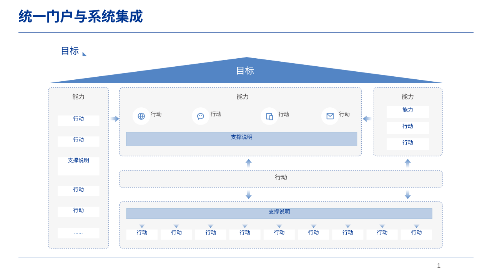

# 统一门户与系统集成

来源为房子图战略图.pptx#6。

## 结构与适用场景

屋顶；左开发平台、中央多端接入与统一门户、右监控BI；中部流程平台；下部ESB与8系统；多向接口箭头

系统接入、门户整合、应用集成

保留左中右角色、层内模块、平台总线与双向连接

固定节点、圆弧、扇区、分面和连接表达定性关系。数量比较、趋势或占比使用数据驱动图表，源页中已登记的微图槽可接收实际数据。

## 预览



## 调用

将下列完整page对象放入schema_version=1、template_id=business-blue-v1的pages数组，替换各节点内容。nodes键对应原文本框或已明确拆分的语义分段，字段角色及source_ref、segment见下表。

```json
{
  "id": "house-06",
  "family": "source-house",
  "variant": "page-06",
  "content": {
    "title": "统一门户与系统集成",
    "nodes": {
      "shape_90": "目标",
      "shape_91": "能力",
      "shape_92": "能力",
      "shape_93": "能力",
      "shape_94": "行动",
      "shape_95": "行动",
      "shape_96": "行动",
      "shape_97": "支撑说明",
      "shape_98": "行动",
      "shape_99": "行动",
      "shape_100": "行动",
      "shape_101": "行动",
      "shape_102": "行动",
      "shape_103": "行动",
      "shape_104": "行动",
      "shape_105": "行动",
      "shape_106": "行动",
      "shape_107": "行动",
      "shape_108": "行动",
      "shape_109": "行动",
      "shape_110": "行动",
      "shape_111": "能力",
      "shape_112": "支撑说明",
      "shape_113": "支撑说明",
      "shape_114": "行动",
      "shape_115": "行动",
      "shape_116": "行动",
      "shape_117": "行动",
      "shape_119": "目标"
    }
  },
  "config": {
    "show_source": true,
    "show_page_number": true
  }
}
```

config支持show_source、show_page_number、image_fit与image_position。image_fit可选contain或cover，image_position为xMin/xMid/xMax与YMin/YMid/YMax组合的九个焦点，默认为xMidYMid。字体、颜色、全局区和固定字阶取自tokens，节点数与连接结构由variant确定。

## 字段合同

每个业务节点required=true、min=1，max按具体框体登记。字符按规范化后的Unicode码点计数，空格标点换行均计入。build会以实际字体测量宽高，字符数通过后仍可能需要调整文字。

| 字段 | 节点角色与源标签 | 最短/最长 | 字阶 | 框体px | 原框引用 | 分段 | 旋转° | 垂直锚点 |
|---|---|---|---|---|---|---|---|---|
| nodes.shape_90 | 上左节点，源标签“优化” | 1/5 | body | [157.1721, 120, 61.7771, 35.3038] | slide:90 |  | 0.0 | t |
| nodes.shape_91 | 上左节点，源标签“敏捷开发平台应用” | 1/18 | caption | [136.5161, 243.9092, 135.316, 26.4733] | slide:91 |  | 0.0 | t |
| nodes.shape_92 | 上中节点，源标签“全方位用户接入” | 1/16 | caption | [570.9947, 243.9092, 120.6046, 26.4733] | slide:92 |  | 0.0 | t |
| nodes.shape_93 | 上右节点，源标签“流程监控预警平台（BI）” | 1/24 | caption | [971.3166, 243.9092, 179.1316, 26.4733] | slide:93 |  | 0.0 | t |
| nodes.shape_94 | 中中节点，源标签“统一流程运营平台” | 1/18 | caption | [663.1596, 454.4118, 135.316, 26.4733] | slide:94 |  | 0.0 | t |
| nodes.shape_95 | 中左节点，源标签“集团用户” | 1/11 | diagramCompact | [168.3787, 302.327, 71.5816, 25.0076] | slide:95 |  | 0.0 | t |
| nodes.shape_96 | 中左节点，源标签“子公司门户” | 1/13 | diagramCompact | [161.642, 357.1216, 85.0641, 25.0076] | slide:96 |  | 0.0 | t |
| nodes.shape_97 | 中左节点，源标签“公告/会议/车辆/设备点检...” | 1/30 | diagramCompact | [154.35, 410.8238, 99.3841, 46.7197] | slide:97 |  | 0.0 | t |
| nodes.shape_98 | 下左节点，源标签“流程中心” | 1/11 | diagramCompact | [168.3787, 486.9026, 71.5816, 25.0076] | slide:98 |  | 0.0 | t |
| nodes.shape_99 | 下左节点，源标签“应用敏捷开发” | 1/15 | diagramCompact | [154.8962, 541.151, 98.5465, 25.0076] | slide:99 |  | 0.0 | t |
| nodes.shape_100 | 下左节点，源标签“SAP” | 1/7 | diagramCompact | [347.046, 599.3321, 44.462, 25.0076] | slide:100 |  | 0.0 | t |
| nodes.shape_101 | 下中节点，源标签“浪潮财务” | 1/11 | diagramCompact | [423.1521, 599.3321, 71.5816, 25.0076] | slide:101 |  | 0.0 | t |
| nodes.shape_102 | 下中节点，源标签“浪潮财务” | 1/11 | diagramCompact | [512.5222, 599.3321, 71.5816, 25.0076] | slide:102 |  | 0.0 | t |
| nodes.shape_103 | 下中节点，源标签“CRM” | 1/7 | diagramCompact | [612.6073, 599.3321, 48.9046, 25.0076] | slide:103 |  | 0.0 | t |
| nodes.shape_104 | 下中节点，源标签“人力系统” | 1/11 | diagramCompact | [690.5341, 599.3321, 71.5816, 25.0076] | slide:104 |  | 0.0 | t |
| nodes.shape_105 | 下中节点，源标签“研发系统” | 1/11 | diagramCompact | [779.6493, 599.3321, 71.5816, 25.0076] | slide:105 |  | 0.0 | t |
| nodes.shape_106 | 下右节点，源标签“工程系统” | 1/11 | diagramCompact | [869.0558, 599.3321, 71.5816, 25.0076] | slide:106 |  | 0.0 | t |
| nodes.shape_107 | 下右节点，源标签“MES” | 1/7 | diagramCompact | [971.4987, 599.3321, 45.2267, 25.0076] | slide:107 |  | 0.0 | t |
| nodes.shape_108 | 下右节点，源标签“SRM…” | 1/9 | diagramCompact | [1052.6391, 599.3321, 61.4675, 25.0076] | slide:108 |  | 0.0 | t |
| nodes.shape_109 | 中右节点，源标签“统计分析” | 1/11 | diagramCompact | [1025.0916, 364.5319, 71.5816, 25.0076] | slide:109 |  | 0.0 | t |
| nodes.shape_110 | 中右节点，源标签“系统预警” | 1/11 | diagramCompact | [1025.0916, 321.7723, 71.5816, 25.0076] | slide:110 |  | 0.0 | t |
| nodes.shape_111 | 上右节点，源标签“流程监控” | 1/11 | diagramCompact | [1025.0916, 279.1947, 71.5816, 25.0076] | slide:111 |  | 0.0 | t |
| nodes.shape_112 | 中中节点，源标签“统一信息门户（单点登录、审批集成、消息推送）” | 1/49 | diagramCompact | [471.6106, 350.1391, 314.2655, 25.0076] | slide:112 |  | 0.0 | t |
| nodes.shape_113 | 下中节点，源标签“统一业务集成平台（ESB）” | 1/28 | diagramCompact | [637.4874, 544.7924, 178.2122, 25.0076] | slide:113 |  | 0.0 | t |
| nodes.shape_114 | 中左节点，源标签“浏览器” | 1/9 | diagramCompact | [392.209, 290.5287, 58.0992, 25.0076] | slide:114 |  | 0.0 | t |
| nodes.shape_115 | 中中节点，源标签“微信/APP” | 1/12 | diagramCompact | [547.7987, 290.0917, 77.3988, 25.0076] | slide:115 |  | 0.0 | t |
| nodes.shape_116 | 中中节点，源标签“智能设备” | 1/11 | diagramCompact | [724.4906, 290.5287, 71.5816, 25.0076] | slide:116 |  | 0.0 | t |
| nodes.shape_117 | 中右节点，源标签“邮件” | 1/7 | diagramCompact | [881.8737, 290.5287, 44.6168, 25.0076] | slide:117 |  | 0.0 | t |
| nodes.shape_119 | 上中节点，源标签“产品功能矩阵” | 1/26 | body | [492.5671, 171.6174, 289.1123, 35.3038] | slide:119 |  | 0.0 | t |

全局title必填、2至32码点，使用统一标题框。section_name可选0至24码点，source可选0至64码点。所有可编辑文本通过独立原生carrier导出，页码为派生文字。

## 来源处理

原生PPTX源件保存于用户材料目录，分发包仅含用户资产衍生的几何、字段和说明。原始逐框文字、源框与标准化框在page-catalog.json的variant.fields中。

源标题引用为`slide:88`，原文为“Design Optimization”。模板默认标题依据真实结构设置。

密集全景中的diagramCompact为14px、diagramMicro为12px。适用于体系概览或附录局部标签，现场关键结论用统一标题与正常正文字阶表达。

源画布边界裁切已烘焙为可编辑Bezier几何，3D顶面、侧面与前面通过tokens配色的相对明暗保留。

