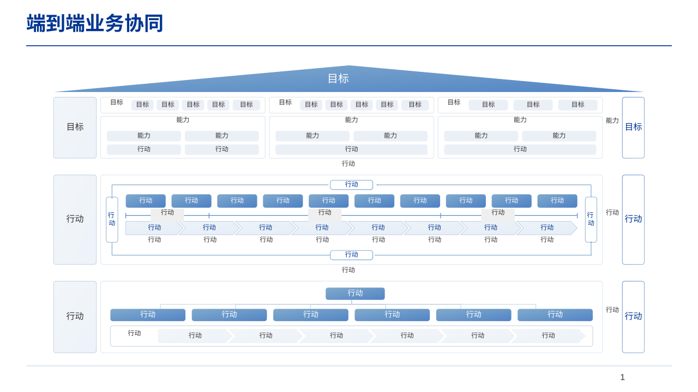

# 端到端业务协同

来源为房子图战略图.pptx#7。

## 结构与适用场景

屋顶；企业层3决策/赋能/风控中心；项目层全生命周期多角色横向流程；客户层营销/建造/透明/物业链；右侧数据回流栏

端到端数字业务架构

企业/项目/客户层与生命周期、数据生产/消费分开字段，结构密度高适合拆页

固定节点、圆弧、扇区、分面和连接表达定性关系。数量比较、趋势或占比使用数据驱动图表，源页中已登记的微图槽可接收实际数据。

## 预览



## 调用

将下列完整page对象放入schema_version=1、template_id=business-blue-v1的pages数组，替换各节点内容。nodes键对应原文本框或已明确拆分的语义分段，字段角色及source_ref、segment见下表。

```json
{
  "id": "house-07",
  "family": "source-house",
  "variant": "page-07",
  "content": {
    "title": "端到端业务协同",
    "nodes": {
      "shape_27": "目标",
      "shape_50": "目标",
      "shape_494": "目标",
      "shape_495": "目标",
      "shape_496": "目标",
      "shape_497": "目标",
      "shape_498": "目标",
      "shape_36": "目标",
      "shape_524": "目标",
      "shape_528": "目标",
      "shape_535": "目标",
      "shape_536": "目标",
      "shape_537": "目标",
      "shape_523": "目标",
      "shape_541": "目标",
      "shape_548": "能力",
      "shape_549": "能力",
      "shape_552": "行动",
      "shape_553": "行动",
      "shape_555": "能力",
      "shape_569": "能力",
      "shape_570": "能力",
      "shape_565": "行动",
      "shape_562": "能力",
      "shape_131": "能力",
      "shape_132": "能力",
      "shape_129": "行动",
      "shape_574": "能力",
      "shape_675": "目标",
      "shape_58": "行动",
      "shape_676": "行动",
      "shape_452": "行动",
      "shape_652": "行动",
      "shape_653": "行动",
      "shape_654": "行动",
      "shape_655": "行动",
      "shape_656": "行动",
      "shape_657": "行动",
      "shape_658": "行动",
      "shape_628": "行动",
      "shape_632": "行动",
      "shape_633": "行动",
      "shape_634": "行动",
      "shape_635": "行动",
      "shape_636": "行动",
      "shape_662": "行动",
      "shape_677": "行动",
      "shape_148": "行动",
      "shape_158": "行动",
      "shape_159": "行动",
      "shape_160": "行动",
      "shape_161": "行动",
      "shape_162": "行动",
      "shape_163": "行动",
      "shape_164": "行动",
      "shape_166": "行动",
      "shape_167": "行动",
      "shape_168": "行动",
      "shape_169": "行动",
      "shape_170": "行动",
      "shape_171": "行动",
      "shape_172": "行动",
      "shape_174": "行动",
      "shape_1045": "行动",
      "shape_1046": "行动",
      "shape_1064": "行动",
      "shape_1065": "行动",
      "shape_1067": "行动",
      "shape_1068": "行动",
      "shape_1070": "行动",
      "shape_1071": "行动",
      "shape_1073": "行动",
      "shape_1074": "行动",
      "shape_1085": "行动",
      "shape_576": "行动",
      "shape_579": "行动",
      "shape_580": "行动",
      "shape_686": "行动",
      "shape_688": "行动",
      "shape_692": "能力",
      "shape_693": "行动",
      "shape_694": "行动",
      "shape_31": "目标",
      "shape_32": "目标",
      "shape_33": "目标",
      "shape_53": "行动",
      "shape_54": "行动",
      "shape_55": "行动"
    }
  },
  "config": {
    "show_source": true,
    "show_page_number": true
  }
}
```

config支持show_source、show_page_number、image_fit与image_position。image_fit可选contain或cover，image_position为xMin/xMid/xMax与YMin/YMid/YMax组合的九个焦点，默认为xMidYMid。字体、颜色、全局区和固定字阶取自tokens，节点数与连接结构由variant确定。

## 字段合同

每个业务节点required=true、min=1，max按具体框体登记。字符按规范化后的Unicode码点计数，空格标点换行均计入。build会以实际字体测量宽高，字符数通过后仍可能需要调整文字。

| 字段 | 节点角色与源标签 | 最短/最长 | 字阶 | 框体px | 原框引用 | 分段 | 旋转° | 垂直锚点 |
|---|---|---|---|---|---|---|---|---|
| nodes.shape_27 | 上中节点，源标签“企业直达项目，项目直达客户” | 1/30 | compactBody | [484.4709, 133.6985, 270.9217, 32.1563] | slide:27 |  | 0.0 | t |
| nodes.shape_50 | 上左节点，源标签“企业层 / 平台化经营” | 1/50 | caption | [98.2969, 178.4676, 78.4545, 112.1036] | slide:50 |  | 0.0 | ctr |
| nodes.shape_494 | 上中节点，源标签“供应链” | 1/9 | diagramMicro | [426.4466, 183.1906, 50.6593, 19.8783] | slide:494 |  | 0.0 | ctr |
| nodes.shape_495 | 上左节点，源标签“组织” | 1/7 | diagramMicro | [380.0489, 183.1906, 40.797, 19.8783] | slide:495 |  | 0.0 | ctr |
| nodes.shape_496 | 上左节点，源标签“产品” | 1/7 | diagramMicro | [333.6512, 183.1906, 40.797, 19.8783] | slide:496 |  | 0.0 | ctr |
| nodes.shape_497 | 上左节点，源标签“财务” | 1/7 | diagramMicro | [287.2626, 183.1906, 40.797, 19.8783] | slide:497 |  | 0.0 | ctr |
| nodes.shape_498 | 上左节点，源标签“战略” | 1/7 | diagramMicro | [240.8649, 183.1906, 40.797, 19.8783] | slide:498 |  | 0.0 | ctr |
| nodes.shape_36 | 上左节点，源标签“创新视角” | 1/12 | diagramMicro | [180.2348, 181.4172, 67.1174, 23.416] | slide:36 |  | 0.0 | t |
| nodes.shape_524 | 上中节点，源标签“客户” | 1/9 | diagramMicro | [735.7405, 183.1906, 50.6593, 19.8783] | slide:524 |  | 0.0 | ctr |
| nodes.shape_528 | 上中节点，源标签“技术” | 1/7 | diagramMicro | [689.3518, 183.1906, 40.797, 19.8783] | slide:528 |  | 0.0 | ctr |
| nodes.shape_535 | 上中节点，源标签“人才” | 1/7 | diagramMicro | [642.9541, 183.1906, 40.797, 19.8783] | slide:535 |  | 0.0 | ctr |
| nodes.shape_536 | 上中节点，源标签“资金” | 1/7 | diagramMicro | [596.5564, 183.1906, 40.797, 19.8783] | slide:536 |  | 0.0 | ctr |
| nodes.shape_537 | 上中节点，源标签“土地” | 1/7 | diagramMicro | [550.1678, 183.1906, 40.797, 19.8783] | slide:537 |  | 0.0 | ctr |
| nodes.shape_523 | 上中节点，源标签“创新视角” | 1/12 | diagramMicro | [489.5377, 181.4172, 67.1174, 23.416] | slide:523 |  | 0.0 | t |
| nodes.shape_541 | 上中节点，源标签“生产要素” | 1/12 | diagramMicro | [798.8406, 181.4172, 67.1174, 23.416] | slide:541 |  | 0.0 | t |
| nodes.shape_548 | 上左节点，源标签“智能企业经营决策” | 1/25 | diagramMicro | [195.8968, 240.301, 136.0354, 19.4168] | slide:548 |  | 0.0 | ctr |
| nodes.shape_549 | 上左节点，源标签“智能资源交易决策” | 1/25 | diagramMicro | [338.8447, 240.301, 136.0354, 19.4168] | slide:549 |  | 0.0 | ctr |
| nodes.shape_552 | 上左节点，源标签“智能生产智慧决策” | 1/25 | diagramMicro | [195.8968, 265.1828, 136.0354, 19.4168] | slide:552 |  | 0.0 | ctr |
| nodes.shape_553 | 上左节点，源标签“智能客户运营决策” | 1/25 | diagramMicro | [338.8447, 265.1828, 136.0354, 19.4168] | slide:553 |  | 0.0 | ctr |
| nodes.shape_555 | 上左节点，源标签“数字决策中心” | 1/32 | diagramMicro | [246.8546, 213.6007, 177.0677, 23.416] | slide:555 |  | 0.0 | t |
| nodes.shape_569 | 上中节点，源标签“智能资源整合与统筹” | 1/25 | diagramMicro | [505.1997, 240.301, 136.0354, 19.4168] | slide:569 |  | 0.0 | ctr |
| nodes.shape_570 | 上中节点，源标签“智能专家支持与指引” | 1/25 | diagramMicro | [648.1476, 240.301, 136.0354, 19.4168] | slide:570 |  | 0.0 | ctr |
| nodes.shape_565 | 上中节点，源标签“数字知识沉淀与传递” | 1/51 | diagramMicro | [505.1997, 265.1828, 278.9833, 19.4168] | slide:565 |  | 0.0 | ctr |
| nodes.shape_562 | 上中节点，源标签“数字赋能中心” | 1/32 | diagramMicro | [556.1575, 213.6007, 177.0677, 23.416] | slide:562 |  | 0.0 | t |
| nodes.shape_131 | 上中节点，源标签“智能经营监管与审计” | 1/25 | diagramMicro | [814.4935, 240.301, 136.0354, 19.4168] | slide:131 |  | 0.0 | ctr |
| nodes.shape_132 | 上右节点，源标签“智能财务监控与审计” | 1/25 | diagramMicro | [957.4505, 240.301, 136.0354, 19.4168] | slide:132 |  | 0.0 | ctr |
| nodes.shape_129 | 上中节点，源标签“智能舆情监管与审计” | 1/51 | diagramMicro | [814.4935, 265.1828, 278.9833, 19.4168] | slide:129 |  | 0.0 | ctr |
| nodes.shape_574 | 上右节点，源标签“数字风控中心” | 1/32 | diagramMicro | [865.4604, 213.6007, 177.0677, 23.416] | slide:574 |  | 0.0 | t |
| nodes.shape_675 | 上右节点，源标签“经营 / 数据” | 1/25 | caption | [1141.2498, 178.4676, 40.4442, 112.1036] | slide:675 |  | 0.0 | ctr |
| nodes.shape_58 | 中左节点，源标签“项目层 / 精细化管理” | 1/80 | caption | [98.2969, 321.2618, 78.4545, 164.4549] | slide:58 |  | 0.0 | ctr |
| nodes.shape_676 | 中右节点，源标签“产品数据” | 1/40 | caption | [1141.2498, 321.2618, 40.4442, 164.4549] | slide:676 |  | 0.0 | ctr |
| nodes.shape_452 | 下左节点，源标签“客户层 / 精细化运营” | 1/60 | caption | [98.2969, 516.4072, 78.4545, 131.5928] | slide:452 |  | 0.0 | ctr |
| nodes.shape_652 | 下中节点，源标签“成功客户体验” | 1/17 | diagramCompact | [597.2803, 528.2328, 108.3759, 22.5203] | slide:652 |  | 0.0 | ctr |
| nodes.shape_653 | 下左节点，源标签“数字洞见管理” | 1/21 | diagramCompact | [202.366, 567.3559, 137.7454, 22.5203] | slide:653 |  | 0.0 | ctr |
| nodes.shape_654 | 下左节点，源标签“柔性定制管理” | 1/21 | diagramCompact | [351.7471, 567.3559, 137.7454, 22.5203] | slide:654 |  | 0.0 | ctr |
| nodes.shape_655 | 下中节点，源标签“透明建造管理” | 1/21 | diagramCompact | [501.1281, 567.3559, 137.7454, 22.5203] | slide:655 |  | 0.0 | ctr |
| nodes.shape_656 | 下中节点，源标签“个性营销管理” | 1/21 | diagramCompact | [650.5092, 567.3559, 137.7454, 22.5203] | slide:656 |  | 0.0 | ctr |
| nodes.shape_657 | 下中节点，源标签“智能营运管理” | 1/21 | diagramCompact | [799.8811, 567.3559, 137.7454, 22.5203] | slide:657 |  | 0.0 | ctr |
| nodes.shape_658 | 下右节点，源标签“智慧人居管理” | 1/21 | diagramCompact | [949.2622, 567.3559, 137.7454, 22.5203] | slide:658 |  | 0.0 | ctr |
| nodes.shape_628 | 下左节点，源标签“需求” | 1/25 | diagramMicro | [290.4565, 604.9319, 135.0763, 24.6284] | slide:628 |  | 0.0 | ctr |
| nodes.shape_632 | 下中节点，源标签“推荐” | 1/25 | diagramMicro | [420.0045, 604.9319, 135.0763, 24.6284] | slide:632 |  | 0.0 | ctr |
| nodes.shape_633 | 下中节点，源标签“配置” | 1/25 | diagramMicro | [549.5616, 604.9319, 135.0763, 24.6284] | slide:633 |  | 0.0 | ctr |
| nodes.shape_634 | 下中节点，源标签“体验” | 1/25 | diagramMicro | [679.1187, 604.9319, 135.0763, 24.6284] | slide:634 |  | 0.0 | ctr |
| nodes.shape_635 | 下中节点，源标签“购买” | 1/25 | diagramMicro | [808.6667, 604.9319, 135.0763, 24.6284] | slide:635 |  | 0.0 | ctr |
| nodes.shape_636 | 下右节点，源标签“使用” | 1/25 | diagramMicro | [938.2237, 604.9319, 135.0763, 24.6284] | slide:636 |  | 0.0 | ctr |
| nodes.shape_662 | 下左节点，源标签“全链路触点” | 1/16 | diagramMicro | [202.366, 605.5381, 88.0905, 23.416] | slide:662 |  | 0.0 | t |
| nodes.shape_677 | 下右节点，源标签“客户数据” | 1/30 | caption | [1141.2498, 516.4072, 40.4442, 131.5928] | slide:677 |  | 0.0 | ctr |
| nodes.shape_148 | 中左节点，源标签“数字投拓” | 1/19 | diagramMicro | [230.6589, 406.5293, 105.4263, 24.6284] | slide:148 |  | 0.0 | ctr |
| nodes.shape_158 | 中左节点，源标签“规划设计” | 1/20 | diagramMicro | [328.3582, 406.5293, 110.9546, 24.6284] | slide:158 |  | 0.0 | ctr |
| nodes.shape_159 | 中中节点，源标签“招标采购” | 1/20 | diagramMicro | [431.5949, 406.5293, 110.9546, 24.6284] | slide:159 |  | 0.0 | ctr |
| nodes.shape_160 | 中中节点，源标签“施工建造” | 1/20 | diagramMicro | [534.8225, 406.5293, 110.9546, 24.6284] | slide:160 |  | 0.0 | ctr |
| nodes.shape_161 | 中中节点，源标签“竣工交付” | 1/20 | diagramMicro | [638.0592, 406.5293, 110.9546, 24.6284] | slide:161 |  | 0.0 | ctr |
| nodes.shape_162 | 中中节点，源标签“市场销售” | 1/20 | diagramMicro | [741.2959, 406.5293, 110.9546, 24.6284] | slide:162 |  | 0.0 | ctr |
| nodes.shape_163 | 中右节点，源标签“商业管理” | 1/20 | diagramMicro | [844.5326, 406.5293, 110.9546, 24.6284] | slide:163 |  | 0.0 | ctr |
| nodes.shape_164 | 中右节点，源标签“物业运营” | 1/20 | diagramMicro | [947.7602, 406.5293, 110.9546, 24.6284] | slide:164 |  | 0.0 | ctr |
| nodes.shape_166 | 中左节点，源标签“投资方” | 1/9 | diagramMicro | [258.1555, 433.6549, 50.4331, 23.416] | slide:166 |  | 0.0 | t |
| nodes.shape_167 | 中左节点，源标签“设计方” | 1/9 | diagramMicro | [360.0621, 433.6549, 50.4331, 23.416] | slide:167 |  | 0.0 | t |
| nodes.shape_168 | 中中节点，源标签“咨询方” | 1/9 | diagramMicro | [463.0545, 433.6549, 50.4331, 23.416] | slide:168 |  | 0.0 | t |
| nodes.shape_169 | 中中节点，源标签“监理方” | 1/9 | diagramMicro | [566.0469, 433.6549, 50.4331, 23.416] | slide:169 |  | 0.0 | t |
| nodes.shape_170 | 中中节点，源标签“施工方” | 1/9 | diagramMicro | [669.0393, 433.6549, 50.4331, 23.416] | slide:170 |  | 0.0 | t |
| nodes.shape_171 | 中中节点，源标签“供应方” | 1/9 | diagramMicro | [772.0407, 433.6549, 50.4331, 23.416] | slide:171 |  | 0.0 | t |
| nodes.shape_172 | 中右节点，源标签“销代方” | 1/9 | diagramMicro | [875.0331, 433.6549, 50.4331, 23.416] | slide:172 |  | 0.0 | t |
| nodes.shape_174 | 中右节点，源标签“运营方” | 1/9 | diagramMicro | [978.0255, 433.6549, 50.4331, 23.416] | slide:174 |  | 0.0 | t |
| nodes.shape_1045 | 中左节点，源标签“数字投拓” | 1/13 | diagramMicro | [230.6589, 356.9286, 73.1433, 24.6284] | slide:1045 |  | 0.0 | ctr |
| nodes.shape_1046 | 中左节点，源标签“数字投拓” | 1/13 | diagramMicro | [314.5421, 356.9286, 73.1433, 24.6284] | slide:1046 |  | 0.0 | ctr |
| nodes.shape_1064 | 中左节点，源标签“数字投拓” | 1/13 | diagramMicro | [398.4162, 356.9286, 73.1433, 24.6284] | slide:1064 |  | 0.0 | ctr |
| nodes.shape_1065 | 中中节点，源标签“数字投拓” | 1/13 | diagramMicro | [482.2994, 356.9286, 73.1433, 24.6284] | slide:1065 |  | 0.0 | ctr |
| nodes.shape_1067 | 中中节点，源标签“数字投拓” | 1/13 | diagramMicro | [566.1826, 356.9286, 73.1433, 24.6284] | slide:1067 |  | 0.0 | ctr |
| nodes.shape_1068 | 中中节点，源标签“数字投拓” | 1/13 | diagramMicro | [650.0568, 356.9286, 73.1433, 24.6284] | slide:1068 |  | 0.0 | ctr |
| nodes.shape_1070 | 中中节点，源标签“数字投拓” | 1/13 | diagramMicro | [733.94, 356.9286, 73.1433, 24.6284] | slide:1070 |  | 0.0 | ctr |
| nodes.shape_1071 | 中中节点，源标签“数字投拓” | 1/13 | diagramMicro | [817.8232, 356.9286, 73.1433, 24.6284] | slide:1071 |  | 0.0 | ctr |
| nodes.shape_1073 | 中右节点，源标签“数字投拓” | 1/13 | diagramMicro | [901.6973, 356.9286, 73.1433, 24.6284] | slide:1073 |  | 0.0 | ctr |
| nodes.shape_1074 | 中右节点，源标签“数字投拓” | 1/13 | diagramMicro | [985.5805, 356.9286, 73.1433, 24.6284] | slide:1074 |  | 0.0 | ctr |
| nodes.shape_1085 | 中左节点，源标签“企项联动” | 1/15 | diagramMicro | [194.7567, 361.8326, 21.335, 83.3041] | slide:1085 |  | 0.0 | ctr |
| nodes.shape_576 | 中右节点，源标签“数据驱动” | 1/15 | diagramMicro | [1073.291, 361.8326, 21.335, 83.3041] | slide:576 |  | 0.0 | ctr |
| nodes.shape_579 | 中中节点，源标签“业务前置” | 1/14 | diagramMicro | [605.7039, 331.1149, 77.9659, 17.0915] | slide:579 |  | 0.0 | ctr |
| nodes.shape_580 | 中中节点，源标签“甲乙联动” | 1/14 | diagramMicro | [605.7039, 460.102, 77.9659, 17.0915] | slide:580 |  | 0.0 | ctr |
| nodes.shape_686 | 中中节点，源标签“企项联动（企项一体）” | 1/23 | diagramMicro | [575.2758, 294.2085, 127.1775, 23.416] | slide:686 |  | 0.0 | t |
| nodes.shape_688 | 下中节点，源标签“客企互a动（甲乙联动）” | 1/24 | diagramMicro | [572.3804, 489.3539, 132.9591, 23.416] | slide:688 |  | 0.0 | t |
| nodes.shape_692 | 上右节点，源标签“数据赋能” | 1/14 | diagramMicro | [1101.5838, 214.9217, 42.8781, 39.2046] | slide:692 |  | 0.0 | t |
| nodes.shape_693 | 中右节点，源标签“数据赋能” | 1/14 | diagramMicro | [1101.5838, 383.8914, 42.8781, 39.2046] | slide:693 |  | 0.0 | t |
| nodes.shape_694 | 下右节点，源标签“数据赋能” | 1/14 | diagramMicro | [1101.5838, 562.6058, 42.8781, 39.2046] | slide:694 |  | 0.0 | t |
| nodes.shape_31 | 上右节点，源标签“合作方” | 1/13 | diagramMicro | [1023.5546, 183.1906, 72.1481, 19.8783] | slide:31 |  | 0.0 | ctr |
| nodes.shape_32 | 上右节点，源标签“设备” | 1/13 | diagramMicro | [941.5081, 183.1906, 72.1481, 19.8783] | slide:32 |  | 0.0 | ctr |
| nodes.shape_33 | 上右节点，源标签“物料” | 1/13 | diagramMicro | [859.4616, 183.1906, 72.1481, 19.8783] | slide:33 |  | 0.0 | ctr |
| nodes.shape_53 | 中左节点，源标签“数字前策” | 1/11 | diagramMicro | [276.3146, 383.6109, 61.3991, 23.416] | slide:53 |  | 0.0 | t |
| nodes.shape_54 | 中中节点，源标签“数字前策” | 1/11 | diagramMicro | [564.9883, 383.6109, 61.3991, 23.416] | slide:54 |  | 0.0 | t |
| nodes.shape_55 | 中右节点，源标签“数字前策” | 1/11 | diagramMicro | [882.6876, 383.6109, 61.3991, 23.416] | slide:55 |  | 0.0 | t |

全局title必填、2至32码点，使用统一标题框。section_name可选0至24码点，source可选0至64码点。所有可编辑文本通过独立原生carrier导出，页码为派生文字。

## 来源处理

原生PPTX源件保存于用户材料目录，分发包仅含用户资产衍生的几何、字段和说明。原始逐框文字、源框与标准化框在page-catalog.json的variant.fields中。

源标题引用为`slide:184`，原文为“房型图”。模板默认标题依据真实结构设置。

密集全景中的diagramCompact为14px、diagramMicro为12px。适用于体系概览或附录局部标签，现场关键结论用统一标题与正常正文字阶表达。

源画布边界裁切已烘焙为可编辑Bezier几何，3D顶面、侧面与前面通过tokens配色的相对明暗保留。

