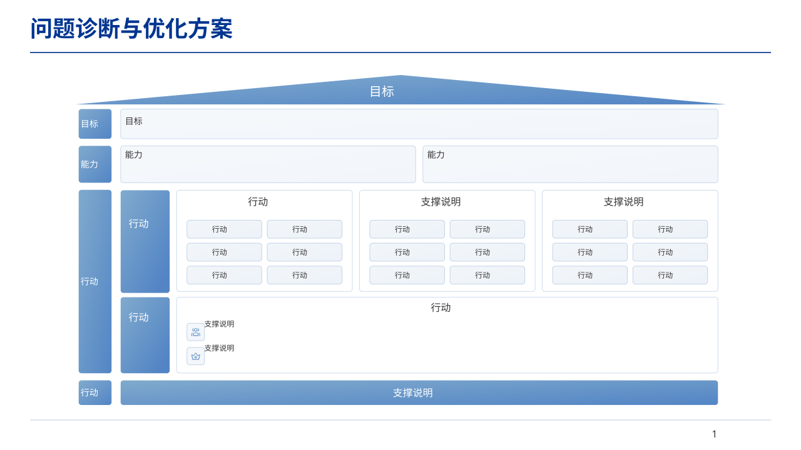

# 问题诊断与优化方案

来源为房子图战略图.pptx#8。

## 结构与适用场景

屋顶目标；背景行；两痛点；3项产品体验优化及各6细项；一条定制营销说明；底部收获

问题-动作-预期收益方案

保留痛点到各动作的对应与实际证据，假设背景不可当报告事实

固定节点、圆弧、扇区、分面和连接表达定性关系。数量比较、趋势或占比使用数据驱动图表，源页中已登记的微图槽可接收实际数据。

## 预览



## 调用

将下列完整page对象放入schema_version=1、template_id=business-blue-v1的pages数组，替换各节点内容。nodes键对应原文本框或已明确拆分的语义分段，字段角色及source_ref、segment见下表。

```json
{
  "id": "house-08",
  "family": "source-house",
  "variant": "page-08",
  "content": {
    "title": "问题诊断与优化方案",
    "nodes": {
      "shape_5": "目标",
      "shape_49": "行动",
      "shape_71": "能力",
      "shape_33": "能力",
      "shape_34": "能力",
      "shape_25": "目标",
      "shape_35": "目标",
      "shape_78": "行动",
      "shape_132": "行动",
      "shape_84": "行动",
      "shape_94": "支撑说明",
      "shape_110": "支撑说明",
      "shape_149": "支撑说明",
      "shape_160": "支撑说明",
      "shape_50": "支撑说明",
      "shape_103": "行动",
      "shape_98": "行动",
      "shape_90": "行动",
      "shape_88": "行动",
      "shape_102": "行动",
      "shape_116": "行动",
      "shape_114": "行动",
      "shape_99": "行动",
      "shape_91": "行动",
      "shape_89": "行动",
      "shape_104": "行动",
      "shape_118": "行动",
      "shape_115": "行动",
      "shape_216": "行动",
      "shape_217": "行动",
      "shape_218": "行动",
      "shape_219": "行动",
      "shape_220": "行动",
      "shape_221": "行动",
      "shape_20": "行动"
    }
  },
  "config": {
    "show_source": true,
    "show_page_number": true
  }
}
```

config支持show_source、show_page_number、image_fit与image_position。image_fit可选contain或cover，image_position为xMin/xMid/xMax与YMin/YMid/YMax组合的九个焦点，默认为xMidYMid。字体、颜色、全局区和固定字阶取自tokens，节点数与连接结构由variant确定。

## 字段合同

每个业务节点required=true、min=1，max按具体框体登记。字符按规范化后的Unicode码点计数，空格标点换行均计入。build会以实际字体测量宽高，字符数通过后仍可能需要调整文字。

| 字段 | 节点角色与源标签 | 最短/最长 | 字阶 | 框体px | 原框引用 | 分段 | 旋转° | 垂直锚点 |
|---|---|---|---|---|---|---|---|---|
| nodes.shape_5 | 上中节点，源标签“提升用户体验与转化率，实现销售额增长” | 1/39 | compactBody | [445.8572, 134.8335, 353.7959, 30.8835] | slide:5 |  | 0.0 | t |
| nodes.shape_49 | 下左节点，源标签“收获” | 1/16 | diagramCompact | [125.7168, 608.5657, 52.5211, 39.4342] | slide:49 |  | 0.0 | ctr |
| nodes.shape_71 | 上左节点，源标签“痛点” | 1/24 | diagramCompact | [125.7168, 233.393, 52.5211, 58.9949] | slide:71 |  | 0.0 | ctr |
| nodes.shape_33 | 上左节点，源标签“公司面临着来自其他电商平台和线下实体店的竞争压力，导致销售额 / 增长缓慢。” | 1/144 | diagramCompact | [199.7451, 239.1109, 457.6301, 47.5592] | slide:33 |  | 0.0 | t |
| nodes.shape_34 | 上中节点，源标签“尽管公司拥有大量访客流量，但用户转化为付费客户的比例较低， / 需要提高用户的购买意” | 1/144 | diagramCompact | [682.7146, 239.1109, 457.6301, 47.5592] | slide:34 |  | 0.0 | t |
| nodes.shape_25 | 上左节点，源标签“背景” | 1/16 | diagramCompact | [125.7168, 174.4589, 52.5211, 47.5679] | slide:25 |  | 0.0 | ctr |
| nodes.shape_35 | 上中节点，源标签“假设背景是一家电子商务公司，该公司销售各类产品，包括电子设备、家居用品等。目前公” | 1/147 | diagramCompact | [199.7451, 185.521, 928.6164, 25.4437] | slide:35 |  | 0.0 | t |
| nodes.shape_78 | 中左节点，源标签“解法” | 1/136 | diagramCompact | [125.7168, 303.7542, 52.5211, 293.454] | slide:78 |  | 0.0 | ctr |
| nodes.shape_132 | 下左节点，源标签“定制 / 营销 / 策略” | 1/27 | caption | [197.2077, 497.5364, 69.5096, 77.6345] | slide:132 |  | 0.0 | t |
| nodes.shape_84 | 中左节点，源标签“优化网站页面加载速度” | 1/28 | caption | [320.2985, 312.5222, 204.7661, 30.4664] | slide:84 |  | 0.0 | t |
| nodes.shape_94 | 中中节点，源标签“更清晰、直观的信息和图片展示” | 1/36 | caption | [582.4085, 312.5222, 264.7864, 30.4664] | slide:94 |  | 0.0 | t |
| nodes.shape_110 | 中右节点，源标签“改进购物流程，简化结账过程” | 1/33 | caption | [885.3083, 312.5222, 243.2358, 30.4664] | slide:110 |  | 0.0 | t |
| nodes.shape_149 | 下中节点，源标签“通过收集用户注册信息、购买记录和浏览行为等丰富的数据，企业可以利用数据分析工具进” | 1/300 | diagramMicro | [326.3466, 510.6145, 815.1452, 40.1034] | slide:149 |  | 0.0 | t |
| nodes.shape_160 | 下中节点，源标签“根据用户的购买频次或金额设置会员等级制度，可以为企业增加用户忠诚度和参与度。会员” | 1/300 | diagramMicro | [326.3466, 549.2232, 812.182, 40.1034] | slide:160 |  | 0.0 | t |
| nodes.shape_50 | 下中节点，源标签“数据驱动决策、用户体验优化和品牌口碑营销来实现个性化营销，以更好地满足用户需求和” | 1/132 | caption | [192.7759, 608.6092, 954.5207, 39.3473] | slide:50 |  | 0.0 | ctr |
| nodes.shape_103 | 中左节点，源标签“改善用户体验” | 1/21 | caption | [203.9249, 347.7158, 56.0839, 77.6345] | slide:103 |  | 0.0 | t |
| nodes.shape_98 | 中中节点，源标签“规格参数表” | 1/22 | diagramMicro | [719.1857, 352.304, 119.4672, 28.7458] | slide:98 |  | 0.0 | ctr |
| nodes.shape_90 | 中左节点，源标签“压缩图片大小” | 1/22 | diagramMicro | [298.826, 352.304, 119.4672, 28.7458] | slide:90 |  | 0.0 | ctr |
| nodes.shape_88 | 中中节点，源标签“减少HTTP请求” | 1/22 | diagramMicro | [427.0612, 352.304, 119.4672, 28.7458] | slide:88 |  | 0.0 | ctr |
| nodes.shape_102 | 中中节点，源标签“详细产品描述” | 1/22 | diagramMicro | [590.9505, 352.304, 119.4672, 28.7458] | slide:102 |  | 0.0 | ctr |
| nodes.shape_116 | 中右节点，源标签“简化注册流程” | 1/22 | diagramMicro | [883.075, 352.304, 119.4672, 28.7458] | slide:116 |  | 0.0 | ctr |
| nodes.shape_114 | 中右节点，源标签“购物车页面清晰” | 1/22 | diagramMicro | [1011.3101, 352.304, 119.4672, 28.7458] | slide:114 |  | 0.0 | ctr |
| nodes.shape_99 | 中中节点，源标签“提供多角度展示” | 1/22 | diagramMicro | [719.1857, 389.0705, 119.4672, 28.7458] | slide:99 |  | 0.0 | ctr |
| nodes.shape_91 | 中左节点，源标签“使用浏览器缓存” | 1/22 | diagramMicro | [298.826, 389.0705, 119.4672, 28.7458] | slide:91 |  | 0.0 | ctr |
| nodes.shape_89 | 中中节点，源标签“使用延迟加载” | 1/22 | diagramMicro | [427.0612, 389.0705, 119.4672, 28.7458] | slide:89 |  | 0.0 | ctr |
| nodes.shape_104 | 中中节点，源标签“高质量产品图片” | 1/22 | diagramMicro | [590.9505, 389.0705, 119.4672, 28.7458] | slide:104 |  | 0.0 | ctr |
| nodes.shape_118 | 中右节点，源标签“简化结算流程” | 1/22 | diagramMicro | [883.075, 389.0705, 119.4672, 28.7458] | slide:118 |  | 0.0 | ctr |
| nodes.shape_115 | 中右节点，源标签“提供订单跟踪” | 1/22 | diagramMicro | [1011.3101, 389.0705, 119.4672, 28.7458] | slide:115 |  | 0.0 | ctr |
| nodes.shape_216 | 中中节点，源标签“提供多角度展示” | 1/22 | diagramMicro | [719.1857, 425.837, 119.4672, 28.7458] | slide:216 |  | 0.0 | ctr |
| nodes.shape_217 | 中左节点，源标签“使用浏览器缓存” | 1/22 | diagramMicro | [298.826, 425.837, 119.4672, 28.7458] | slide:217 |  | 0.0 | ctr |
| nodes.shape_218 | 中中节点，源标签“使用延迟加载” | 1/22 | diagramMicro | [427.0612, 425.837, 119.4672, 28.7458] | slide:218 |  | 0.0 | ctr |
| nodes.shape_219 | 中中节点，源标签“高质量产品图片” | 1/22 | diagramMicro | [590.9505, 425.837, 119.4672, 28.7458] | slide:219 |  | 0.0 | ctr |
| nodes.shape_220 | 中右节点，源标签“简化结算流程” | 1/22 | diagramMicro | [883.075, 425.837, 119.4672, 28.7458] | slide:220 |  | 0.0 | ctr |
| nodes.shape_221 | 中右节点，源标签“提供订单跟踪” | 1/22 | diagramMicro | [1011.3101, 425.837, 119.4672, 28.7458] | slide:221 |  | 0.0 | ctr |
| nodes.shape_20 | 下中节点，源标签“优化网站页面加载速度” | 1/28 | caption | [612.423, 481.8774, 204.7661, 30.4664] | slide:20 |  | 0.0 | t |

全局title必填、2至32码点，使用统一标题框。section_name可选0至24码点，source可选0至64码点。所有可编辑文本通过独立原生carrier导出，页码为派生文字。

## 来源处理

原生PPTX源件保存于用户材料目录，分发包仅含用户资产衍生的几何、字段和说明。原始逐框文字、源框与标准化框在page-catalog.json的variant.fields中。

源标题引用为`slide:61`，原文为“房型图”。模板默认标题依据真实结构设置。

密集全景中的diagramCompact为14px、diagramMicro为12px。适用于体系概览或附录局部标签，现场关键结论用统一标题与正常正文字阶表达。

源画布边界裁切已烘焙为可编辑Bezier几何，3D顶面、侧面与前面通过tokens配色的相对明暗保留。

