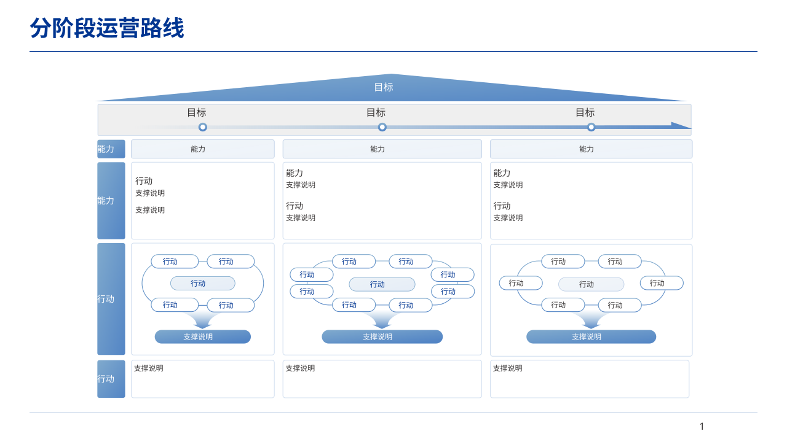

# 分阶段运营路线

来源为房子图战略图.pptx#9。

## 结构与适用场景

屋顶总规划；起步/运营/变革3阶段水平箭头；每阶段目标、策略、能力图、持续改进4层

分阶段运营路线图

阶段时间与指标需来源；支持每阶段不同节点数，能力图不能被降成正文

固定节点、圆弧、扇区、分面和连接表达定性关系。数量比较、趋势或占比使用数据驱动图表，源页中已登记的微图槽可接收实际数据。

## 预览



## 调用

将下列完整page对象放入schema_version=1、template_id=business-blue-v1的pages数组，替换各节点内容。nodes键对应原文本框或已明确拆分的语义分段，字段角色及source_ref、segment见下表。

```json
{
  "id": "house-09",
  "family": "source-house",
  "variant": "page-09",
  "content": {
    "title": "分阶段运营路线",
    "nodes": {
      "shape_184": "目标",
      "shape_55": "目标",
      "shape_56": "目标",
      "shape_57": "目标",
      "shape_13": "能力",
      "shape_14": "能力",
      "shape_15": "能力",
      "shape_479": "能力",
      "shape_484": "行动",
      "shape_482": "能力",
      "shape_144": "行动",
      "shape_145": "支撑说明",
      "shape_149": "支撑说明",
      "shape_156": "能力",
      "shape_157": "支撑说明",
      "shape_174": "行动",
      "shape_175": "支撑说明",
      "shape_512": "能力",
      "shape_513": "支撑说明",
      "shape_515": "行动",
      "shape_516": "支撑说明",
      "shape_483": "行动",
      "shape_461": "行动",
      "shape_465": "行动",
      "shape_467": "行动",
      "shape_468": "行动",
      "shape_469": "行动",
      "shape_473": "行动",
      "shape_474": "行动",
      "shape_475": "行动",
      "shape_476": "行动",
      "shape_481": "支撑说明",
      "shape_485": "行动",
      "shape_488": "行动",
      "shape_489": "行动",
      "shape_490": "行动",
      "shape_491": "行动",
      "shape_492": "行动",
      "shape_498": "支撑说明",
      "shape_503": "行动",
      "shape_504": "行动",
      "shape_505": "行动",
      "shape_506": "行动",
      "shape_130": "行动",
      "shape_132": "行动",
      "shape_523": "支撑说明",
      "shape_486": "支撑说明",
      "shape_535": "支撑说明",
      "shape_541": "支撑说明"
    }
  },
  "config": {
    "show_source": true,
    "show_page_number": true
  }
}
```

config支持show_source、show_page_number、image_fit与image_position。image_fit可选contain或cover，image_position为xMin/xMid/xMax与YMin/YMid/YMax组合的九个焦点，默认为xMidYMid。字体、颜色、全局区和固定字阶取自tokens，节点数与连接结构由variant确定。

## 字段合同

每个业务节点required=true、min=1，max按具体框体登记。字符按规范化后的Unicode码点计数，空格标点换行均计入。build会以实际字体测量宽高，字符数通过后仍可能需要调整文字。

| 字段 | 节点角色与源标签 | 最短/最长 | 字阶 | 框体px | 原框引用 | 分段 | 旋转° | 垂直锚点 |
|---|---|---|---|---|---|---|---|---|
| nodes.shape_184 | 上中节点，源标签“下一年度规划-稳扎稳打三步走” | 1/35 | caption | [505.2691, 131.7381, 257.7319, 29.5449] | slide:184 |  | 0.0 | t |
| nodes.shape_55 | 上左节点，源标签“起步阶段” | 1/11 | caption | [288.9865, 172.9879, 81.7347, 27.0094] | slide:55 |  | 0.0 | t |
| nodes.shape_56 | 上中节点，源标签“运营阶段” | 1/11 | caption | [581.8663, 172.9879, 79.3571, 27.0094] | slide:56 |  | 0.0 | t |
| nodes.shape_57 | 上右节点，源标签“变革阶段” | 1/11 | caption | [922.0894, 172.9879, 79.3571, 27.0094] | slide:57 |  | 0.0 | t |
| nodes.shape_13 | 上左节点，源标签“提高销售额：增加产品销售额10%。” | 1/86 | diagramMicro | [213.5199, 227.655, 232.6761, 30.1683] | slide:13 |  | 0.0 | ctr |
| nodes.shape_14 | 上中节点，源标签“提升用户满意度：提高客户满意度评分至85%以上。” | 1/118 | diagramMicro | [460.1621, 227.655, 323.3557, 30.1683] | slide:14 |  | 0.0 | ctr |
| nodes.shape_15 | 上中节点，源标签“扩大市场份额：增加市场份额2%。” | 1/120 | diagramMicro | [797.4839, 227.655, 328.5764, 30.1683] | slide:15 |  | 0.0 | ctr |
| nodes.shape_479 | 上左节点，源标签“目标” | 1/7 | diagramCompact | [158.329, 227.655, 45.2234, 30.1683] | slide:479 |  | 0.0 | ctr |
| nodes.shape_484 | 下左节点，源标签“持续改进” | 1/21 | diagramCompact | [158.329, 586.7572, 45.2234, 61.2345] | slide:484 |  | 0.0 | ctr |
| nodes.shape_482 | 上左节点，源标签“策略规划” | 1/49 | diagramCompact | [158.329, 264.2743, 45.2234, 125.3038] | slide:482 |  | 0.0 | ctr |
| nodes.shape_144 | 中左节点，源标签“市场推广策略” | 1/15 | diagramCompact | [220.0457, 286.4371, 96.7066, 24.1746] | slide:144 |  | 0.0 | t |
| nodes.shape_145 | 中左节点，源标签“制定全年市场推广计划，包括线上广告、社交媒体宣传等，以吸引更多潜在客户。” | 1/80 | diagramMicro | [220.0457, 306.8292, 217.0142, 32.9034] | slide:145 |  | 0.0 | t |
| nodes.shape_149 | 中左节点，源标签“与品牌合作伙伴建立战略合作关系，增强品牌知名度和影响力。 ” | 1/80 | diagramMicro | [220.0457, 334.4953, 220.0319, 32.9034] | slide:149 |  | 0.0 | t |
| nodes.shape_156 | 上中节点，源标签“社交媒体推广” | 1/15 | diagramCompact | [465.0253, 273.3855, 96.7066, 24.1746] | slide:156 |  | 0.0 | t |
| nodes.shape_157 | 中中节点，源标签“通过在主要社交媒体平台上创建和分享有趣、有价值的内容，吸引潜在用户的注意，并鼓励” | 1/116 | diagramMicro | [465.0253, 293.4035, 316.8299, 32.9034] | slide:157 |  | 0.0 | t |
| nodes.shape_174 | 中中节点，源标签“口碑营销” | 1/11 | diagramCompact | [465.0253, 327.1548, 69.8386, 24.1746] | slide:174 |  | 0.0 | t |
| nodes.shape_175 | 中中节点，源标签“提供卓越的产品和服务，以激发用户口碑传播。满足用户需求并提供出色的用户体验，以使” | 1/116 | diagramMicro | [465.0253, 347.1729, 316.8299, 32.9034] | slide:175 |  | 0.0 | t |
| nodes.shape_512 | 上中节点，源标签“产品创新和差异化” | 1/19 | diagramCompact | [802.3471, 273.3855, 123.5663, 24.1746] | slide:512 |  | 0.0 | t |
| nodes.shape_513 | 中中节点，源标签“进行市场调研，了解用户未满足的需求，开发符合市场需求的新产品或服务，提升市场竞争” | 1/116 | diagramMicro | [802.3471, 293.4035, 316.8299, 32.9034] | slide:513 |  | 0.0 | t |
| nodes.shape_515 | 中中节点，源标签“产品改进和更新” | 1/17 | diagramCompact | [802.3471, 327.1548, 110.1323, 24.1746] | slide:515 |  | 0.0 | t |
| nodes.shape_516 | 中中节点，源标签“基于用户需求和市场趋势，持续进行产品功能的更新和升级，提供更好的用户体验和附加价” | 1/116 | diagramMicro | [802.3471, 347.1729, 316.8299, 32.9034] | slide:516 |  | 0.0 | t |
| nodes.shape_483 | 中左节点，源标签“解决方案” | 1/70 | diagramCompact | [158.329, 396.0208, 45.2234, 182.2736] | slide:483 |  | 0.0 | ctr |
| nodes.shape_461 | 中中节点，源标签“持续提升运营效果” | 1/19 | diagramMicro | [567.9501, 452.0596, 107.1728, 22.1129] | slide:461 |  | 0.0 | ctr |
| nodes.shape_465 | 中中节点，源标签“持续优化” | 1/12 | diagramMicro | [701.6502, 463.5234, 70.1379, 22.1379] | slide:465 |  | 0.0 | ctr |
| nodes.shape_467 | 中中节点，源标签“品牌建设” | 1/12 | diagramMicro | [471.8836, 463.5234, 70.1379, 22.1379] | slide:467 |  | 0.0 | ctr |
| nodes.shape_468 | 中中节点，源标签“客户关系” | 1/12 | diagramMicro | [701.0516, 436.2896, 70.1379, 22.1379] | slide:468 |  | 0.0 | ctr |
| nodes.shape_469 | 中中节点，源标签“用户反馈” | 1/12 | diagramMicro | [471.8836, 436.2896, 70.1379, 22.1379] | slide:469 |  | 0.0 | ctr |
| nodes.shape_473 | 下中节点，源标签“内容营销” | 1/12 | diagramMicro | [540.5999, 485.4784, 70.1379, 22.1379] | slide:473 |  | 0.0 | ctr |
| nodes.shape_474 | 下中节点，源标签“社交媒体” | 1/12 | diagramMicro | [632.9338, 486.0437, 70.1379, 22.1379] | slide:474 |  | 0.0 | ctr |
| nodes.shape_475 | 中中节点，源标签“用户体验” | 1/12 | diagramMicro | [540.5999, 414.7087, 70.1379, 22.1379] | slide:475 |  | 0.0 | ctr |
| nodes.shape_476 | 中中节点，源标签“数据分析” | 1/12 | diagramMicro | [632.9338, 414.7087, 70.1379, 22.1379] | slide:476 |  | 0.0 | ctr |
| nodes.shape_481 | 下右节点，源标签“全面实施策略以扩大市场份额。” | 1/39 | diagramMicro | [856.1995, 537.4604, 211.1368, 22.1379] | slide:481 |  | 0.0 | ctr |
| nodes.shape_485 | 中右节点，源标签“差异化定位” | 1/12 | diagramMicro | [1041.2747, 449.9065, 70.1379, 22.1379] | slide:485 |  | 0.0 | ctr |
| nodes.shape_488 | 中中节点，源标签“产品创新” | 1/12 | diagramMicro | [812.115, 449.9065, 70.1379, 22.1379] | slide:488 |  | 0.0 | ctr |
| nodes.shape_489 | 下右节点，源标签“品牌推广” | 1/12 | diagramMicro | [880.8313, 485.4784, 70.1379, 22.1379] | slide:489 |  | 0.0 | ctr |
| nodes.shape_490 | 下右节点，源标签“渠道拓展” | 1/12 | diagramMicro | [973.1652, 486.0437, 70.1379, 22.1379] | slide:490 |  | 0.0 | ctr |
| nodes.shape_491 | 中右节点，源标签“市场调研” | 1/12 | diagramMicro | [880.8313, 414.7087, 70.1379, 22.1379] | slide:491 |  | 0.0 | ctr |
| nodes.shape_492 | 中右节点，源标签“竞争分析” | 1/12 | diagramMicro | [973.1652, 414.7087, 70.1379, 22.1379] | slide:492 |  | 0.0 | ctr |
| nodes.shape_498 | 下左节点，源标签“全面提升品牌曝光和用户体验” | 1/28 | diagramMicro | [251.6522, 537.4604, 156.4115, 22.1379] | slide:498 |  | 0.0 | ctr |
| nodes.shape_503 | 下左节点，源标签“用户体验” | 1/14 | diagramMicro | [245.9162, 485.4784, 76.9047, 22.1379] | slide:503 |  | 0.0 | ctr |
| nodes.shape_504 | 下左节点，源标签“合作伙伴关系” | 1/14 | diagramMicro | [336.8867, 486.0437, 76.9047, 22.1379] | slide:504 |  | 0.0 | ctr |
| nodes.shape_505 | 中左节点，源标签“社交媒体” | 1/14 | diagramMicro | [245.9162, 414.7087, 76.9047, 22.1379] | slide:505 |  | 0.0 | ctr |
| nodes.shape_506 | 中左节点，源标签“内容营销” | 1/14 | diagramMicro | [336.8867, 414.7087, 76.9047, 22.1379] | slide:506 |  | 0.0 | ctr |
| nodes.shape_130 | 中右节点，源标签“实现市场份额扩大” | 1/19 | diagramMicro | [908.5224, 452.0596, 106.4912, 22.1129] | slide:130 |  | 0.0 | ctr |
| nodes.shape_132 | 中左节点，源标签“创新市场推广策略” | 1/19 | diagramMicro | [277.4312, 450.3887, 104.8535, 22.1129] | slide:132 |  | 0.0 | ctr |
| nodes.shape_523 | 下中节点，源标签“持续优化运营策略，不断提升运营效果” | 1/36 | diagramMicro | [523.4167, 537.4604, 196.8466, 22.1379] | slide:523 |  | 0.0 | ctr |
| nodes.shape_486 | 下中节点，源标签“定期举行团队会议是一个重要的管理实践，通过这种方式可以促进团队学习和交流，分享最” | 1/174 | diagramMicro | [464.2189, 592.1192, 314.5272, 50.5189] | slide:486 |  | 0.0 | t |
| nodes.shape_535 | 下中节点，源标签“在现代商业环境下，持续改进已经成为企业取得成功的关键因素 / 之一。它强调团队成员的” | 1/177 | diagramMicro | [801.5407, 592.1192, 319.2906, 50.5189] | slide:535 |  | 0.0 | t |
| nodes.shape_541 | 下左节点，源标签“设立定期的绩效评估和反馈机制，以跟踪目标 / 的实现情况，并对团队成员的表现给予及时” | 1/123 | diagramMicro | [217.5767, 592.1192, 225.5102, 50.5189] | slide:541 |  | 0.0 | t |

全局title必填、2至32码点，使用统一标题框。section_name可选0至24码点，source可选0至64码点。所有可编辑文本通过独立原生carrier导出，页码为派生文字。

## 来源处理

原生PPTX源件保存于用户材料目录，分发包仅含用户资产衍生的几何、字段和说明。原始逐框文字、源框与标准化框在page-catalog.json的variant.fields中。

源标题引用为`slide:77`，原文为“房型图”。模板默认标题依据真实结构设置。

密集全景中的diagramCompact为14px、diagramMicro为12px。适用于体系概览或附录局部标签，现场关键结论用统一标题与正常正文字阶表达。

源画布边界裁切已烘焙为可编辑Bezier几何，3D顶面、侧面与前面通过tokens配色的相对明暗保留。

