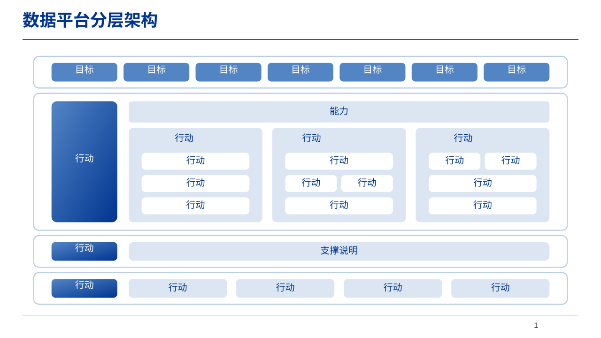

# 数据平台分层架构

来源为房子图战略图.pptx#10。

## 结构与适用场景

业务前台7模块；中台3列开发/标准/治理；统一查询横向总服务；基础设施行；数据源4类

数据平台分层架构

列层级、ODS/明细汇总/ADS、标准/质量/资产模块独立配置

固定节点、圆弧、扇区、分面和连接表达定性关系。数量比较、趋势或占比使用数据驱动图表，源页中已登记的微图槽可接收实际数据。

## 预览



## 调用

将下列完整page对象放入schema_version=1、template_id=business-blue-v1的pages数组，替换各节点内容。nodes键对应原文本框或已明确拆分的语义分段，字段角色及source_ref、segment见下表。

```json
{
  "id": "house-10",
  "family": "source-house",
  "variant": "page-10",
  "content": {
    "title": "数据平台分层架构",
    "nodes": {
      "shape_259": "行动",
      "shape_326": "行动",
      "shape_343": "支撑说明",
      "shape_348": "行动",
      "shape_365": "行动",
      "shape_376": "能力",
      "shape_260": "行动",
      "shape_261": "行动",
      "shape_262": "行动",
      "shape_278": "行动",
      "shape_50": "行动",
      "shape_65": "行动",
      "shape_44": "行动",
      "shape_51": "行动",
      "shape_53": "行动",
      "shape_66": "行动",
      "shape_45": "行动",
      "shape_52": "行动",
      "shape_74": "行动",
      "shape_75": "行动",
      "shape_79": "行动",
      "shape_82": "行动",
      "shape_85": "行动",
      "shape_103": "目标",
      "shape_104": "目标",
      "shape_105": "目标",
      "shape_106": "目标",
      "shape_107": "目标",
      "shape_108": "目标",
      "shape_109": "目标"
    }
  },
  "config": {
    "show_source": true,
    "show_page_number": true
  }
}
```

config支持show_source、show_page_number、image_fit与image_position。image_fit可选contain或cover，image_position为xMin/xMid/xMax与YMin/YMid/YMax组合的九个焦点，默认为xMidYMid。字体、颜色、全局区和固定字阶取自tokens，节点数与连接结构由variant确定。

## 字段合同

每个业务节点required=true、min=1，max按具体框体登记。字符按规范化后的Unicode码点计数，空格标点换行均计入。build会以实际字体测量宽高，字符数通过后仍可能需要调整文字。

| 字段 | 节点角色与源标签 | 最短/最长 | 字阶 | 框体px | 原框引用 | 分段 | 旋转° | 垂直锚点 |
|---|---|---|---|---|---|---|---|---|
| nodes.shape_259 | 中左节点，源标签“数据中台” | 1/11 | compactBody | [126.8615, 326.7986, 105.7744, 35.6155] | slide:259 |  | 0.0 | t |
| nodes.shape_326 | 下左节点，源标签“业务前台” | 1/11 | compactBody | [126.8615, 517.6835, 105.7744, 35.6155] | slide:326 |  | 0.0 | t |
| nodes.shape_343 | 下中节点，源标签“大数据基础设施（计算和存储平台）” | 1/99 | compactBody | [273.9636, 515.6091, 896.3313, 39.7643] | slide:343 |  | 0.0 | ctr |
| nodes.shape_348 | 下左节点，源标签“数据源” | 1/9 | compactBody | [137.6544, 596.4606, 84.1886, 35.6155] | slide:348 |  | 0.0 | t |
| nodes.shape_365 | 下左节点，源标签“数据库” | 1/23 | compactBody | [273.9636, 594.3862, 209.1637, 39.7643] | slide:365 |  | 0.0 | ctr |
| nodes.shape_376 | 上中节点，源标签“统一查询服务” | 1/99 | compactBody | [273.9636, 215.7832, 896.3313, 45.3161] | slide:376 |  | 0.0 | ctr |
| nodes.shape_260 | 中左节点，源标签“开发套件” | 1/10 | compactBody | [372.3122, 283.4367, 94.9815, 32.3787] | slide:260 |  | 0.0 | t |
| nodes.shape_261 | 中中节点，源标签“数据标准体系建设” | 1/18 | compactBody | [643.5976, 283.4367, 170.5417, 32.3787] | slide:261 |  | 0.0 | t |
| nodes.shape_262 | 中右节点，源标签“数据治理平台” | 1/14 | compactBody | [966.4926, 283.4367, 132.7616, 32.3787] | slide:262 |  | 0.0 | t |
| nodes.shape_278 | 中左节点，源标签“数据集成工具” | 1/25 | compactBody | [301.6323, 420.3972, 229.607, 36.1066] | slide:278 |  | 0.0 | ctr |
| nodes.shape_50 | 中中节点，源标签“操作数据（ODS)” | 1/25 | compactBody | [607.3207, 420.3972, 229.607, 36.1066] | slide:50 |  | 0.0 | ctr |
| nodes.shape_65 | 中右节点，源标签“数据资产中心” | 1/25 | compactBody | [913.0191, 420.3972, 229.607, 36.1066] | slide:65 |  | 0.0 | ctr |
| nodes.shape_44 | 中左节点，源标签“敏捷开发平台” | 1/25 | compactBody | [301.6323, 372.9265, 229.607, 36.1066] | slide:44 |  | 0.0 | ctr |
| nodes.shape_51 | 中中节点，源标签“公共明细” | 1/12 | compactBody | [607.3207, 372.9265, 110.2138, 36.1066] | slide:51 |  | 0.0 | ctr |
| nodes.shape_53 | 中中节点，源标签“公共汇总” | 1/12 | compactBody | [726.7139, 372.9265, 110.2138, 36.1066] | slide:53 |  | 0.0 | ctr |
| nodes.shape_66 | 中右节点，源标签“数据质量中心” | 1/25 | compactBody | [913.0191, 372.9265, 229.607, 36.1066] | slide:66 |  | 0.0 | ctr |
| nodes.shape_45 | 中左节点，源标签“自助查询系统” | 1/25 | compactBody | [301.6323, 325.4658, 229.607, 36.1066] | slide:45 |  | 0.0 | ctr |
| nodes.shape_52 | 中中节点，源标签“应用数据层（ADS）” | 1/25 | compactBody | [607.3207, 325.4658, 229.607, 36.1066] | slide:52 |  | 0.0 | ctr |
| nodes.shape_74 | 中右节点，源标签“数据地图” | 1/12 | compactBody | [913.0191, 325.4658, 110.2138, 36.1066] | slide:74 |  | 0.0 | ctr |
| nodes.shape_75 | 中右节点，源标签“数据来源” | 1/12 | compactBody | [1032.4024, 325.4658, 110.2138, 36.1066] | slide:75 |  | 0.0 | ctr |
| nodes.shape_79 | 下中节点，源标签“埋点采集” | 1/23 | compactBody | [503.0194, 594.3862, 209.1637, 39.7643] | slide:79 |  | 0.0 | ctr |
| nodes.shape_82 | 下中节点，源标签“服务器日志” | 1/23 | compactBody | [732.0753, 594.3862, 209.1637, 39.7643] | slide:82 |  | 0.0 | ctr |
| nodes.shape_85 | 下右节点，源标签“爬虫数据” | 1/23 | compactBody | [961.1312, 594.3862, 209.1637, 39.7643] | slide:85 |  | 0.0 | ctr |
| nodes.shape_103 | 上左节点，源标签“业务前台” | 1/10 | compactBody | [132.263, 137.5372, 94.9815, 32.3787] | slide:103 |  | 0.0 | t |
| nodes.shape_104 | 上左节点，源标签“智能分析” | 1/10 | compactBody | [285.6784, 137.5372, 94.9815, 32.3787] | slide:104 |  | 0.0 | t |
| nodes.shape_105 | 上中节点，源标签“标签系统” | 1/10 | compactBody | [439.0938, 137.5372, 94.9815, 32.3787] | slide:105 |  | 0.0 | t |
| nodes.shape_106 | 上中节点，源标签“用户画像” | 1/10 | compactBody | [592.5093, 137.5372, 94.9815, 32.3787] | slide:106 |  | 0.0 | t |
| nodes.shape_107 | 上中节点，源标签“数字化运营” | 1/12 | compactBody | [736.4746, 137.5372, 113.8715, 32.3787] | slide:107 |  | 0.0 | t |
| nodes.shape_108 | 上右节点，源标签“数字化管理” | 1/12 | compactBody | [889.8901, 137.5372, 113.8715, 32.3787] | slide:108 |  | 0.0 | t |
| nodes.shape_109 | 上右节点，源标签“数字化供应链” | 1/14 | compactBody | [1033.8655, 137.5372, 132.7616, 32.3787] | slide:109 |  | 0.0 | t |

全局title必填、2至32码点，使用统一标题框。section_name可选0至24码点，source可选0至64码点。所有可编辑文本通过独立原生carrier导出，页码为派生文字。

## 来源处理

原生PPTX源件保存于用户材料目录，分发包仅含用户资产衍生的几何、字段和说明。原始逐框文字、源框与标准化框在page-catalog.json的variant.fields中。

源标题引用为`slide:37`，原文为“产品功能矩阵”。模板默认标题依据真实结构设置。

密集全景中的diagramCompact为14px、diagramMicro为12px。适用于体系概览或附录局部标签，现场关键结论用统一标题与正常正文字阶表达。

源画布边界裁切已烘焙为可编辑Bezier几何，3D顶面、侧面与前面通过tokens配色的相对明暗保留。

