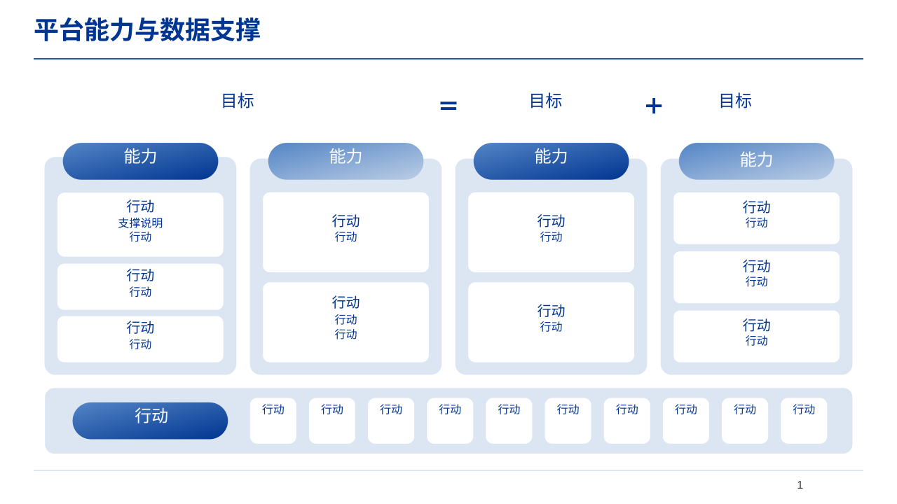

# 平台能力与数据支撑

来源为房子图战略图.pptx#11。

## 结构与适用场景

顶部流量=留存+智能整合；4根功能柱分别触达、投放、沉淀、智能；底部11类数据支持

平台能力与数据支撑

公式为语义关系，不能宣称量化等式；柱数、柱内清单、数据底座列表参数化

固定节点、圆弧、扇区、分面和连接表达定性关系。数量比较、趋势或占比使用数据驱动图表，源页中已登记的微图槽可接收实际数据。

## 预览



## 调用

将下列完整page对象放入schema_version=1、template_id=business-blue-v1的pages数组，替换各节点内容。nodes键对应原文本框或已明确拆分的语义分段，字段角色及source_ref、segment见下表。

```json
{
  "id": "house-11",
  "family": "source-house",
  "variant": "page-11",
  "content": {
    "title": "平台能力与数据支撑",
    "nodes": {
      "shape_35": "目标",
      "shape_36": "目标",
      "shape_46": "目标",
      "shape_63": "行动",
      "shape_79": "行动",
      "shape_80": "支撑说明",
      "shape_81": "行动",
      "shape_82": "行动",
      "shape_83": "行动",
      "shape_84": "行动",
      "shape_85": "行动",
      "shape_91": "行动",
      "shape_92": "行动",
      "shape_95": "行动",
      "shape_96": "行动",
      "shape_99": "行动",
      "shape_100": "行动",
      "shape_103": "行动",
      "shape_104": "行动",
      "shape_106": "行动",
      "shape_107": "行动",
      "shape_112": "能力",
      "shape_114": "能力",
      "shape_116": "能力",
      "shape_16": "行动",
      "shape_17": "行动",
      "shape_20": "行动",
      "shape_23": "行动",
      "shape_25": "行动",
      "shape_110": "能力",
      "shape_167": "行动",
      "shape_168": "行动",
      "shape_169": "行动",
      "shape_170": "行动",
      "shape_171": "行动",
      "shape_172": "行动",
      "shape_173": "行动",
      "shape_174": "行动",
      "shape_175": "行动",
      "shape_176": "行动"
    }
  },
  "config": {
    "show_source": true,
    "show_page_number": true
  }
}
```

config支持show_source、show_page_number、image_fit与image_position。image_fit可选contain或cover，image_position为xMin/xMid/xMax与YMin/YMid/YMax组合的九个焦点，默认为xMidYMid。字体、颜色、全局区和固定字阶取自tokens，节点数与连接结构由variant确定。

## 字段合同

每个业务节点required=true、min=1，max按具体框体登记。字符按规范化后的Unicode码点计数，空格标点换行均计入。build会以实际字体测量宽高，字符数通过后仍可能需要调整文字。

| 字段 | 节点角色与源标签 | 最短/最长 | 字阶 | 框体px | 原框引用 | 分段 | 旋转° | 垂直锚点 |
|---|---|---|---|---|---|---|---|---|
| nodes.shape_35 | 上左节点，源标签“流量” | 1/6 | body | [314.7353, 131.442, 68.957, 39.4069] | slide:35 |  | 0.0 | t |
| nodes.shape_36 | 上右节点，源标签“智能整合” | 1/10 | body | [1025.0051, 131.442, 118.2106, 39.4069] | slide:36 |  | 0.0 | t |
| nodes.shape_46 | 上中节点，源标签“留存” | 1/6 | body | [754.2984, 131.442, 68.957, 39.4069] | slide:46 |  | 0.0 | t |
| nodes.shape_63 | 下左节点，源标签“数据支持” | 1/14 | body | [140.5035, 581.4513, 151.297, 39.4069] | slide:63 |  | 0.0 | t |
| nodes.shape_79 | 中左节点，源标签“路径覆盖” | 1/10 | compactBody | [152.1792, 284.3751, 96.3122, 32.8323] | slide:79 |  | 0.0 | t |
| nodes.shape_80 | 中左节点，源标签“公域：发现页 精选页 同城页等” | 1/31 | caption | [88.557, 310.2975, 223.5464, 27.9141] | slide:80 |  | 0.0 | t |
| nodes.shape_81 | 中左节点，源标签“私域：关注页” | 1/18 | caption | [135.3718, 329.8282, 129.927, 27.9141] | slide:81 |  | 0.0 | t |
| nodes.shape_82 | 中左节点，源标签“能力覆盖” | 1/10 | compactBody | [152.1792, 382.7603, 96.3122, 32.8323] | slide:82 |  | 0.0 | t |
| nodes.shape_83 | 中左节点，源标签“短视频推广+直播推广” | 1/22 | caption | [118.4831, 408.6827, 163.6942, 27.9141] | slide:83 |  | 0.0 | t |
| nodes.shape_84 | 中左节点，源标签“能力覆盖” | 1/10 | compactBody | [152.1792, 457.5806, 96.3122, 32.8323] | slide:84 |  | 0.0 | t |
| nodes.shape_85 | 下左节点，源标签“原生种草+专业首个” | 1/20 | caption | [126.0129, 483.503, 148.6448, 27.9141] | slide:85 |  | 0.0 | t |
| nodes.shape_91 | 中中节点，源标签“快手账号” | 1/10 | compactBody | [738.3954, 305.237, 96.3122, 32.8323] | slide:91 |  | 0.0 | t |
| nodes.shape_92 | 中中节点，源标签“粉丝数量 私域流量” | 1/20 | caption | [714.4545, 329.9196, 144.2042, 27.9141] | slide:92 |  | 0.0 | t |
| nodes.shape_95 | 中中节点，源标签“电商小店” | 1/10 | compactBody | [738.3954, 433.7413, 96.3122, 32.8323] | slide:95 |  | 0.0 | t |
| nodes.shape_96 | 中中节点，源标签“店铺受众 复购用户” | 1/20 | caption | [714.4545, 458.424, 144.2042, 27.9141] | slide:96 |  | 0.0 | t |
| nodes.shape_99 | 中右节点，源标签“DMP升级” | 1/11 | compactBody | [1029.6286, 285.5233, 100.0822, 32.8323] | slide:99 |  | 0.0 | t |
| nodes.shape_100 | 中右节点，源标签“短视频推广+直播推广” | 1/22 | caption | [997.8125, 309.6878, 163.6942, 27.9141] | slide:100 |  | 0.0 | t |
| nodes.shape_103 | 中右节点，源标签“智能托管” | 1/10 | compactBody | [1031.5086, 369.8346, 96.3122, 32.8323] | slide:103 |  | 0.0 | t |
| nodes.shape_104 | 中右节点，源标签“购物意图/粉丝/复购人群” | 1/25 | caption | [987.5594, 393.9889, 184.2208, 27.9141] | slide:104 |  | 0.0 | t |
| nodes.shape_106 | 中右节点，源标签“程序化创意” | 1/12 | compactBody | [1021.9261, 454.2476, 115.467, 32.8323] | slide:106 |  | 0.0 | t |
| nodes.shape_107 | 下右节点，源标签“素材优选 素材拓量” | 1/20 | caption | [1007.5677, 478.412, 144.2042, 27.9141] | slide:107 |  | 0.0 | t |
| nodes.shape_112 | 上中节点，源标签“沉淀营销” | 1/14 | body | [710.9691, 210.703, 151.297, 39.4069] | slide:112 |  | 0.0 | t |
| nodes.shape_114 | 上右节点，源标签“智能工具” | 1/14 | body | [1004.0111, 210.703, 151.297, 39.4069] | slide:114 |  | 0.0 | ctr |
| nodes.shape_116 | 上中节点，源标签“投放整合” | 1/14 | body | [417.9372, 210.703, 151.297, 39.4069] | slide:116 |  | 0.0 | t |
| nodes.shape_16 | 中中节点，源标签“推广升级” | 1/10 | compactBody | [445.4245, 421.5575, 96.3122, 32.8323] | slide:16 |  | 0.0 | t |
| nodes.shape_17 | 中中节点，源标签“速推推广（一键式下单）” | 1/25 | caption | [400.9672, 448.2725, 185.2471, 27.9141] | slide:17 |  | 0.0 | t |
| nodes.shape_20 | 中中节点，源标签“专业推广（定制化下单）” | 1/24 | caption | [407.1455, 469.1446, 172.8804, 27.9141] | slide:20 |  | 0.0 | t |
| nodes.shape_23 | 中中节点，源标签“两个统一” | 1/10 | compactBody | [445.4245, 305.237, 96.3122, 32.8323] | slide:23 |  | 0.0 | t |
| nodes.shape_25 | 中中节点，源标签“账户统一+预算统一” | 1/20 | caption | [419.2582, 329.9196, 148.6448, 27.9141] | slide:25 |  | 0.0 | t |
| nodes.shape_110 | 上左节点，源标签“流量触达” | 1/14 | body | [124.8951, 210.703, 151.297, 39.4069] | slide:110 |  | 0.0 | t |
| nodes.shape_167 | 下左节点，源标签“平台 / 数据” | 1/16 | caption | [357.7497, 576.533, 64.0794, 49.2536] | slide:167 |  | 0.0 | t |
| nodes.shape_168 | 下中节点，源标签“流量 / 数据” | 1/14 | caption | [447.5991, 576.533, 52.7085, 49.2536] | slide:168 |  | 0.0 | t |
| nodes.shape_169 | 下中节点，源标签“客户 / 数据” | 1/14 | caption | [531.7681, 576.533, 52.7085, 49.2536] | slide:169 |  | 0.0 | t |
| nodes.shape_170 | 下中节点，源标签“主播 / 信息” | 1/14 | caption | [615.927, 576.533, 52.7085, 49.2536] | slide:170 |  | 0.0 | t |
| nodes.shape_171 | 下中节点，源标签“粉丝 / 画像” | 1/14 | caption | [700.0961, 576.533, 52.7085, 49.2536] | slide:171 |  | 0.0 | t |
| nodes.shape_172 | 下中节点，源标签“互动 / 信息” | 1/14 | caption | [784.255, 576.533, 52.7085, 49.2536] | slide:172 |  | 0.0 | t |
| nodes.shape_173 | 下右节点，源标签“电商 / 数据” | 1/14 | caption | [868.424, 576.533, 52.7085, 49.2536] | slide:173 |  | 0.0 | t |
| nodes.shape_174 | 下右节点，源标签“商品 / 类目” | 1/14 | caption | [952.5829, 576.533, 52.7085, 49.2536] | slide:174 |  | 0.0 | t |
| nodes.shape_175 | 下右节点，源标签“订单 / 成交” | 1/14 | caption | [1036.752, 576.533, 52.7085, 49.2536] | slide:175 |  | 0.0 | t |
| nodes.shape_176 | 下右节点，源标签“转化 / 回传” | 1/14 | caption | [1120.9109, 576.533, 52.7085, 49.2536] | slide:176 |  | 0.0 | t |

全局title必填、2至32码点，使用统一标题框。section_name可选0至24码点，source可选0至64码点。所有可编辑文本通过独立原生carrier导出，页码为派生文字。

## 来源处理

原生PPTX源件保存于用户材料目录，分发包仅含用户资产衍生的几何、字段和说明。原始逐框文字、源框与标准化框在page-catalog.json的variant.fields中。

源标题引用为`slide:37`，原文为“磁力金牛电商营销平台”。模板默认标题依据真实结构设置。

密集全景中的diagramCompact为14px、diagramMicro为12px。适用于体系概览或附录局部标签，现场关键结论用统一标题与正常正文字阶表达。

源画布边界裁切已烘焙为可编辑Bezier几何，3D顶面、侧面与前面通过tokens配色的相对明暗保留。

