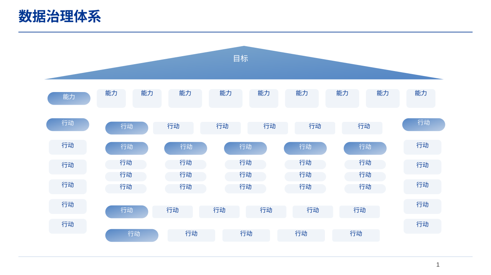

# 数据治理体系

来源为房子图战略图.pptx#12。

## 结构与适用场景

屋顶业务目标；治理门户横梁；左生命周期、右安全边柱；中部主数据/标准/质量/资产/集成/交换6域；底部元数据与实时数据两行

治理体系、能力架构

保留两侧贯穿支撑域、6列模块和门户/底座；层内条目可变

固定节点、圆弧、扇区、分面和连接表达定性关系。数量比较、趋势或占比使用数据驱动图表，源页中已登记的微图槽可接收实际数据。

## 预览



## 调用

将下列完整page对象放入schema_version=1、template_id=business-blue-v1的pages数组，替换各节点内容。nodes键对应原文本框或已明确拆分的语义分段，字段角色及source_ref、segment见下表。

```json
{
  "id": "house-12",
  "family": "source-house",
  "variant": "page-12",
  "content": {
    "title": "数据治理体系",
    "nodes": {
      "shape_442": "目标",
      "shape_457": "能力",
      "shape_447": "行动",
      "shape_483": "行动",
      "shape_614": "行动",
      "shape_615": "行动",
      "shape_616": "行动",
      "shape_617": "行动",
      "shape_618": "行动",
      "shape_619": "行动",
      "shape_620": "行动",
      "shape_621": "行动",
      "shape_5": "行动",
      "shape_6": "行动",
      "shape_10": "行动",
      "shape_11": "行动",
      "shape_12": "行动",
      "shape_14": "能力",
      "shape_15": "能力",
      "shape_16": "能力",
      "shape_17": "能力",
      "shape_18": "能力",
      "shape_19": "能力",
      "shape_20": "能力",
      "shape_21": "能力",
      "shape_22": "能力",
      "shape_23": "行动",
      "shape_24": "行动",
      "shape_25": "行动",
      "shape_26": "行动",
      "shape_27": "行动",
      "shape_28": "行动",
      "shape_29": "行动",
      "shape_30": "行动",
      "shape_31": "行动",
      "shape_32": "行动",
      "shape_33": "行动",
      "shape_35": "行动",
      "shape_36": "行动",
      "shape_37": "行动",
      "shape_38": "行动",
      "shape_39": "行动",
      "shape_40": "行动",
      "shape_43": "行动",
      "shape_44": "行动",
      "shape_46": "行动",
      "shape_49": "行动",
      "shape_51": "行动",
      "shape_52": "行动",
      "shape_54": "行动",
      "shape_55": "行动",
      "shape_58": "行动",
      "shape_59": "行动",
      "shape_61": "行动",
      "shape_62": "行动",
      "shape_449": "行动",
      "shape_451": "行动",
      "shape_452": "行动",
      "shape_455": "行动",
      "shape_458": "行动"
    }
  },
  "config": {
    "show_source": true,
    "show_page_number": true
  }
}
```

config支持show_source、show_page_number、image_fit与image_position。image_fit可选contain或cover，image_position为xMin/xMid/xMax与YMin/YMid/YMax组合的九个焦点，默认为xMidYMid。字体、颜色、全局区和固定字阶取自tokens，节点数与连接结构由variant确定。

## 字段合同

每个业务节点required=true、min=1，max按具体框体登记。字符按规范化后的Unicode码点计数，空格标点换行均计入。build会以实际字体测量宽高，字符数通过后仍可能需要调整文字。

| 字段 | 节点角色与源标签 | 最短/最长 | 字阶 | 框体px | 原框引用 | 分段 | 旋转° | 垂直锚点 |
|---|---|---|---|---|---|---|---|---|
| nodes.shape_442 | 上中节点，源标签“业务目标 / (营商环境提升、便民利民、社会开发利用等)” | 1/90 | compactBody | [420.3293, 142.6598, 412.9902, 57.0818] | slide:442 |  | 0.0 | t |
| nodes.shape_457 | 上左节点，源标签“治理门户” | 1/14 | caption | [128.0673, 244.8566, 103.4707, 25.8398] | slide:457 |  | 0.0 | t |
| nodes.shape_447 | 中左节点，源标签“生命周期管理” | 1/14 | caption | [123.1765, 313.4497, 106.8739, 25.8398] | slide:447 |  | 0.0 | t |
| nodes.shape_483 | 中左节点，源标签“主数据管理” | 1/13 | caption | [280.3259, 322.4132, 100.2535, 25.8398] | slide:483 |  | 0.0 | t |
| nodes.shape_614 | 中右节点，源标签“数据安全管理” | 1/14 | caption | [1051.1863, 312.1758, 106.8739, 25.8398] | slide:614 |  | 0.0 | t |
| nodes.shape_615 | 下左节点，源标签“元数据管理” | 1/14 | caption | [277.025, 541.684, 106.8739, 25.8398] | slide:615 |  | 0.0 | t |
| nodes.shape_616 | 下左节点，源标签“实时大数据管理” | 1/17 | caption | [284.5752, 603.5266, 129.0966, 25.8398] | slide:616 |  | 0.0 | t |
| nodes.shape_617 | 中左节点，源标签“数据标准” | 1/14 | caption | [278.5964, 375.5805, 103.7125, 25.8398] | slide:617 |  | 0.0 | t |
| nodes.shape_618 | 中中节点，源标签“数据质量管理” | 1/16 | caption | [427.3867, 375.5805, 116.5161, 25.8398] | slide:618 |  | 0.0 | t |
| nodes.shape_619 | 中中节点，源标签“数据资产” | 1/13 | caption | [591.7422, 375.5805, 96.5063, 25.8398] | slide:619 |  | 0.0 | t |
| nodes.shape_620 | 中右节点，源标签“数据交换” | 1/14 | caption | [900.6387, 375.5805, 102.5223, 25.8398] | slide:620 |  | 0.0 | t |
| nodes.shape_621 | 中中节点，源标签“数据集成” | 1/14 | caption | [743.824, 375.5805, 104.2425, 25.8398] | slide:621 |  | 0.0 | t |
| nodes.shape_5 | 中左节点，源标签“数据策略” | 1/11 | caption | [134.1763, 371.9355, 84.8742, 27.0393] | slide:5 |  | 0.0 | t |
| nodes.shape_6 | 下左节点，源标签“数据销毁” | 1/11 | caption | [134.1763, 578.8398, 84.8742, 27.0393] | slide:6 |  | 0.0 | t |
| nodes.shape_10 | 中左节点，源标签“级别协议” | 1/11 | caption | [134.1763, 423.6616, 84.8742, 27.0393] | slide:10 |  | 0.0 | t |
| nodes.shape_11 | 下左节点，源标签“分类评估” | 1/11 | caption | [134.1763, 475.3877, 84.8742, 27.0393] | slide:11 |  | 0.0 | t |
| nodes.shape_12 | 下左节点，源标签“数据归档” | 1/11 | caption | [134.1763, 527.1137, 84.8742, 27.0393] | slide:12 |  | 0.0 | t |
| nodes.shape_14 | 上左节点，源标签“数据 / 地图” | 1/18 | caption | [254.1978, 235.2423, 71.9032, 45.0685] | slide:14 |  | 0.0 | t |
| nodes.shape_15 | 上左节点，源标签“资产 / 统计” | 1/18 | caption | [347.5335, 235.2423, 71.9032, 45.0685] | slide:15 |  | 0.0 | t |
| nodes.shape_16 | 上中节点，源标签“资产交换 / 频率分析” | 1/22 | caption | [441.176, 235.2423, 83.3772, 45.0685] | slide:16 |  | 0.0 | t |
| nodes.shape_17 | 上中节点，源标签“标准化 / 数据查询” | 1/22 | caption | [546.5993, 235.2423, 83.3772, 45.0685] | slide:17 |  | 0.0 | t |
| nodes.shape_18 | 上中节点，源标签“数值质量整改报告” | 1/22 | caption | [745.3676, 235.2423, 83.3772, 45.0685] | slide:18 |  | 0.0 | t |
| nodes.shape_19 | 上右节点，源标签“数据治理对比分析” | 1/22 | caption | [850.7909, 235.2423, 83.3772, 45.0685] | slide:19 |  | 0.0 | t |
| nodes.shape_20 | 上右节点，源标签“数据服务 / API” | 1/22 | caption | [956.2142, 235.2423, 83.3772, 45.0685] | slide:20 |  | 0.0 | t |
| nodes.shape_21 | 上中节点，源标签“数据 / 画像” | 1/18 | caption | [651.7158, 235.2423, 71.9032, 45.0685] | slide:21 |  | 0.0 | t |
| nodes.shape_22 | 上右节点，源标签“更多 / 应用” | 1/18 | caption | [1061.3307, 235.2423, 71.9032, 45.0685] | slide:22 |  | 0.0 | t |
| nodes.shape_23 | 中中节点，源标签“主数据检索” | 1/14 | caption | [529.0907, 321.8088, 101.1554, 27.0393] | slide:23 |  | 0.0 | t |
| nodes.shape_24 | 中中节点，源标签“识别申请” | 1/12 | caption | [406.0193, 321.8088, 91.7456, 27.0393] | slide:24 |  | 0.0 | t |
| nodes.shape_25 | 中中节点，源标签“共享发布” | 1/12 | caption | [775.2242, 321.8088, 91.7456, 27.0393] | slide:25 |  | 0.0 | t |
| nodes.shape_26 | 中中节点，源标签“主数据存储” | 1/14 | caption | [652.1528, 321.8088, 101.1554, 27.0393] | slide:26 |  | 0.0 | t |
| nodes.shape_27 | 中右节点，源标签“主数据监控” | 1/14 | caption | [898.2862, 321.8088, 101.1554, 27.0393] | slide:27 |  | 0.0 | t |
| nodes.shape_28 | 中左节点，源标签“标准发布” | 1/13 | caption | [280.986, 417.2551, 94.2469, 27.0393] | slide:28 |  | 0.0 | t |
| nodes.shape_29 | 中左节点，源标签“标准映射” | 1/13 | caption | [280.986, 448.9063, 94.2469, 27.0393] | slide:29 |  | 0.0 | t |
| nodes.shape_30 | 下左节点，源标签“标准查询” | 1/13 | caption | [280.986, 480.5575, 94.2469, 27.0393] | slide:30 |  | 0.0 | t |
| nodes.shape_31 | 中中节点，源标签“规则管理” | 1/13 | caption | [436.9267, 417.2551, 94.2469, 27.0393] | slide:31 |  | 0.0 | t |
| nodes.shape_32 | 中中节点，源标签“质量报告” | 1/13 | caption | [436.9267, 448.9063, 94.2469, 27.0393] | slide:32 |  | 0.0 | t |
| nodes.shape_33 | 下中节点，源标签“问题整改” | 1/13 | caption | [436.9267, 480.5575, 94.2469, 27.0393] | slide:33 |  | 0.0 | t |
| nodes.shape_35 | 中中节点，源标签“资产编目” | 1/13 | caption | [592.8766, 417.2551, 94.2469, 27.0393] | slide:35 |  | 0.0 | t |
| nodes.shape_36 | 中中节点，源标签“资产检索” | 1/13 | caption | [592.8766, 448.9063, 94.2469, 27.0393] | slide:36 |  | 0.0 | t |
| nodes.shape_37 | 下中节点，源标签“资产服务” | 1/13 | caption | [592.8766, 480.5575, 94.2469, 27.0393] | slide:37 |  | 0.0 | t |
| nodes.shape_38 | 中中节点，源标签“实时采集” | 1/13 | caption | [748.8265, 417.2551, 94.2469, 27.0393] | slide:38 |  | 0.0 | t |
| nodes.shape_39 | 中中节点，源标签“清洗转化” | 1/13 | caption | [748.8265, 448.9063, 94.2469, 27.0393] | slide:39 |  | 0.0 | t |
| nodes.shape_40 | 下中节点，源标签“加密脱敏” | 1/13 | caption | [748.8265, 480.5575, 94.2469, 27.0393] | slide:40 |  | 0.0 | t |
| nodes.shape_43 | 中右节点，源标签“数据传输” | 1/13 | caption | [904.7764, 417.2551, 94.2469, 27.0393] | slide:43 |  | 0.0 | t |
| nodes.shape_44 | 中右节点，源标签“节点管理” | 1/13 | caption | [904.7764, 448.9063, 94.2469, 27.0393] | slide:44 |  | 0.0 | t |
| nodes.shape_46 | 下右节点，源标签“交换审批” | 1/13 | caption | [904.7764, 480.5575, 94.2469, 27.0393] | slide:46 |  | 0.0 | t |
| nodes.shape_49 | 下中节点，源标签“元数据采集” | 1/13 | caption | [402.8486, 541.7119, 94.0702, 27.0393] | slide:49 |  | 0.0 | t |
| nodes.shape_51 | 下中节点，源标签“元数据检索” | 1/13 | caption | [524.7577, 541.7119, 94.0702, 27.0393] | slide:51 |  | 0.0 | t |
| nodes.shape_52 | 下中节点，源标签“血缘分析” | 1/13 | caption | [768.5945, 541.7119, 94.0702, 27.0393] | slide:52 |  | 0.0 | t |
| nodes.shape_54 | 下右节点，源标签“影响分析” | 1/13 | caption | [890.5036, 541.7119, 94.0702, 27.0393] | slide:54 |  | 0.0 | t |
| nodes.shape_55 | 下中节点，源标签“数据地图” | 1/13 | caption | [646.6761, 541.7119, 94.0702, 27.0393] | slide:55 |  | 0.0 | t |
| nodes.shape_58 | 下中节点，源标签“分布式数据存储” | 1/30 | caption | [442.4684, 602.9315, 112.8061, 45.0685] | slide:58 |  | 0.0 | t |
| nodes.shape_59 | 下中节点，源标签“实时数据处理” | 1/15 | caption | [585.5496, 602.9315, 112.8061, 27.0393] | slide:59 |  | 0.0 | t |
| nodes.shape_61 | 下中节点，源标签“数据敏捷计算” | 1/15 | caption | [728.6214, 602.9315, 112.8061, 27.0393] | slide:61 |  | 0.0 | t |
| nodes.shape_62 | 下右节点，源标签“统一运维管理” | 1/15 | caption | [871.6933, 602.9315, 112.8061, 27.0393] | slide:62 |  | 0.0 | t |
| nodes.shape_449 | 中右节点，源标签“变更追踪” | 1/11 | caption | [1058.9876, 371.9355, 84.8742, 27.0393] | slide:449 |  | 0.0 | t |
| nodes.shape_451 | 下右节点，源标签“去隐私化” | 1/11 | caption | [1058.9876, 578.8398, 84.8742, 27.0393] | slide:451 |  | 0.0 | t |
| nodes.shape_452 | 中右节点，源标签“异常监控” | 1/11 | caption | [1058.9876, 423.6616, 84.8742, 27.0393] | slide:452 |  | 0.0 | t |
| nodes.shape_455 | 下右节点，源标签“数据脱敏” | 1/11 | caption | [1058.9876, 475.3877, 84.8742, 27.0393] | slide:455 |  | 0.0 | t |
| nodes.shape_458 | 下右节点，源标签“安全传输” | 1/11 | caption | [1058.9876, 527.1137, 84.8742, 27.0393] | slide:458 |  | 0.0 | t |

全局title必填、2至32码点，使用统一标题框。section_name可选0至24码点，source可选0至64码点。所有可编辑文本通过独立原生carrier导出，页码为派生文字。

## 来源处理

原生PPTX源件保存于用户材料目录，分发包仅含用户资产衍生的几何、字段和说明。原始逐框文字、源框与标准化框在page-catalog.json的variant.fields中。

源标题引用为`slide:8`，原文为“睿智数据治理平台”。模板默认标题依据真实结构设置。

密集全景中的diagramCompact为14px、diagramMicro为12px。适用于体系概览或附录局部标签，现场关键结论用统一标题与正常正文字阶表达。

源画布边界裁切已烘焙为可编辑Bezier几何，3D顶面、侧面与前面通过tokens配色的相对明暗保留。

