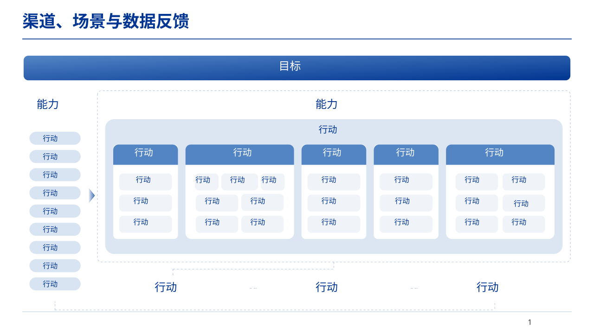

# 渠道、场景与数据反馈

来源为房子图战略图.pptx#13。

## 结构与适用场景

左9触达渠道竖栏；中间支付前/买单场景/支付后/游戏/其他5阶段或功能簇；底部交易行为/分析/画像

渠道-业务场景-数据反馈

先辨别横向是流程还是并列功能，保留接入箭头；不同字段组角色不能混用

固定节点、圆弧、扇区、分面和连接表达定性关系。数量比较、趋势或占比使用数据驱动图表，源页中已登记的微图槽可接收实际数据。

## 预览



## 调用

将下列完整page对象放入schema_version=1、template_id=business-blue-v1的pages数组，替换各节点内容。nodes键对应原文本框或已明确拆分的语义分段，字段角色及source_ref、segment见下表。

```json
{
  "id": "house-13",
  "family": "source-house",
  "variant": "page-13",
  "content": {
    "title": "渠道、场景与数据反馈",
    "nodes": {
      "shape_114": "目标",
      "shape_119": "能力",
      "shape_95": "行动",
      "shape_97": "行动",
      "shape_99": "行动",
      "shape_101": "行动",
      "shape_103": "行动",
      "shape_105": "行动",
      "shape_107": "行动",
      "shape_109": "行动",
      "shape_111": "行动",
      "shape_192": "行动",
      "shape_196": "行动",
      "shape_200": "行动",
      "shape_87": "行动",
      "shape_88": "能力",
      "shape_93": "行动",
      "shape_91": "行动",
      "shape_86": "行动",
      "shape_84": "行动",
      "shape_82": "行动",
      "shape_2": "行动",
      "shape_7": "行动",
      "shape_8": "行动",
      "shape_13": "行动",
      "shape_14": "行动",
      "shape_19": "行动",
      "shape_20": "行动",
      "shape_28": "行动",
      "shape_29": "行动",
      "shape_34": "行动",
      "shape_35": "行动",
      "shape_36": "行动",
      "shape_37": "行动",
      "shape_38": "行动",
      "shape_39": "行动",
      "shape_40": "行动",
      "shape_41": "行动",
      "shape_42": "行动",
      "shape_43": "行动",
      "shape_44": "行动",
      "shape_45": "行动",
      "shape_47": "行动"
    }
  },
  "config": {
    "show_source": true,
    "show_page_number": true
  }
}
```

config支持show_source、show_page_number、image_fit与image_position。image_fit可选contain或cover，image_position为xMin/xMid/xMax与YMin/YMid/YMax组合的九个焦点，默认为xMidYMid。字体、颜色、全局区和固定字阶取自tokens，节点数与连接结构由variant确定。

## 字段合同

每个业务节点required=true、min=1，max按具体框体登记。字符按规范化后的Unicode码点计数，空格标点换行均计入。build会以实际字体测量宽高，字符数通过后仍可能需要调整文字。

| 字段 | 节点角色与源标签 | 最短/最长 | 字阶 | 框体px | 原框引用 | 分段 | 旋转° | 垂直锚点 |
|---|---|---|---|---|---|---|---|---|
| nodes.shape_114 | 上中节点，源标签“优化营销触达的触点，实现高效精准触达” | 1/39 | body | [428.4945, 128.1144, 423.0109, 36.9254] | slide:114 |  | 0.0 | t |
| nodes.shape_119 | 上左节点，源标签“统一 / 查询服务” | 1/20 | body | [63.7185, 210.5368, 109.6645, 63.7831] | slide:119 |  | 0.0 | t |
| nodes.shape_95 | 中左节点，源标签“微信聊天” | 1/15 | caption | [63.3445, 284.0448, 110.4333, 28.0733] | slide:95 |  | 0.0 | ctr |
| nodes.shape_97 | 中左节点，源标签“公众号” | 1/15 | caption | [63.3445, 323.2767, 110.4333, 28.0733] | slide:97 |  | 0.0 | ctr |
| nodes.shape_99 | 中左节点，源标签“小程序” | 1/15 | caption | [63.3445, 362.5191, 110.4333, 28.0733] | slide:99 |  | 0.0 | ctr |
| nodes.shape_101 | 中左节点，源标签“企业微信” | 1/15 | caption | [63.3445, 401.751, 110.4333, 28.0733] | slide:101 |  | 0.0 | ctr |
| nodes.shape_103 | 中左节点，源标签“微信支付” | 1/15 | caption | [63.3445, 440.983, 110.4333, 28.0733] | slide:103 |  | 0.0 | ctr |
| nodes.shape_105 | 下左节点，源标签“朋友圈广告” | 1/15 | caption | [63.3445, 480.2149, 110.4333, 28.0733] | slide:105 |  | 0.0 | ctr |
| nodes.shape_107 | 下左节点，源标签“视频号” | 1/15 | caption | [63.3445, 519.4572, 110.4333, 28.0733] | slide:107 |  | 0.0 | ctr |
| nodes.shape_109 | 下左节点，源标签“直播” | 1/15 | caption | [63.3445, 558.6892, 110.4333, 28.0733] | slide:109 |  | 0.0 | ctr |
| nodes.shape_111 | 下左节点，源标签“短信” | 1/15 | caption | [63.3445, 597.9211, 110.4333, 28.0733] | slide:111 |  | 0.0 | ctr |
| nodes.shape_192 | 下左节点，源标签“交易行为” | 1/10 | body | [317.9261, 604.955, 109.6645, 36.9254] | slide:192 |  | 0.0 | t |
| nodes.shape_196 | 下中节点，源标签“数据分析” | 1/10 | body | [664.6446, 604.955, 109.6645, 36.9254] | slide:196 |  | 0.0 | t |
| nodes.shape_200 | 下右节点，源标签“用户画像” | 1/10 | body | [1011.3736, 604.955, 109.6645, 36.9254] | slide:200 |  | 0.0 | t |
| nodes.shape_87 | 上中节点，源标签“购物中心小程序” | 1/29 | compactBody | [586.7626, 267.7016, 265.4702, 33.5695] | slide:87 |  | 0.0 | t |
| nodes.shape_88 | 上中节点，源标签“优化营销互动的方式，实现有效高频互动” | 1/41 | body | [494.7296, 210.3394, 449.5361, 36.9254] | slide:88 |  | 0.0 | t |
| nodes.shape_93 | 中左节点，源标签“支付前” | 1/10 | compactBody | [276.3357, 317.0844, 92.7811, 33.5695] | slide:93 |  | 0.0 | t |
| nodes.shape_91 | 中中节点，源标签“支付中-买单场景” | 1/21 | compactBody | [438.3752, 317.0844, 194.1025, 33.5695] | slide:91 |  | 0.0 | t |
| nodes.shape_86 | 中中节点，源标签“支付后” | 1/10 | compactBody | [682.0995, 317.0844, 92.7811, 33.5695] | slide:86 |  | 0.0 | t |
| nodes.shape_84 | 中中节点，源标签“互动游戏” | 1/12 | compactBody | [828.7414, 317.0844, 115.2438, 33.5695] | slide:84 |  | 0.0 | t |
| nodes.shape_82 | 中右节点，源标签“其他形式” | 1/17 | compactBody | [999.8409, 317.0844, 156.481, 33.5695] | slide:82 |  | 0.0 | t |
| nodes.shape_2 | 中右节点，源标签“线上商城” | 1/12 | caption | [1088.1647, 422.728, 90.3394, 31.6162] | slide:2 |  | 0.0 | ctr |
| nodes.shape_7 | 中左节点，源标签“免费领券” | 1/13 | caption | [269.3329, 377.0336, 99.389, 30.2136] | slide:7 |  | 0.0 | t |
| nodes.shape_8 | 中左节点，源标签“精准派券” | 1/13 | caption | [265.2186, 422.6761, 97.0409, 30.2136] | slide:8 |  | 0.0 | t |
| nodes.shape_13 | 中左节点，源标签“互动发券” | 1/12 | caption | [267.7017, 468.3289, 92.0745, 30.2136] | slide:13 |  | 0.0 | t |
| nodes.shape_14 | 中中节点，源标签“满减” | 1/8 | caption | [416.4735, 377.3453, 62.048, 30.2136] | slide:14 |  | 0.0 | t |
| nodes.shape_19 | 中中节点，源标签“联单折扣” | 1/13 | caption | [472.0175, 377.3453, 99.8669, 30.2136] | slide:19 |  | 0.0 | t |
| nodes.shape_20 | 中中节点，源标签“满增” | 1/8 | caption | [558.8659, 377.3453, 62.048, 30.2136] | slide:20 |  | 0.0 | t |
| nodes.shape_28 | 中中节点，源标签“随机立减” | 1/13 | caption | [419.7359, 422.9982, 95.659, 30.2136] | slide:28 |  | 0.0 | t |
| nodes.shape_29 | 中中节点，源标签“定额立减” | 1/13 | caption | [517.8365, 422.9047, 95.659, 30.2136] | slide:29 |  | 0.0 | t |
| nodes.shape_34 | 中中节点，源标签“逐级减增” | 1/13 | caption | [419.7359, 468.6406, 95.659, 30.2136] | slide:34 |  | 0.0 | t |
| nodes.shape_35 | 中中节点，源标签“n件n折” | 1/13 | caption | [517.8365, 468.5575, 95.659, 30.2136] | slide:35 |  | 0.0 | t |
| nodes.shape_36 | 中中节点，源标签“通用券” | 1/10 | caption | [679.554, 377.0336, 78.7132, 30.2136] | slide:36 |  | 0.0 | t |
| nodes.shape_37 | 中中节点，源标签“品牌券” | 1/10 | caption | [679.554, 422.6761, 78.7132, 30.2136] | slide:37 |  | 0.0 | t |
| nodes.shape_38 | 中中节点，源标签“送积分” | 1/10 | caption | [679.554, 468.3289, 78.7132, 30.2136] | slide:38 |  | 0.0 | t |
| nodes.shape_39 | 中中节点，源标签“免费抽奖” | 1/13 | caption | [827.5258, 377.0336, 96.9162, 30.2136] | slide:39 |  | 0.0 | t |
| nodes.shape_40 | 中中节点，源标签“支付后抽奖” | 1/15 | caption | [819.8061, 422.7696, 115.1192, 30.2136] | slide:40 |  | 0.0 | t |
| nodes.shape_41 | 中中节点，源标签“社交游戏” | 1/13 | caption | [827.5258, 468.5056, 96.9162, 30.2136] | slide:41 |  | 0.0 | t |
| nodes.shape_42 | 中右节点，源标签“储值增值” | 1/12 | caption | [983.8509, 377.0336, 87.2848, 30.2136] | slide:42 |  | 0.0 | t |
| nodes.shape_43 | 中右节点，源标签“拼团闪惠” | 1/12 | caption | [1085.0166, 377.0336, 87.2848, 30.2136] | slide:43 |  | 0.0 | t |
| nodes.shape_44 | 中右节点，源标签“分销返佣” | 1/12 | caption | [983.8509, 422.728, 87.2848, 30.2136] | slide:44 |  | 0.0 | t |
| nodes.shape_45 | 中右节点，源标签“砍价” | 1/8 | caption | [997.5759, 468.4225, 59.8349, 30.2136] | slide:45 |  | 0.0 | t |
| nodes.shape_47 | 中右节点，源标签“免费抽奖” | 1/12 | caption | [1085.0166, 468.4225, 87.2848, 30.2136] | slide:47 |  | 0.0 | t |

全局title必填、2至32码点，使用统一标题框。section_name可选0至24码点，source可选0至64码点。所有可编辑文本通过独立原生carrier导出，页码为派生文字。

## 来源处理

原生PPTX源件保存于用户材料目录，分发包仅含用户资产衍生的几何、字段和说明。原始逐框文字、源框与标准化框在page-catalog.json的variant.fields中。

源标题引用为`slide:5`，原文为“结合核心业务场景，全面突破三大痛点，优化体验链路”。模板默认标题依据真实结构设置。

密集全景中的diagramCompact为14px、diagramMicro为12px。适用于体系概览或附录局部标签，现场关键结论用统一标题与正常正文字阶表达。

源画布边界裁切已烘焙为可编辑Bezier几何，3D顶面、侧面与前面通过tokens配色的相对明暗保留。

