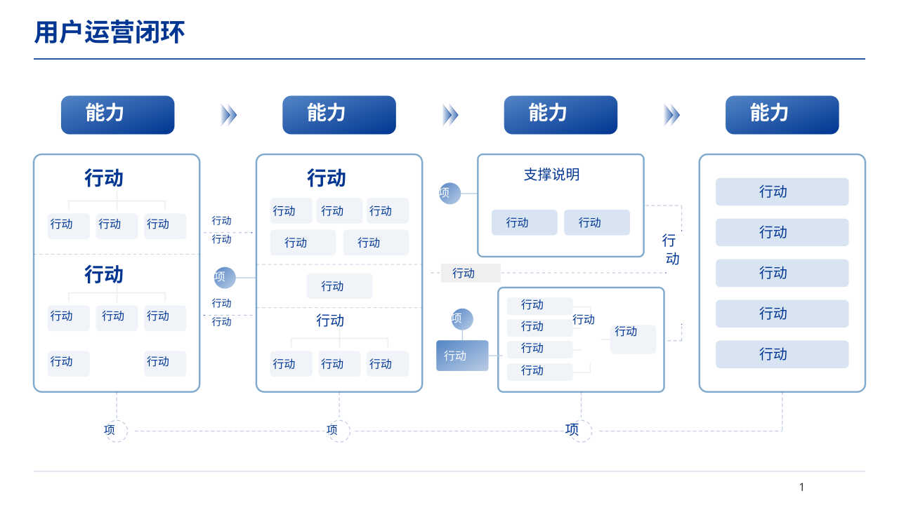

# 用户运营闭环

来源为房子图战略图.pptx#14。

## 结构与适用场景

顶部导入→触达→转化→持续运营；4纵向分组；公域/商域输入、私域/品牌触点、内容/CRM转化；底部虚线反推反馈

运营漏斗、用户经营闭环

可用于问题-动作-反馈的机制图，但应重新命名阶段并保留回路方向；需流程依据

固定节点、圆弧、扇区、分面和连接表达定性关系。数量比较、趋势或占比使用数据驱动图表，源页中已登记的微图槽可接收实际数据。

## 预览



## 调用

将下列完整page对象放入schema_version=1、template_id=business-blue-v1的pages数组，替换各节点内容。nodes键对应原文本框或已明确拆分的语义分段，字段角色及source_ref、segment见下表。

```json
{
  "id": "house-14",
  "family": "source-house",
  "variant": "page-14",
  "content": {
    "title": "用户运营闭环",
    "nodes": {
      "shape_341": "能力",
      "shape_354": "能力",
      "shape_361": "能力",
      "shape_359": "能力",
      "shape_401": "行动",
      "shape_331": "行动",
      "shape_334": "行动",
      "shape_337": "行动",
      "shape_328": "行动",
      "shape_324": "行动",
      "shape_32": "行动",
      "shape_159": "行动",
      "shape_201": "支撑说明",
      "shape_222": "行动",
      "shape_225": "行动",
      "shape_377": "行动",
      "shape_467": "项",
      "shape_468": "项",
      "shape_466": "项",
      "shape_469": "行动",
      "shape_70": "行动",
      "shape_138": "行动",
      "shape_213": "行动",
      "shape_218": "行动",
      "shape_216": "行动",
      "shape_190": "行动",
      "shape_99": "行动",
      "shape_100": "行动",
      "shape_109": "行动",
      "shape_110": "行动",
      "shape_111": "项",
      "shape_112": "项",
      "shape_113": "项",
      "shape_173": "行动",
      "shape_175": "行动",
      "shape_177": "行动",
      "shape_158": "行动",
      "shape_122": "行动",
      "shape_126": "行动",
      "shape_4": "行动",
      "shape_7": "行动",
      "shape_10": "行动",
      "shape_12": "行动",
      "shape_13": "行动",
      "shape_15": "行动",
      "shape_16": "行动",
      "shape_20": "行动",
      "shape_22": "行动",
      "shape_23": "行动",
      "shape_24": "行动",
      "shape_25": "行动",
      "shape_26": "行动"
    }
  },
  "config": {
    "show_source": true,
    "show_page_number": true
  }
}
```

config支持show_source、show_page_number、image_fit与image_position。image_fit可选contain或cover，image_position为xMin/xMid/xMax与YMin/YMid/YMax组合的九个焦点，默认为xMidYMid。字体、颜色、全局区和固定字阶取自tokens，节点数与连接结构由variant确定。

## 字段合同

每个业务节点required=true、min=1，max按具体框体登记。字符按规范化后的Unicode码点计数，空格标点换行均计入。build会以实际字体测量宽高，字符数通过后仍可能需要调整文字。

| 字段 | 节点角色与源标签 | 最短/最长 | 字阶 | 框体px | 原框引用 | 分段 | 旋转° | 垂直锚点 |
|---|---|---|---|---|---|---|---|---|
| nodes.shape_341 | 上左节点，源标签“流量导入” | 1/9 | heading | [106.0973, 143.7782, 123.1779, 40.42] | slide:341 |  | 0.0 | t |
| nodes.shape_354 | 上中节点，源标签“流量触达” | 1/9 | heading | [421.4943, 143.7782, 123.1779, 40.42] | slide:354 |  | 0.0 | t |
| nodes.shape_361 | 上中节点，源标签“促进转化” | 1/9 | heading | [736.8913, 143.7782, 123.1779, 40.42] | slide:361 |  | 0.0 | t |
| nodes.shape_359 | 上右节点，源标签“持续运营” | 1/9 | heading | [1052.2883, 143.7782, 123.1779, 40.42] | slide:359 |  | 0.0 | t |
| nodes.shape_401 | 中中节点，源标签“直接转化” | 1/11 | caption | [627.8365, 375.8337, 84.9883, 26.9432] | slide:401 |  | 0.0 | ctr |
| nodes.shape_331 | 中右节点，源标签“内容运营工具” | 1/21 | compactBody | [1019.1435, 369.5903, 189.4571, 39.5549] | slide:331 |  | 0.0 | ctr |
| nodes.shape_334 | 中右节点，源标签“投放指导工具” | 1/21 | compactBody | [1019.1435, 427.5312, 189.4571, 39.5549] | slide:334 |  | 0.0 | ctr |
| nodes.shape_337 | 下右节点，源标签“数据评估体系” | 1/21 | compactBody | [1019.1435, 485.4722, 189.4571, 39.5549] | slide:337 |  | 0.0 | ctr |
| nodes.shape_328 | 中右节点，源标签“品牌资产运营工具” | 1/21 | compactBody | [1019.1435, 311.6598, 189.4571, 39.5549] | slide:328 |  | 0.0 | ctr |
| nodes.shape_324 | 上右节点，源标签“关系管理工具” | 1/21 | compactBody | [1019.1435, 253.7189, 189.4571, 39.5549] | slide:324 |  | 0.0 | ctr |
| nodes.shape_32 | 上左节点，源标签“公域(原生关注)” | 1/15 | heading | [71.2952, 237.2299, 189.6551, 40.42] | slide:32 |  | 0.0 | t |
| nodes.shape_159 | 上中节点，源标签“私域流量” | 1/9 | heading | [422.4636, 237.2299, 121.2496, 40.42] | slide:159 |  | 0.0 | t |
| nodes.shape_201 | 上中节点，源标签“内容自主生产 / 内容联合运营” | 1/30 | compactBody | [729.4389, 237.2299, 138.0826, 57.253] | slide:201 |  | 0.0 | t |
| nodes.shape_222 | 中中节点，源标签“品牌+” | 1/13 | caption | [803.2227, 298.7771, 93.754, 36.7095] | slide:222 |  | 0.0 | ctr |
| nodes.shape_225 | 中中节点，源标签“智能短信” | 1/13 | caption | [699.9838, 298.7771, 93.754, 36.7095] | slide:225 |  | 0.0 | ctr |
| nodes.shape_377 | 中右节点，源标签“转化成交” | 1/10 | compactBody | [958.8887, 330.0458, 23.5245, 131.3494] | slide:377 |  | 0.0 | t |
| nodes.shape_467 | 中左节点，源标签“01” | 1/4 | caption | [304.7369, 384.2554, 31.1853, 25.3485] | slide:467 |  | 0.0 | t |
| nodes.shape_468 | 上中节点，源标签“03” | 1/4 | caption | [623.9592, 264.5692, 31.1853, 25.3485] | slide:468 |  | 0.0 | t |
| nodes.shape_466 | 中中节点，源标签“02” | 1/4 | caption | [641.5634, 443.4262, 31.1853, 25.3485] | slide:466 |  | 0.0 | t |
| nodes.shape_469 | 下中节点，源标签“粉丝关注 / 后反推” | 1/11 | caption | [615.8918, 491.6008, 84.9883, 30.956] | slide:469 |  | 0.0 | ctr |
| nodes.shape_70 | 中左节点，源标签“商域(推广广告)” | 1/15 | heading | [71.2952, 374.7705, 189.6551, 40.42] | slide:70 |  | 0.0 | t |
| nodes.shape_138 | 中中节点，源标签“品牌自由” | 1/10 | compactBody | [433.6891, 445.4378, 98.7883, 33.6764] | slide:138 |  | 0.0 | t |
| nodes.shape_213 | 下左节点，源标签“官网” | 1/8 | caption | [384.6181, 500.3248, 60.2756, 36.7095] | slide:213 |  | 0.0 | ctr |
| nodes.shape_218 | 下中节点，源标签“App” | 1/8 | caption | [453.3571, 500.3248, 60.2756, 36.7095] | slide:218 |  | 0.0 | ctr |
| nodes.shape_216 | 下中节点，源标签“App” | 1/8 | caption | [522.0961, 500.3248, 60.2756, 36.7095] | slide:216 |  | 0.0 | ctr |
| nodes.shape_190 | 中中节点，源标签“快应用” | 1/13 | caption | [436.8055, 389.5085, 93.754, 36.7095] | slide:190 |  | 0.0 | ctr |
| nodes.shape_99 | 中左节点，源标签“消费者链路分析” | 1/32 | diagramCompact | [272.8324, 424.0187, 103.5411, 40.42] | slide:99 |  | 0.0 | t |
| nodes.shape_100 | 中左节点，源标签“转化数据分析” | 1/16 | diagramCompact | [272.8324, 450.4408, 103.5411, 25.2547] | slide:100 |  | 0.0 | t |
| nodes.shape_109 | 中左节点，源标签“有效流量导入” | 1/16 | diagramCompact | [272.8324, 306.3025, 103.5411, 25.2547] | slide:109 |  | 0.0 | t |
| nodes.shape_110 | 中左节点，源标签“拉新扩增” | 1/16 | diagramCompact | [272.8324, 332.7245, 103.5411, 25.2547] | slide:110 |  | 0.0 | t |
| nodes.shape_111 | 下左节点，源标签“A” | 1/3 | caption | [154.2198, 602.9279, 23.8163, 25.3485] | slide:111 |  | 0.0 | t |
| nodes.shape_112 | 下中节点，源标签“B” | 1/3 | caption | [471.2636, 602.9279, 23.6391, 25.3485] | slide:112 |  | 0.0 | t |
| nodes.shape_113 | 下中节点，源标签“C” | 1/2 | compactBody | [814.198, 601.1143, 26.4429, 30.3932] | slide:113 |  | 0.0 | t |
| nodes.shape_173 | 中左节点，源标签“锁屏” | 1/8 | caption | [384.6181, 282.163, 60.2756, 36.7095] | slide:173 |  | 0.0 | ctr |
| nodes.shape_175 | 中中节点，源标签“游戏” | 1/9 | caption | [450.4908, 282.163, 66.0187, 36.7095] | slide:175 |  | 0.0 | ctr |
| nodes.shape_177 | 中中节点，源标签“视频” | 1/8 | caption | [522.0961, 282.163, 60.2756, 36.7095] | slide:177 |  | 0.0 | ctr |
| nodes.shape_158 | 中左节点，源标签“智能短信” | 1/13 | caption | [384.6181, 327.4505, 93.754, 36.7095] | slide:158 |  | 0.0 | ctr |
| nodes.shape_122 | 中中节点，源标签“品牌+” | 1/13 | caption | [488.6178, 327.4505, 93.754, 36.7095] | slide:122 |  | 0.0 | ctr |
| nodes.shape_126 | 中中节点，源标签“用户 / 关系” | 1/24 | caption | [818.8466, 445.2606, 44.9123, 80.8296] | slide:126 |  | 0.0 | t |
| nodes.shape_4 | 中左节点，源标签“内容” | 1/9 | caption | [64.9476, 309.0645, 65.7164, 30.3098] | slide:4 |  | 0.0 | t |
| nodes.shape_7 | 中左节点，源标签“服务” | 1/9 | caption | [133.6763, 309.0645, 65.7164, 30.3098] | slide:7 |  | 0.0 | t |
| nodes.shape_10 | 中左节点，源标签“社区” | 1/9 | caption | [202.4153, 309.0645, 65.7164, 30.3098] | slide:10 |  | 0.0 | t |
| nodes.shape_12 | 中左节点，源标签“第0屏” | 1/9 | caption | [64.9476, 440.1221, 65.7164, 30.3098] | slide:12 |  | 0.0 | t |
| nodes.shape_13 | 中左节点，源标签“全场景” | 1/10 | caption | [133.6763, 440.1221, 75.4618, 30.3098] | slide:13 |  | 0.0 | t |
| nodes.shape_15 | 中左节点，源标签“联盟” | 1/9 | caption | [202.4153, 440.1221, 65.7164, 30.3098] | slide:15 |  | 0.0 | t |
| nodes.shape_16 | 下左节点，源标签“线上” | 1/9 | caption | [64.9476, 505.0672, 65.7164, 30.3098] | slide:16 |  | 0.0 | t |
| nodes.shape_20 | 下左节点，源标签“线下” | 1/9 | caption | [202.4153, 505.0672, 65.7164, 30.3098] | slide:20 |  | 0.0 | t |
| nodes.shape_22 | 下中节点，源标签“全局搜索” | 1/13 | caption | [719.2245, 485.8265, 97.9857, 28.6317] | slide:22 |  | 0.0 | t |
| nodes.shape_23 | 中中节点，源标签“锁屏杂志” | 1/13 | caption | [719.2245, 423.9979, 97.9857, 28.6317] | slide:23 |  | 0.0 | t |
| nodes.shape_24 | 中中节点，源标签“主动Push” | 1/13 | caption | [719.2245, 454.9122, 97.9857, 28.6317] | slide:24 |  | 0.0 | t |
| nodes.shape_25 | 下中节点，源标签“应用分发” | 1/13 | caption | [719.2245, 517.7727, 97.9857, 28.6317] | slide:25 |  | 0.0 | t |
| nodes.shape_26 | 中右节点，源标签“商品 / 品牌详情” | 1/30 | caption | [863.6547, 462.0936, 75.8579, 63.1524] | slide:26 |  | 0.0 | t |

全局title必填、2至32码点，使用统一标题框。section_name可选0至24码点，source可选0至64码点。所有可编辑文本通过独立原生carrier导出，页码为派生文字。

## 来源处理

原生PPTX源件保存于用户材料目录，分发包仅含用户资产衍生的几何、字段和说明。原始逐框文字、源框与标准化框在page-catalog.json的variant.fields中。

源标题引用为`slide:6`，原文为“运营引擎 为用户提供终端顾问式服务”。模板默认标题依据真实结构设置。

密集全景中的diagramCompact为14px、diagramMicro为12px。适用于体系概览或附录局部标签，现场关键结论用统一标题与正常正文字阶表达。

源画布边界裁切已烘焙为可编辑Bezier几何，3D顶面、侧面与前面通过tokens配色的相对明暗保留。

