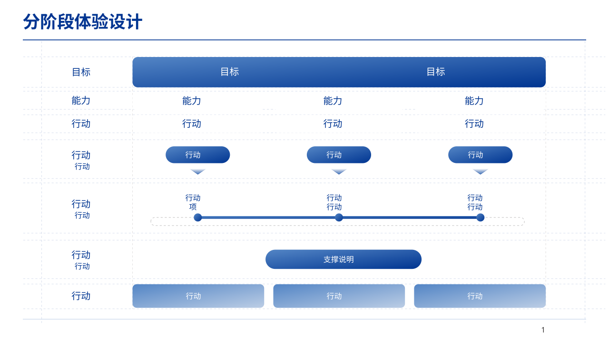

# 分阶段体验设计

来源为房子图战略图.pptx#15。

## 结构与适用场景

3阶段短视频时间轴1–3/4–24/25–30秒；目标/用户视角/结构/内容/表现/效果多条泳道

阶段化体验设计、用户旅程

横轴时间与纵轴维度独立，原页不是量化趋势图；适合说明旅程而非领导汇报KPI

固定节点、圆弧、扇区、分面和连接表达定性关系。数量比较、趋势或占比使用数据驱动图表，源页中已登记的微图槽可接收实际数据。

## 预览



## 调用

将下列完整page对象放入schema_version=1、template_id=business-blue-v1的pages数组，替换各节点内容。nodes键对应原文本框或已明确拆分的语义分段，字段角色及source_ref、segment见下表。

```json
{
  "id": "house-15",
  "family": "source-house",
  "variant": "page-15",
  "content": {
    "title": "分阶段体验设计",
    "nodes": {
      "shape_140": "行动",
      "shape_152": "支撑说明",
      "shape_159": "能力",
      "shape_160": "能力",
      "shape_161": "能力",
      "shape_162": "目标",
      "shape_163": "能力",
      "shape_164": "行动",
      "shape_165": "行动",
      "shape_166": "行动",
      "shape_167": "行动",
      "shape_168": "行动",
      "shape_169": "行动",
      "shape_170": "行动",
      "shape_171": "行动",
      "shape_172": "目标",
      "shape_173": "目标",
      "shape_184": "行动",
      "shape_185": "项",
      "shape_186": "行动",
      "shape_187": "行动",
      "shape_188": "行动",
      "shape_189": "行动",
      "shape_196": "行动",
      "shape_199": "行动",
      "shape_8": "行动",
      "shape_9": "行动",
      "shape_10": "行动",
      "shape_156": "行动",
      "shape_157": "行动",
      "shape_158": "行动"
    }
  },
  "config": {
    "show_source": true,
    "show_page_number": true
  }
}
```

config支持show_source、show_page_number、image_fit与image_position。image_fit可选contain或cover，image_position为xMin/xMid/xMax与YMin/YMid/YMax组合的九个焦点，默认为xMidYMid。字体、颜色、全局区和固定字阶取自tokens，节点数与连接结构由variant确定。

## 字段合同

每个业务节点required=true、min=1，max按具体框体登记。字符按规范化后的Unicode码点计数，空格标点换行均计入。build会以实际字体测量宽高，字符数通过后仍可能需要调整文字。

| 字段 | 节点角色与源标签 | 最短/最长 | 字阶 | 框体px | 原框引用 | 分段 | 旋转° | 垂直锚点 |
|---|---|---|---|---|---|---|---|---|
| nodes.shape_140 | 中左节点，源标签“奠定主题基调” | 1/18 | caption | [348.2364, 308.0608, 135.1584, 35.4888] | slide:140 |  | 0.0 | ctr |
| nodes.shape_152 | 下中节点，源标签“循序渐进 在转化的零界点推动用户行动” | 1/90 | caption | [558.0855, 525.6138, 328.01, 40.5784] | slide:152 |  | 0.0 | ctr |
| nodes.shape_159 | 上左节点，源标签“停留” | 1/30 | compactBody | [278.5285, 193.6238, 274.5741, 37.7402] | slide:159 |  | 0.0 | ctr |
| nodes.shape_160 | 上中节点，源标签“观看” | 1/30 | compactBody | [575.1577, 193.6238, 274.5741, 37.7402] | slide:160 |  | 0.0 | ctr |
| nodes.shape_161 | 上右节点，源标签“停留” | 1/30 | compactBody | [872.5018, 193.6238, 274.5741, 37.7402] | slide:161 |  | 0.0 | ctr |
| nodes.shape_162 | 上左节点，源标签“情境目标” | 1/8 | compactBody | [142.986, 140.3213, 80.4527, 25.0] | slide:162 |  | 0.0 | t |
| nodes.shape_163 | 上左节点，源标签“用户视角” | 1/8 | compactBody | [142.986, 199.9352, 80.4527, 25.0] | slide:163 |  | 0.0 | t |
| nodes.shape_164 | 上左节点，源标签“短广结构” | 1/8 | compactBody | [142.986, 248.9004, 80.4527, 25.0] | slide:164 |  | 0.0 | t |
| nodes.shape_165 | 中左节点，源标签“娱乐化包装” | 1/11 | compactBody | [132.9241, 315.1831, 100.5552, 25.0] | slide:165 |  | 0.0 | t |
| nodes.shape_166 | 中左节点，源标签“视觉层面” | 1/8 | caption | [153.0373, 340.1437, 60.3395, 20.0] | slide:166 |  | 0.0 | t |
| nodes.shape_167 | 中左节点，源标签“内容力增强” | 1/11 | compactBody | [132.9241, 418.0857, 100.5552, 25.0] | slide:167 |  | 0.0 | t |
| nodes.shape_168 | 中左节点，源标签“逻辑层面” | 1/8 | caption | [153.0373, 443.0463, 60.3395, 20.0] | slide:168 |  | 0.0 | t |
| nodes.shape_169 | 下左节点，源标签“极致获得感” | 1/11 | compactBody | [132.9241, 525.2457, 100.5552, 25.0] | slide:169 |  | 0.0 | t |
| nodes.shape_170 | 下左节点，源标签“体感层面” | 1/8 | caption | [153.0373, 550.2063, 60.3395, 20.0] | slide:170 |  | 0.0 | t |
| nodes.shape_171 | 下左节点，源标签“预期效果” | 1/8 | compactBody | [142.986, 611.5456, 80.4527, 25.0] | slide:171 |  | 0.0 | t |
| nodes.shape_172 | 上中节点，源标签“用短视频让更多用户感到价值” | 1/29 | compactBody | [364.583, 139.4357, 261.4605, 25.0] | slide:172 |  | 0.0 | t |
| nodes.shape_173 | 上中节点，源标签“完成下载并打开优酷的行为” | 1/26 | compactBody | [807.8409, 139.4357, 241.3473, 25.0] | slide:173 |  | 0.0 | t |
| nodes.shape_184 | 中左节点，源标签“吸睛开篇” | 1/8 | caption | [384.216, 406.2504, 63.2098, 20.0] | slide:184 |  | 0.0 | t |
| nodes.shape_185 | 中左节点，源标签“1-3s” | 1/4 | caption | [399.2075, 425.446, 33.2161, 20.0] | slide:185 |  | 0.0 | t |
| nodes.shape_186 | 中中节点，源标签“高能叙事” | 1/8 | caption | [681.1973, 406.2504, 63.2098, 20.0] | slide:186 |  | 0.0 | t |
| nodes.shape_187 | 中中节点，源标签“4-24s” | 1/5 | caption | [691.7927, 425.446, 42.0189, 20.0] | slide:187 |  | 0.0 | t |
| nodes.shape_188 | 中右节点，源标签“强力号召” | 1/8 | caption | [977.1116, 406.2504, 63.2098, 20.0] | slide:188 |  | 0.0 | t |
| nodes.shape_189 | 中右节点，源标签“25-30s” | 1/7 | caption | [983.1296, 425.446, 51.1739, 20.0] | slide:189 |  | 0.0 | t |
| nodes.shape_196 | 中中节点，源标签“渲染视觉氛围” | 1/18 | caption | [644.8656, 308.0608, 135.1584, 35.4888] | slide:196 |  | 0.0 | ctr |
| nodes.shape_199 | 中右节点，源标签“烘托产品价值” | 1/18 | caption | [942.2097, 308.0608, 135.1584, 35.4888] | slide:199 |  | 0.0 | ctr |
| nodes.shape_8 | 下左节点，源标签“打破刻板印象：去广告心智” | 1/76 | caption | [278.5285, 598.3199, 276.7081, 49.6801] | slide:8 |  | 0.0 | ctr |
| nodes.shape_9 | 下中节点，源标签“结合优酷内容、可复制” | 1/76 | caption | [574.4428, 598.3199, 276.7081, 49.6801] | slide:9 |  | 0.0 | ctr |
| nodes.shape_10 | 下右节点，源标签“亮明钩子、指引行动” | 1/76 | caption | [870.3678, 598.3199, 276.7081, 49.6801] | slide:10 |  | 0.0 | ctr |
| nodes.shape_156 | 上左节点，源标签“前” | 1/30 | compactBody | [278.5285, 241.842, 274.5741, 37.7402] | slide:156 |  | 0.0 | ctr |
| nodes.shape_157 | 上中节点，源标签“中” | 1/30 | compactBody | [575.1577, 241.842, 274.5741, 37.7402] | slide:157 |  | 0.0 | ctr |
| nodes.shape_158 | 上右节点，源标签“后” | 1/30 | compactBody | [872.5018, 241.842, 274.5741, 37.7402] | slide:158 |  | 0.0 | ctr |

全局title必填、2至32码点，使用统一标题框。section_name可选0至24码点，source可选0至64码点。所有可编辑文本通过独立原生carrier导出，页码为派生文字。

## 来源处理

原生PPTX源件保存于用户材料目录，分发包仅含用户资产衍生的几何、字段和说明。原始逐框文字、源框与标准化框在page-catalog.json的variant.fields中。

源标题引用为`slide:37`，原文为“覆盖用户的生命周期”。模板默认标题依据真实结构设置。

密集全景中的diagramCompact为14px、diagramMicro为12px。适用于体系概览或附录局部标签，现场关键结论用统一标题与正常正文字阶表达。

源画布边界裁切已烘焙为可编辑Bezier几何，3D顶面、侧面与前面通过tokens配色的相对明暗保留。

