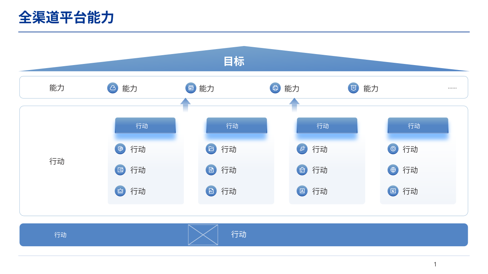

# 全渠道平台能力

来源为房子图战略图.pptx#16。

## 结构与适用场景

屋顶总目标；多渠道入口行；4纵向能力簇；底部开放生态；4上行连接箭头

全渠道平台能力架构

入口、能力簇、能力子项、底座开放生态分别字段

固定节点、圆弧、扇区、分面和连接表达定性关系。数量比较、趋势或占比使用数据驱动图表，源页中已登记的微图槽可接收实际数据。

## 预览



## 调用

将下列完整page对象放入schema_version=1、template_id=business-blue-v1的pages数组，替换各节点内容。nodes键对应原文本框或已明确拆分的语义分段，字段角色及source_ref、segment见下表。

```json
{
  "id": "house-16",
  "family": "source-house",
  "variant": "page-16",
  "content": {
    "title": "全渠道平台能力",
    "nodes": {
      "shape_103": "目标",
      "shape_104": "能力",
      "shape_105": "能力",
      "shape_106": "能力",
      "shape_107": "能力",
      "shape_108": "能力",
      "shape_109": "行动",
      "shape_110": "行动",
      "shape_111": "行动",
      "shape_112": "行动",
      "shape_113": "行动",
      "shape_114": "行动",
      "shape_115": "行动",
      "shape_116": "行动",
      "shape_117": "行动",
      "shape_118": "行动",
      "shape_119": "行动",
      "shape_120": "行动",
      "shape_121": "行动",
      "shape_122": "行动",
      "shape_123": "行动",
      "shape_124": "行动",
      "shape_125": "行动",
      "shape_126": "行动",
      "shape_127": "行动"
    }
  },
  "config": {
    "show_source": true,
    "show_page_number": true
  }
}
```

config支持show_source、show_page_number、image_fit与image_position。image_fit可选contain或cover，image_position为xMin/xMid/xMax与YMin/YMid/YMax组合的九个焦点，默认为xMidYMid。字体、颜色、全局区和固定字阶取自tokens，节点数与连接结构由variant确定。

## 字段合同

每个业务节点required=true、min=1，max按具体框体登记。字符按规范化后的Unicode码点计数，空格标点换行均计入。build会以实际字体测量宽高，字符数通过后仍可能需要调整文字。

| 字段 | 节点角色与源标签 | 最短/最长 | 字阶 | 框体px | 原框引用 | 分段 | 旋转° | 垂直锚点 |
|---|---|---|---|---|---|---|---|---|
| nodes.shape_103 | 上中节点，源标签“从采到销一站式智慧经营赋能” | 1/28 | heading | [451.8384, 144.5391, 358.8547, 35.0] | slide:103 |  | 0.0 | t |
| nodes.shape_104 | 上左节点，源标签“全域经营” | 1/8 | compactBody | [117.9462, 219.1931, 77.2965, 25.0] | slide:104 |  | 0.0 | t |
| nodes.shape_105 | 上左节点，源标签“线下门店” | 1/8 | compactBody | [320.4548, 221.2536, 77.2965, 25.0] | slide:105 |  | 0.0 | t |
| nodes.shape_106 | 上中节点，源标签“小程序商城” | 1/10 | compactBody | [522.1228, 221.2536, 96.6104, 25.0] | slide:106 |  | 0.0 | t |
| nodes.shape_107 | 上中节点，源标签“外卖平台” | 1/8 | compactBody | [745.6984, 221.2536, 77.2965, 25.0] | slide:107 |  | 0.0 | t |
| nodes.shape_108 | 上右节点，源标签“生活服务平台” | 1/12 | compactBody | [953.0765, 221.2536, 115.9345, 25.0] | slide:108 |  | 0.0 | t |
| nodes.shape_109 | 中左节点，源标签“智能化供应链升级” | 1/18 | caption | [316.2107, 320.8407, 132.501, 20.0] | slide:109 |  | 0.0 | t |
| nodes.shape_110 | 中中节点，源标签“全渠道一体化经营” | 1/18 | caption | [553.1337, 320.8407, 132.501, 20.0] | slide:110 |  | 0.0 | t |
| nodes.shape_111 | 中中节点，源标签“全触点客户覆盖” | 1/16 | caption | [799.0473, 320.8407, 115.9345, 20.0] | slide:111 |  | 0.0 | t |
| nodes.shape_112 | 中右节点，源标签“全业务高效管理” | 1/16 | caption | [1038.441, 320.8407, 115.9345, 20.0] | slide:112 |  | 0.0 | t |
| nodes.shape_113 | 中左节点，源标签“全流程运营” | 1/10 | compactBody | [98.622, 412.6086, 96.6104, 25.0] | slide:113 |  | 0.0 | t |
| nodes.shape_114 | 下左节点，源标签“全域经营” | 1/8 | caption | [134.5126, 607.0531, 60.73, 20.0] | slide:114 |  | 0.0 | t |
| nodes.shape_115 | 中左节点，源标签“供应商协同” | 1/10 | compactBody | [341.9215, 381.0032, 96.6104, 25.0] | slide:115 |  | 0.0 | t |
| nodes.shape_116 | 中左节点，源标签“仓储分拣” | 1/8 | compactBody | [341.9215, 435.5208, 77.2965, 25.0] | slide:116 |  | 0.0 | t |
| nodes.shape_117 | 下左节点，源标签“成本核酸” | 1/8 | compactBody | [341.9215, 491.1968, 77.2965, 25.0] | slide:117 |  | 0.0 | t |
| nodes.shape_118 | 中中节点，源标签“门店上云” | 1/8 | compactBody | [580.126, 381.0032, 77.2965, 25.0] | slide:118 |  | 0.0 | t |
| nodes.shape_119 | 中中节点，源标签“全渠道销售” | 1/10 | compactBody | [580.126, 435.5208, 96.6104, 25.0] | slide:119 |  | 0.0 | t |
| nodes.shape_120 | 下中节点，源标签“直营/加盟管理” | 1/13 | compactBody | [580.126, 491.1968, 123.5309, 25.0] | slide:120 |  | 0.0 | t |
| nodes.shape_121 | 中中节点，源标签“云店促销” | 1/8 | compactBody | [818.9558, 381.0032, 77.2965, 25.0] | slide:121 |  | 0.0 | t |
| nodes.shape_122 | 中中节点，源标签“会员营销” | 1/8 | compactBody | [818.9558, 435.5208, 77.2965, 25.0] | slide:122 |  | 0.0 | t |
| nodes.shape_123 | 下中节点，源标签“分销裂变” | 1/8 | compactBody | [818.9558, 491.1968, 77.2965, 25.0] | slide:123 |  | 0.0 | t |
| nodes.shape_124 | 中右节点，源标签“移动店务” | 1/8 | compactBody | [1056.1659, 381.0032, 77.2965, 25.0] | slide:124 |  | 0.0 | t |
| nodes.shape_125 | 中右节点，源标签“财务结算” | 1/8 | compactBody | [1056.1659, 435.5208, 77.2965, 25.0] | slide:125 |  | 0.0 | t |
| nodes.shape_126 | 下右节点，源标签“大数据分析” | 1/10 | compactBody | [1056.1659, 491.1968, 96.6104, 25.0] | slide:126 |  | 0.0 | t |
| nodes.shape_127 | 下中节点，源标签“微盟云开放生态” | 1/15 | compactBody | [571.6992, 604.2199, 135.2586, 25.0] | slide:127 |  | 0.0 | t |

## 可替换图片

在content.visuals提供下列槽位对象，省略时显示中性空槽。每项含path和可选alt，path为--assets目录下的相对本地路径，1至260码点，alt为0至200码点。原案例照片、界面或品牌保留来源引用，默认页使用空槽。

- `visuals.picture_129`用于品牌或形象，框体为`[493.9517, 590.3632, 77.3785, 53.3899]`，源引用为`['slide:129']`。

```json
{
  "visuals": {
    "picture_129": {
      "path": "assets/replacement.png",
      "alt": "品牌或形象"
    }
  }
}
```


## 保留的原装饰

本页保留用户原模板的结构图标或装饰图片，逐项身份见source-field-coverage.json中本页retained_source_images。其中图片内固化的字形随整图编辑，可在PowerPoint中原生替换整图；nodes字段控制已登记的可编辑文字。参数图片替换使用本页image_slots列出的槽位。


全局title必填、2至32码点，使用统一标题框。section_name可选0至24码点，source可选0至64码点。所有可编辑文本通过独立原生carrier导出，页码为派生文字。

## 来源处理

原生PPTX源件保存于用户材料目录，分发包仅含用户资产衍生的几何、字段和说明。原始逐框文字、源框与标准化框在page-catalog.json的variant.fields中。

源标题引用为`slide:102`，原文为“智慧商超解决方案”。模板默认标题依据真实结构设置。

密集全景中的diagramCompact为14px、diagramMicro为12px。适用于体系概览或附录局部标签，现场关键结论用统一标题与正常正文字阶表达。

源画布边界裁切已烘焙为可编辑Bezier几何，3D顶面、侧面与前面通过tokens配色的相对明暗保留。

