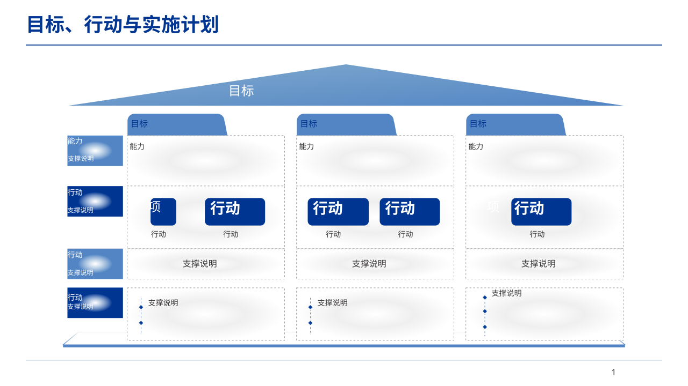

# 目标、行动与实施计划

来源为房子图战略图.pptx#17。

## 结构与适用场景

屋顶总计划；3列目标；4行具体行动/量化指标/公司关联/时间计划；底部时间箭头

年度计划与可执行性说明

指标按数值/单位/目标属性结构化；3列目标可扩但需限制复杂度

固定节点、圆弧、扇区、分面和连接表达定性关系。数量比较、趋势或占比使用数据驱动图表，源页中已登记的微图槽可接收实际数据。

## 预览



## 调用

将下列完整page对象放入schema_version=1、template_id=business-blue-v1的pages数组，替换各节点内容。nodes键对应原文本框或已明确拆分的语义分段，字段角色及source_ref、segment见下表。

```json
{
  "id": "house-17",
  "family": "source-house",
  "variant": "page-17",
  "content": {
    "title": "目标、行动与实施计划",
    "nodes": {
      "shape_30": "目标",
      "shape_6": "能力",
      "shape_7": "行动",
      "shape_15": "支撑说明",
      "shape_16": "支撑说明",
      "shape_24": "行动",
      "shape_25": "支撑说明",
      "shape_27": "行动",
      "shape_28": "支撑说明",
      "shape_11": "能力",
      "shape_13": "支撑说明",
      "shape_14": "支撑说明",
      "shape_34": "行动",
      "shape_35": "项",
      "shape_38": "行动",
      "shape_39": "行动",
      "shape_40": "目标",
      "shape_545": "能力",
      "shape_546": "支撑说明",
      "shape_547": "支撑说明",
      "shape_548": "行动",
      "shape_549": "行动",
      "shape_551": "行动",
      "shape_552": "行动",
      "shape_553": "目标",
      "shape_564": "能力",
      "shape_565": "支撑说明",
      "shape_566": "支撑说明",
      "shape_568": "项",
      "shape_570": "行动",
      "shape_571": "行动",
      "shape_572": "目标"
    }
  },
  "config": {
    "show_source": true,
    "show_page_number": true
  }
}
```

config支持show_source、show_page_number、image_fit与image_position。image_fit可选contain或cover，image_position为xMin/xMid/xMax与YMin/YMid/YMax组合的九个焦点，默认为xMidYMid。字体、颜色、全局区和固定字阶取自tokens，节点数与连接结构由variant确定。

## 字段合同

每个业务节点required=true、min=1，max按具体框体登记。字符按规范化后的Unicode码点计数，空格标点换行均计入。build会以实际字体测量宽高，字符数通过后仍可能需要调整文字。

| 字段 | 节点角色与源标签 | 最短/最长 | 字阶 | 框体px | 原框引用 | 分段 | 旋转° | 垂直锚点 |
|---|---|---|---|---|---|---|---|---|
| nodes.shape_30 | 上中节点，源标签“明年工作计划、工作目标、SMART模型” | 1/38 | body | [424.6248, 155.1607, 419.1156, 35.913] | slide:30 |  | 0.0 | t |
| nodes.shape_6 | 上左节点，源标签“具体的 / 目标/行动” | 1/24 | diagramCompact | [125.4727, 254.7527, 77.1432, 41.4354] | slide:6 |  | 0.0 | t |
| nodes.shape_7 | 中左节点，源标签“可量化 / 的指标” | 1/18 | diagramCompact | [125.4727, 350.4636, 58.0113, 41.4354] | slide:7 |  | 0.0 | t |
| nodes.shape_15 | 中左节点，源标签“Enter your title” | 1/17 | diagramMicro | [126.3275, 288.0754, 96.2922, 20.7134] | slide:15 |  | 0.0 | t |
| nodes.shape_16 | 中左节点，源标签“Enter your title” | 1/17 | diagramMicro | [125.4727, 384.2821, 96.2922, 20.7134] | slide:16 |  | 0.0 | t |
| nodes.shape_24 | 中左节点，源标签“与公司/部门 / 的目标关联” | 1/28 | diagramCompact | [125.4727, 467.0247, 90.9578, 41.4354] | slide:24 |  | 0.0 | t |
| nodes.shape_25 | 下左节点，源标签“Enter your title” | 1/17 | diagramMicro | [125.4727, 500.8347, 96.2922, 20.7134] | slide:25 |  | 0.0 | t |
| nodes.shape_27 | 下左节点，源标签“时间计划” | 1/11 | diagramCompact | [125.4727, 546.553, 71.8174, 24.8595] | slide:27 |  | 0.0 | t |
| nodes.shape_28 | 下左节点，源标签“Enter your title” | 1/17 | diagramMicro | [125.4727, 564.129, 96.2922, 20.7134] | slide:28 |  | 0.0 | t |
| nodes.shape_11 | 上左节点，源标签“明年计划提供更多渠道的客服支持，以提高客户满意度。计划增加电话客服、电子邮件客服” | 1/176 | diagramCompact | [241.2046, 264.8828, 281.6701, 68.9108] | slide:11 |  | 0.0 | t |
| nodes.shape_13 | 下左节点，源标签“《客户至上的品牌形象提升计划》” | 1/39 | caption | [238.0672, 481.5489, 287.9534, 27.6208] | slide:13 |  | 0.0 | t |
| nodes.shape_14 | 下左节点，源标签“3月份 — 开通电话、邮箱服务； / 4月份 — 开通北京线下服务中心” | 1/102 | diagramCompact | [275.5531, 556.3583, 216.5634, 55.4381] | slide:14 |  | 0.0 | t |
| nodes.shape_34 | 中左节点，源标签“新增渠道数量” | 1/17 | diagramCompact | [247.4622, 428.4787, 113.0903, 24.8595] | slide:34 |  | 0.0 | t |
| nodes.shape_35 | 中左节点，源标签“3” | 1/2 | body | [289.3235, 371.7583, 26.88, 46.5646] | slide:35 |  | 0.0 | t |
| nodes.shape_38 | 中左节点，源标签“客户满意度” | 1/17 | diagramCompact | [381.7703, 428.4787, 113.0903, 24.8595] | slide:38 |  | 0.0 | t |
| nodes.shape_39 | 中左节点，源标签“≥98%” | 1/8 | heading | [383.4801, 371.7583, 107.1832, 46.5646] | slide:39 |  | 0.0 | t |
| nodes.shape_40 | 上左节点，源标签“多渠道的客服支持” | 1/24 | caption | [243.0511, 220.4212, 179.0861, 27.6208] | slide:40 |  | 0.0 | t |
| nodes.shape_545 | 上中节点，源标签“对于常客，可以通过积分系统、会员制度等方式，给予一定的优惠和特权，增强他们的忠诚” | 1/176 | diagramCompact | [556.2572, 264.8828, 281.6701, 68.9108] | slide:545 |  | 0.0 | t |
| nodes.shape_546 | 下中节点，源标签“《客户至上的品牌形象提升计划》” | 1/39 | caption | [553.1199, 481.5489, 287.9534, 27.6208] | slide:546 |  | 0.0 | t |
| nodes.shape_547 | 下中节点，源标签“10月份 — 完成会员系统建设； / 11月份 — 通过试运行，正式上线。” | 1/136 | diagramCompact | [590.6058, 556.3583, 216.5634, 80.5456] | slide:547 |  | 0.0 | t |
| nodes.shape_548 | 中中节点，源标签“会员系统建设” | 1/17 | diagramCompact | [572.7733, 428.4787, 113.0903, 24.8595] | slide:548 |  | 0.0 | t |
| nodes.shape_549 | 中中节点，源标签“100%” | 1/8 | heading | [574.6454, 371.7583, 106.8584, 46.5646] | slide:549 |  | 0.0 | t |
| nodes.shape_551 | 中中节点，源标签“客户复购率” | 1/17 | diagramCompact | [707.0814, 428.4787, 113.0903, 24.8595] | slide:551 |  | 0.0 | t |
| nodes.shape_552 | 中中节点，源标签“≥35%” | 1/8 | heading | [708.7911, 371.7583, 107.1832, 46.5646] | slide:552 |  | 0.0 | t |
| nodes.shape_553 | 上中节点，源标签“建立会员积分制度” | 1/24 | caption | [558.1037, 220.4212, 179.0861, 27.6208] | slide:553 |  | 0.0 | t |
| nodes.shape_564 | 上右节点，源标签“明年计划提供将新开发的XX产品进行全面的市场推广，计划通过活动、广告进行大量的曝” | 1/176 | diagramCompact | [871.3099, 264.8828, 281.6701, 68.9108] | slide:564 |  | 0.0 | t |
| nodes.shape_565 | 下右节点，源标签“《新的增长点、新产品计划》” | 1/39 | caption | [868.1725, 481.5489, 287.9534, 27.6208] | slide:565 |  | 0.0 | t |
| nodes.shape_566 | 下右节点，源标签“3月份 — 完成投放计划的制定  / 4-10月份 — 投放广告 / 12月份 — 基本” | 1/136 | diagramCompact | [914.5491, 538.4916, 216.5634, 80.3062] | slide:566 |  | 0.0 | t |
| nodes.shape_568 | 中右节点，源标签“3” | 1/2 | body | [919.4289, 371.7583, 26.88, 46.5646] | slide:568 |  | 0.0 | t |
| nodes.shape_570 | 中右节点，源标签“销售额” | 1/17 | diagramCompact | [951.958, 428.4787, 113.0903, 24.8595] | slide:570 |  | 0.0 | t |
| nodes.shape_571 | 中右节点，源标签“1000W” | 1/9 | heading | [944.6318, 371.7583, 116.2021, 49.6421] | slide:571 |  | 0.0 | t |
| nodes.shape_572 | 上右节点，源标签“提高XX产品销售额” | 1/24 | caption | [873.1564, 220.4212, 179.0861, 27.6208] | slide:572 |  | 0.0 | t |

全局title必填、2至32码点，使用统一标题框。section_name可选0至24码点，source可选0至64码点。所有可编辑文本通过独立原生carrier导出，页码为派生文字。

## 来源处理

原生PPTX源件保存于用户材料目录，分发包仅含用户资产衍生的几何、字段和说明。原始逐框文字、源框与标准化框在page-catalog.json的variant.fields中。

源标题引用为`slide:79`，原文为“房子图/策略/定位”。模板默认标题依据真实结构设置。

密集全景中的diagramCompact为14px、diagramMicro为12px。适用于体系概览或附录局部标签，现场关键结论用统一标题与正常正文字阶表达。

源画布边界裁切已烘焙为可编辑Bezier几何，3D顶面、侧面与前面通过tokens配色的相对明暗保留。

