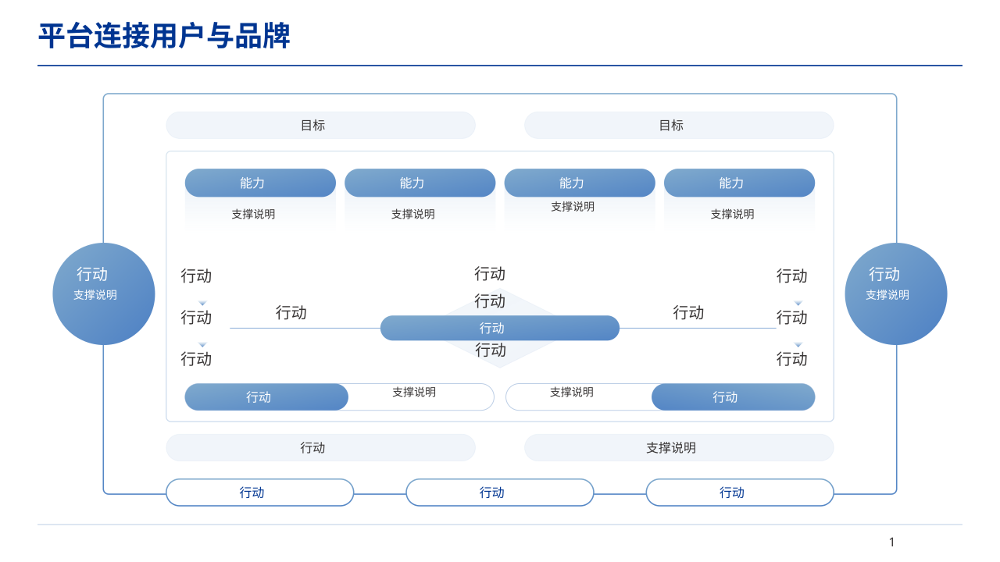

# 平台连接用户与品牌

来源为房子图战略图.pptx#19。

## 结构与适用场景

左用户圈、右品牌圈；中央线上4活动柱和线下活动带；上下曝光资源与底部3类价值；外部大环线连接双方

平台连接两端群体、触点运营

用户与品牌两端角色、线上/线下层和连接方向独立；适合双边关系，不能把两端强行改为因果

固定节点、圆弧、扇区、分面和连接表达定性关系。数量比较、趋势或占比使用数据驱动图表，源页中已登记的微图槽可接收实际数据。

## 预览



## 调用

将下列完整page对象放入schema_version=1、template_id=business-blue-v1的pages数组，替换各节点内容。nodes键对应原文本框或已明确拆分的语义分段，字段角色及source_ref、segment见下表。

```json
{
  "id": "house-19",
  "family": "source-house",
  "variant": "page-19",
  "content": {
    "title": "平台连接用户与品牌",
    "nodes": {
      "shape_10": "行动",
      "shape_11": "行动",
      "shape_12": "行动",
      "shape_14": "目标",
      "shape_15": "目标",
      "shape_18": "行动",
      "shape_19": "支撑说明",
      "shape_36": "支撑说明",
      "shape_37": "能力",
      "shape_42": "支撑说明",
      "shape_43": "能力",
      "shape_46": "支撑说明",
      "shape_47": "能力",
      "shape_50": "支撑说明",
      "shape_51": "能力",
      "shape_57": "行动",
      "shape_59": "支撑说明",
      "shape_143": "行动",
      "shape_144": "行动",
      "shape_149": "行动",
      "shape_153": "行动",
      "shape_154": "行动",
      "shape_156": "行动",
      "shape_160": "行动",
      "shape_161": "行动",
      "shape_163": "行动",
      "shape_54": "行动",
      "shape_166": "行动",
      "shape_167": "行动",
      "shape_207": "行动",
      "shape_205": "支撑说明",
      "shape_208": "行动",
      "shape_209": "支撑说明",
      "shape_220": "行动",
      "shape_221": "支撑说明"
    }
  },
  "config": {
    "show_source": true,
    "show_page_number": true
  }
}
```

config支持show_source、show_page_number、image_fit与image_position。image_fit可选contain或cover，image_position为xMin/xMid/xMax与YMin/YMid/YMax组合的九个焦点，默认为xMidYMid。字体、颜色、全局区和固定字阶取自tokens，节点数与连接结构由variant确定。

## 字段合同

每个业务节点required=true、min=1，max按具体框体登记。字符按规范化后的Unicode码点计数，空格标点换行均计入。build会以实际字体测量宽高，字符数通过后仍可能需要调整文字。

| 字段 | 节点角色与源标签 | 最短/最长 | 字阶 | 框体px | 原框引用 | 分段 | 旋转° | 垂直锚点 |
|---|---|---|---|---|---|---|---|---|
| nodes.shape_10 | 下左节点，源标签“用户的知识圣地” | 1/33 | caption | [212.7861, 613.7532, 239.9208, 34.2468] | slide:10 |  | 0.0 | ctr |
| nodes.shape_11 | 下中节点，源标签“创作者的圈层盛典” | 1/33 | caption | [520.0396, 613.7532, 239.9208, 34.2468] | slide:11 |  | 0.0 | ctr |
| nodes.shape_12 | 下中节点，源标签“品牌的超级盛会” | 1/33 | caption | [827.293, 613.7532, 239.9208, 34.2468] | slide:12 |  | 0.0 | ctr |
| nodes.shape_14 | 上左节点，源标签“抖音：固定入口+黄金资源曝光” | 1/54 | caption | [212.7861, 143.2085, 395.6856, 34.2468] | slide:14 |  | 0.0 | ctr |
| nodes.shape_15 | 上中节点，源标签“公益背书+亿级VV宣发” | 1/54 | caption | [671.5283, 143.2085, 395.6856, 34.2468] | slide:15 |  | 0.0 | ctr |
| nodes.shape_18 | 下左节点，源标签“官方百万流量激励” | 1/54 | caption | [212.7861, 556.2883, 395.6856, 34.2468] | slide:18 |  | 0.0 | ctr |
| nodes.shape_19 | 下中节点，源标签“品牌线上线下big day” | 1/54 | caption | [671.5283, 556.2883, 395.6856, 34.2468] | slide:19 |  | 0.0 | ctr |
| nodes.shape_36 | 上左节点，源标签“分赛道打榜 / 流量扶持/荣誉认证” | 1/44 | diagramCompact | [263.8467, 266.0325, 139.0767, 49.1354] | slide:36 |  | 0.0 | t |
| nodes.shape_37 | 上左节点，源标签“TOP领学官打榜赛” | 1/26 | caption | [236.7685, 216.1135, 193.233, 36.288] | slide:37 |  | 0.0 | ctr |
| nodes.shape_42 | 上中节点，源标签“名师系列付费直播课 / 品牌定制大师课” | 1/46 | diagramCompact | [463.9387, 266.0325, 147.7061, 49.1354] | slide:42 |  | 0.0 | t |
| nodes.shape_43 | 上中节点，源标签“创作者分层跃迁” | 1/26 | caption | [441.1753, 216.1135, 193.233, 36.288] | slide:43 |  | 0.0 | ctr |
| nodes.shape_46 | 上中节点，源标签“优质创作者主题分享 / 研学、闭门会、培训营 / 品牌定制大讲堂” | 1/100 | diagramCompact | [661.1866, 256.3776, 162.0336, 69.7705] | slide:46 |  | 0.0 | t |
| nodes.shape_47 | 上中节点，源标签“研学与成长” | 1/26 | caption | [645.5917, 216.1135, 193.233, 36.288] | slide:47 |  | 0.0 | ctr |
| nodes.shape_50 | 上右节点，源标签“官方公益活动 / 彰显品牌社会责任” | 1/42 | diagramCompact | [879.9305, 266.0325, 133.3786, 49.1354] | slide:50 |  | 0.0 | t |
| nodes.shape_51 | 上右节点，源标签“研学与成长” | 1/26 | caption | [849.9985, 216.1135, 193.233, 36.288] | slide:51 |  | 0.0 | ctr |
| nodes.shape_57 | 下中节点，源标签“品牌定制线下互动活动” | 1/29 | caption | [834.065, 491.4807, 209.1665, 34.2468] | slide:57 |  | 0.0 | ctr |
| nodes.shape_59 | 下中节点，源标签“品牌线上线下big day” | 1/29 | diagramCompact | [647.5459, 493.9863, 186.6062, 28.5003] | slide:59 |  | 0.0 | t |
| nodes.shape_143 | 中左节点，源标签“曝光” | 1/6 | compactBody | [231.1381, 342.0719, 55.2302, 29.2549] | slide:143 |  | 0.0 | t |
| nodes.shape_144 | 中左节点，源标签“互动” | 1/6 | compactBody | [231.1381, 395.3092, 55.2302, 29.2549] | slide:144 |  | 0.0 | t |
| nodes.shape_149 | 中左节点，源标签“转化” | 1/6 | compactBody | [231.1381, 448.5464, 55.2302, 29.2549] | slide:149 |  | 0.0 | t |
| nodes.shape_153 | 中右节点，源标签“内容” | 1/6 | compactBody | [993.6414, 342.0719, 55.2302, 29.2549] | slide:153 |  | 0.0 | t |
| nodes.shape_154 | 中右节点，源标签“场景” | 1/6 | compactBody | [993.6414, 395.3092, 55.2302, 29.2549] | slide:154 |  | 0.0 | t |
| nodes.shape_156 | 中右节点，源标签“课程” | 1/6 | compactBody | [993.6414, 448.5464, 55.2302, 29.2549] | slide:156 |  | 0.0 | t |
| nodes.shape_160 | 中左节点，源标签“多元高质量知识内容” | 1/20 | compactBody | [294.2431, 389.108, 182.8719, 31.2574] | slide:160 |  | 0.0 | t |
| nodes.shape_161 | 中中节点，源标签“多维品牌定制空间” | 1/18 | compactBody | [812.0078, 389.108, 164.636, 31.2574] | slide:161 |  | 0.0 | t |
| nodes.shape_163 | 中中节点，源标签“多场景触点连接” | 1/16 | compactBody | [566.7951, 339.2857, 146.4001, 31.2574] | slide:163 |  | 0.0 | t |
| nodes.shape_54 | 中中节点，源标签“知识创作者参与” | 1/42 | caption | [486.828, 404.1804, 306.3538, 32.1571] | slide:54 |  | 0.0 | ctr |
| nodes.shape_166 | 中中节点，源标签“online” | 1/7 | compactBody | [605.1438, 374.3064, 69.7125, 31.2574] | slide:166 |  | 0.0 | t |
| nodes.shape_167 | 中中节点，源标签“offline” | 1/7 | compactBody | [605.1438, 436.9664, 71.8311, 31.2574] | slide:167 |  | 0.0 | t |
| nodes.shape_207 | 下左节点，源标签“线下沙龙/峰会” | 1/29 | caption | [236.7685, 491.4807, 209.1665, 34.2468] | slide:207 |  | 0.0 | ctr |
| nodes.shape_205 | 下中节点，源标签“领学知识局 &#124; future 大会” | 1/29 | diagramCompact | [445.8479, 493.9863, 186.6062, 28.5003] | slide:205 |  | 0.0 | t |
| nodes.shape_208 | 中左节点，源标签“用户” | 1/6 | compactBody | [103.2932, 339.8081, 55.2302, 31.2574] | slide:208 |  | 0.0 | t |
| nodes.shape_209 | 中左节点，源标签“高效便捷选课 / 促进用户决策” | 1/32 | diagramCompact | [78.5466, 369.479, 104.7235, 43.7662] | slide:209 |  | 0.0 | t |
| nodes.shape_220 | 中右节点，源标签“品牌” | 1/6 | compactBody | [1117.4135, 339.8081, 55.2302, 31.2574] | slide:220 |  | 0.0 | t |
| nodes.shape_221 | 中右节点，源标签“品牌形象塑造 / 短链高效转化” | 1/32 | diagramCompact | [1092.6668, 369.479, 104.7235, 43.7662] | slide:221 |  | 0.0 | t |

全局title必填、2至32码点，使用统一标题框。section_name可选0至24码点，source可选0至64码点。所有可编辑文本通过独立原生carrier导出，页码为派生文字。

## 来源处理

原生PPTX源件保存于用户材料目录，分发包仅含用户资产衍生的几何、字段和说明。原始逐框文字、源框与标准化框在page-catalog.json的variant.fields中。

源标题引用为`slide:184`，原文为“建立品牌与用户的多触点链接”。模板默认标题依据真实结构设置。

密集全景中的diagramCompact为14px、diagramMicro为12px。适用于体系概览或附录局部标签，现场关键结论用统一标题与正常正文字阶表达。

源画布边界裁切已烘焙为可编辑Bezier几何，3D顶面、侧面与前面通过tokens配色的相对明暗保留。

