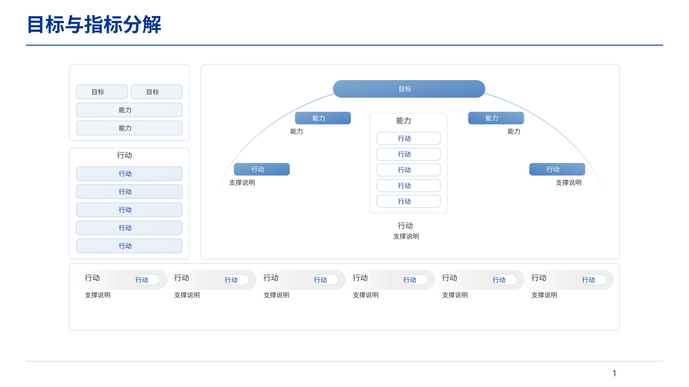

# 目标与指标分解

来源为房子图战略图.pptx#20。

## 结构与适用场景

左目标列表2组；右顶产品需求椭圆；弧线串联4数据/核心目标簇；底部6个指标卡

目标到指标分解

原图环弧多但缺明确箭头，不能据此定义因果或时间；子目标与指标支持独立

固定节点、圆弧、扇区、分面和连接表达定性关系。数量比较、趋势或占比使用数据驱动图表，源页中已登记的微图槽可接收实际数据。

## 预览



## 调用

将下列完整page对象放入schema_version=1、template_id=business-blue-v1的pages数组，替换各节点内容。nodes键对应原文本框或已明确拆分的语义分段，字段角色及source_ref、segment见下表。

```json
{
  "id": "house-20",
  "family": "source-house",
  "variant": "page-20",
  "content": {
    "title": "目标与指标分解",
    "nodes": {
      "shape_60": "目标",
      "shape_61": "目标",
      "shape_62": "能力",
      "shape_64": "能力",
      "shape_71": "行动",
      "shape_73": "行动",
      "shape_75": "行动",
      "shape_77": "行动",
      "shape_84": "行动",
      "shape_87": "行动",
      "shape_137": "支撑说明",
      "shape_194": "行动",
      "shape_215": "行动",
      "shape_219": "支撑说明",
      "shape_221": "行动",
      "shape_222": "行动",
      "shape_225": "支撑说明",
      "shape_227": "行动",
      "shape_228": "行动",
      "shape_231": "支撑说明",
      "shape_233": "行动",
      "shape_234": "行动",
      "shape_237": "支撑说明",
      "shape_239": "行动",
      "shape_240": "行动",
      "shape_243": "支撑说明",
      "shape_245": "行动",
      "shape_246": "行动",
      "shape_23": "能力",
      "shape_24": "能力",
      "shape_30": "能力",
      "shape_31": "能力",
      "shape_27": "行动",
      "shape_28": "支撑说明",
      "shape_33": "行动",
      "shape_34": "支撑说明",
      "shape_38": "行动",
      "shape_39": "行动",
      "shape_40": "行动",
      "shape_41": "行动",
      "shape_42": "行动",
      "shape_22": "目标",
      "shape_55": "能力",
      "shape_57": "行动",
      "shape_63": "支撑说明"
    }
  },
  "config": {
    "show_source": true,
    "show_page_number": true
  }
}
```

config支持show_source、show_page_number、image_fit与image_position。image_fit可选contain或cover，image_position为xMin/xMid/xMax与YMin/YMid/YMax组合的九个焦点，默认为xMidYMid。字体、颜色、全局区和固定字阶取自tokens，节点数与连接结构由variant确定。

## 字段合同

每个业务节点required=true、min=1，max按具体框体登记。字符按规范化后的Unicode码点计数，空格标点换行均计入。build会以实际字体测量宽高，字符数通过后仍可能需要调整文字。

| 字段 | 节点角色与源标签 | 最短/最长 | 字阶 | 框体px | 原框引用 | 分段 | 旋转° | 垂直锚点 |
|---|---|---|---|---|---|---|---|---|
| nodes.shape_60 | 上左节点，源标签“扩大市场份额” | 1/17 | diagramMicro | [141.9584, 157.7247, 94.8761, 26.2669] | slide:60 |  | 0.0 | ctr |
| nodes.shape_61 | 上左节点，源标签“提高转化率” | 1/17 | diagramMicro | [243.7954, 157.7247, 94.8761, 26.2669] | slide:61 |  | 0.0 | ctr |
| nodes.shape_62 | 上左节点，源标签“提升品牌知名度” | 1/36 | diagramMicro | [141.9584, 191.3229, 196.7045, 26.2669] | slide:62 |  | 0.0 | ctr |
| nodes.shape_64 | 上左节点，源标签“提升用户满意度” | 1/36 | diagramMicro | [141.9584, 224.9211, 196.7045, 26.2669] | slide:64 |  | 0.0 | ctr |
| nodes.shape_71 | 中左节点，源标签“确定整体目标” | 1/30 | diagramCompact | [142.8457, 280.5219, 194.9385, 25.5519] | slide:71 |  | 0.0 | t |
| nodes.shape_73 | 中左节点，源标签“销售增长目标” | 1/36 | diagramMicro | [141.9584, 309.916, 196.7045, 26.2669] | slide:73 |  | 0.0 | ctr |
| nodes.shape_75 | 中左节点，源标签“成本控制目标” | 1/36 | diagramMicro | [141.9584, 343.5142, 196.7045, 26.2669] | slide:75 |  | 0.0 | ctr |
| nodes.shape_77 | 中左节点，源标签“客户满意度目标” | 1/36 | diagramMicro | [141.9584, 377.1124, 196.7045, 26.2669] | slide:77 |  | 0.0 | ctr |
| nodes.shape_84 | 中左节点，源标签“品质和安全目标” | 1/36 | diagramMicro | [141.9584, 410.7106, 196.7045, 26.2669] | slide:84 |  | 0.0 | ctr |
| nodes.shape_87 | 中左节点，源标签“市场份额目标” | 1/36 | diagramMicro | [141.9584, 444.3088, 196.7045, 26.2669] | slide:87 |  | 0.0 | ctr |
| nodes.shape_137 | 下左节点，源标签“基于专业方法论，依托对汽车出行产业创新升级的持续研究洞察与分析，帮助企业解决 / 内” | 1/104 | diagramMicro | [157.3791, 541.2094, 143.4988, 64.9996] | slide:137 |  | 0.0 | t |
| nodes.shape_194 | 下左节点，源标签“支持协作” | 1/6 | diagramMicro | [257.7947, 513.1582, 33.2019, 15.0] | slide:194 |  | 0.0 | t |
| nodes.shape_215 | 下左节点，源标签“巨大数据吞吐” | 1/14 | diagramCompact | [157.3791, 508.5933, 93.2565, 23.6652] | slide:215 |  | 0.0 | t |
| nodes.shape_219 | 下左节点，源标签“基于专业方法论，依托对汽车出行产业创新升级的持续研究洞察与分析，帮助企业解决 / 内” | 1/104 | diagramMicro | [323.3284, 541.2094, 143.4988, 64.9996] | slide:219 |  | 0.0 | t |
| nodes.shape_221 | 下中节点，源标签“支持协作” | 1/6 | diagramMicro | [423.7525, 513.1582, 33.2019, 15.0] | slide:221 |  | 0.0 | t |
| nodes.shape_222 | 下左节点，源标签“巨大数据吞吐” | 1/14 | diagramCompact | [323.3284, 508.5933, 93.2565, 23.6652] | slide:222 |  | 0.0 | t |
| nodes.shape_225 | 下中节点，源标签“基于专业方法论，依托对汽车出行产业创新升级的持续研究洞察与分析，帮助企业解决 / 内” | 1/104 | diagramMicro | [489.2862, 541.2094, 143.4988, 64.9996] | slide:225 |  | 0.0 | t |
| nodes.shape_227 | 下中节点，源标签“支持协作” | 1/6 | diagramMicro | [589.7018, 513.1582, 33.2019, 15.0] | slide:227 |  | 0.0 | t |
| nodes.shape_228 | 下中节点，源标签“巨大数据吞吐” | 1/14 | diagramCompact | [489.2862, 508.5933, 93.2565, 23.6652] | slide:228 |  | 0.0 | t |
| nodes.shape_231 | 下中节点，源标签“基于专业方法论，依托对汽车出行产业创新升级的持续研究洞察与分析，帮助企业解决 / 内” | 1/104 | diagramMicro | [655.2355, 541.2094, 143.4988, 64.9996] | slide:231 |  | 0.0 | t |
| nodes.shape_233 | 下中节点，源标签“支持协作” | 1/6 | diagramMicro | [755.651, 513.1582, 33.2019, 15.0] | slide:233 |  | 0.0 | t |
| nodes.shape_234 | 下中节点，源标签“巨大数据吞吐” | 1/14 | diagramCompact | [655.2355, 508.5933, 93.2565, 23.6652] | slide:234 |  | 0.0 | t |
| nodes.shape_237 | 下中节点，源标签“基于专业方法论，依托对汽车出行产业创新升级的持续研究洞察与分析，帮助企业解决 / 内” | 1/104 | diagramMicro | [821.1848, 541.2094, 143.4988, 64.9996] | slide:237 |  | 0.0 | t |
| nodes.shape_239 | 下右节点，源标签“支持协作” | 1/6 | diagramMicro | [921.6089, 513.1582, 33.2019, 15.0] | slide:239 |  | 0.0 | t |
| nodes.shape_240 | 下中节点，源标签“巨大数据吞吐” | 1/14 | diagramCompact | [821.1848, 508.5933, 93.2565, 23.6652] | slide:240 |  | 0.0 | t |
| nodes.shape_243 | 下右节点，源标签“基于专业方法论，依托对汽车出行产业创新升级的持续研究洞察与分析，帮助企业解决 / 内” | 1/104 | diagramMicro | [987.1426, 541.2094, 143.4988, 64.9996] | slide:243 |  | 0.0 | t |
| nodes.shape_245 | 下右节点，源标签“支持协作” | 1/6 | diagramMicro | [1087.5582, 513.1582, 33.2019, 15.0] | slide:245 |  | 0.0 | t |
| nodes.shape_246 | 下右节点，源标签“巨大数据吞吐” | 1/14 | diagramCompact | [987.1426, 508.5933, 93.2565, 23.6652] | slide:246 |  | 0.0 | t |
| nodes.shape_23 | 上中节点，源标签“巨大的数据吞吐” | 1/19 | diagramMicro | [548.1262, 207.8808, 103.8357, 23.4412] | slide:23 |  | 0.0 | ctr |
| nodes.shape_24 | 上中节点，源标签“知乎白嫖用户和付费用户向知乎直播观众转化知乎内容传作者和知乎大V向知乎直播主播转” | 1/81 | diagramMicro | [539.0805, 236.6719, 147.9182, 50.5265] | slide:24 |  | 0.0 | t |
| nodes.shape_30 | 上右节点，源标签“巨大的数据吞吐” | 1/19 | diagramMicro | [869.6782, 207.8808, 103.8357, 23.4412] | slide:30 |  | 0.0 | ctr |
| nodes.shape_31 | 上中节点，源标签“知乎白嫖用户和付费用户向知乎直播观众转化知乎内容传作者和知乎大V向知乎直播主播转” | 1/81 | diagramMicro | [834.6413, 236.6719, 147.9182, 50.5265] | slide:31 |  | 0.0 | t |
| nodes.shape_27 | 中中节点，源标签“巨大的数据吞吐” | 1/19 | diagramMicro | [434.5556, 303.1877, 103.8357, 23.4412] | slide:27 |  | 0.0 | ctr |
| nodes.shape_28 | 中中节点，源标签“知乎白嫖用户和付费用户向知乎直播观众转化知乎内容传作者和知乎大V向知乎直播主播转” | 1/81 | diagramMicro | [425.51, 331.9788, 147.9182, 50.5265] | slide:28 |  | 0.0 | t |
| nodes.shape_33 | 中右节点，源标签“巨大的数据吞吐” | 1/19 | diagramMicro | [983.2487, 303.1877, 103.8357, 23.4412] | slide:33 |  | 0.0 | ctr |
| nodes.shape_34 | 中右节点，源标签“知乎白嫖用户和付费用户向知乎直播观众转化知乎内容传作者和知乎大V向知乎直播主播转” | 1/81 | diagramMicro | [948.2204, 331.9788, 147.9182, 50.5265] | slide:34 |  | 0.0 | t |
| nodes.shape_38 | 上中节点，源标签“关系型数据库” | 1/21 | diagramMicro | [699.6971, 245.976, 118.6189, 23.0708] | slide:38 |  | 0.0 | ctr |
| nodes.shape_39 | 上中节点，源标签“关系型数据库” | 1/21 | diagramMicro | [699.6971, 275.2495, 118.6189, 23.0708] | slide:39 |  | 0.0 | ctr |
| nodes.shape_40 | 中中节点，源标签“关系型数据库” | 1/21 | diagramMicro | [699.6971, 304.5144, 118.6189, 23.0708] | slide:40 |  | 0.0 | ctr |
| nodes.shape_41 | 中中节点，源标签“关系型数据库” | 1/21 | diagramMicro | [699.6971, 333.7879, 118.6189, 23.0708] | slide:41 |  | 0.0 | ctr |
| nodes.shape_42 | 中中节点，源标签“关系型数据库” | 1/21 | diagramMicro | [699.6971, 363.0614, 118.6189, 23.0708] | slide:42 |  | 0.0 | ctr |
| nodes.shape_22 | 上中节点，源标签“对计算平台需求” | 1/104 | diagramMicro | [618.5101, 148.9461, 283.0433, 32.8573] | slide:22 |  | 0.0 | ctr |
| nodes.shape_55 | 上中节点，源标签“确定整体目标” | 1/18 | diagramCompact | [702.0318, 216.0392, 113.9582, 27.1025] | slide:55 |  | 0.0 | t |
| nodes.shape_57 | 中中节点，源标签“工作职责/范围” | 1/16 | diagramCompact | [708.984, 411.753, 106.446, 25.0522] | slide:57 |  | 0.0 | t |
| nodes.shape_63 | 中中节点，源标签“在某知名电商平台担任资深电商运营专家期间，我成功策划并推出了一项针对主要类目的促” | 1/272 | diagramMicro | [392.3511, 432.0153, 739.7204, 37.3285] | slide:63 |  | 0.0 | t |

全局title必填、2至32码点，使用统一标题框。section_name可选0至24码点，source可选0至64码点。所有可编辑文本通过独立原生carrier导出，页码为派生文字。

## 来源处理

原生PPTX源件保存于用户材料目录，分发包仅含用户资产衍生的几何、字段和说明。原始逐框文字、源框与标准化框在page-catalog.json的variant.fields中。

源标题引用为`slide:12`，原文为“工作目标拆解”。模板默认标题依据真实结构设置。

密集全景中的diagramCompact为14px、diagramMicro为12px。适用于体系概览或附录局部标签，现场关键结论用统一标题与正常正文字阶表达。

源画布边界裁切已烘焙为可编辑Bezier几何，3D顶面、侧面与前面通过tokens配色的相对明暗保留。

