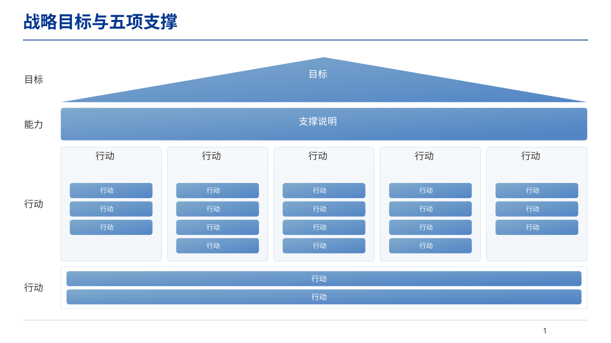

# 战略目标与五项支撑

来源为房子图战略图.pptx#21。

## 结构与适用场景

屋顶使命；愿景横梁；5根战略支柱，每柱3–4行动；底座ESG治理/数智创新2条

目标与5类支撑，职能战略

5柱含行动清单，多级字段应保留；屋顶文字与愿景原文相同需例文去重

固定节点、圆弧、扇区、分面和连接表达定性关系。数量比较、趋势或占比使用数据驱动图表，源页中已登记的微图槽可接收实际数据。

## 预览



## 调用

将下列完整page对象放入schema_version=1、template_id=business-blue-v1的pages数组，替换各节点内容。nodes键对应原文本框或已明确拆分的语义分段，字段角色及source_ref、segment见下表。

```json
{
  "id": "house-21",
  "family": "source-house",
  "variant": "page-21",
  "content": {
    "title": "战略目标与五项支撑",
    "nodes": {
      "shape_36": "目标",
      "shape_33": "能力",
      "shape_25": "行动",
      "shape_46": "行动",
      "shape_47": "行动",
      "shape_27": "行动",
      "shape_60": "行动",
      "shape_81": "行动",
      "shape_89": "行动",
      "shape_97": "行动",
      "shape_105": "行动",
      "shape_49": "行动",
      "shape_50": "行动",
      "shape_61": "行动",
      "shape_83": "行动",
      "shape_84": "行动",
      "shape_85": "行动",
      "shape_86": "行动",
      "shape_91": "行动",
      "shape_92": "行动",
      "shape_93": "行动",
      "shape_94": "行动",
      "shape_99": "行动",
      "shape_100": "行动",
      "shape_101": "行动",
      "shape_102": "行动",
      "shape_107": "行动",
      "shape_108": "行动",
      "shape_109": "行动",
      "shape_24": "目标",
      "shape_30": "支撑说明"
    }
  },
  "config": {
    "show_source": true,
    "show_page_number": true
  }
}
```

config支持show_source、show_page_number、image_fit与image_position。image_fit可选contain或cover，image_position为xMin/xMid/xMax与YMin/YMid/YMax组合的九个焦点，默认为xMidYMid。字体、颜色、全局区和固定字阶取自tokens，节点数与连接结构由variant确定。

## 字段合同

每个业务节点required=true、min=1，max按具体框体登记。字符按规范化后的Unicode码点计数，空格标点换行均计入。build会以实际字体测量宽高，字符数通过后仍可能需要调整文字。

| 字段 | 节点角色与源标签 | 最短/最长 | 字阶 | 框体px | 原框引用 | 分段 | 旋转° | 垂直锚点 |
|---|---|---|---|---|---|---|---|---|
| nodes.shape_36 | 上左节点，源标签“战略实名” | 1/21 | compactBody | [49.7693, 120, 67.1686, 94.4927] | slide:36 |  | 0.0 | ctr |
| nodes.shape_33 | 上左节点，源标签“战略愿景” | 1/14 | compactBody | [49.7693, 226.408, 67.1686, 70.3889] | slide:33 |  | 0.0 | ctr |
| nodes.shape_25 | 下左节点，源标签“底座 / 基石” | 1/21 | compactBody | [49.7693, 560.1431, 67.1686, 87.8569] | slide:25 |  | 0.0 | ctr |
| nodes.shape_46 | 下中节点，源标签“ESG 治理体系” | 1/149 | caption | [139.3827, 569.1894, 1078.8254, 31.4911] | slide:46 |  | 0.0 | ctr |
| nodes.shape_47 | 下中节点，源标签“数智技术创新” | 1/149 | caption | [139.3827, 607.4627, 1078.8254, 31.4911] | slide:47 |  | 0.0 | ctr |
| nodes.shape_27 | 中左节点，源标签“战略支柱” | 1/63 | compactBody | [49.7693, 308.7122, 67.1686, 239.5449] | slide:27 |  | 0.0 | ctr |
| nodes.shape_60 | 中左节点，源标签“数智供应链 / 加速产业升级” | 1/40 | compactBody | [142.7397, 315.8165, 180.193, 60.6986] | slide:60 |  | 0.0 | t |
| nodes.shape_81 | 中中节点，源标签“数智供应链 / 推动社会公平” | 1/40 | compactBody | [365.7144, 315.8165, 180.193, 60.6986] | slide:81 |  | 0.0 | t |
| nodes.shape_89 | 中中节点，源标签“数智供应链 / 引领绿色低碳” | 1/40 | compactBody | [588.6989, 315.8165, 180.193, 60.6986] | slide:89 |  | 0.0 | t |
| nodes.shape_97 | 中中节点，源标签“构建数智供应链 / 信任体系” | 1/40 | compactBody | [811.6737, 315.8165, 180.193, 60.6986] | slide:97 |  | 0.0 | t |
| nodes.shape_105 | 中右节点，源标签“加快数智供应链 / 人才发展” | 1/40 | compactBody | [1034.6582, 315.8165, 180.193, 60.6986] | slide:105 |  | 0.0 | t |
| nodes.shape_49 | 中左节点，源标签“加大数智创新” | 1/27 | diagramCompact | [146.2138, 384.0878, 173.2448, 31.8619] | slide:49 |  | 0.0 | ctr |
| nodes.shape_50 | 中左节点，源标签“助力产业数智化” | 1/27 | diagramCompact | [146.2138, 422.6832, 173.2448, 31.8619] | slide:50 |  | 0.0 | ctr |
| nodes.shape_61 | 中左节点，源标签“深化行业合作” | 1/27 | diagramCompact | [146.2138, 461.2785, 173.2448, 31.8619] | slide:61 |  | 0.0 | ctr |
| nodes.shape_83 | 中中节点，源标签“赋能中小微企业发展” | 1/27 | diagramCompact | [369.1885, 384.0878, 173.2448, 31.8619] | slide:83 |  | 0.0 | ctr |
| nodes.shape_84 | 中中节点，源标签“增强金融普惠性” | 1/27 | diagramCompact | [369.1885, 422.6832, 173.2448, 31.8619] | slide:84 |  | 0.0 | ctr |
| nodes.shape_85 | 中中节点，源标签“助力乡村全面阵型” | 1/27 | diagramCompact | [369.1885, 461.2785, 173.2448, 31.8619] | slide:85 |  | 0.0 | ctr |
| nodes.shape_86 | 下中节点，源标签“推动人人参与公益” | 1/27 | diagramCompact | [369.1885, 499.8739, 173.2448, 31.8619] | slide:86 |  | 0.0 | ctr |
| nodes.shape_91 | 中中节点，源标签“应对气候变化” | 1/27 | diagramCompact | [592.173, 384.0878, 173.2448, 31.8619] | slide:91 |  | 0.0 | ctr |
| nodes.shape_92 | 中中节点，源标签“助力零碳园区建设” | 1/27 | diagramCompact | [592.173, 422.6832, 173.2448, 31.8619] | slide:92 |  | 0.0 | ctr |
| nodes.shape_93 | 中中节点，源标签“绿色数据中心” | 1/27 | diagramCompact | [592.173, 461.2785, 173.2448, 31.8619] | slide:93 |  | 0.0 | ctr |
| nodes.shape_94 | 下中节点，源标签“践行绿色办公” | 1/27 | diagramCompact | [592.173, 499.8739, 173.2448, 31.8619] | slide:94 |  | 0.0 | ctr |
| nodes.shape_99 | 中中节点，源标签“强化治理合规” | 1/27 | diagramCompact | [815.1478, 384.0878, 173.2448, 31.8619] | slide:99 |  | 0.0 | ctr |
| nodes.shape_100 | 中中节点，源标签“严守信息安全” | 1/27 | diagramCompact | [815.1478, 422.6832, 173.2448, 31.8619] | slide:100 |  | 0.0 | ctr |
| nodes.shape_101 | 中中节点，源标签“专注客户体验” | 1/27 | diagramCompact | [815.1478, 461.2785, 173.2448, 31.8619] | slide:101 |  | 0.0 | ctr |
| nodes.shape_102 | 下中节点，源标签“负责供应链” | 1/27 | diagramCompact | [815.1478, 499.8739, 173.2448, 31.8619] | slide:102 |  | 0.0 | ctr |
| nodes.shape_107 | 中右节点，源标签“广泛吸引人才” | 1/27 | diagramCompact | [1038.1323, 384.0878, 173.2448, 31.8619] | slide:107 |  | 0.0 | ctr |
| nodes.shape_108 | 中右节点，源标签“打造科技人才高低” | 1/27 | diagramCompact | [1038.1323, 422.6832, 173.2448, 31.8619] | slide:108 |  | 0.0 | ctr |
| nodes.shape_109 | 中右节点，源标签“保障员工权益” | 1/27 | diagramCompact | [1038.1323, 461.2785, 173.2448, 31.8619] | slide:109 |  | 0.0 | ctr |
| nodes.shape_24 | 上中节点，源标签“以科技引领产业数智化升级 / 推动世界更加高效和美好” | 1/60 | compactBody | [543.2043, 144.094, 271.1823, 59.9082] | slide:24 |  | 0.0 | t |
| nodes.shape_30 | 上中节点，源标签“以科技引领产业数智化升级推动世界更加高效和美好” | 1/57 | compactBody | [419.7284, 243.1441, 518.1243, 34.6821] | slide:30 |  | 0.0 | t |

全局title必填、2至32码点，使用统一标题框。section_name可选0至24码点，source可选0至64码点。所有可编辑文本通过独立原生carrier导出，页码为派生文字。

## 来源处理

原生PPTX源件保存于用户材料目录，分发包仅含用户资产衍生的几何、字段和说明。原始逐框文字、源框与标准化框在page-catalog.json的variant.fields中。

源标题引用为`slide:2`，原文为“房型图”。模板默认标题依据真实结构设置。

密集全景中的diagramCompact为14px、diagramMicro为12px。适用于体系概览或附录局部标签，现场关键结论用统一标题与正常正文字阶表达。

源画布边界裁切已烘焙为可编辑Bezier几何，3D顶面、侧面与前面通过tokens配色的相对明暗保留。

