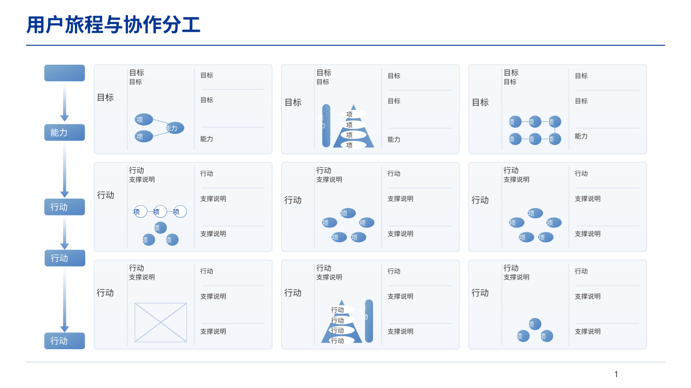

# 用户旅程与协作分工

来源为房子图战略图.pptx#23。

## 结构与适用场景

左认识→认知→兴趣→购买→忠诚纵向旅程；右3×3模块含运营、私域、门店及各自角色/关键工作/小图

用户生命周期和协作分工

大量不同微图，拆分旅程/工作包；不能把这页概括为均匀9卡而丢掉阶段关系

固定节点、圆弧、扇区、分面和连接表达定性关系。数量比较、趋势或占比使用数据驱动图表，源页中已登记的微图槽可接收实际数据。

## 预览



## 调用

将下列完整page对象放入schema_version=1、template_id=business-blue-v1的pages数组，替换各节点内容。nodes键对应原文本框或已明确拆分的语义分段，字段角色及source_ref、segment见下表。

```json
{
  "id": "house-23",
  "family": "source-house",
  "variant": "page-23",
  "content": {
    "title": "用户旅程与协作分工",
    "nodes": {
      "shape_6": "能力",
      "shape_7": "行动",
      "shape_8": "行动",
      "shape_9": "行动",
      "shape_159": "目标",
      "shape_162": "目标",
      "shape_166": "目标",
      "shape_167": "能力",
      "shape_240": "目标",
      "shape_290": "目标",
      "shape_305": "目标",
      "shape_309": "目标",
      "shape_310": "能力",
      "shape_55": "行动",
      "shape_119": "行动",
      "shape_128": "支撑说明",
      "shape_129": "支撑说明",
      "shape_40": "行动",
      "shape_41": "支撑说明",
      "shape_79": "行动",
      "shape_98": "行动",
      "shape_116": "行动",
      "shape_117": "行动",
      "shape_118": "行动",
      "shape_168": "目标",
      "shape_169": "目标",
      "shape_176": "项",
      "shape_189": "项",
      "shape_206": "能力",
      "shape_249": "目标",
      "shape_250": "目标",
      "shape_262": "能力",
      "shape_257": "项",
      "shape_258": "项",
      "shape_259": "项",
      "shape_260": "项",
      "shape_292": "目标",
      "shape_293": "目标",
      "shape_316": "项",
      "shape_347": "项",
      "shape_350": "项",
      "shape_366": "项",
      "shape_364": "项",
      "shape_361": "项",
      "shape_415": "行动",
      "shape_424": "支撑说明",
      "shape_417": "行动",
      "shape_418": "支撑说明",
      "shape_445": "项",
      "shape_443": "项",
      "shape_429": "项",
      "shape_457": "项",
      "shape_458": "项",
      "shape_459": "项",
      "shape_493": "行动",
      "shape_500": "支撑说明",
      "shape_501": "行动",
      "shape_502": "支撑说明",
      "shape_552": "项",
      "shape_555": "项",
      "shape_558": "项",
      "shape_561": "项",
      "shape_564": "项",
      "shape_595": "行动",
      "shape_419": "行动",
      "shape_495": "行动",
      "shape_597": "行动",
      "shape_423": "支撑说明",
      "shape_499": "支撑说明",
      "shape_601": "支撑说明",
      "shape_602": "支撑说明",
      "shape_603": "行动",
      "shape_604": "支撑说明",
      "shape_653": "行动",
      "shape_655": "行动",
      "shape_659": "支撑说明",
      "shape_660": "支撑说明",
      "shape_661": "行动",
      "shape_662": "支撑说明",
      "shape_770": "行动",
      "shape_772": "行动",
      "shape_776": "支撑说明",
      "shape_777": "支撑说明",
      "shape_778": "行动",
      "shape_779": "支撑说明",
      "shape_790": "项",
      "shape_791": "项",
      "shape_792": "项",
      "shape_826": "目标",
      "shape_829": "目标",
      "shape_830": "能力",
      "shape_856": "项",
      "shape_857": "项",
      "shape_858": "项",
      "shape_859": "项",
      "shape_860": "项"
    }
  },
  "config": {
    "show_source": true,
    "show_page_number": true
  }
}
```

config支持show_source、show_page_number、image_fit与image_position。image_fit可选contain或cover，image_position为xMin/xMid/xMax与YMin/YMid/YMax组合的九个焦点，默认为xMidYMid。字体、颜色、全局区和固定字阶取自tokens，节点数与连接结构由variant确定。

## 字段合同

每个业务节点required=true、min=1，max按具体框体登记。字符按规范化后的Unicode码点计数，空格标点换行均计入。build会以实际字体测量宽高，字符数通过后仍可能需要调整文字。

| 字段 | 节点角色与源标签 | 最短/最长 | 字阶 | 框体px | 原框引用 | 分段 | 旋转° | 垂直锚点 |
|---|---|---|---|---|---|---|---|---|
| nodes.shape_6 | 上左节点，源标签“认知” | 1/10 | caption | [82.0541, 230.3387, 75.2296, 30.8744] | slide:6 |  | 0.0 | ctr |
| nodes.shape_7 | 中左节点，源标签“兴趣” | 1/10 | caption | [82.0541, 368.5581, 75.2296, 30.8744] | slide:7 |  | 0.0 | ctr |
| nodes.shape_8 | 中左节点，源标签“购买” | 1/10 | caption | [82.7077, 463.4548, 75.2296, 30.8744] | slide:8 |  | 0.0 | ctr |
| nodes.shape_9 | 下左节点，源标签“忠诚” | 1/10 | caption | [82.0541, 617.1162, 75.2296, 30.8744] | slide:9 |  | 0.0 | ctr |
| nodes.shape_159 | 上左节点，源标签“会员APP / 运营” | 1/18 | caption | [180.1434, 170.6078, 50.0678, 64.2877] | slide:159 |  | 0.0 | t |
| nodes.shape_162 | 上左节点，源标签“BD；CM；BP” | 1/15 | diagramMicro | [370.8369, 132.1356, 82.619, 21.4292] | slide:162 |  | 0.0 | t |
| nodes.shape_166 | 上左节点，源标签“B端沙龙活动 / 本地广告 / B端合作方案” | 1/42 | diagramMicro | [370.8369, 177.9025, 76.2433, 45.9184] | slide:166 |  | 0.0 | t |
| nodes.shape_167 | 上左节点，源标签“线索量，用户数量” | 1/18 | diagramMicro | [370.8369, 250.0437, 100.6377, 21.4292] | slide:167 |  | 0.0 | t |
| nodes.shape_240 | 上中节点，源标签“私域运营” | 1/12 | caption | [527.8614, 179.7972, 50.0678, 45.9184] | slide:240 |  | 0.0 | t |
| nodes.shape_290 | 上右节点，源标签“门店运营” | 1/12 | caption | [874.7551, 179.7972, 50.0678, 45.9184] | slide:290 |  | 0.0 | t |
| nodes.shape_305 | 上右节点，源标签“OS；教练；BP” | 1/16 | diagramMicro | [1064.615, 133.083, 86.6074, 21.4292] | slide:305 |  | 0.0 | t |
| nodes.shape_309 | 上右节点，源标签“门店陈设 / 邀约&体验流程 / C端&B端活动” | 1/48 | diagramMicro | [1064.615, 179.7972, 88.521, 45.9184] | slide:309 |  | 0.0 | t |
| nodes.shape_310 | 上右节点，源标签“邀约量；体验时长； / 成交数据” | 1/40 | diagramMicro | [1064.615, 244.8711, 110.2061, 33.6691] | slide:310 |  | 0.0 | t |
| nodes.shape_55 | 下中节点，源标签“会员APP / 运营” | 1/18 | caption | [527.8614, 533.1045, 50.0678, 64.2877] | slide:55 |  | 0.0 | t |
| nodes.shape_119 | 下中节点，源标签“总部产品运营；OS” | 1/19 | diagramMicro | [717.7307, 495.5797, 103.9819, 21.4292] | slide:119 |  | 0.0 | t |
| nodes.shape_128 | 下中节点，源标签“会员生命周期 / 用户运动等级 / 会员标签同步” | 1/42 | diagramMicro | [717.7307, 542.2844, 79.5875, 45.9184] | slide:128 |  | 0.0 | t |
| nodes.shape_129 | 下中节点，源标签“交付量；机器使用频次； / 转介绍成交量” | 1/48 | diagramMicro | [717.7307, 607.3679, 130.6121, 33.6691] | slide:129 |  | 0.0 | t |
| nodes.shape_40 | 下中节点，源标签“Key work” | 1/21 | diagramCompact | [585.7638, 489.0808, 132.6395, 24.4892] | slide:40 |  | 0.0 | t |
| nodes.shape_41 | 下中节点，源标签“会员push方案 / 积分运营 / 成长级管理” | 1/48 | diagramMicro | [585.7638, 506.6827, 88.4547, 52.1899] | slide:41 |  | 0.0 | t |
| nodes.shape_79 | 下中节点，源标签“沉默用户” | 1/9 | diagramMicro | [673.7923, 566.8873, 19.4777, 57.7035] | slide:79 |  | 0.0 | t |
| nodes.shape_98 | 下中节点，源标签“核心用户” | 1/6 | diagramMicro | [615.1698, 567.3862, 35.7154, 15.0] | slide:98 |  | 0.0 | t |
| nodes.shape_116 | 下中节点，源标签“成熟用户” | 1/6 | diagramMicro | [615.1698, 587.0249, 35.7154, 15.0] | slide:116 |  | 0.0 | t |
| nodes.shape_117 | 下中节点，源标签“成长用户” | 1/6 | diagramMicro | [615.1698, 605.6594, 35.7154, 15.0] | slide:117 |  | 0.0 | t |
| nodes.shape_118 | 下中节点，源标签“新手用户” | 1/6 | diagramMicro | [615.1698, 624.7961, 35.7154, 15.0] | slide:118 |  | 0.0 | t |
| nodes.shape_168 | 上左节点，源标签“Key work” | 1/17 | diagramCompact | [238.8701, 126.5936, 107.5061, 24.4892] | slide:168 |  | 0.0 | t |
| nodes.shape_169 | 上左节点，源标签“核心用户信息 / 用户信息收集 / 用户信息分层” | 1/48 | diagramMicro | [238.8701, 144.186, 88.4547, 52.1899] | slide:169 |  | 0.0 | t |
| nodes.shape_176 | 上左节点，源标签“B端” | 1/2 | diagramMicro | [259.1909, 214.7325, 14.8261, 15.0] | slide:176 |  | 0.0 | t |
| nodes.shape_189 | 上左节点，源标签“C端” | 1/2 | diagramMicro | [259.0393, 246.109, 15.1482, 15.0] | slide:189 |  | 0.0 | t |
| nodes.shape_206 | 上左节点，源标签“流量池” | 1/4 | diagramMicro | [310.8598, 230.4208, 26.7818, 15.0] | slide:206 |  | 0.0 | t |
| nodes.shape_249 | 上中节点，源标签“Key work” | 1/21 | diagramCompact | [585.7638, 126.5936, 132.6395, 24.4892] | slide:249 |  | 0.0 | t |
| nodes.shape_250 | 上中节点，源标签“私域流量盘点 / 私域运维计划 / 公私域联动” | 1/48 | diagramMicro | [585.7638, 144.186, 88.4547, 52.1899] | slide:250 |  | 0.0 | t |
| nodes.shape_262 | 上中节点，源标签“流量池” | 1/6 | diagramMicro | [594.6879, 211.7421, 19.4777, 43.01] | slide:262 |  | 0.0 | t |
| nodes.shape_257 | 上中节点，源标签“体验” | 1/3 | diagramMicro | [645.9968, 204.8895, 17.8577, 15.0] | slide:257 |  | 0.0 | t |
| nodes.shape_258 | 上中节点，源标签“种草” | 1/3 | diagramMicro | [646.0063, 224.5377, 17.8577, 15.0] | slide:258 |  | 0.0 | t |
| nodes.shape_259 | 上中节点，源标签“互动” | 1/3 | diagramMicro | [645.9968, 243.1627, 17.8577, 15.0] | slide:259 |  | 0.0 | t |
| nodes.shape_260 | 上中节点，源标签“留存” | 1/3 | diagramMicro | [646.0063, 262.3088, 17.8577, 15.0] | slide:260 |  | 0.0 | t |
| nodes.shape_292 | 上右节点，源标签“Key work” | 1/21 | diagramCompact | [932.6481, 126.5936, 132.6395, 24.4892] | slide:292 |  | 0.0 | t |
| nodes.shape_293 | 上右节点，源标签“门店邀约 / 门店形象 / 门店活动 / 到店体验-成交” | 1/64 | diagramMicro | [932.6481, 144.186, 88.4547, 66.8834] | slide:293 |  | 0.0 | t |
| nodes.shape_316 | 上右节点，源标签“邀约” | 1/3 | diagramMicro | [945.5227, 218.8535, 17.8577, 15.0] | slide:316 |  | 0.0 | t |
| nodes.shape_347 | 上右节点，源标签“意向” | 1/3 | diagramMicro | [982.1759, 218.8535, 17.8577, 15.0] | slide:347 |  | 0.0 | t |
| nodes.shape_350 | 上右节点，源标签“进店” | 1/3 | diagramMicro | [1018.8292, 218.8535, 17.8577, 15.0] | slide:350 |  | 0.0 | t |
| nodes.shape_366 | 上右节点，源标签“交付” | 1/3 | diagramMicro | [945.5227, 251.0732, 17.8577, 15.0] | slide:366 |  | 0.0 | t |
| nodes.shape_364 | 上右节点，源标签“成交” | 1/3 | diagramMicro | [982.1759, 251.0732, 17.8577, 15.0] | slide:364 |  | 0.0 | t |
| nodes.shape_361 | 上右节点，源标签“体验” | 1/3 | diagramMicro | [1018.8292, 251.0732, 17.8577, 15.0] | slide:361 |  | 0.0 | t |
| nodes.shape_415 | 中左节点，源标签“已购用户运维” | 1/18 | caption | [180.9771, 351.8562, 50.0678, 64.2877] | slide:415 |  | 0.0 | t |
| nodes.shape_424 | 中左节点，源标签“交付量；机器使用频次； / 转介绍成交量” | 1/48 | diagramMicro | [370.8369, 426.1195, 130.6121, 33.6691] | slide:424 |  | 0.0 | t |
| nodes.shape_417 | 中左节点，源标签“Key work” | 1/21 | diagramCompact | [238.8701, 307.8325, 132.6395, 24.4892] | slide:417 |  | 0.0 | t |
| nodes.shape_418 | 中左节点，源标签“机器交付服务流程 / 用户运动指导 / 培育忠实用户/KOC” | 1/57 | diagramMicro | [238.8701, 325.4344, 106.9377, 52.1899] | slide:418 |  | 0.0 | t |
| nodes.shape_445 | 中左节点，源标签“成交” | 1/3 | diagramMicro | [251.7447, 385.5221, 17.8577, 15.0] | slide:445 |  | 0.0 | t |
| nodes.shape_443 | 中左节点，源标签“交付” | 1/3 | diagramMicro | [288.3979, 385.5221, 17.8577, 15.0] | slide:443 |  | 0.0 | t |
| nodes.shape_429 | 中左节点，源标签“运维” | 1/3 | diagramMicro | [325.0512, 385.5221, 17.8577, 15.0] | slide:429 |  | 0.0 | t |
| nodes.shape_457 | 中左节点，源标签“邀约” | 1/3 | diagramMicro | [288.3979, 415.648, 17.8577, 15.0] | slide:457 |  | 0.0 | t |
| nodes.shape_458 | 中左节点，源标签“硬件” | 1/3 | diagramMicro | [266.6087, 437.8825, 17.8577, 15.0] | slide:458 |  | 0.0 | t |
| nodes.shape_459 | 中左节点，源标签“内容” | 1/3 | diagramMicro | [310.1871, 437.8825, 17.8577, 15.0] | slide:459 |  | 0.0 | t |
| nodes.shape_493 | 中中节点，源标签“新媒体 / 运营” | 1/16 | caption | [521.0499, 361.0361, 63.7856, 45.9184] | slide:493 |  | 0.0 | t |
| nodes.shape_500 | 中中节点，源标签“账号数据；私域添加量 / 引导到店量” | 1/44 | diagramMicro | [717.7307, 426.1195, 120.4091, 33.6691] | slide:500 |  | 0.0 | t |
| nodes.shape_501 | 中中节点，源标签“Key work” | 1/21 | diagramCompact | [585.7638, 307.8325, 132.6395, 24.4892] | slide:501 |  | 0.0 | t |
| nodes.shape_502 | 中中节点，源标签“视频号运营指导 / 抖音运营指导 / 小红书运营指导” | 1/57 | diagramMicro | [585.7638, 325.4344, 106.9377, 52.1899] | slide:502 |  | 0.0 | t |
| nodes.shape_552 | 中中节点，源标签“分发” | 1/3 | diagramMicro | [635.9832, 388.6768, 17.8577, 15.0] | slide:552 |  | 0.0 | t |
| nodes.shape_555 | 中中节点，源标签“策划” | 1/3 | diagramMicro | [601.5279, 406.1366, 17.8577, 15.0] | slide:555 |  | 0.0 | t |
| nodes.shape_558 | 中中节点，源标签“变现” | 1/3 | diagramMicro | [619.5561, 433.2783, 17.8577, 15.0] | slide:558 |  | 0.0 | t |
| nodes.shape_561 | 中中节点，源标签“裂变” | 1/3 | diagramMicro | [655.2904, 433.2783, 17.8577, 15.0] | slide:561 |  | 0.0 | t |
| nodes.shape_564 | 中中节点，源标签“传播” | 1/3 | diagramMicro | [670.4386, 406.1366, 17.8577, 15.0] | slide:564 |  | 0.0 | t |
| nodes.shape_595 | 中右节点，源标签“活动 / 运营” | 1/16 | caption | [867.9436, 361.0361, 63.7856, 45.9184] | slide:595 |  | 0.0 | t |
| nodes.shape_419 | 中左节点，源标签“OS；CM” | 1/10 | diagramMicro | [370.8369, 314.3314, 58.8593, 21.4292] | slide:419 |  | 0.0 | t |
| nodes.shape_495 | 中中节点，源标签“OS；” | 1/7 | diagramMicro | [717.7307, 314.3314, 42.7637, 21.4292] | slide:495 |  | 0.0 | t |
| nodes.shape_597 | 中右节点，源标签“总部用户运营；OS” | 1/19 | diagramMicro | [1064.615, 314.3314, 103.9819, 21.4292] | slide:597 |  | 0.0 | t |
| nodes.shape_423 | 中左节点，源标签“上门交付流程 / 用户1V1&社群运维 / 机器使用时数据” | 1/57 | diagramMicro | [370.8369, 361.0361, 104.6166, 45.9184] | slide:423 |  | 0.0 | t |
| nodes.shape_499 | 中中节点，源标签“社媒热点选题 / 公域平台活动 / 品宣活动；平台直播” | 1/60 | diagramMicro | [717.7307, 361.0361, 110.2061, 45.9184] | slide:499 |  | 0.0 | t |
| nodes.shape_601 | 中右节点，源标签“会员生命周期 / 用户运动等级 / 会员标签用户” | 1/42 | diagramMicro | [1064.615, 361.0361, 79.5875, 45.9184] | slide:601 |  | 0.0 | t |
| nodes.shape_602 | 中右节点，源标签“交付量；机器使用频次； / 转介绍成交量” | 1/48 | diagramMicro | [1064.615, 426.1195, 130.6121, 33.6691] | slide:602 |  | 0.0 | t |
| nodes.shape_603 | 中右节点，源标签“Key work” | 1/21 | diagramCompact | [932.6481, 307.8325, 132.6395, 24.4892] | slide:603 |  | 0.0 | t |
| nodes.shape_604 | 中右节点，源标签“沙龙活动、B端活动 / C端活动、联名活动” | 1/38 | diagramMicro | [932.6481, 325.4344, 106.9377, 37.4964] | slide:604 |  | 0.0 | t |
| nodes.shape_653 | 下左节点，源标签“KOC / KOL / 培育” | 1/21 | caption | [176.8656, 533.1045, 56.5572, 64.2877] | slide:653 |  | 0.0 | t |
| nodes.shape_655 | 下左节点，源标签“总部用户运维；OS” | 1/19 | diagramMicro | [370.8369, 495.5797, 103.9819, 21.4292] | slide:655 |  | 0.0 | t |
| nodes.shape_659 | 下左节点，源标签“人群画像 / KOC/KOL权益 / 具体合作方案” | 1/45 | diagramMicro | [370.8369, 542.2844, 85.1674, 45.9184] | slide:659 |  | 0.0 | t |
| nodes.shape_660 | 下左节点，源标签“KOC/KOL数量； / KOC/KOL投产比” | 1/34 | diagramMicro | [370.8369, 607.3679, 95.3704, 33.6691] | slide:660 |  | 0.0 | t |
| nodes.shape_661 | 下左节点，源标签“Key work” | 1/21 | diagramCompact | [238.8701, 489.0808, 132.6395, 24.4892] | slide:661 |  | 0.0 | t |
| nodes.shape_662 | 下左节点，源标签“本地KOC/KOL资源 / 私欲KOC挖掘 / 平台KOC挖掘” | 1/57 | diagramMicro | [238.8701, 506.6827, 106.9377, 52.1899] | slide:662 |  | 0.0 | t |
| nodes.shape_770 | 下右节点，源标签“已购用户运维” | 1/18 | caption | [874.7551, 533.1045, 50.0678, 64.2877] | slide:770 |  | 0.0 | t |
| nodes.shape_772 | 下右节点，源标签“总部产品运营；OS” | 1/19 | diagramMicro | [1064.615, 495.5797, 103.9819, 21.4292] | slide:772 |  | 0.0 | t |
| nodes.shape_776 | 下右节点，源标签“上新活动 / 硬件卖点挖掘 / 精品课程素材” | 1/42 | diagramMicro | [1064.615, 542.2844, 79.5875, 45.9184] | slide:776 |  | 0.0 | t |
| nodes.shape_777 | 下右节点，源标签“机器使用数据 / 课程使用数据” | 1/28 | diagramMicro | [1064.615, 607.3679, 79.5875, 33.6691] | slide:777 |  | 0.0 | t |
| nodes.shape_778 | 下右节点，源标签“Key work” | 1/21 | diagramCompact | [932.6481, 489.0808, 132.6395, 24.4892] | slide:778 |  | 0.0 | t |
| nodes.shape_779 | 下右节点，源标签“硬件上新 / 课程上新 / 功能更新升级 / 用户数据看板” | 1/80 | diagramMicro | [932.6481, 506.6827, 111.5418, 66.8834] | slide:779 |  | 0.0 | t |
| nodes.shape_790 | 下右节点，源标签“软件” | 1/3 | diagramMicro | [982.1759, 594.3669, 17.8577, 15.0] | slide:790 |  | 0.0 | t |
| nodes.shape_791 | 下右节点，源标签“硬件” | 1/3 | diagramMicro | [960.3962, 616.6014, 17.8577, 15.0] | slide:791 |  | 0.0 | t |
| nodes.shape_792 | 下右节点，源标签“内容” | 1/3 | diagramMicro | [1003.9651, 616.6014, 17.8577, 15.0] | slide:792 |  | 0.0 | t |
| nodes.shape_826 | 上中节点，源标签“OS；CM” | 1/10 | diagramMicro | [717.7307, 133.083, 58.8593, 21.4292] | slide:826 |  | 0.0 | t |
| nodes.shape_829 | 上中节点，源标签“朋友圈&社群&1V1种草 / 用户分层标签 / 私域用户转化” | 1/66 | diagramMicro | [717.7307, 179.7972, 122.3227, 45.9184] | slide:829 |  | 0.0 | t |
| nodes.shape_830 | 上中节点，源标签“用户层级，分层用户量” | 1/22 | diagramMicro | [717.7307, 250.9911, 120.4091, 21.4292] | slide:830 |  | 0.0 | t |
| nodes.shape_856 | 中右节点，源标签“引流” | 1/3 | diagramMicro | [948.4121, 406.1366, 17.8577, 15.0] | slide:856 |  | 0.0 | t |
| nodes.shape_857 | 中右节点，源标签“邀约” | 1/3 | diagramMicro | [982.8675, 388.6768, 17.8577, 15.0] | slide:857 |  | 0.0 | t |
| nodes.shape_858 | 中右节点，源标签“共创” | 1/3 | diagramMicro | [966.4403, 433.2783, 17.8577, 15.0] | slide:858 |  | 0.0 | t |
| nodes.shape_859 | 中右节点，源标签“会员” | 1/3 | diagramMicro | [1002.1841, 433.2783, 17.8577, 15.0] | slide:859 |  | 0.0 | t |
| nodes.shape_860 | 中右节点，源标签“成交” | 1/3 | diagramMicro | [1017.3324, 406.1366, 17.8577, 15.0] | slide:860 |  | 0.0 | t |

## 可替换图片

在content.visuals提供下列槽位对象，省略时显示中性空槽。每项含path和可选alt，path为--assets目录下的相对本地路径，1至260码点，alt为0至200码点。原案例照片、界面或品牌保留来源引用，默认页使用空槽。

- `visuals.picture_4`用于业务界面截图，框体为`[249.8973, 562.52, 95.9104, 71.9328]`，源引用为`['slide:4']`。

```json
{
  "visuals": {
    "picture_4": {
      "path": "assets/replacement.png",
      "alt": "业务界面截图"
    }
  }
}
```


全局title必填、2至32码点，使用统一标题框。section_name可选0至24码点，source可选0至64码点。所有可编辑文本通过独立原生carrier导出，页码为派生文字。

## 来源处理

原生PPTX源件保存于用户材料目录，分发包仅含用户资产衍生的几何、字段和说明。原始逐框文字、源框与标准化框在page-catalog.json的variant.fields中。

源标题引用为`slide:839`，原文为“AEKE全域用户运营模式”。模板默认标题依据真实结构设置。

密集全景中的diagramCompact为14px、diagramMicro为12px。适用于体系概览或附录局部标签，现场关键结论用统一标题与正常正文字阶表达。

源画布边界裁切已烘焙为可编辑Bezier几何，3D顶面、侧面与前面通过tokens配色的相对明暗保留。

