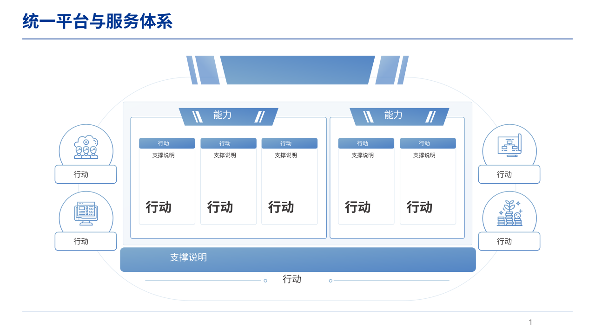

# 统一平台与服务体系

来源为房子图战略图.pptx#24。

## 结构与适用场景

顶部总平台；左脑3能力柱、右脑2能力柱；外围4服务圈；底部技术底座；大外椭圆边界

统一平台、多类服务与基础技术

左右脑是语义分组，可改为两类能力域；外部服务圈、底座与内部能力模块独立

固定节点、圆弧、扇区、分面和连接表达定性关系。数量比较、趋势或占比使用数据驱动图表，源页中已登记的微图槽可接收实际数据。

## 预览



## 调用

将下列完整page对象放入schema_version=1、template_id=business-blue-v1的pages数组，替换各节点内容。nodes键对应原文本框或已明确拆分的语义分段，字段角色及source_ref、segment见下表。

```json
{
  "id": "house-24",
  "family": "source-house",
  "variant": "page-24",
  "content": {
    "title": "统一平台与服务体系",
    "nodes": {
      "shape_21": "行动",
      "shape_25": "行动",
      "shape_55": "支撑说明",
      "shape_56": "行动",
      "shape_69": "行动",
      "shape_73": "行动",
      "shape_72": "支撑说明",
      "shape_77": "行动",
      "shape_78": "行动",
      "shape_79": "支撑说明",
      "shape_82": "行动",
      "shape_83": "行动",
      "shape_84": "支撑说明",
      "shape_87": "行动",
      "shape_88": "行动",
      "shape_89": "支撑说明",
      "shape_92": "行动",
      "shape_93": "行动",
      "shape_94": "支撑说明",
      "shape_169": "行动",
      "shape_172": "行动",
      "shape_186": "能力",
      "shape_225": "能力"
    }
  },
  "config": {
    "show_source": true,
    "show_page_number": true
  }
}
```

config支持show_source、show_page_number、image_fit与image_position。image_fit可选contain或cover，image_position为xMin/xMid/xMax与YMin/YMid/YMax组合的九个焦点，默认为xMidYMid。字体、颜色、全局区和固定字阶取自tokens，节点数与连接结构由variant确定。

## 字段合同

每个业务节点required=true、min=1，max按具体框体登记。字符按规范化后的Unicode码点计数，空格标点换行均计入。build会以实际字体测量宽高，字符数通过后仍可能需要调整文字。

| 字段 | 节点角色与源标签 | 最短/最长 | 字阶 | 框体px | 原框引用 | 分段 | 旋转° | 垂直锚点 |
|---|---|---|---|---|---|---|---|---|
| nodes.shape_21 | 中左节点，源标签“身份统一化” | 1/18 | caption | [118.3206, 355.9746, 132.3152, 39.4859] | slide:21 |  | 0.0 | ctr |
| nodes.shape_25 | 下左节点，源标签“场景化教学工具” | 1/18 | caption | [118.3206, 500.3717, 132.3152, 39.4859] | slide:25 |  | 0.0 | ctr |
| nodes.shape_55 | 下中节点，源标签“云计算 &#124; AI &#124; 大数据 &#124; 5G &#124; 音视频 &#124; 区块链 &#124; 安全 &#124; 物” | 1/58 | compactBody | [365.3029, 543.1688, 529.8554, 33.0411] | slide:55 |  | 0.0 | t |
| nodes.shape_56 | 下中节点，源标签“数字底座” | 1/9 | compactBody | [596.1465, 590.2093, 89.953, 30.2891] | slide:56 |  | 0.0 | t |
| nodes.shape_69 | 中左节点，源标签“一体化精细管理” | 1/22 | diagramMicro | [299.2918, 297.6423, 120.2244, 22.8234] | slide:69 |  | 0.0 | ctr |
| nodes.shape_73 | 中左节点，源标签“01” | 1/5 | heading | [322.9053, 429.8776, 72.9975, 63.3391] | slide:73 |  | 0.0 | t |
| nodes.shape_72 | 中左节点，源标签“智慧教育云平台 / 行政管理 / 后勤管理 / 财务管理 / 人事管理 / 教育督导 / 德育发展 / 学工” | 1/153 | diagramMicro | [313.4954, 326.9017, 91.8172, 131.0546] | slide:72 |  | 0.0 | t |
| nodes.shape_77 | 中中节点，源标签“智能化精准服务” | 1/22 | diagramMicro | [431.5803, 297.6423, 120.2244, 22.8234] | slide:77 |  | 0.0 | ctr |
| nodes.shape_78 | 中中节点，源标签“02” | 1/5 | heading | [455.1938, 429.8776, 72.9975, 63.3391] | slide:78 |  | 0.0 | t |
| nodes.shape_79 | 中中节点，源标签“招生服务 / 用户画像 / 学校/校长/教师能力 / 学生综合素质评估 / 教学质量与结果评估 / ” | 1/180 | diagramMicro | [435.0247, 326.9017, 113.3356, 131.0546] | slide:79 |  | 0.0 | t |
| nodes.shape_82 | 中中节点，源标签“陪伴式家校沟通” | 1/22 | diagramMicro | [562.777, 297.6423, 120.2244, 22.8234] | slide:82 |  | 0.0 | ctr |
| nodes.shape_83 | 中中节点，源标签“03” | 1/5 | heading | [586.3904, 429.8776, 72.9975, 63.3391] | slide:83 |  | 0.0 | t |
| nodes.shape_84 | 中中节点，源标签“学生家长陪伴 / 云端家长会 / 消息通知 / 家校通讯录 / 校园圈 / 班级圈” | 1/90 | diagramMicro | [582.3601, 326.9017, 81.0669, 100.073] | slide:84 |  | 0.0 | t |
| nodes.shape_87 | 中中节点，源标签“多元化精准服务” | 1/22 | diagramMicro | [727.7514, 297.6423, 120.2244, 22.8234] | slide:87 |  | 0.0 | ctr |
| nodes.shape_88 | 中中节点，源标签“01” | 1/5 | heading | [751.3649, 429.8776, 72.9975, 63.3391] | slide:88 |  | 0.0 | t |
| nodes.shape_89 | 中中节点，源标签“教科研 / 口语测试 / 在线备课 / AI双师 / 智能课表 / 作业批改 / 智能组卷 / 教学效果” | 1/99 | diagramMicro | [758.0938, 326.9017, 59.5485, 131.0546] | slide:89 |  | 0.0 | t |
| nodes.shape_92 | 中右节点，源标签“个性化精准学习” | 1/22 | diagramMicro | [860.5282, 297.6423, 120.2244, 22.8234] | slide:92 |  | 0.0 | ctr |
| nodes.shape_93 | 中右节点，源标签“02” | 1/5 | heading | [884.1417, 429.8776, 72.9975, 63.3391] | slide:93 |  | 0.0 | t |
| nodes.shape_94 | 中右节点，源标签“学能诊断 / 学情分析 / 学习路径规划 / 自适应学习 / 教学课程库 / 在线学习平台 / 在线题库” | 1/135 | diagramMicro | [880.1025, 326.9017, 81.0669, 131.0546] | slide:94 |  | 0.0 | t |
| nodes.shape_169 | 中右节点，源标签“知识图谱化” | 1/18 | caption | [1029.3643, 355.9746, 132.3152, 39.4859] | slide:169 |  | 0.0 | ctr |
| nodes.shape_172 | 下右节点，源标签“生态开发化” | 1/18 | caption | [1029.3643, 500.3717, 132.3152, 39.4859] | slide:172 |  | 0.0 | ctr |
| nodes.shape_186 | 上中节点，源标签“左脑” | 1/6 | compactBody | [464.3107, 236.1763, 54.7725, 31.2123] | slide:186 |  | 0.0 | t |
| nodes.shape_225 | 上中节点，源标签“右脑” | 1/6 | compactBody | [832.0145, 236.1763, 54.7725, 31.2123] | slide:225 |  | 0.0 | t |

全局title必填、2至32码点，使用统一标题框。section_name可选0至24码点，source可选0至64码点。所有可编辑文本通过独立原生carrier导出，页码为派生文字。

## 来源处理

原生PPTX源件保存于用户材料目录，分发包仅含用户资产衍生的几何、字段和说明。原始逐框文字、源框与标准化框在page-catalog.json的variant.fields中。

源标题引用为`slide:146`，原文为“腾讯教育智慧脑”。模板默认标题依据真实结构设置。

密集全景中的diagramCompact为14px、diagramMicro为12px。适用于体系概览或附录局部标签，现场关键结论用统一标题与正常正文字阶表达。

源画布边界裁切已烘焙为可编辑Bezier几何，3D顶面、侧面与前面通过tokens配色的相对明暗保留。

