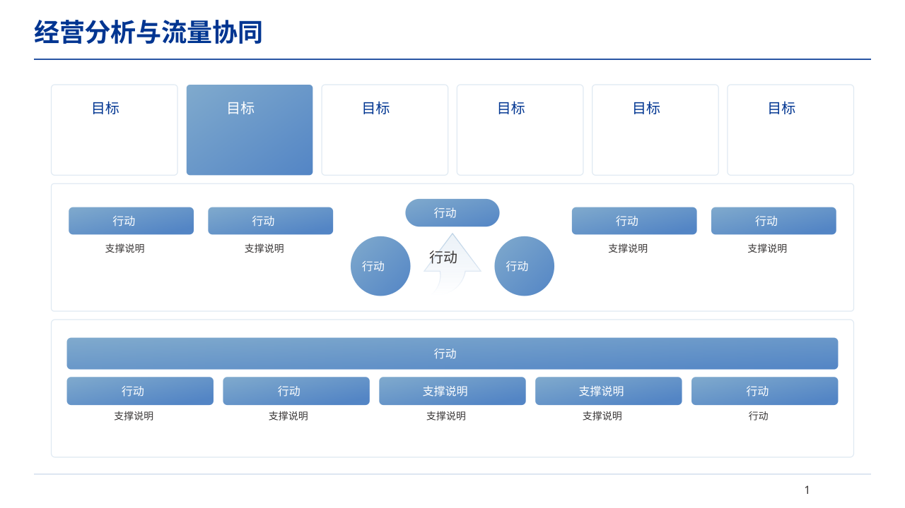

# 经营分析与流量协同

来源为房子图战略图.pptx#25。

## 结构与适用场景

顶6指标；中商业/自然流量2圈与协同箭头；底部购买人群资产横梁和5个研究问题

经营分析框架，营销运营方法

百分比为源例文，来源待核；指标/渠道协同/研究问题三部分可拆

固定节点、圆弧、扇区、分面和连接表达定性关系。数量比较、趋势或占比使用数据驱动图表，源页中已登记的微图槽可接收实际数据。

## 预览



## 调用

将下列完整page对象放入schema_version=1、template_id=business-blue-v1的pages数组，替换各节点内容。nodes键对应原文本框或已明确拆分的语义分段，字段角色及source_ref、segment见下表。

```json
{
  "id": "house-25",
  "family": "source-house",
  "variant": "page-25",
  "content": {
    "title": "经营分析与流量协同",
    "nodes": {
      "shape_33": "行动",
      "shape_278": "行动",
      "shape_44": "支撑说明",
      "shape_45": "支撑说明",
      "shape_47": "行动",
      "shape_48": "支撑说明",
      "shape_49": "支撑说明",
      "shape_50": "行动",
      "shape_53": "支撑说明",
      "shape_54": "支撑说明",
      "shape_55": "行动",
      "shape_295": "行动",
      "shape_292": "行动",
      "shape_293": "行动",
      "shape_61": "目标",
      "shape_412": "目标",
      "shape_415": "目标",
      "shape_418": "目标",
      "shape_421": "目标",
      "shape_424": "目标",
      "shape_323": "行动",
      "shape_327": "支撑说明",
      "shape_433": "行动",
      "shape_434": "支撑说明",
      "shape_443": "行动",
      "shape_444": "支撑说明",
      "shape_441": "行动",
      "shape_442": "支撑说明",
      "shape_446": "行动"
    }
  },
  "config": {
    "show_source": true,
    "show_page_number": true
  }
}
```

config支持show_source、show_page_number、image_fit与image_position。image_fit可选contain或cover，image_position为xMin/xMid/xMax与YMin/YMid/YMax组合的九个焦点，默认为xMidYMid。字体、颜色、全局区和固定字阶取自tokens，节点数与连接结构由variant确定。

## 字段合同

每个业务节点required=true、min=1，max按具体框体登记。字符按规范化后的Unicode码点计数，空格标点换行均计入。build会以实际字体测量宽高，字符数通过后仍可能需要调整文字。

| 字段 | 节点角色与源标签 | 最短/最长 | 字阶 | 框体px | 原框引用 | 分段 | 旋转° | 垂直锚点 |
|---|---|---|---|---|---|---|---|---|
| nodes.shape_33 | 下中节点，源标签“积累品牌购买人群资产” | 1/302 | caption | [94.5594, 478.6248, 1090.8812, 44.9532] | slide:33 |  | 0.0 | ctr |
| nodes.shape_278 | 下左节点，源标签“ 找那群人？” | 1/28 | caption | [94.5594, 534.2559, 207.3925, 39.8547] | slide:278 |  | 0.0 | ctr |
| nodes.shape_44 | 下左节点，源标签“参考当前渗透表现 / 输出圈层人群建议” | 1/58 | diagramCompact | [103.7943, 581.1907, 188.9225, 46.829] | slide:44 |  | 0.0 | t |
| nodes.shape_45 | 下左节点，源标签“基于历史A3/购买人群流转率推荐最优触点组合” | 1/58 | diagramCompact | [322.3746, 581.1907, 188.9225, 46.829] | slide:45 |  | 0.0 | t |
| nodes.shape_47 | 下左节点，源标签“ 通过什么触点？” | 1/28 | caption | [315.4291, 534.2559, 207.3925, 39.8547] | slide:47 |  | 0.0 | ctr |
| nodes.shape_48 | 下中节点，源标签“ 用什么内容？找那些达人？” | 1/28 | caption | [536.3085, 534.2559, 207.3925, 39.8547] | slide:48 |  | 0.0 | ctr |
| nodes.shape_49 | 下中节点，源标签“ 打什么商品？用什么热词？” | 1/28 | caption | [757.1783, 534.2559, 207.3925, 39.8547] | slide:49 |  | 0.0 | ctr |
| nodes.shape_50 | 下右节点，源标签“如何追踪效果？” | 1/28 | caption | [978.0481, 534.2559, 207.3925, 39.8547] | slide:50 |  | 0.0 | ctr |
| nodes.shape_53 | 下中节点，源标签“基于TA与触点给出内容创意建议及达人优选参考” | 1/58 | diagramCompact | [545.5339, 581.1907, 188.9225, 46.829] | slide:53 |  | 0.0 | t |
| nodes.shape_54 | 下中节点，源标签“基于TA的商品互动指标 / 提供商品参考” | 1/58 | diagramCompact | [766.4133, 581.1907, 188.9225, 46.829] | slide:54 |  | 0.0 | t |
| nodes.shape_55 | 下右节点，源标签“购买人群拉新复盘” | 1/29 | diagramCompact | [987.2831, 581.1907, 188.9225, 27.2528] | slide:55 |  | 0.0 | t |
| nodes.shape_295 | 中中节点，源标签“拉动生意增长” | 1/18 | caption | [573.4216, 281.8525, 133.1568, 39.4314] | slide:295 |  | 0.0 | ctr |
| nodes.shape_292 | 中中节点，源标签“商业流量” | 1/44 | caption | [495.9248, 334.819, 84.6251, 84.6251] | slide:292 |  | 0.0 | ctr |
| nodes.shape_293 | 中中节点，源标签“自然流量” | 1/44 | caption | [699.4597, 334.819, 84.6251, 84.6251] | slide:293 |  | 0.0 | ctr |
| nodes.shape_61 | 上左节点，源标签“自提点营销活动 / 25%+” | 1/45 | compactBody | [89.8553, 141.7888, 143.902, 98.6314] | slide:61 |  | 0.0 | t |
| nodes.shape_412 | 上左节点，源标签“自提点营销活动 / 20%+” | 1/45 | compactBody | [281.1347, 141.7888, 143.902, 98.6314] | slide:412 |  | 0.0 | t |
| nodes.shape_415 | 上中节点，源标签“自提点营销活动 / 85%+” | 1/45 | compactBody | [472.4141, 141.7888, 143.902, 98.6314] | slide:415 |  | 0.0 | t |
| nodes.shape_418 | 上中节点，源标签“自提点营销活动 / 44%+” | 1/45 | compactBody | [663.6934, 141.7888, 143.902, 98.6314] | slide:418 |  | 0.0 | t |
| nodes.shape_421 | 上右节点，源标签“自提点营销活动 / 60%+” | 1/45 | compactBody | [854.9728, 141.7888, 143.902, 98.6314] | slide:421 |  | 0.0 | t |
| nodes.shape_424 | 上右节点，源标签“自提点营销活动 / 75%+” | 1/45 | compactBody | [1046.2522, 141.7888, 143.902, 98.6314] | slide:424 |  | 0.0 | t |
| nodes.shape_323 | 中左节点，源标签“广告排序策略升级” | 1/24 | caption | [294.3715, 293.6175, 176.7728, 38.758] | slide:323 |  | 0.0 | ctr |
| nodes.shape_327 | 中左节点，源标签“好内容将优化eCPM / 内容互动指标 / GPM最终影响广告ROI” | 1/112 | diagramCompact | [294.3715, 343.775, 176.7728, 69.3777] | slide:327 |  | 0.0 | t |
| nodes.shape_433 | 中左节点，源标签“广告排序策略升级” | 1/24 | caption | [97.2529, 293.6175, 176.7728, 38.758] | slide:433 |  | 0.0 | ctr |
| nodes.shape_434 | 中左节点，源标签“好内容将优化eCPM / 内容互动指标 / GPM最终影响广告ROI” | 1/112 | diagramCompact | [97.2529, 343.775, 176.7728, 69.3777] | slide:434 |  | 0.0 | t |
| nodes.shape_443 | 中右节点，源标签“流量协同诊断产品” | 1/24 | caption | [1005.9743, 293.6175, 176.7728, 38.758] | slide:443 |  | 0.0 | ctr |
| nodes.shape_444 | 中右节点，源标签“衡量内容质量和交易能力 / 衡量付费流量 / 与自然流量的贴合度” | 1/112 | diagramCompact | [1005.9743, 343.775, 176.7728, 69.3777] | slide:444 |  | 0.0 | t |
| nodes.shape_441 | 中中节点，源标签“流量协同诊断产品” | 1/24 | caption | [808.8557, 293.6175, 176.7728, 38.758] | slide:441 |  | 0.0 | ctr |
| nodes.shape_442 | 中中节点，源标签“衡量内容质量和交易能力 / 衡量付费流量 / 与自然流量的贴合度” | 1/112 | diagramCompact | [808.8557, 343.775, 176.7728, 69.3777] | slide:442 |  | 0.0 | t |
| nodes.shape_446 | 中中节点，源标签“协同” | 1/5 | compactBody | [613.3821, 353.1638, 53.2358, 30.2445] | slide:446 |  | 0.0 | t |

全局title必填、2至32码点，使用统一标题框。section_name可选0至24码点，source可选0至64码点。所有可编辑文本通过独立原生carrier导出，页码为派生文字。

## 来源处理

原生PPTX源件保存于用户材料目录，分发包仅含用户资产衍生的几何、字段和说明。原始逐框文字、源框与标准化框在page-catalog.json的variant.fields中。

源标题引用为`slide:2`，原文为“全域生意布局：营销扩大流量，全局生意加速”。模板默认标题依据真实结构设置。

密集全景中的diagramCompact为14px、diagramMicro为12px。适用于体系概览或附录局部标签，现场关键结论用统一标题与正常正文字阶表达。

源画布边界裁切已烘焙为可编辑Bezier几何，3D顶面、侧面与前面通过tokens配色的相对明暗保留。

