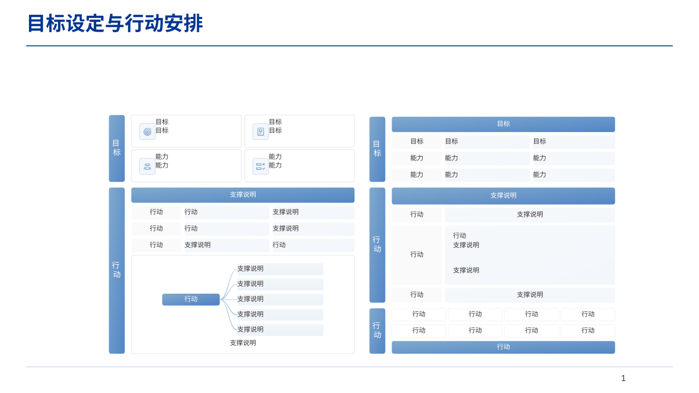

# 目标设定与行动安排

来源为房子图战略图.pptx#26。

## 结构与适用场景

左目标原则4卡与Why/What/Choose模型+SMART分支；右Task/Who/Time行动计划、团队共识、工具

目标设定到行动计划

多框架混排，优先拆页；SMART分支和任务责任时间独立字段

固定节点、圆弧、扇区、分面和连接表达定性关系。数量比较、趋势或占比使用数据驱动图表，源页中已登记的微图槽可接收实际数据。

## 预览



## 调用

将下列完整page对象放入schema_version=1、template_id=business-blue-v1的pages数组，替换各节点内容。nodes键对应原文本框或已明确拆分的语义分段，字段角色及source_ref、segment见下表。

```json
{
  "id": "house-26",
  "family": "source-house",
  "variant": "page-26",
  "content": {
    "title": "目标设定与行动安排",
    "nodes": {
      "shape_5": "目标",
      "shape_7": "行动",
      "shape_8": "支撑说明",
      "shape_9": "行动",
      "shape_10": "行动",
      "shape_11": "支撑说明",
      "shape_12": "行动",
      "shape_13": "行动",
      "shape_14": "支撑说明",
      "shape_15": "行动",
      "shape_16": "支撑说明",
      "shape_17": "行动",
      "shape_18": "目标",
      "shape_19": "目标",
      "shape_20": "目标",
      "shape_21": "目标",
      "shape_22": "目标",
      "shape_23": "能力",
      "shape_24": "能力",
      "shape_25": "能力",
      "shape_26": "能力",
      "shape_27": "能力",
      "shape_28": "能力",
      "shape_29": "行动",
      "shape_30": "支撑说明",
      "shape_31": "行动",
      "shape_704": "行动",
      "shape_705": "行动",
      "shape_706": "支撑说明",
      "shape_708": "支撑说明",
      "shape_709": "行动",
      "shape_710": "行动",
      "shape_711": "行动",
      "shape_712": "行动",
      "shape_713": "行动",
      "shape_714": "行动",
      "shape_715": "行动",
      "shape_716": "行动",
      "shape_717": "行动",
      "shape_718": "行动",
      "shape_719": "支撑说明",
      "shape_722": "目标",
      "shape_723": "目标",
      "shape_725": "目标",
      "shape_726": "目标",
      "shape_853": "能力",
      "shape_854": "能力",
      "shape_856": "能力",
      "shape_857": "能力",
      "shape_858": "支撑说明",
      "shape_859": "支撑说明",
      "shape_860": "支撑说明",
      "shape_861": "支撑说明",
      "shape_862": "支撑说明",
      "shape_863": "行动",
      "shape_871": "行动",
      "shape_873": "支撑说明",
      "shape_874": "支撑说明"
    }
  },
  "config": {
    "show_source": true,
    "show_page_number": true
  }
}
```

config支持show_source、show_page_number、image_fit与image_position。image_fit可选contain或cover，image_position为xMin/xMid/xMax与YMin/YMid/YMax组合的九个焦点，默认为xMidYMid。字体、颜色、全局区和固定字阶取自tokens，节点数与连接结构由variant确定。

## 字段合同

每个业务节点required=true、min=1，max按具体框体登记。字符按规范化后的Unicode码点计数，空格标点换行均计入。build会以实际字体测量宽高，字符数通过后仍可能需要调整文字。

| 字段 | 节点角色与源标签 | 最短/最长 | 字阶 | 框体px | 原框引用 | 分段 | 旋转° | 垂直锚点 |
|---|---|---|---|---|---|---|---|---|
| nodes.shape_5 | 上左节点，源标签“定目标四部曲” | 1/28 | diagramCompact | [199.4028, 210.7188, 29.0904, 122.5706] | slide:5 |  | 0.0 | ctr |
| nodes.shape_7 | 中左节点，源标签“厘清目标” | 1/72 | diagramCompact | [199.4028, 343.5768, 29.0904, 304.4232] | slide:7 |  | 0.0 | ctr |
| nodes.shape_8 | 中中节点，源标签“关键能力1：厘清目标的能力” | 1/75 | diagramMicro | [240.4086, 343.5768, 408.8213, 27.8852] | slide:8 |  | 0.0 | ctr |
| nodes.shape_9 | 中左节点，源标签“目标的感性面” | 1/16 | diagramMicro | [240.4086, 377.1444, 91.6127, 24.5013] | slide:9 |  | 0.0 | ctr |
| nodes.shape_10 | 中左节点，源标签“Why-有什么意义” | 1/28 | diagramMicro | [337.6877, 377.1444, 155.6673, 24.5013] | slide:10 |  | 0.0 | ctr |
| nodes.shape_11 | 中中节点，源标签“对行业/公司/团队/自己的意义” | 1/27 | diagramMicro | [499.0215, 377.1444, 150.2084, 24.5013] | slide:11 |  | 0.0 | ctr |
| nodes.shape_12 | 中左节点，源标签“目标的理性面” | 1/16 | diagramMicro | [240.4086, 407.3281, 91.6127, 24.5013] | slide:12 |  | 0.0 | ctr |
| nodes.shape_13 | 中左节点，源标签“What-目标是什么” | 1/28 | diagramMicro | [337.6877, 407.3281, 155.6673, 24.5013] | slide:13 |  | 0.0 | ctr |
| nodes.shape_14 | 中中节点，源标签“SMART原则、跳一跳原则” | 1/27 | diagramMicro | [499.0215, 407.3281, 150.2084, 24.5013] | slide:14 |  | 0.0 | ctr |
| nodes.shape_15 | 中左节点，源标签“策略和差距” | 1/16 | diagramMicro | [240.4086, 437.5119, 91.6127, 24.5013] | slide:15 |  | 0.0 | ctr |
| nodes.shape_16 | 中左节点，源标签“Choose-达成目标的核心策略” | 1/28 | diagramMicro | [337.6877, 437.5119, 155.6673, 24.5013] | slide:16 |  | 0.0 | ctr |
| nodes.shape_17 | 中中节点，源标签“目标分解、三三法” | 1/27 | diagramMicro | [499.0215, 437.5119, 150.2084, 24.5013] | slide:17 |  | 0.0 | ctr |
| nodes.shape_18 | 上中节点，源标签“制定计划” | 1/28 | diagramCompact | [676.4926, 213.8394, 29.0904, 119.45] | slide:18 |  | 0.0 | ctr |
| nodes.shape_19 | 上中节点，源标签“关键能力2：把目标变成行动计划的能力” | 1/75 | diagramMicro | [717.4985, 213.8394, 408.8213, 28.1247] | slide:19 |  | 0.0 | ctr |
| nodes.shape_20 | 上中节点，源标签“关键人物” | 1/16 | diagramMicro | [717.4985, 247.6943, 91.6127, 24.7168] | slide:20 |  | 0.0 | ctr |
| nodes.shape_21 | 上中节点，源标签“Task-策略分解任务” | 1/28 | diagramMicro | [814.7776, 247.6943, 155.6673, 24.7168] | slide:21 |  | 0.0 | ctr |
| nodes.shape_22 | 上右节点，源标签“抓重点” | 1/27 | diagramMicro | [976.1114, 247.6943, 150.2084, 24.7168] | slide:22 |  | 0.0 | ctr |
| nodes.shape_23 | 上中节点，源标签“责任到人” | 1/16 | diagramMicro | [717.4985, 278.1334, 91.6127, 24.7168] | slide:23 |  | 0.0 | ctr |
| nodes.shape_24 | 上中节点，源标签“Who-谁来负责” | 1/28 | diagramMicro | [814.7776, 278.1334, 155.6673, 24.7168] | slide:24 |  | 0.0 | ctr |
| nodes.shape_25 | 上右节点，源标签“事前达成共识” | 1/27 | diagramMicro | [976.1114, 278.1334, 150.2084, 24.7168] | slide:25 |  | 0.0 | ctr |
| nodes.shape_26 | 中中节点，源标签“时间节点” | 1/16 | diagramMicro | [717.4985, 308.5726, 91.6127, 24.7168] | slide:26 |  | 0.0 | ctr |
| nodes.shape_27 | 中中节点，源标签“Time-开始/结束时间” | 1/28 | diagramMicro | [814.7776, 308.5726, 155.6673, 24.7168] | slide:27 |  | 0.0 | ctr |
| nodes.shape_28 | 中右节点，源标签“反馈机制” | 1/27 | diagramMicro | [976.1114, 308.5726, 150.2084, 24.7168] | slide:28 |  | 0.0 | ctr |
| nodes.shape_29 | 中中节点，源标签“启动团队” | 1/48 | diagramCompact | [676.4926, 343.5768, 29.0904, 210.967] | slide:29 |  | 0.0 | ctr |
| nodes.shape_30 | 中中节点，源标签“关键能力2：给团队绘制地图的能力” | 1/150 | diagramMicro | [717.4985, 343.5768, 408.8213, 31.0217] | slide:30 |  | 0.0 | ctr |
| nodes.shape_31 | 中中节点，源标签“谈目标” | 1/16 | diagramMicro | [717.4985, 380.2091, 91.6127, 27.2548] | slide:31 |  | 0.0 | ctr |
| nodes.shape_704 | 中中节点，源标签“谈内容” | 1/112 | diagramMicro | [717.4985, 413.0744, 91.6127, 108.604] | slide:704 |  | 0.0 | ctr |
| nodes.shape_705 | 下中节点，源标签“KPI” | 1/16 | diagramMicro | [717.4985, 527.281, 91.6127, 27.2548] | slide:705 |  | 0.0 | ctr |
| nodes.shape_706 | 中中节点，源标签“Target-谈目标的能力决定了实现目标的能力” | 1/57 | diagramMicro | [814.7776, 380.2091, 311.5422, 27.2548] | slide:706 |  | 0.0 | ctr |
| nodes.shape_708 | 下中节点，源标签“KPI-为不同员工制定不同KPI，不能用老员工KPI考核新员工” | 1/57 | diagramMicro | [814.7776, 527.281, 311.5422, 27.2548] | slide:708 |  | 0.0 | ctr |
| nodes.shape_709 | 下中节点，源标签“跟进目标” | 1/16 | diagramCompact | [676.4926, 564.8311, 29.0904, 83.1689] | slide:709 |  | 0.0 | ctr |
| nodes.shape_710 | 下中节点，源标签“用户体验” | 1/75 | diagramMicro | [717.4985, 624.7756, 408.8213, 23.2244] | slide:710 |  | 0.0 | ctr |
| nodes.shape_711 | 下中节点，源标签“CRO工具” | 1/18 | diagramMicro | [717.4985, 564.8311, 99.1067, 23.2244] | slide:711 |  | 0.0 | ctr |
| nodes.shape_712 | 下中节点，源标签“售后服务工具” | 1/18 | diagramMicro | [717.4985, 594.8073, 99.1067, 23.2244] | slide:712 |  | 0.0 | ctr |
| nodes.shape_713 | 下中节点，源标签“营销自动化工具” | 1/18 | diagramMicro | [820.7393, 564.8311, 99.1067, 23.2244] | slide:713 |  | 0.0 | ctr |
| nodes.shape_714 | 下中节点，源标签“数据分析工具” | 1/18 | diagramMicro | [820.7393, 594.8073, 99.1067, 23.2244] | slide:714 |  | 0.0 | ctr |
| nodes.shape_715 | 下右节点，源标签“营销自动化工具” | 1/18 | diagramMicro | [923.9722, 564.8311, 99.1067, 23.2244] | slide:715 |  | 0.0 | ctr |
| nodes.shape_716 | 下右节点，源标签“数据分析工具” | 1/18 | diagramMicro | [923.9722, 594.8073, 99.1067, 23.2244] | slide:716 |  | 0.0 | ctr |
| nodes.shape_717 | 下右节点，源标签“营销自动化工具” | 1/18 | diagramMicro | [1027.213, 564.8311, 99.1067, 23.2244] | slide:717 |  | 0.0 | ctr |
| nodes.shape_718 | 下右节点，源标签“数据分析工具” | 1/18 | diagramMicro | [1027.213, 594.8073, 99.1067, 23.2244] | slide:718 |  | 0.0 | ctr |
| nodes.shape_719 | 下中节点，源标签“跳一跳原则：努力协作付出就能够得着的目标” | 1/44 | diagramMicro | [324.2639, 621.7827, 241.1188, 21.2771] | slide:719 |  | 0.0 | t |
| nodes.shape_722 | 上左节点，源标签“厘清目标” | 1/11 | diagramMicro | [284.4951, 216.8641, 62.7538, 21.9235] | slide:722 |  | 0.0 | t |
| nodes.shape_723 | 上左节点，源标签“私域流量运营需要解决如何获取流量的问题。” | 1/56 | diagramMicro | [284.4951, 232.6264, 153.0336, 34.5812] | slide:723 |  | 0.0 | t |
| nodes.shape_725 | 上中节点，源标签“可执行方案” | 1/13 | diagramMicro | [492.0542, 216.8641, 74.5735, 21.9235] | slide:725 |  | 0.0 | t |
| nodes.shape_726 | 上中节点，源标签“私域流量运营需要解决如何获取流量的问题。” | 1/56 | diagramMicro | [492.0542, 232.6264, 153.0336, 34.5812] | slide:726 |  | 0.0 | t |
| nodes.shape_853 | 中左节点，源标签“启动团队” | 1/11 | diagramMicro | [284.4951, 280.5197, 62.7538, 21.9235] | slide:853 |  | 0.0 | t |
| nodes.shape_854 | 中左节点，源标签“私域流量运营需要解决如何获取流量的问题。” | 1/56 | diagramMicro | [284.4951, 296.282, 153.0336, 34.5812] | slide:854 |  | 0.0 | t |
| nodes.shape_856 | 中中节点，源标签“跟进目标” | 1/11 | diagramMicro | [492.0542, 280.5197, 62.7538, 21.9235] | slide:856 |  | 0.0 | t |
| nodes.shape_857 | 中中节点，源标签“私域流量运营需要解决如何获取流量的问题。” | 1/56 | diagramMicro | [492.0542, 296.282, 153.0336, 34.5812] | slide:857 |  | 0.0 | t |
| nodes.shape_858 | 下中节点，源标签“Specific  目标明确” | 1/29 | diagramMicro | [434.4561, 482.3007, 158.1255, 21.7559] | slide:858 |  | 0.0 | ctr |
| nodes.shape_859 | 下中节点，源标签“Measurable  结果可量化” | 1/29 | diagramMicro | [434.4561, 510.154, 158.1255, 21.7559] | slide:859 |  | 0.0 | ctr |
| nodes.shape_860 | 下中节点，源标签“Agreed  团队达成一致” | 1/29 | diagramMicro | [434.4561, 538.0153, 158.1255, 21.7559] | slide:860 |  | 0.0 | ctr |
| nodes.shape_861 | 下中节点，源标签“Rewardiing 成功有激励” | 1/29 | diagramMicro | [434.4561, 565.8686, 158.1255, 21.7559] | slide:861 |  | 0.0 | ctr |
| nodes.shape_862 | 下中节点，源标签“Time-frame set  具体时间表” | 1/29 | diagramMicro | [434.4561, 593.7219, 158.1255, 21.7559] | slide:862 |  | 0.0 | ctr |
| nodes.shape_863 | 下左节点，源标签“SMART原则” | 1/19 | diagramMicro | [297.057, 538.0153, 105.3558, 21.7559] | slide:863 |  | 0.0 | ctr |
| nodes.shape_871 | 中中节点，源标签“Content” | 1/9 | diagramMicro | [829.5742, 425.3011, 51.4688, 20.6546] | slide:871 |  | 0.0 | t |
| nodes.shape_873 | 中中节点，源标签“1.重点谈目标的感性面和理性面（语文题和数字题） / 语文题-完成目标增强团队凝聚力” | 1/156 | diagramMicro | [829.5742, 442.6037, 284.1039, 48.4999] | slide:873 |  | 0.0 | t |
| nodes.shape_874 | 下中节点，源标签“2.扣动每个人的心灵扳机是不一样的，因人而异” | 1/40 | diagramMicro | [829.5742, 488.7732, 216.809, 19.3377] | slide:874 |  | 0.0 | t |

全局title必填、2至32码点，使用统一标题框。section_name可选0至24码点，source可选0至64码点。所有可编辑文本通过独立原生carrier导出，页码为派生文字。

## 来源处理

原生PPTX源件保存于用户材料目录，分发包仅含用户资产衍生的几何、字段和说明。原始逐框文字、源框与标准化框在page-catalog.json的variant.fields中。

源标题引用为`slide:4`，原文为“团队管理—定目标”。模板默认标题依据真实结构设置。

密集全景中的diagramCompact为14px、diagramMicro为12px。适用于体系概览或附录局部标签，现场关键结论用统一标题与正常正文字阶表达。

源画布边界裁切已烘焙为可编辑Bezier几何，3D顶面、侧面与前面通过tokens配色的相对明暗保留。

