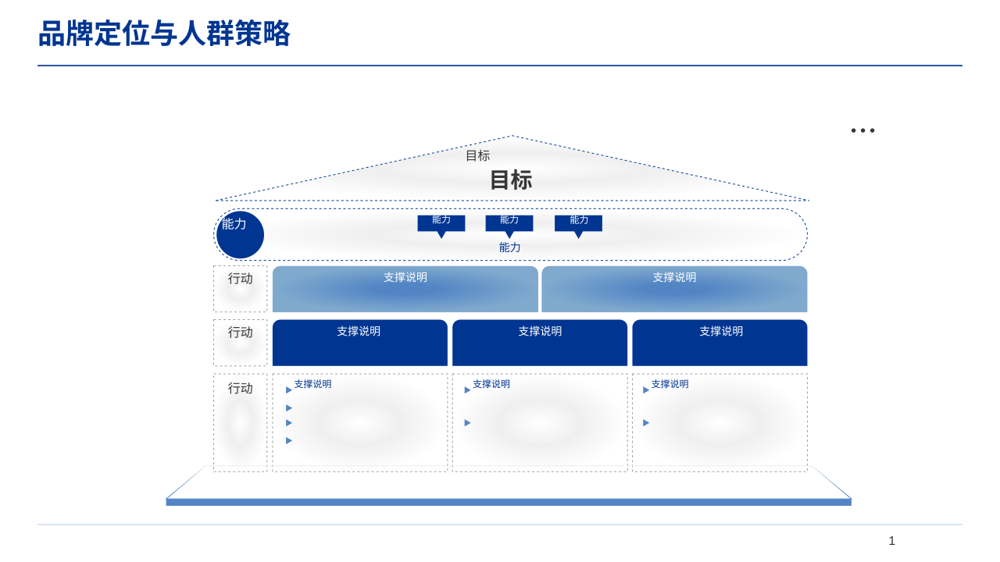

# 品牌定位与人群策略

来源为房子图战略图.pptx#27。

## 结构与适用场景

虚线屋顶口号；定位与价值2层；3人群；3列执行策略；立体底板

品牌定位与人群策略

口号/定位/价值/人群/执行各层角色保留，原业务文案仅示例

固定节点、圆弧、扇区、分面和连接表达定性关系。数量比较、趋势或占比使用数据驱动图表，源页中已登记的微图槽可接收实际数据。

## 预览



## 调用

将下列完整page对象放入schema_version=1、template_id=business-blue-v1的pages数组，替换各节点内容。nodes键对应原文本框或已明确拆分的语义分段，字段角色及source_ref、segment见下表。

```json
{
  "id": "house-27",
  "family": "source-house",
  "variant": "page-27",
  "content": {
    "title": "品牌定位与人群策略",
    "nodes": {
      "shape_25": "目标",
      "shape_27": "行动",
      "shape_28": "行动",
      "shape_29": "行动",
      "shape_31": "目标",
      "shape_26": "能力",
      "shape_453": "能力",
      "shape_468": "能力",
      "shape_469": "能力",
      "shape_470": "能力",
      "shape_472": "支撑说明",
      "shape_473": "支撑说明",
      "shape_475": "支撑说明",
      "shape_476": "支撑说明",
      "shape_477": "支撑说明",
      "shape_479": "支撑说明",
      "shape_50": "支撑说明",
      "shape_55": "支撑说明"
    }
  },
  "config": {
    "show_source": true,
    "show_page_number": true
  }
}
```

config支持show_source、show_page_number、image_fit与image_position。image_fit可选contain或cover，image_position为xMin/xMid/xMax与YMin/YMid/YMax组合的九个焦点，默认为xMidYMid。字体、颜色、全局区和固定字阶取自tokens，节点数与连接结构由variant确定。

## 字段合同

每个业务节点required=true、min=1，max按具体框体登记。字符按规范化后的Unicode码点计数，空格标点换行均计入。build会以实际字体测量宽高，字符数通过后仍可能需要调整文字。

| 字段 | 节点角色与源标签 | 最短/最长 | 字阶 | 框体px | 原框引用 | 分段 | 旋转° | 垂直锚点 |
|---|---|---|---|---|---|---|---|---|
| nodes.shape_25 | 上中节点，源标签“品牌Slogan” | 1/14 | caption | [595.3756, 191.051, 107.3697, 28.3711] | slide:25 |  | 0.0 | t |
| nodes.shape_27 | 中左节点，源标签“品牌 / 价值” | 1/20 | caption | [270.055, 348.5169, 75.2558, 44.9132] | slide:27 |  | 0.0 | t |
| nodes.shape_28 | 中左节点，源标签“目标 / 人群” | 1/14 | caption | [281.8763, 417.4269, 51.6133, 44.9517] | slide:28 |  | 0.0 | t |
| nodes.shape_29 | 下左节点，源标签“执行 / 策略” | 1/14 | caption | [281.8763, 489.1325, 51.6133, 44.9517] | slide:29 |  | 0.0 | t |
| nodes.shape_31 | 上中节点，源标签“时尚不止一瞬间，我们与你同行” | 1/47 | heading | [351.826, 215.9335, 603.3406, 40.1847] | slide:31 |  | 0.0 | t |
| nodes.shape_26 | 上左节点，源标签“品牌 / 定位” | 1/12 | caption | [283.5937, 278.4516, 45.7065, 44.9132] | slide:26 |  | 0.0 | t |
| nodes.shape_453 | 中中节点，源标签“致力于为追求个性化、时尚潮流的年轻女性提供优质的服装产品和全方位的时尚体验。” | 1/117 | diagramCompact | [282.2768, 309.572, 740.8219, 23.6426] | slide:453 |  | 0.0 | t |
| nodes.shape_468 | 上中节点，源标签“年轻” | 1/7 | diagramMicro | [546.0727, 274.8166, 37.8282, 21.2783] | slide:468 |  | 0.0 | t |
| nodes.shape_469 | 上中节点，源标签“时尚” | 1/7 | diagramMicro | [633.0728, 274.9476, 37.8282, 21.2783] | slide:469 |  | 0.0 | t |
| nodes.shape_470 | 上中节点，源标签“品质” | 1/7 | diagramMicro | [722.4834, 275.2402, 37.8282, 21.2783] | slide:470 |  | 0.0 | t |
| nodes.shape_472 | 中中节点，源标签“让每一位顾客都能够发掘自己的美丽和自信，成为自己生活中的时尚icon。” | 1/90 | diagramCompact | [376.3543, 347.8315, 285.1898, 45.5139] | slide:472 |  | 0.0 | t |
| nodes.shape_473 | 中中节点，源标签“帮助每一位顾客找到自己的风格，展现内心的独特魅力。” | 1/90 | diagramCompact | [720.7892, 347.8315, 285.1898, 45.5139] | slide:473 |  | 0.0 | t |
| nodes.shape_475 | 中中节点，源标签“18-25岁的年轻女性 / 注重时尚潮流，热爱尝试新鲜事物” | 1/72 | diagramCompact | [345.3108, 416.988, 227.5619, 45.5524] | slide:475 |  | 0.0 | t |
| nodes.shape_476 | 中中节点，源标签“25-35岁的都市女性 / 注重品质、舒适性和时尚感” | 1/72 | diagramCompact | [577.5551, 416.988, 227.5619, 45.5524] | slide:476 |  | 0.0 | t |
| nodes.shape_477 | 中中节点，源标签“35-45岁的成熟女性 / 注重品质和优雅，体现内在的品味” | 1/72 | diagramCompact | [809.4681, 416.988, 227.5619, 45.4831] | slide:477 |  | 0.0 | t |
| nodes.shape_479 | 下中节点，源标签“重点关注社交媒体和线上渠道宣传 / 推出时尚、个性化的产品 / 加强线下实体店的体验感 / ” | 1/245 | diagramMicro | [376.3543, 485.6901, 190.1804, 111.2973] | slide:479 |  | 0.0 | t |
| nodes.shape_50 | 下中节点，源标签“注重线下实体店的布局和服务，提供舒适、时尚、品质的购物体验 / 同时加强品牌形象的宣” | 1/245 | diagramMicro | [604.9327, 485.6901, 190.1804, 111.2973] | slide:50 |  | 0.0 | t |
| nodes.shape_55 | 下中节点，源标签“注重品牌形象的打造和维护，提供高品质、优雅、舒适的产品和服务 / 同时加强线下实体店” | 1/245 | diagramMicro | [833.5112, 485.6901, 190.1804, 111.2973] | slide:55 |  | 0.0 | t |

## 保留的原装饰

本页保留用户原模板的结构图标或装饰图片，逐项身份见source-field-coverage.json中本页retained_source_images。其中图片内固化的字形随整图编辑，可在PowerPoint中原生替换整图；nodes字段控制已登记的可编辑文字。参数图片替换使用本页image_slots列出的槽位。


全局title必填、2至32码点，使用统一标题框。section_name可选0至24码点，source可选0至64码点。所有可编辑文本通过独立原生carrier导出，页码为派生文字。

## 来源处理

原生PPTX源件保存于用户材料目录，分发包仅含用户资产衍生的几何、字段和说明。原始逐框文字、源框与标准化框在page-catalog.json的variant.fields中。

源标题引用为`slide:30`，原文为“房子图/品牌策略/定位”。模板默认标题依据真实结构设置。

密集全景中的diagramCompact为14px、diagramMicro为12px。适用于体系概览或附录局部标签，现场关键结论用统一标题与正常正文字阶表达。

源画布边界裁切已烘焙为可编辑Bezier几何，3D顶面、侧面与前面通过tokens配色的相对明暗保留。

