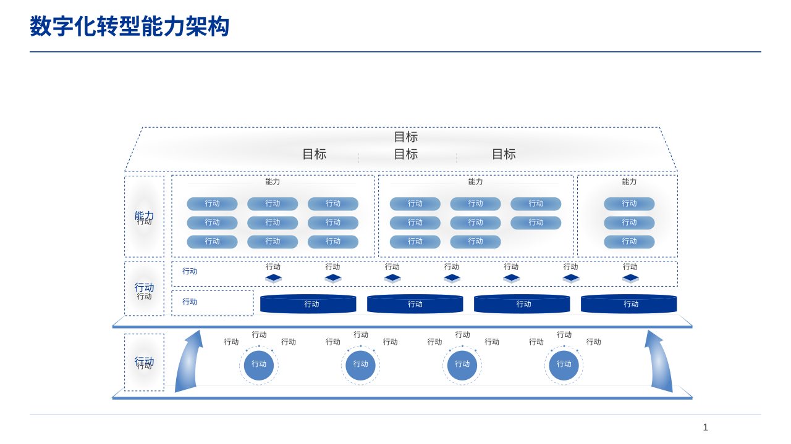

# 数字化转型能力架构

来源为房子图战略图.pptx#28。

## 结构与适用场景

梯形总框；应用层3业务域多应用；技术层7技术+5圆柱设施；支撑层4轮/圈；两侧上行箭头

数字化转型架构

应用、技术、组织支撑层次保留，圆柱与支撑回路可编辑；未证实技术不可填入当前报告

固定节点、圆弧、扇区、分面和连接表达定性关系。数量比较、趋势或占比使用数据驱动图表，源页中已登记的微图槽可接收实际数据。

## 预览



## 调用

将下列完整page对象放入schema_version=1、template_id=business-blue-v1的pages数组，替换各节点内容。nodes键对应原文本框或已明确拆分的语义分段，字段角色及source_ref、segment见下表。

```json
{
  "id": "house-28",
  "family": "source-house",
  "variant": "page-28",
  "content": {
    "title": "数字化转型能力架构",
    "nodes": {
      "shape_22": "目标",
      "shape_24": "目标",
      "shape_25": "目标",
      "shape_26": "目标",
      "shape_34": "能力",
      "shape_35": "行动",
      "shape_40": "行动",
      "shape_45": "行动",
      "shape_46": "行动",
      "shape_49": "行动",
      "shape_451": "能力",
      "shape_452": "行动",
      "shape_453": "行动",
      "shape_454": "行动",
      "shape_455": "行动",
      "shape_456": "行动",
      "shape_457": "行动",
      "shape_459": "行动",
      "shape_460": "行动",
      "shape_470": "行动",
      "shape_474": "能力",
      "shape_475": "行动",
      "shape_476": "行动",
      "shape_477": "行动",
      "shape_478": "行动",
      "shape_479": "行动",
      "shape_480": "行动",
      "shape_481": "行动",
      "shape_482": "行动",
      "shape_486": "行动",
      "shape_489": "行动",
      "shape_492": "行动",
      "shape_497": "能力",
      "shape_498": "行动",
      "shape_499": "行动",
      "shape_514": "行动",
      "shape_515": "行动",
      "shape_516": "行动",
      "shape_517": "行动",
      "shape_538": "行动",
      "shape_539": "行动",
      "shape_540": "行动",
      "shape_543": "行动",
      "shape_688": "行动",
      "shape_689": "行动",
      "shape_690": "行动",
      "shape_692": "行动",
      "shape_702": "行动",
      "shape_703": "行动",
      "shape_704": "行动",
      "shape_706": "行动",
      "shape_716": "行动",
      "shape_717": "行动",
      "shape_718": "行动",
      "shape_720": "行动",
      "shape_733": "行动",
      "shape_13": "行动",
      "shape_19": "行动",
      "shape_36": "行动",
      "shape_48": "行动",
      "shape_55": "行动",
      "shape_61": "行动"
    }
  },
  "config": {
    "show_source": true,
    "show_page_number": true
  }
}
```

config支持show_source、show_page_number、image_fit与image_position。image_fit可选contain或cover，image_position为xMin/xMid/xMax与YMin/YMid/YMax组合的九个焦点，默认为xMidYMid。字体、颜色、全局区和固定字阶取自tokens，节点数与连接结构由variant确定。

## 字段合同

每个业务节点required=true、min=1，max按具体框体登记。字符按规范化后的Unicode码点计数，空格标点换行均计入。build会以实际字体测量宽高，字符数通过后仍可能需要调整文字。

| 字段 | 节点角色与源标签 | 最短/最长 | 字阶 | 框体px | 原框引用 | 分段 | 旋转° | 垂直锚点 |
|---|---|---|---|---|---|---|---|---|
| nodes.shape_22 | 上中节点，源标签“XXXXX数字化转型框架” | 1/84 | compactBody | [276.206, 211.4736, 760.3958, 30.1133] | slide:22 |  | 0.0 | t |
| nodes.shape_24 | 上中节点，源标签“业务导向” | 1/14 | compactBody | [441.2856, 239.436, 134.0733, 32.241] | slide:24 |  | 0.0 | t |
| nodes.shape_25 | 上中节点，源标签“全力转型” | 1/14 | compactBody | [589.3673, 239.436, 134.0733, 32.241] | slide:25 |  | 0.0 | t |
| nodes.shape_26 | 上中节点，源标签“智能辅助” | 1/14 | compactBody | [747.9319, 239.436, 134.0733, 32.241] | slide:26 |  | 0.0 | t |
| nodes.shape_34 | 中左节点，源标签“应用” | 1/48 | caption | [201.676, 285.5067, 63.5268, 131.4564] | slide:34 |  | 0.0 | ctr |
| nodes.shape_35 | 中左节点，源标签“Enter your” | 1/11 | diagramMicro | [201.676, 353.0092, 63.5268, 18.815] | slide:35 |  | 0.0 | t |
| nodes.shape_40 | 中左节点，源标签“技术” | 1/32 | caption | [201.676, 423.7576, 63.5268, 88.1346] | slide:40 |  | 0.0 | ctr |
| nodes.shape_45 | 中左节点，源标签“Enter your” | 1/11 | diagramMicro | [201.676, 474.2156, 63.5268, 18.815] | slide:45 |  | 0.0 | t |
| nodes.shape_46 | 下左节点，源标签“支撑” | 1/32 | caption | [201.676, 541.6483, 63.5268, 92.2579] | slide:46 |  | 0.0 | ctr |
| nodes.shape_49 | 下左节点，源标签“Enter your” | 1/11 | diagramMicro | [201.676, 587.191, 63.5268, 18.815] | slide:49 |  | 0.0 | t |
| nodes.shape_451 | 中中节点，源标签“销售” | 1/7 | diagramMicro | [421.1894, 288.24, 40.1459, 22.5811] | slide:451 |  | 0.0 | t |
| nodes.shape_452 | 中左节点，源标签“智慧营销” | 1/15 | diagramMicro | [302.4212, 319.9995, 82.2175, 21.5872] | slide:452 |  | 0.0 | ctr |
| nodes.shape_453 | 中中节点，源标签“智能电商” | 1/15 | diagramMicro | [400.1536, 319.9995, 82.2175, 21.5872] | slide:453 |  | 0.0 | ctr |
| nodes.shape_454 | 中中节点，源标签“智慧CRM” | 1/15 | diagramMicro | [497.8937, 319.9995, 82.2175, 21.5872] | slide:454 |  | 0.0 | ctr |
| nodes.shape_455 | 中左节点，源标签“统一支付” | 1/15 | diagramMicro | [302.4212, 350.7729, 82.2175, 21.5872] | slide:455 |  | 0.0 | ctr |
| nodes.shape_456 | 中中节点，源标签“全渠道系统” | 1/15 | diagramMicro | [400.1536, 350.7729, 82.2175, 21.5872] | slide:456 |  | 0.0 | ctr |
| nodes.shape_457 | 中中节点，源标签“数字货币” | 1/15 | diagramMicro | [497.8937, 350.7729, 82.2175, 21.5872] | slide:457 |  | 0.0 | ctr |
| nodes.shape_459 | 中左节点，源标签“智慧码管理” | 1/15 | diagramMicro | [302.4212, 381.5384, 82.2175, 21.5872] | slide:459 |  | 0.0 | ctr |
| nodes.shape_460 | 中中节点，源标签“物联网系统” | 1/15 | diagramMicro | [400.1536, 381.5384, 82.2175, 21.5872] | slide:460 |  | 0.0 | ctr |
| nodes.shape_470 | 中中节点，源标签“智慧会员” | 1/15 | diagramMicro | [497.8937, 381.5384, 82.2175, 21.5872] | slide:470 |  | 0.0 | ctr |
| nodes.shape_474 | 中中节点，源标签“生产” | 1/7 | diagramMicro | [749.4849, 288.24, 40.1459, 22.5811] | slide:474 |  | 0.0 | t |
| nodes.shape_475 | 中中节点，源标签“智慧物流” | 1/15 | diagramMicro | [630.709, 319.9995, 82.2175, 21.5872] | slide:475 |  | 0.0 | ctr |
| nodes.shape_476 | 中中节点，源标签“智慧仓储” | 1/15 | diagramMicro | [728.4491, 319.9995, 82.2175, 21.5872] | slide:476 |  | 0.0 | ctr |
| nodes.shape_477 | 中中节点，源标签“智慧WMS” | 1/15 | diagramMicro | [826.1814, 319.9995, 82.2175, 21.5872] | slide:477 |  | 0.0 | ctr |
| nodes.shape_478 | 中中节点，源标签“智慧排产” | 1/15 | diagramMicro | [630.709, 350.7729, 82.2175, 21.5872] | slide:478 |  | 0.0 | ctr |
| nodes.shape_479 | 中中节点，源标签“智慧物料” | 1/15 | diagramMicro | [728.4491, 350.7729, 82.2175, 21.5872] | slide:479 |  | 0.0 | ctr |
| nodes.shape_480 | 中中节点，源标签“智慧供应链” | 1/15 | diagramMicro | [826.1814, 350.7729, 82.2175, 21.5872] | slide:480 |  | 0.0 | ctr |
| nodes.shape_481 | 中中节点，源标签“智慧DMC” | 1/15 | diagramMicro | [630.709, 381.5384, 82.2175, 21.5872] | slide:481 |  | 0.0 | ctr |
| nodes.shape_482 | 中中节点，源标签“智慧货架” | 1/15 | diagramMicro | [728.4491, 381.5384, 82.2175, 21.5872] | slide:482 |  | 0.0 | ctr |
| nodes.shape_486 | 中右节点，源标签“智慧人力” | 1/15 | diagramMicro | [977.3458, 319.9995, 82.2175, 21.5872] | slide:486 |  | 0.0 | ctr |
| nodes.shape_489 | 中右节点，源标签“智慧OA” | 1/15 | diagramMicro | [977.3458, 350.7729, 82.2175, 21.5872] | slide:489 |  | 0.0 | ctr |
| nodes.shape_492 | 中右节点，源标签“智慧门户” | 1/15 | diagramMicro | [977.3458, 381.5384, 82.2175, 21.5872] | slide:492 |  | 0.0 | ctr |
| nodes.shape_497 | 中右节点，源标签“综合” | 1/7 | diagramMicro | [998.3817, 288.24, 40.1459, 22.5811] | slide:497 |  | 0.0 | t |
| nodes.shape_498 | 中左节点，源标签“关键技术” | 1/12 | diagramMicro | [295.021, 433.5184, 67.3317, 22.5811] | slide:498 |  | 0.0 | t |
| nodes.shape_499 | 下左节点，源标签“基础设施和平台” | 1/19 | diagramMicro | [295.021, 483.1534, 106.406, 22.5811] | slide:499 |  | 0.0 | t |
| nodes.shape_514 | 下中节点，源标签“网络设备” | 1/10 | diagramMicro | [474.8544, 486.8263, 58.9609, 20.7019] | slide:514 |  | 0.0 | t |
| nodes.shape_515 | 下中节点，源标签“大数据云” | 1/10 | diagramMicro | [642.3179, 486.8263, 58.9609, 20.7019] | slide:515 |  | 0.0 | t |
| nodes.shape_516 | 下中节点，源标签“数据服务器” | 1/12 | diagramMicro | [812.5691, 486.8263, 69.9408, 20.7019] | slide:516 |  | 0.0 | t |
| nodes.shape_517 | 下右节点，源标签“容器” | 1/6 | diagramMicro | [1002.7146, 486.8263, 37.0088, 20.7019] | slide:517 |  | 0.0 | t |
| nodes.shape_538 | 下左节点，源标签“协调机制” | 1/9 | diagramMicro | [392.5748, 536.4457, 53.7737, 20.1428] | slide:538 |  | 0.0 | t |
| nodes.shape_539 | 下左节点，源标签“独立部门” | 1/9 | diagramMicro | [347.3504, 548.2099, 53.7737, 20.1428] | slide:539 |  | 0.0 | t |
| nodes.shape_540 | 下左节点，源标签“组织架构” | 1/9 | diagramMicro | [392.1865, 583.7821, 53.7737, 18.815] | slide:540 |  | 0.0 | t |
| nodes.shape_543 | 下中节点，源标签“部门责任制” | 1/13 | diagramMicro | [429.6534, 548.2099, 74.5533, 20.1428] | slide:543 |  | 0.0 | t |
| nodes.shape_688 | 下中节点，源标签“激励奖金” | 1/9 | diagramMicro | [557.1185, 536.4457, 53.7737, 20.1428] | slide:688 |  | 0.0 | t |
| nodes.shape_689 | 下中节点，源标签“专享资金” | 1/9 | diagramMicro | [511.8942, 548.2099, 53.7737, 20.1428] | slide:689 |  | 0.0 | t |
| nodes.shape_690 | 下中节点，源标签“预算支出” | 1/9 | diagramMicro | [556.7303, 583.7821, 53.7737, 18.815] | slide:690 |  | 0.0 | t |
| nodes.shape_692 | 下中节点，源标签“专用通道” | 1/9 | diagramMicro | [604.587, 548.2099, 53.7737, 20.1428] | slide:692 |  | 0.0 | t |
| nodes.shape_702 | 下中节点，源标签“培训计划” | 1/9 | diagramMicro | [721.6623, 536.4457, 53.7737, 20.1428] | slide:702 |  | 0.0 | t |
| nodes.shape_703 | 下中节点，源标签“人才储备” | 1/9 | diagramMicro | [676.438, 548.2099, 53.7737, 20.1428] | slide:703 |  | 0.0 | t |
| nodes.shape_704 | 下中节点，源标签“人才” | 1/9 | diagramMicro | [721.2741, 583.7821, 53.7737, 18.815] | slide:704 |  | 0.0 | t |
| nodes.shape_706 | 下中节点，源标签“轮岗机制” | 1/9 | diagramMicro | [769.1308, 548.2099, 53.7737, 20.1428] | slide:706 |  | 0.0 | t |
| nodes.shape_716 | 下右节点，源标签“先进企业体验” | 1/15 | diagramMicro | [871.5999, 536.4457, 82.9863, 20.1428] | slide:716 |  | 0.0 | t |
| nodes.shape_717 | 下右节点，源标签“培训演讲” | 1/9 | diagramMicro | [840.9818, 548.2099, 53.7737, 20.1428] | slide:717 |  | 0.0 | t |
| nodes.shape_718 | 下右节点，源标签“转型思想” | 1/9 | diagramMicro | [885.8179, 583.7821, 53.7737, 18.815] | slide:718 |  | 0.0 | t |
| nodes.shape_720 | 下右节点，源标签“书籍阅读” | 1/9 | diagramMicro | [933.6746, 548.2099, 53.7737, 20.1428] | slide:720 |  | 0.0 | t |
| nodes.shape_733 | 中中节点，源标签“5G” | 1/5 | diagramMicro | [427.7509, 426.39, 28.3817, 20.0729] | slide:733 |  | 0.0 | t |
| nodes.shape_13 | 中中节点，源标签“AI人工智能” | 1/12 | diagramMicro | [505.1541, 426.39, 66.1514, 20.0729] | slide:13 |  | 0.0 | t |
| nodes.shape_19 | 中中节点，源标签“物联网” | 1/8 | diagramMicro | [611.3116, 426.39, 46.4201, 20.0729] | slide:19 |  | 0.0 | t |
| nodes.shape_36 | 中中节点，源标签“区块链” | 1/8 | diagramMicro | [707.5996, 426.39, 46.4201, 20.0729] | slide:36 |  | 0.0 | t |
| nodes.shape_48 | 中中节点，源标签“AR/VR” | 1/8 | diagramMicro | [803.9498, 426.39, 46.2881, 20.0729] | slide:48 |  | 0.0 | t |
| nodes.shape_55 | 中右节点，源标签“机器人” | 1/8 | diagramMicro | [900.1757, 426.39, 46.4201, 20.0729] | slide:55 |  | 0.0 | t |
| nodes.shape_61 | 中右节点，源标签“量子计算” | 1/10 | diagramMicro | [991.2377, 426.39, 56.872, 20.0729] | slide:61 |  | 0.0 | t |

## 保留的原装饰

本页保留用户原模板的结构图标或装饰图片，逐项身份见source-field-coverage.json中本页retained_source_images。其中图片内固化的字形随整图编辑，可在PowerPoint中原生替换整图；nodes字段控制已登记的可编辑文字。参数图片替换使用本页image_slots列出的槽位。


全局title必填、2至32码点，使用统一标题框。section_name可选0至24码点，source可选0至64码点。所有可编辑文本通过独立原生carrier导出，页码为派生文字。

## 来源处理

原生PPTX源件保存于用户材料目录，分发包仅含用户资产衍生的几何、字段和说明。原始逐框文字、源框与标准化框在page-catalog.json的variant.fields中。

源标题引用为`slide:30`，原文为“数字化转型战略屋/架构”。模板默认标题依据真实结构设置。

密集全景中的diagramCompact为14px、diagramMicro为12px。适用于体系概览或附录局部标签，现场关键结论用统一标题与正常正文字阶表达。

源画布边界裁切已烘焙为可编辑Bezier几何，3D顶面、侧面与前面通过tokens配色的相对明暗保留。

