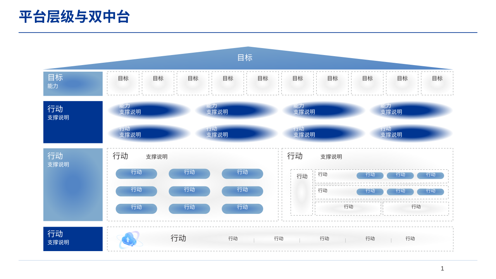

# 平台层级与双中台

来源为房子图战略图.pptx#29。

## 结构与适用场景

屋顶；触点11小块；应用8椭圆；业务/数据双中台；云平台基础；左层标签

平台层级与双中台

各层模块数独立，底座技术列表；椭圆应用非流程步骤

固定节点、圆弧、扇区、分面和连接表达定性关系。数量比较、趋势或占比使用数据驱动图表，源页中已登记的微图槽可接收实际数据。

## 预览



## 调用

将下列完整page对象放入schema_version=1、template_id=business-blue-v1的pages数组，替换各节点内容。nodes键对应原文本框或已明确拆分的语义分段，字段角色及source_ref、segment见下表。

```json
{
  "id": "house-29",
  "family": "source-house",
  "variant": "page-29",
  "content": {
    "title": "平台层级与双中台",
    "nodes": {
      "shape_11": "行动",
      "shape_13": "支撑说明",
      "shape_53": "行动",
      "shape_54": "支撑说明",
      "shape_55": "行动",
      "shape_56": "支撑说明",
      "shape_57": "目标",
      "shape_58": "能力",
      "shape_59": "行动",
      "shape_60": "支撑说明",
      "shape_450": "行动",
      "shape_451": "支撑说明",
      "shape_477": "行动",
      "shape_479": "行动",
      "shape_481": "行动",
      "shape_483": "行动",
      "shape_485": "行动",
      "shape_487": "行动",
      "shape_489": "行动",
      "shape_491": "行动",
      "shape_493": "行动",
      "shape_512": "行动",
      "shape_515": "行动",
      "shape_516": "行动",
      "shape_517": "行动",
      "shape_518": "行动",
      "shape_525": "行动",
      "shape_531": "行动",
      "shape_533": "行动",
      "shape_535": "行动",
      "shape_537": "行动",
      "shape_539": "行动",
      "shape_540": "行动",
      "shape_542": "行动",
      "shape_550": "行动",
      "shape_552": "行动",
      "shape_554": "行动",
      "shape_556": "行动",
      "shape_560": "能力",
      "shape_561": "支撑说明",
      "shape_565": "行动",
      "shape_566": "支撑说明",
      "shape_568": "能力",
      "shape_569": "支撑说明",
      "shape_571": "行动",
      "shape_572": "支撑说明",
      "shape_574": "能力",
      "shape_575": "支撑说明",
      "shape_577": "行动",
      "shape_578": "支撑说明",
      "shape_580": "能力",
      "shape_581": "支撑说明",
      "shape_583": "行动",
      "shape_584": "支撑说明",
      "shape_585": "目标",
      "shape_586": "目标",
      "shape_587": "目标",
      "shape_588": "目标",
      "shape_589": "目标",
      "shape_590": "目标",
      "shape_591": "目标",
      "shape_592": "目标",
      "shape_593": "目标",
      "shape_594": "目标",
      "shape_128": "目标"
    }
  },
  "config": {
    "show_source": true,
    "show_page_number": true
  }
}
```

config支持show_source、show_page_number、image_fit与image_position。image_fit可选contain或cover，image_position为xMin/xMid/xMax与YMin/YMid/YMax组合的九个焦点，默认为xMidYMid。字体、颜色、全局区和固定字阶取自tokens，节点数与连接结构由variant确定。

## 字段合同

每个业务节点required=true、min=1，max按具体框体登记。字符按规范化后的Unicode码点计数，空格标点换行均计入。build会以实际字体测量宽高，字符数通过后仍可能需要调整文字。

| 字段 | 节点角色与源标签 | 最短/最长 | 字阶 | 框体px | 原框引用 | 分段 | 旋转° | 垂直锚点 |
|---|---|---|---|---|---|---|---|---|
| nodes.shape_11 | 下左节点，源标签“云平台” | 1/16 | compactBody | [122.3109, 592.9075, 144.876, 30.9924] | slide:11 |  | 0.0 | t |
| nodes.shape_13 | 下左节点，源标签“Enter your title” | 1/20 | diagramCompact | [122.3109, 618.1639, 129.779, 25.3574] | slide:13 |  | 0.0 | t |
| nodes.shape_53 | 中左节点，源标签“双中台” | 1/16 | compactBody | [122.3109, 391.9752, 144.876, 30.9924] | slide:53 |  | 0.0 | t |
| nodes.shape_54 | 中左节点，源标签“Enter your title” | 1/20 | diagramCompact | [122.3109, 417.2409, 129.779, 25.3574] | slide:54 |  | 0.0 | t |
| nodes.shape_55 | 上左节点，源标签“应用层” | 1/16 | compactBody | [122.3109, 270.768, 144.876, 30.9924] | slide:55 |  | 0.0 | t |
| nodes.shape_56 | 中左节点，源标签“Enter your title” | 1/20 | diagramCompact | [122.3109, 296.0245, 129.779, 25.3574] | slide:56 |  | 0.0 | t |
| nodes.shape_57 | 上左节点，源标签“触点” | 1/16 | compactBody | [122.3109, 189.4094, 144.876, 30.9924] | slide:57 |  | 0.0 | t |
| nodes.shape_58 | 上左节点，源标签“Enter your title” | 1/20 | diagramCompact | [122.3109, 214.6659, 129.779, 25.3574] | slide:58 |  | 0.0 | t |
| nodes.shape_59 | 中左节点，源标签“业务中台” | 1/16 | compactBody | [290.5804, 391.9752, 144.876, 30.9924] | slide:59 |  | 0.0 | t |
| nodes.shape_60 | 中中节点，源标签“Enter your title” | 1/20 | diagramCompact | [376.3533, 397.1881, 129.779, 25.3574] | slide:60 |  | 0.0 | t |
| nodes.shape_450 | 中中节点，源标签“数据中台” | 1/16 | compactBody | [740.9662, 391.9752, 144.876, 30.9924] | slide:450 |  | 0.0 | t |
| nodes.shape_451 | 中中节点，源标签“Enter your title” | 1/20 | diagramCompact | [826.7392, 397.1881, 129.779, 25.3574] | slide:451 |  | 0.0 | t |
| nodes.shape_477 | 中左节点，源标签“用户中心” | 1/14 | diagramCompact | [306.3932, 436.4035, 91.3161, 25.3574] | slide:477 |  | 0.0 | t |
| nodes.shape_479 | 中中节点，源标签“商品中心” | 1/14 | diagramCompact | [443.2298, 436.4035, 91.3161, 25.3574] | slide:479 |  | 0.0 | t |
| nodes.shape_481 | 中中节点，源标签“交易中心” | 1/14 | diagramCompact | [580.0755, 436.4035, 91.3161, 25.3574] | slide:481 |  | 0.0 | t |
| nodes.shape_483 | 下左节点，源标签“计划中心” | 1/14 | diagramCompact | [306.3932, 481.5752, 91.3161, 25.3574] | slide:483 |  | 0.0 | t |
| nodes.shape_485 | 下中节点，源标签“渠道中心” | 1/14 | diagramCompact | [443.2298, 481.5752, 91.3161, 25.3574] | slide:485 |  | 0.0 | t |
| nodes.shape_487 | 下中节点，源标签“库存中心” | 1/14 | diagramCompact | [580.0755, 481.5752, 91.3161, 25.3574] | slide:487 |  | 0.0 | t |
| nodes.shape_489 | 下左节点，源标签“数据中心” | 1/14 | diagramCompact | [306.3932, 526.7469, 91.3161, 25.3574] | slide:489 |  | 0.0 | t |
| nodes.shape_491 | 下中节点，源标签“物流中心” | 1/14 | diagramCompact | [443.2298, 526.7469, 91.3161, 25.3574] | slide:491 |  | 0.0 | t |
| nodes.shape_493 | 下中节点，源标签“生产中心” | 1/14 | diagramCompact | [580.0755, 526.7469, 91.3161, 25.3574] | slide:493 |  | 0.0 | t |
| nodes.shape_512 | 中中节点，源标签“数据运营体系” | 1/20 | diagramCompact | [764.0385, 447.7377, 31.2035, 101.4206] | slide:512 |  | 0.0 | t |
| nodes.shape_515 | 中中节点，源标签“数据资产管理” | 1/17 | diagramMicro | [820.7096, 443.3784, 93.1057, 23.9441] | slide:515 |  | 0.0 | t |
| nodes.shape_516 | 下中节点，源标签“数据资产体系” | 1/17 | diagramMicro | [820.7096, 485.2278, 93.1057, 23.9441] | slide:516 |  | 0.0 | t |
| nodes.shape_517 | 下右节点，源标签“数据汇集” | 1/17 | diagramMicro | [852.9685, 527.0772, 93.1057, 23.9441] | slide:517 |  | 0.0 | t |
| nodes.shape_518 | 下右节点，源标签“数据开发” | 1/17 | diagramMicro | [1027.341, 527.0772, 93.1057, 23.9441] | slide:518 |  | 0.0 | t |
| nodes.shape_525 | 中右节点，源标签“元数据管理” | 1/13 | diagramMicro | [918.0645, 443.8098, 75.0903, 21.1266] | slide:525 |  | 0.0 | t |
| nodes.shape_531 | 中右节点，源标签“数据血缘” | 1/13 | diagramMicro | [997.5508, 443.8098, 72.181, 21.1266] | slide:531 |  | 0.0 | t |
| nodes.shape_533 | 中右节点，源标签“数据质量” | 1/13 | diagramMicro | [1075.5871, 443.8098, 72.181, 21.1266] | slide:533 |  | 0.0 | t |
| nodes.shape_535 | 下右节点，源标签“主题域” | 1/12 | diagramMicro | [922.4238, 485.6592, 66.3717, 21.1266] | slide:535 |  | 0.0 | t |
| nodes.shape_537 | 下右节点，源标签“ODS” | 1/12 | diagramMicro | [1000.4601, 485.6592, 66.3717, 21.1266] | slide:537 |  | 0.0 | t |
| nodes.shape_539 | 下右节点，源标签“ODW” | 1/12 | diagramMicro | [1078.4872, 485.6592, 66.3717, 21.1266] | slide:539 |  | 0.0 | t |
| nodes.shape_540 | 下中节点，源标签“私有云/共有云平台” | 1/21 | compactBody | [361.5316, 604.1591, 197.5549, 30.9924] | slide:540 |  | 0.0 | t |
| nodes.shape_542 | 下中节点，源标签“监控服务体系” | 1/17 | diagramMicro | [554.7915, 609.3444, 93.1057, 23.9441] | slide:542 |  | 0.0 | t |
| nodes.shape_550 | 下中节点，源标签“日志服务体系” | 1/17 | diagramMicro | [672.7866, 609.3444, 93.1057, 23.2374] | slide:550 |  | 0.0 | t |
| nodes.shape_552 | 下中节点，源标签“元数据库” | 1/17 | diagramMicro | [790.7725, 609.3444, 93.1057, 23.9441] | slide:552 |  | 0.0 | t |
| nodes.shape_554 | 下右节点，源标签“平台负载均衡” | 1/17 | diagramMicro | [908.7677, 609.3444, 93.1057, 23.9441] | slide:554 |  | 0.0 | t |
| nodes.shape_556 | 下右节点，源标签“中间件” | 1/17 | diagramMicro | [1012.1431, 609.3444, 93.1057, 23.9441] | slide:556 |  | 0.0 | t |
| nodes.shape_560 | 上左节点，源标签“营销管理系统” | 1/20 | diagramCompact | [307.6505, 265.4175, 130.2746, 25.3574] | slide:560 |  | 0.0 | t |
| nodes.shape_561 | 中左节点，源标签“Enter your title” | 1/20 | diagramCompact | [307.6505, 281.4231, 129.779, 25.3574] | slide:561 |  | 0.0 | t |
| nodes.shape_565 | 中左节点，源标签“ERP管理” | 1/20 | diagramCompact | [307.6505, 324.4472, 127.3378, 25.3574] | slide:565 |  | 0.0 | t |
| nodes.shape_566 | 中左节点，源标签“Enter your title” | 1/20 | diagramCompact | [307.6505, 340.4528, 129.779, 25.3574] | slide:566 |  | 0.0 | t |
| nodes.shape_568 | 上中节点，源标签“微信小商城” | 1/20 | diagramCompact | [532.3158, 265.4175, 127.3378, 25.3574] | slide:568 |  | 0.0 | t |
| nodes.shape_569 | 中中节点，源标签“Enter your title” | 1/20 | diagramCompact | [532.3158, 281.4231, 129.779, 25.3574] | slide:569 |  | 0.0 | t |
| nodes.shape_571 | 中中节点，源标签“CRM客户管理系统” | 1/23 | diagramCompact | [532.3158, 324.4472, 150.098, 25.3574] | slide:571 |  | 0.0 | t |
| nodes.shape_572 | 中中节点，源标签“Enter your title” | 1/20 | diagramCompact | [532.3158, 340.4528, 129.779, 25.3574] | slide:572 |  | 0.0 | t |
| nodes.shape_574 | 上中节点，源标签“OMS管理系统” | 1/20 | diagramCompact | [756.981, 265.4175, 127.3378, 25.3574] | slide:574 |  | 0.0 | t |
| nodes.shape_575 | 中中节点，源标签“Enter your title” | 1/20 | diagramCompact | [756.981, 281.4231, 129.779, 25.3574] | slide:575 |  | 0.0 | t |
| nodes.shape_577 | 中中节点，源标签“WMS仓储管理” | 1/20 | diagramCompact | [756.981, 324.4472, 127.3378, 25.3574] | slide:577 |  | 0.0 | t |
| nodes.shape_578 | 中中节点，源标签“Enter your title” | 1/20 | diagramCompact | [756.981, 340.4528, 129.779, 25.3574] | slide:578 |  | 0.0 | t |
| nodes.shape_580 | 上右节点，源标签“互联网营销系统” | 1/20 | diagramCompact | [981.6462, 265.4175, 127.3378, 25.3574] | slide:580 |  | 0.0 | t |
| nodes.shape_581 | 中右节点，源标签“Enter your title” | 1/20 | diagramCompact | [981.6462, 281.4231, 129.779, 25.3574] | slide:581 |  | 0.0 | t |
| nodes.shape_583 | 中右节点，源标签“MES生产制作系统” | 1/23 | diagramCompact | [981.6462, 324.4472, 150.8322, 25.3574] | slide:583 |  | 0.0 | t |
| nodes.shape_584 | 中右节点，源标签“Enter your title” | 1/20 | diagramCompact | [981.6462, 340.4528, 129.779, 25.3574] | slide:584 |  | 0.0 | t |
| nodes.shape_585 | 上左节点，源标签“电商 / 平台” | 1/22 | diagramCompact | [280.3933, 194.9802, 74.7783, 42.2624] | slide:585 |  | 0.0 | t |
| nodes.shape_586 | 上左节点，源标签“微欣 / 公众浩” | 1/22 | diagramCompact | [370.443, 194.9802, 74.7783, 42.2624] | slide:586 |  | 0.0 | t |
| nodes.shape_587 | 上中节点，源标签“小红书 / 微博等” | 1/22 | diagramCompact | [460.4835, 194.9802, 74.7783, 42.2624] | slide:587 |  | 0.0 | t |
| nodes.shape_588 | 上中节点，源标签“线下 / 门店” | 1/22 | diagramCompact | [550.5331, 194.9802, 74.7783, 42.2624] | slide:588 |  | 0.0 | t |
| nodes.shape_589 | 上中节点，源标签“地推 / 广告” | 1/22 | diagramCompact | [640.5827, 194.9802, 74.7783, 42.2624] | slide:589 |  | 0.0 | t |
| nodes.shape_590 | 上中节点，源标签“会展 / 展览” | 1/22 | diagramCompact | [730.6232, 194.9802, 74.7783, 42.2624] | slide:590 |  | 0.0 | t |
| nodes.shape_591 | 上中节点，源标签“异业 / 合作” | 1/22 | diagramCompact | [820.6728, 194.9802, 74.7783, 42.2624] | slide:591 |  | 0.0 | t |
| nodes.shape_592 | 上右节点，源标签“官方 / 网站” | 1/22 | diagramCompact | [910.7225, 194.9802, 74.7783, 42.2624] | slide:592 |  | 0.0 | t |
| nodes.shape_593 | 上右节点，源标签“电视 / 广告” | 1/22 | diagramCompact | [1000.763, 194.9802, 74.7783, 42.2624] | slide:593 |  | 0.0 | t |
| nodes.shape_594 | 上右节点，源标签“垂直 / 媒体” | 1/22 | diagramCompact | [1090.8126, 194.9802, 74.7783, 42.2624] | slide:594 |  | 0.0 | t |
| nodes.shape_128 | 上中节点，源标签“企业直达项目，项目直达客户” | 1/34 | compactBody | [477.9207, 138.1806, 307.1159, 32.6168] | slide:128 |  | 0.0 | t |

## 保留的原装饰

本页保留用户原模板的结构图标或装饰图片，逐项身份见source-field-coverage.json中本页retained_source_images。其中图片内固化的字形随整图编辑，可在PowerPoint中原生替换整图；nodes字段控制已登记的可编辑文字。参数图片替换使用本页image_slots列出的槽位。


全局title必填、2至32码点，使用统一标题框。section_name可选0至24码点，source可选0至64码点。所有可编辑文本通过独立原生carrier导出，页码为派生文字。

## 来源处理

原生PPTX源件保存于用户材料目录，分发包仅含用户资产衍生的几何、字段和说明。原始逐框文字、源框与标准化框在page-catalog.json的variant.fields中。

源标题引用为`slide:30`，原文为“平台架构图”。模板默认标题依据真实结构设置。

密集全景中的diagramCompact为14px、diagramMicro为12px。适用于体系概览或附录局部标签，现场关键结论用统一标题与正常正文字阶表达。

源画布边界裁切已烘焙为可编辑Bezier几何，3D顶面、侧面与前面通过tokens配色的相对明暗保留。

