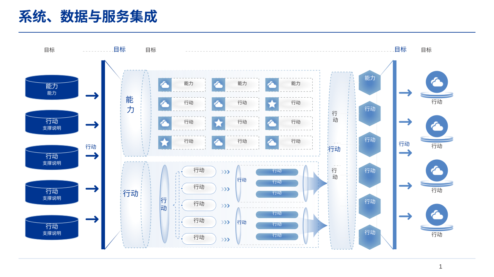

# 系统、数据与服务集成

来源为房子图战略图.pptx#30。

## 结构与适用场景

左5源系统圆柱输入；中央业务/数据双中台；右服务能力竖栏和4用户应用；双向/右向箭头；立体面板与圆柱

系统集成、数据到服务链

保留输入-中台-服务-应用的方向、中心模块列表与3D面板关系；复杂原形状应原生转换

固定节点、圆弧、扇区、分面和连接表达定性关系。数量比较、趋势或占比使用数据驱动图表，源页中已登记的微图槽可接收实际数据。

## 预览



## 调用

将下列完整page对象放入schema_version=1、template_id=business-blue-v1的pages数组，替换各节点内容。nodes键对应原文本框或已明确拆分的语义分段，字段角色及source_ref、segment见下表。

```json
{
  "id": "house-30",
  "family": "source-house",
  "variant": "page-30",
  "content": {
    "title": "系统、数据与服务集成",
    "nodes": {
      "shape_528": "能力",
      "shape_529": "行动",
      "shape_531": "行动",
      "shape_713": "能力",
      "shape_717": "行动",
      "shape_720": "行动",
      "shape_723": "行动",
      "shape_726": "行动",
      "shape_729": "行动",
      "shape_735": "行动",
      "shape_741": "行动",
      "shape_748": "行动",
      "shape_755": "行动",
      "shape_541": "能力",
      "shape_785": "能力",
      "shape_806": "行动",
      "shape_807": "支撑说明",
      "shape_810": "行动",
      "shape_811": "支撑说明",
      "shape_814": "行动",
      "shape_815": "支撑说明",
      "shape_818": "行动",
      "shape_819": "支撑说明",
      "shape_853": "行动",
      "shape_882": "行动",
      "shape_884": "目标",
      "shape_885": "目标",
      "shape_886": "目标",
      "shape_888": "目标",
      "shape_889": "目标",
      "shape_578": "能力",
      "shape_654": "行动",
      "shape_657": "行动",
      "shape_19": "行动",
      "shape_27": "行动",
      "shape_36": "行动",
      "shape_43": "行动",
      "shape_677": "行动",
      "shape_689": "行动",
      "shape_691": "行动",
      "shape_693": "行动",
      "shape_697": "行动",
      "shape_702": "行动",
      "shape_704": "行动",
      "shape_706": "行动",
      "shape_917": "行动",
      "shape_918": "行动",
      "shape_954": "行动",
      "shape_450": "行动",
      "shape_457": "行动",
      "shape_464": "能力",
      "shape_471": "行动",
      "shape_478": "行动",
      "shape_485": "行动",
      "shape_492": "能力",
      "shape_499": "行动",
      "shape_506": "行动",
      "shape_513": "行动"
    }
  },
  "config": {
    "show_source": true,
    "show_page_number": true
  }
}
```

config支持show_source、show_page_number、image_fit与image_position。image_fit可选contain或cover，image_position为xMin/xMid/xMax与YMin/YMid/YMax组合的九个焦点，默认为xMidYMid。字体、颜色、全局区和固定字阶取自tokens，节点数与连接结构由variant确定。

## 字段合同

每个业务节点required=true、min=1，max按具体框体登记。字符按规范化后的Unicode码点计数，空格标点换行均计入。build会以实际字体测量宽高，字符数通过后仍可能需要调整文字。

| 字段 | 节点角色与源标签 | 最短/最长 | 字阶 | 框体px | 原框引用 | 分段 | 旋转° | 垂直锚点 |
|---|---|---|---|---|---|---|---|---|
| nodes.shape_528 | 上左节点，源标签“业务 / 中台” | 1/12 | compactBody | [323.4879, 248.4005, 30.0325, 106.7707] | slide:528 |  | 0.0 | t |
| nodes.shape_529 | 下左节点，源标签“数据中台” | 1/20 | compactBody | [314.0939, 492.3144, 48.8111, 106.7707] | slide:529 |  | 0.0 | t |
| nodes.shape_531 | 中右节点，源标签“服务 / 能力” | 1/12 | caption | [850.3078, 379.2275, 48.8111, 45.7616] | slide:531 |  | 0.0 | t |
| nodes.shape_713 | 上右节点，源标签“用户 / 服务” | 1/12 | diagramCompact | [936.9027, 195.3126, 43.7223, 39.6626] | slide:713 |  | 0.0 | t |
| nodes.shape_717 | 上右节点，源标签“交易 / 服务” | 1/12 | diagramCompact | [936.9027, 275.6196, 43.7223, 39.6626] | slide:717 |  | 0.0 | t |
| nodes.shape_720 | 中右节点，源标签“消息 / 服务” | 1/12 | diagramCompact | [936.9027, 355.936, 43.7223, 39.6626] | slide:720 |  | 0.0 | t |
| nodes.shape_723 | 中右节点，源标签“支付 / 服务” | 1/12 | diagramCompact | [936.9027, 436.2524, 43.7223, 39.6626] | slide:723 |  | 0.0 | t |
| nodes.shape_726 | 下右节点，源标签“报表 / 服务” | 1/12 | diagramCompact | [936.9027, 516.5594, 43.7223, 39.6626] | slide:726 |  | 0.0 | t |
| nodes.shape_729 | 下右节点，源标签“智能推荐 / 服务” | 1/20 | diagramCompact | [924.1948, 596.8759, 69.1475, 39.6626] | slide:729 |  | 0.0 | t |
| nodes.shape_735 | 上右节点，源标签“电子商城” | 1/11 | diagramCompact | [1095.6378, 257.2564, 72.6785, 26.1899] | slide:735 |  | 0.0 | t |
| nodes.shape_741 | 中右节点，源标签“POS系统” | 1/11 | diagramCompact | [1095.6378, 372.3543, 72.6785, 26.1899] | slide:741 |  | 0.0 | t |
| nodes.shape_748 | 下右节点，源标签“可视化大屏” | 1/15 | diagramCompact | [1084.686, 487.4427, 94.5915, 26.1899] | slide:748 |  | 0.0 | t |
| nodes.shape_755 | 下右节点，源标签“会员系统” | 1/16 | diagramCompact | [1079.6444, 602.5406, 104.6559, 26.1899] | slide:755 |  | 0.0 | t |
| nodes.shape_541 | 上左节点，源标签“ERP系统” | 1/10 | caption | [94.9255, 215.7623, 78.6831, 27.4551] | slide:541 |  | 0.0 | t |
| nodes.shape_785 | 上左节点，源标签“Enter your title” | 1/18 | diagramMicro | [83.1901, 235.4944, 102.1445, 19.8266] | slide:785 |  | 0.0 | t |
| nodes.shape_806 | 中左节点，源标签“采购系统” | 1/11 | caption | [94.6045, 306.87, 79.3157, 27.4551] | slide:806 |  | 0.0 | t |
| nodes.shape_807 | 中左节点，源标签“Enter your title” | 1/18 | diagramMicro | [83.1901, 326.6021, 102.1445, 19.8266] | slide:807 |  | 0.0 | t |
| nodes.shape_810 | 中左节点，源标签“基础数据管理” | 1/15 | caption | [79.3475, 397.9777, 109.8297, 27.4551] | slide:810 |  | 0.0 | t |
| nodes.shape_811 | 中左节点，源标签“Enter your title” | 1/18 | diagramMicro | [83.1901, 417.7099, 102.1445, 19.8266] | slide:811 |  | 0.0 | t |
| nodes.shape_814 | 下左节点，源标签“PLM” | 1/6 | caption | [109.144, 489.0855, 50.2367, 27.4551] | slide:814 |  | 0.0 | t |
| nodes.shape_815 | 下左节点，源标签“Enter your title” | 1/18 | diagramMicro | [83.1901, 508.8176, 102.1445, 19.8266] | slide:815 |  | 0.0 | t |
| nodes.shape_818 | 下左节点，源标签“WMS” | 1/7 | caption | [106.2078, 580.1932, 56.1186, 27.4551] | slide:818 |  | 0.0 | t |
| nodes.shape_819 | 下左节点，源标签“Enter your title” | 1/18 | diagramMicro | [83.1901, 599.9254, 102.1445, 19.8266] | slide:819 |  | 0.0 | t |
| nodes.shape_853 | 中左节点，源标签“输入” | 1/7 | diagramCompact | [212.8935, 374.3086, 44.9968, 25.1703] | slide:853 |  | 0.0 | t |
| nodes.shape_882 | 中右节点，源标签“支撑” | 1/7 | diagramCompact | [1024.8382, 366.7556, 44.9968, 25.1703] | slide:882 |  | 0.0 | t |
| nodes.shape_884 | 上左节点，源标签“双中台架构” | 1/13 | caption | [293.531, 120, 94.5727, 27.4551] | slide:884 |  | 0.0 | t |
| nodes.shape_885 | 上右节点，源标签“支撑应用” | 1/11 | caption | [1021.4488, 120, 79.3157, 27.4551] | slide:885 |  | 0.0 | t |
| nodes.shape_886 | 上左节点，源标签“Enter your title” | 1/19 | diagramCompact | [113.6947, 122.4736, 124.2747, 24.4055] | slide:886 |  | 0.0 | t |
| nodes.shape_888 | 上左节点，源标签“Enter your title” | 1/19 | diagramCompact | [376.3587, 122.4736, 124.2747, 24.4055] | slide:888 |  | 0.0 | t |
| nodes.shape_889 | 上右节点，源标签“Enter your title” | 1/19 | diagramCompact | [1090.3413, 122.4736, 124.2747, 24.4055] | slide:889 |  | 0.0 | t |
| nodes.shape_578 | 上中节点，源标签“商品中心” | 1/11 | diagramMicro | [456.9112, 210.5224, 64.0681, 22.8761] | slide:578 |  | 0.0 | t |
| nodes.shape_654 | 下左节点，源标签“数 / 仓” | 1/8 | caption | [416.2951, 512.5941, 32.0907, 45.0252] | slide:654 |  | 0.0 | t |
| nodes.shape_657 | 中中节点，源标签“用户基础数据” | 1/14 | diagramCompact | [469.0148, 434.9023, 93.1093, 23.6691] | slide:657 |  | 0.0 | t |
| nodes.shape_19 | 下中节点，源标签“商品数据” | 1/10 | diagramCompact | [481.7227, 478.5585, 67.6841, 23.6691] | slide:19 |  | 0.0 | t |
| nodes.shape_27 | 下中节点，源标签“订单数据” | 1/10 | diagramCompact | [481.7227, 522.2242, 67.6841, 23.6691] | slide:27 |  | 0.0 | t |
| nodes.shape_36 | 下中节点，源标签“支付数据” | 1/10 | diagramCompact | [481.7227, 565.8803, 67.6841, 23.6691] | slide:36 |  | 0.0 | t |
| nodes.shape_43 | 下中节点，源标签“位置数据” | 1/10 | diagramCompact | [481.7227, 609.546, 67.6841, 23.6691] | slide:43 |  | 0.0 | t |
| nodes.shape_677 | 中中节点，源标签“数据 / 主题域” | 1/18 | diagramMicro | [614.4379, 461.385, 51.162, 35.8766] | slide:677 |  | 0.0 | t |
| nodes.shape_689 | 中中节点，源标签“交易主题域” | 1/12 | diagramMicro | [683.1983, 436.8756, 69.2702, 21.0445] | slide:689 |  | 0.0 | t |
| nodes.shape_691 | 中中节点，源标签“商品主题域” | 1/12 | diagramMicro | [683.1983, 465.5391, 69.2702, 21.0445] | slide:691 |  | 0.0 | t |
| nodes.shape_693 | 下中节点，源标签“用户主题域” | 1/12 | diagramMicro | [683.1983, 494.2026, 69.2702, 21.0445] | slide:693 |  | 0.0 | t |
| nodes.shape_697 | 下中节点，源标签“数据治 / 理套件” | 1/18 | diagramMicro | [614.4379, 571.6961, 51.162, 35.8766] | slide:697 |  | 0.0 | t |
| nodes.shape_702 | 下中节点，源标签“数据地图” | 1/10 | diagramMicro | [688.4382, 547.1867, 58.7905, 21.0445] | slide:702 |  | 0.0 | t |
| nodes.shape_704 | 下中节点，源标签“数据模型” | 1/11 | diagramMicro | [687.9661, 575.8503, 59.744, 21.0445] | slide:704 |  | 0.0 | t |
| nodes.shape_706 | 下中节点，源标签“数据质量” | 1/10 | diagramMicro | [688.4382, 604.5138, 58.7905, 21.0445] | slide:706 |  | 0.0 | t |
| nodes.shape_917 | 中右节点，源标签“功能服务” | 1/12 | diagramCompact | [857.4926, 287.6854, 23.1215, 73.2166] | slide:917 |  | 0.0 | t |
| nodes.shape_918 | 中右节点，源标签“数据服务” | 1/8 | diagramCompact | [860.2692, 435.9125, 15.68, 73.2166] | slide:918 |  | 0.0 | t |
| nodes.shape_954 | 上中节点，源标签“支付中心” | 1/11 | diagramMicro | [456.9112, 260.5608, 64.0681, 22.8761] | slide:954 |  | 0.0 | t |
| nodes.shape_450 | 中中节点，源标签“评价中心” | 1/11 | diagramMicro | [456.9112, 310.5993, 64.0681, 22.8761] | slide:450 |  | 0.0 | t |
| nodes.shape_457 | 中中节点，源标签“营销中心” | 1/11 | diagramMicro | [456.9112, 360.6377, 64.0681, 22.8761] | slide:457 |  | 0.0 | t |
| nodes.shape_464 | 上中节点，源标签“客户/会员中心” | 1/16 | diagramMicro | [581.9601, 210.5224, 91.5515, 22.8761] | slide:464 |  | 0.0 | t |
| nodes.shape_471 | 上中节点，源标签“工单中心” | 1/11 | diagramMicro | [595.6971, 260.5608, 64.0681, 22.8761] | slide:471 |  | 0.0 | t |
| nodes.shape_478 | 中中节点，源标签“物流中心” | 1/11 | diagramMicro | [595.6971, 310.5993, 64.0681, 22.8761] | slide:478 |  | 0.0 | t |
| nodes.shape_485 | 中中节点，源标签“用户中心” | 1/11 | diagramMicro | [595.6971, 360.6377, 64.0681, 22.8761] | slide:485 |  | 0.0 | t |
| nodes.shape_492 | 上中节点，源标签“推荐中心” | 1/11 | diagramMicro | [734.483, 210.5224, 64.0681, 22.8761] | slide:492 |  | 0.0 | t |
| nodes.shape_499 | 上中节点，源标签“消息中心” | 1/11 | diagramMicro | [734.483, 260.5608, 64.0681, 22.8761] | slide:499 |  | 0.0 | t |
| nodes.shape_506 | 中中节点，源标签“渠道中心” | 1/11 | diagramMicro | [734.483, 310.5993, 64.0681, 22.8761] | slide:506 |  | 0.0 | t |
| nodes.shape_513 | 中中节点，源标签“库存中心” | 1/11 | diagramMicro | [734.483, 360.6377, 64.0681, 22.8761] | slide:513 |  | 0.0 | t |

## 保留的原装饰

本页保留用户原模板的结构图标或装饰图片，逐项身份见source-field-coverage.json中本页retained_source_images。其中图片内固化的字形随整图编辑，可在PowerPoint中原生替换整图；nodes字段控制已登记的可编辑文字。参数图片替换使用本页image_slots列出的槽位。


全局title必填、2至32码点，使用统一标题框。section_name可选0至24码点，source可选0至64码点。所有可编辑文本通过独立原生carrier导出，页码为派生文字。

## 来源处理

原生PPTX源件保存于用户材料目录，分发包仅含用户资产衍生的几何、字段和说明。原始逐框文字、源框与标准化框在page-catalog.json的variant.fields中。

源标题引用为`slide:30`，原文为“系统架构图 / 双中台架构”。模板默认标题依据真实结构设置。

密集全景中的diagramCompact为14px、diagramMicro为12px。适用于体系概览或附录局部标签，现场关键结论用统一标题与正常正文字阶表达。

源画布边界裁切已烘焙为可编辑Bezier几何，3D顶面、侧面与前面通过tokens配色的相对明暗保留。

