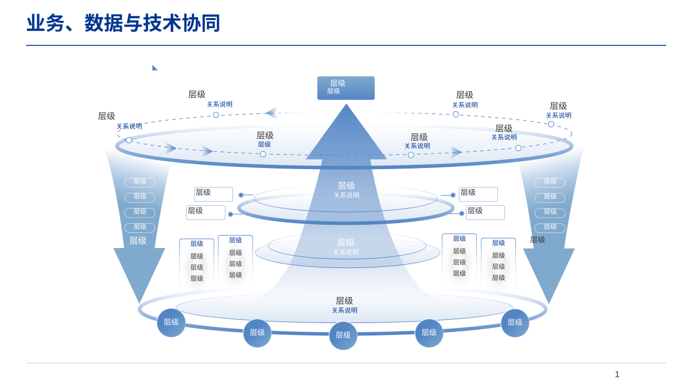

# 业务、数据与技术协同

来源为立体结构逻辑图1122.pptx#2。

## 结构与适用场景

立体漏斗/圆台上下椭圆；顶消费者与7业务触点；中供应链/金融；底技术与5能力；中上行、两侧下行箭头

业务-数据-技术互相赋能

保留3D圆台、上下环、双向流及侧系统簇；箭头代表依赖而非必然增长

固定节点、圆弧、扇区、分面和连接表达定性关系。数量比较、趋势或占比使用数据驱动图表，源页中已登记的微图槽可接收实际数据。

## 预览



## 调用

将下列完整page对象放入schema_version=1、template_id=business-blue-v1的pages数组，替换各节点内容。nodes键对应原文本框或已明确拆分的语义分段，字段角色及source_ref、segment见下表。

```json
{
  "id": "spatial-02",
  "family": "source-spatial",
  "variant": "page-02",
  "content": {
    "title": "业务、数据与技术协同",
    "nodes": {
      "shape_202": "层级",
      "shape_203": "层级",
      "shape_204": "层级",
      "shape_206": "层级",
      "shape_28": "层级",
      "shape_29": "关系说明",
      "shape_31": "层级",
      "shape_32": "关系说明",
      "shape_35": "层级",
      "shape_36": "关系说明",
      "shape_42": "层级",
      "shape_43": "层级",
      "shape_83": "层级",
      "shape_2": "层级",
      "shape_4": "关系说明",
      "shape_10": "层级",
      "shape_11": "关系说明",
      "shape_13": "层级",
      "shape_14": "层级",
      "shape_16": "层级",
      "shape_17": "关系说明",
      "shape_19": "层级",
      "shape_20": "关系说明",
      "shape_22": "层级",
      "shape_23": "关系说明",
      "shape_25": "层级",
      "shape_26": "关系说明",
      "shape_85": "层级",
      "shape_88": "层级",
      "shape_91": "层级",
      "shape_94": "层级",
      "shape_97": "层级",
      "shape_99": "层级",
      "shape_102": "层级",
      "shape_105": "层级",
      "shape_108": "层级",
      "shape_130": "层级",
      "shape_131": "层级",
      "shape_132": "层级",
      "shape_133": "层级",
      "shape_134": "层级",
      "shape_167": "层级",
      "shape_168": "层级",
      "shape_169": "层级",
      "shape_171": "层级",
      "shape_188": "层级",
      "shape_189": "层级",
      "shape_190": "层级",
      "shape_192": "层级",
      "shape_195": "层级",
      "shape_196": "层级",
      "shape_197": "层级",
      "shape_199": "层级",
      "shape_236": "层级",
      "shape_239": "层级",
      "shape_242": "层级",
      "shape_245": "层级"
    }
  },
  "config": {
    "show_source": true,
    "show_page_number": true
  }
}
```

config支持show_source、show_page_number、image_fit与image_position。image_fit可选contain或cover，image_position为xMin/xMid/xMax与YMin/YMid/YMax组合的九个焦点，默认为xMidYMid。字体、颜色、全局区和固定字阶取自tokens，节点数与连接结构由variant确定。

## 字段合同

每个业务节点required=true、min=1，max按具体框体登记。字符按规范化后的Unicode码点计数，空格标点换行均计入。build会以实际字体测量宽高，字符数通过后仍可能需要调整文字。

| 字段 | 节点角色与源标签 | 最短/最长 | 字阶 | 框体px | 原框引用 | 分段 | 旋转° | 垂直锚点 |
|---|---|---|---|---|---|---|---|---|
| nodes.shape_202 | 中左节点，源标签“云智能” | 1/11 | diagramMicro | [332.853, 444.6799, 62.8629, 23.5039] | slide:202 |  | 0.0 | t |
| nodes.shape_203 | 中左节点，源标签“金融云” | 1/11 | diagramMicro | [332.853, 467.9412, 62.8629, 21.2723] | slide:203 |  | 0.0 | t |
| nodes.shape_204 | 下左节点，源标签“服务云” | 1/11 | diagramMicro | [332.853, 509.0467, 62.8629, 21.2723] | slide:204 |  | 0.0 | t |
| nodes.shape_206 | 下左节点，源标签“营销云” | 1/11 | diagramMicro | [332.853, 488.4939, 62.8629, 21.2723] | slide:206 |  | 0.0 | t |
| nodes.shape_28 | 中中节点，源标签“供应链管理” | 1/14 | caption | [589.4631, 335.3186, 102.7637, 28.735] | slide:28 |  | 0.0 | t |
| nodes.shape_29 | 中中节点，源标签“Supply Chain Management” | 1/22 | diagramMicro | [579.4616, 355.1033, 122.7666, 18.2889] | slide:29 |  | 0.0 | t |
| nodes.shape_31 | 中中节点，源标签“金融服务” | 1/11 | caption | [596.8045, 440.516, 85.3399, 28.735] | slide:31 |  | 0.0 | t |
| nodes.shape_32 | 中中节点，源标签“Financial Service” | 1/15 | diagramMicro | [598.6398, 460.3087, 81.6692, 18.2889] | slide:32 |  | 0.0 | t |
| nodes.shape_35 | 下中节点，源标签“云智能+数据技术” | 1/20 | caption | [561.8357, 548.333, 150.7902, 28.735] | slide:35 |  | 0.0 | t |
| nodes.shape_36 | 下中节点，源标签“Cloud Intelligence+data Technology” | 1/30 | diagramMicro | [555.1735, 568.1176, 164.1308, 18.2889] | slide:36 |  | 0.0 | t |
| nodes.shape_42 | 上中节点，源标签“消费者” | 1/8 | diagramCompact | [610.9699, 146.4873, 54.8666, 23.5119] | slide:42 |  | 0.0 | t |
| nodes.shape_43 | 上中节点，源标签“Consumers” | 1/11 | diagramMicro | [605.1161, 162.0919, 60.5748, 18.2889] | slide:43 |  | 0.0 | t |
| nodes.shape_83 | 中左节点，源标签“线索 / 渠道 / 数据” | 1/30 | caption | [217.7674, 436.918, 75.201, 62.7012] | slide:83 |  | 0.0 | t |
| nodes.shape_2 | 上左节点，源标签“数字化营销” | 1/14 | caption | [181.222, 206.4395, 102.7637, 28.735] | slide:2 |  | 0.0 | t |
| nodes.shape_4 | 上左节点，源标签“Digital Marketing” | 1/17 | diagramMicro | [191.1103, 227.3157, 95.2767, 19.5906] | slide:4 |  | 0.0 | t |
| nodes.shape_10 | 上左节点，源标签“销售和分销” | 1/14 | caption | [348.2958, 166.1588, 102.7637, 28.735] | slide:10 |  | 0.0 | t |
| nodes.shape_11 | 上左节点，源标签“Sales And Distribution” | 1/21 | diagramMicro | [347.0345, 186.8328, 117.9963, 19.5906] | slide:11 |  | 0.0 | t |
| nodes.shape_13 | 上中节点，源标签“品牌建设” | 1/11 | caption | [447.7688, 242.2249, 85.3399, 28.735] | slide:13 |  | 0.0 | t |
| nodes.shape_14 | 上中节点，源标签“branding” | 1/10 | diagramMicro | [460.9802, 260.8534, 56.3624, 19.5906] | slide:14 |  | 0.0 | t |
| nodes.shape_16 | 上中节点，源标签“用户运营” | 1/11 | caption | [732.8229, 245.4348, 85.3399, 28.735] | slide:16 |  | 0.0 | t |
| nodes.shape_17 | 上中节点，源标签“User Operation” | 1/15 | diagramMicro | [728.6509, 263.8368, 85.7523, 19.5906] | slide:17 |  | 0.0 | t |
| nodes.shape_19 | 上中节点，源标签“智能制造” | 1/11 | caption | [817.1117, 167.1775, 85.3399, 28.735] | slide:19 |  | 0.0 | t |
| nodes.shape_20 | 上中节点，源标签“Intelligent Manufacturing” | 1/23 | diagramMicro | [795.5402, 188.0294, 128.4748, 19.5906] | slide:20 |  | 0.0 | t |
| nodes.shape_22 | 上右节点，源标签“渠道管理” | 1/11 | caption | [889.5395, 229.24, 85.3399, 28.735] | slide:22 |  | 0.0 | t |
| nodes.shape_23 | 上右节点，源标签“Channel Managemten” | 1/21 | diagramMicro | [875.3903, 247.6986, 113.6465, 19.5906] | slide:23 |  | 0.0 | t |
| nodes.shape_25 | 上右节点，源标签“产品创新” | 1/11 | caption | [990.387, 187.7626, 85.3399, 28.735] | slide:25 |  | 0.0 | t |
| nodes.shape_26 | 上右节点，源标签“Product Innovation” | 1/19 | diagramMicro | [981.1374, 207.4179, 103.8471, 19.5906] | slide:26 |  | 0.0 | t |
| nodes.shape_85 | 中左节点，源标签“垂直媒体” | 1/10 | diagramMicro | [230.8251, 329.0202, 56.233, 19.5906] | slide:85 |  | 0.0 | t |
| nodes.shape_88 | 中左节点，源标签“小程序” | 1/10 | diagramMicro | [230.8251, 357.0437, 56.233, 19.5906] | slide:88 |  | 0.0 | t |
| nodes.shape_91 | 中左节点，源标签“APP” | 1/10 | diagramMicro | [230.8251, 385.0592, 56.233, 19.5906] | slide:91 |  | 0.0 | t |
| nodes.shape_94 | 中左节点，源标签“电商平台” | 1/10 | diagramMicro | [230.8251, 413.0827, 56.233, 19.5906] | slide:94 |  | 0.0 | t |
| nodes.shape_97 | 中右节点，源标签“企业 / 系统 / 数据” | 1/33 | diagramCompact | [980.6442, 436.2955, 75.201, 62.7012] | slide:97 |  | 0.0 | t |
| nodes.shape_99 | 中右节点，源标签“CRM” | 1/10 | diagramMicro | [989.8049, 329.0202, 56.233, 19.5906] | slide:99 |  | 0.0 | t |
| nodes.shape_102 | 中右节点，源标签“ERP” | 1/10 | diagramMicro | [989.8049, 357.0437, 56.233, 19.5906] | slide:102 |  | 0.0 | t |
| nodes.shape_105 | 中右节点，源标签“服务平台” | 1/10 | diagramMicro | [989.8049, 385.0592, 56.233, 19.5906] | slide:105 |  | 0.0 | t |
| nodes.shape_108 | 中右节点，源标签“会员管理” | 1/10 | diagramMicro | [989.8049, 413.0827, 56.233, 19.5906] | slide:108 |  | 0.0 | t |
| nodes.shape_130 | 下左节点，源标签“网络 / 应用” | 1/24 | diagramCompact | [288.7641, 570.3734, 55.8045, 53.8964] | slide:130 |  | 0.0 | ctr |
| nodes.shape_131 | 下中节点，源标签“互通 / 示范” | 1/24 | diagramCompact | [448.4399, 590.1419, 55.0283, 53.1525] | slide:131 |  | 0.0 | ctr |
| nodes.shape_132 | 下中节点，源标签“网联 / 服务” | 1/24 | diagramCompact | [607.3477, 594.8475, 55.0283, 53.1525] | slide:132 |  | 0.0 | ctr |
| nodes.shape_133 | 下中节点，源标签“数字 / 底座” | 1/24 | diagramCompact | [766.2554, 590.1419, 55.0283, 53.1525] | slide:133 |  | 0.0 | ctr |
| nodes.shape_134 | 下右节点，源标签“云边 / 协同” | 1/24 | diagramCompact | [925.1632, 571.3275, 55.0283, 53.1525] | slide:134 |  | 0.0 | ctr |
| nodes.shape_167 | 中右节点，源标签“云智能” | 1/11 | diagramMicro | [890.9302, 443.3297, 62.8629, 23.5119] | slide:167 |  | 0.0 | t |
| nodes.shape_168 | 中右节点，源标签“金融云” | 1/11 | diagramMicro | [890.9302, 466.591, 62.8629, 21.2723] | slide:168 |  | 0.0 | t |
| nodes.shape_169 | 下右节点，源标签“服务云” | 1/11 | diagramMicro | [890.9302, 507.6884, 62.8629, 21.2723] | slide:169 |  | 0.0 | t |
| nodes.shape_171 | 下右节点，源标签“营销云” | 1/11 | diagramMicro | [890.9302, 487.1437, 62.8629, 21.2723] | slide:171 |  | 0.0 | t |
| nodes.shape_188 | 中中节点，源标签“云智能” | 1/11 | diagramMicro | [818.6318, 435.2444, 62.8629, 23.5039] | slide:188 |  | 0.0 | t |
| nodes.shape_189 | 中中节点，源标签“金融云” | 1/11 | diagramMicro | [818.6318, 458.5057, 62.8629, 21.2723] | slide:189 |  | 0.0 | t |
| nodes.shape_190 | 下中节点，源标签“服务云” | 1/22 | diagramMicro | [818.6318, 499.6031, 62.8629, 35.3811] | slide:190 |  | 0.0 | t |
| nodes.shape_192 | 下中节点，源标签“营销云” | 1/11 | diagramMicro | [818.6318, 479.0584, 62.8629, 21.2723] | slide:192 |  | 0.0 | t |
| nodes.shape_195 | 中左节点，源标签“云智能” | 1/11 | diagramMicro | [404.4237, 438.2117, 62.8629, 23.5039] | slide:195 |  | 0.0 | t |
| nodes.shape_196 | 中左节点，源标签“金融云” | 1/11 | diagramMicro | [404.4237, 461.473, 62.8629, 21.2723] | slide:196 |  | 0.0 | t |
| nodes.shape_197 | 下左节点，源标签“服务云” | 1/11 | diagramMicro | [404.4237, 502.5785, 62.8629, 21.2723] | slide:197 |  | 0.0 | t |
| nodes.shape_199 | 下左节点，源标签“营销云” | 1/11 | diagramMicro | [404.4237, 482.0257, 62.8629, 21.2723] | slide:199 |  | 0.0 | t |
| nodes.shape_236 | 中左节点，源标签“后端供应” | 1/10 | diagramCompact | [362.0327, 348.4976, 67.9243, 23.5119] | slide:236 |  | 0.0 | t |
| nodes.shape_239 | 中右节点，源标签“后端供应” | 1/10 | diagramCompact | [851.9996, 348.4976, 67.9243, 23.5119] | slide:239 |  | 0.0 | t |
| nodes.shape_242 | 中右节点，源标签“后端供应” | 1/10 | diagramCompact | [864.9361, 382.4557, 67.9243, 23.5119] | slide:242 |  | 0.0 | t |
| nodes.shape_245 | 中左节点，源标签“后端供应” | 1/10 | diagramCompact | [347.4792, 382.4557, 67.9243, 23.5119] | slide:245 |  | 0.0 | t |

全局title必填、2至32码点，使用统一标题框。section_name可选0至24码点，source可选0至64码点。所有可编辑文本通过独立原生carrier导出，页码为派生文字。

## 来源处理

原生PPTX源件保存于用户材料目录，分发包仅含用户资产衍生的几何、字段和说明。原始逐框文字、源框与标准化框在page-catalog.json的variant.fields中。

源标题引用为`slide:6`，原文为“感知分成”。模板默认标题依据真实结构设置。

密集全景中的diagramCompact为14px、diagramMicro为12px。适用于体系概览或附录局部标签，现场关键结论用统一标题与正常正文字阶表达。

源画布边界裁切已烘焙为可编辑Bezier几何，3D顶面、侧面与前面通过tokens配色的相对明暗保留。

