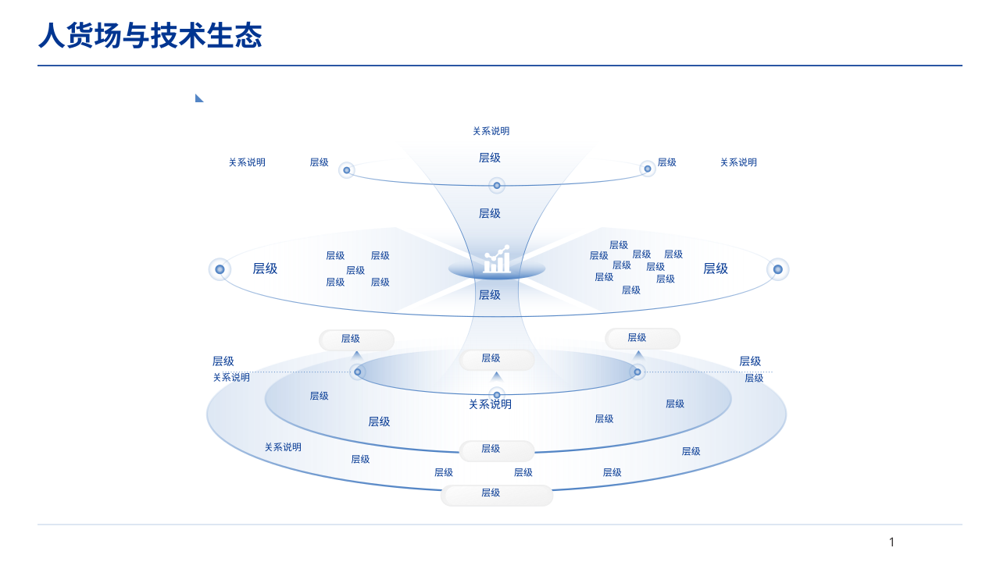

# 人货场与技术生态

来源为立体结构逻辑图1122.pptx#3。

## 结构与适用场景

上生产力环，中人/货/实体空间，底商业生态多层椭圆；倒锥与竖向连接

人货场与技术生态

保留环层与横向角色，源拼写/例文不自动沿用

固定节点、圆弧、扇区、分面和连接表达定性关系。数量比较、趋势或占比使用数据驱动图表，源页中已登记的微图槽可接收实际数据。

## 预览



## 调用

将下列完整page对象放入schema_version=1、template_id=business-blue-v1的pages数组，替换各节点内容。nodes键对应原文本框或已明确拆分的语义分段，字段角色及source_ref、segment见下表。

```json
{
  "id": "spatial-03",
  "family": "source-spatial",
  "variant": "page-03",
  "content": {
    "title": "人货场与技术生态",
    "nodes": {
      "shape_66": "关系说明",
      "shape_67": "关系说明",
      "shape_69": "层级",
      "shape_97": "层级",
      "shape_98": "层级",
      "shape_99": "层级",
      "shape_100": "层级",
      "shape_101": "层级",
      "shape_102": "层级",
      "shape_103": "层级",
      "shape_104": "层级",
      "shape_105": "层级",
      "shape_106": "层级",
      "shape_107": "层级",
      "shape_108": "层级",
      "shape_109": "层级",
      "shape_110": "层级",
      "shape_111": "层级",
      "shape_112": "层级",
      "shape_113": "层级",
      "shape_115": "关系说明",
      "shape_117": "层级",
      "shape_118": "层级",
      "shape_119": "层级",
      "shape_120": "层级",
      "shape_121": "层级",
      "shape_122": "层级",
      "shape_123": "层级",
      "shape_124": "关系说明",
      "shape_125": "层级",
      "shape_126": "层级",
      "shape_129": "层级",
      "shape_130": "关系说明",
      "shape_131": "层级",
      "shape_132": "层级",
      "shape_137": "层级",
      "shape_138": "层级",
      "shape_139": "层级",
      "shape_140": "关系说明",
      "shape_144": "层级",
      "shape_145": "层级",
      "shape_249": "层级",
      "shape_142": "层级",
      "shape_258": "层级"
    }
  },
  "config": {
    "show_source": true,
    "show_page_number": true
  }
}
```

config支持show_source、show_page_number、image_fit与image_position。image_fit可选contain或cover，image_position为xMin/xMid/xMax与YMin/YMid/YMax组合的九个焦点，默认为xMidYMid。字体、颜色、全局区和固定字阶取自tokens，节点数与连接结构由variant确定。

## 字段合同

每个业务节点required=true、min=1，max按具体框体登记。字符按规范化后的Unicode码点计数，空格标点换行均计入。build会以实际字体测量宽高，字符数通过后仍可能需要调整文字。

| 字段 | 节点角色与源标签 | 最短/最长 | 字阶 | 框体px | 原框引用 | 分段 | 旋转° | 垂直锚点 |
|---|---|---|---|---|---|---|---|---|
| nodes.shape_66 | 上右节点，源标签“创新展示形式，供给精准对接 / 营销路径丰富，客户群体洞察” | 1/87 | diagramMicro | [872.2419, 200.2784, 161.1542, 44.4856] | slide:66 |  | 0.0 | t |
| nodes.shape_67 | 上左节点，源标签“随时随地观展，精准获得所需 / 逛展沉浸体验，互动全天在线” | 1/84 | diagramMicro | [246.6039, 200.2784, 154.0545, 44.4856] | slide:67 |  | 0.0 | t |
| nodes.shape_69 | 上中节点，源标签“数据空调” | 1/19 | diagramCompact | [575.8994, 265.076, 120.3483, 25.048] | slide:69 |  | 0.0 | t |
| nodes.shape_97 | 中中节点，源标签“实体空调” | 1/19 | diagramCompact | [575.8994, 369.5192, 120.3483, 25.048] | slide:97 |  | 0.0 | t |
| nodes.shape_98 | 中左节点，源标签“精准的人” | 1/16 | caption | [289.7215, 333.7265, 120.3483, 27.8792] | slide:98 |  | 0.0 | t |
| nodes.shape_99 | 中右节点，源标签“数字的货” | 1/16 | caption | [866.4669, 333.7265, 120.3483, 27.8792] | slide:99 |  | 0.0 | t |
| nodes.shape_100 | 中左节点，源标签“行为路径” | 1/17 | diagramMicro | [389.5154, 319.7609, 95.3522, 19.5847] | slide:100 |  | 0.0 | t |
| nodes.shape_101 | 中中节点，源标签“人群属性” | 1/17 | diagramMicro | [415.3167, 338.6962, 95.3522, 19.5847] | slide:101 |  | 0.0 | t |
| nodes.shape_102 | 中中节点，源标签“地域” | 1/17 | diagramMicro | [446.9535, 319.7609, 95.3522, 19.5847] | slide:102 |  | 0.0 | t |
| nodes.shape_103 | 中中节点，源标签“行为” | 1/17 | diagramMicro | [446.9535, 353.7614, 95.3522, 19.5847] | slide:103 |  | 0.0 | t |
| nodes.shape_104 | 中左节点，源标签“频道” | 1/17 | diagramMicro | [389.5154, 353.7614, 95.3522, 19.5847] | slide:104 |  | 0.0 | t |
| nodes.shape_105 | 中中节点，源标签“解决方案” | 1/17 | diagramMicro | [768.1709, 363.9174, 95.3522, 19.5847] | slide:105 |  | 0.0 | t |
| nodes.shape_106 | 中中节点，源标签“消费品” | 1/17 | diagramMicro | [799.3403, 334.0208, 95.3522, 19.5847] | slide:106 |  | 0.0 | t |
| nodes.shape_107 | 中中节点，源标签“招商引流” | 1/17 | diagramMicro | [733.5903, 347.1812, 95.3522, 19.5847] | slide:107 |  | 0.0 | t |
| nodes.shape_108 | 中中节点，源标签“楼房房产” | 1/17 | diagramMicro | [756.1015, 331.8823, 95.3522, 19.5847] | slide:108 |  | 0.0 | t |
| nodes.shape_109 | 中中节点，源标签“国区” | 1/17 | diagramMicro | [726.9581, 319.7609, 95.3522, 19.5847] | slide:109 |  | 0.0 | t |
| nodes.shape_110 | 中中节点，源标签“设计方案” | 1/17 | diagramMicro | [752.2919, 306.1416, 95.3522, 19.5847] | slide:110 |  | 0.0 | t |
| nodes.shape_111 | 中中节点，源标签“技术” | 1/17 | diagramMicro | [781.617, 317.9686, 95.3522, 19.5847] | slide:111 |  | 0.0 | t |
| nodes.shape_112 | 中中节点，源标签“工厂仓库” | 1/17 | diagramMicro | [822.3104, 317.9686, 95.3522, 19.5847] | slide:112 |  | 0.0 | t |
| nodes.shape_113 | 中中节点，源标签“大型机械” | 1/17 | diagramMicro | [812.1543, 349.6055, 95.3522, 19.5847] | slide:113 |  | 0.0 | t |
| nodes.shape_115 | 下中节点，源标签“商业生态多元化 / 新零售、数字新媒体、新金融” | 1/50 | diagramCompact | [555.9856, 509.6081, 160.1758, 42.3816] | slide:115 |  | 0.0 | t |
| nodes.shape_117 | 下中节点，源标签“TMALL天猫” | 1/22 | diagramMicro | [721.4689, 528.8292, 119.7162, 19.5847] | slide:117 |  | 0.0 | t |
| nodes.shape_118 | 下中节点，源标签“Lazada” | 1/22 | diagramMicro | [812.1543, 509.6081, 119.7162, 19.5847] | slide:118 |  | 0.0 | t |
| nodes.shape_119 | 下中节点，源标签“阿里妈妈” | 1/22 | diagramMicro | [832.7001, 570.5009, 119.7162, 19.5847] | slide:119 |  | 0.0 | t |
| nodes.shape_120 | 下中节点，源标签“蚂蚁金服” | 1/22 | diagramMicro | [731.7461, 597.5749, 119.7162, 19.5847] | slide:120 |  | 0.0 | t |
| nodes.shape_121 | 下中节点，源标签“阿里云” | 1/22 | diagramMicro | [516.0456, 597.5749, 119.7162, 19.5847] | slide:121 |  | 0.0 | t |
| nodes.shape_122 | 下中节点，源标签“逹摩院” | 1/22 | diagramMicro | [617.9174, 597.5749, 119.7162, 19.5847] | slide:122 |  | 0.0 | t |
| nodes.shape_123 | 下中节点，源标签“钉钉” | 1/22 | diagramMicro | [409.4291, 580.605, 119.7162, 19.5847] | slide:123 |  | 0.0 | t |
| nodes.shape_124 | 下左节点，源标签“Alibaba Design” | 1/22 | diagramMicro | [309.8084, 565.1328, 119.7162, 19.5847] | slide:124 |  | 0.0 | t |
| nodes.shape_125 | 下左节点，源标签“Express” | 1/22 | diagramMicro | [356.675, 499.5041, 119.7162, 19.5847] | slide:125 |  | 0.0 | t |
| nodes.shape_126 | 下中节点，源标签“淘宝” | 1/19 | diagramCompact | [434.7715, 531.8249, 119.7162, 25.048] | slide:126 |  | 0.0 | t |
| nodes.shape_129 | 中左节点，源标签“技术场景化” | 1/19 | diagramCompact | [271.8338, 454.4211, 120.3483, 25.048] | slide:129 |  | 0.0 | t |
| nodes.shape_130 | 下左节点，源标签“三维重构、智能匹配、云展大脑” | 1/30 | diagramMicro | [271.8338, 475.7807, 162.3144, 20.8921] | slide:130 |  | 0.0 | t |
| nodes.shape_131 | 中右节点，源标签“运营数字化” | 1/19 | diagramCompact | [872.2419, 454.4211, 120.3483, 25.048] | slide:131 |  | 0.0 | t |
| nodes.shape_132 | 下右节点，源标签“全领域、全链路、全要素” | 1/27 | diagramMicro | [844.2414, 476.6465, 148.8076, 20.8921] | slide:132 |  | 0.0 | t |
| nodes.shape_137 | 上左节点，源标签“观众 / 体验” | 1/30 | diagramMicro | [375.8961, 200.1572, 81.2741, 33.5763] | slide:137 |  | 0.0 | t |
| nodes.shape_138 | 上中节点，源标签“展商 / 获客” | 1/32 | diagramMicro | [815.8427, 200.1572, 91.6638, 33.5763] | slide:138 |  | 0.0 | t |
| nodes.shape_139 | 上中节点，源标签“主办方” | 1/12 | diagramCompact | [595.4408, 193.6982, 81.2741, 25.1779] | slide:139 |  | 0.0 | t |
| nodes.shape_140 | 上中节点，源标签“摆脱时空限制，线上线下一体 / 数据全面沉淀，办展更加经验” | 1/58 | diagramMicro | [556.3926, 160.2258, 159.3706, 33.5763] | slide:140 |  | 0.0 | t |
| nodes.shape_144 | 中中节点，源标签“数据驱动” | 1/13 | diagramMicro | [421.0051, 426.0223, 71.2826, 20.8921] | slide:144 |  | 0.0 | t |
| nodes.shape_145 | 中中节点，源标签“智能重构” | 1/13 | diagramMicro | [787.6085, 424.6803, 71.2826, 20.8921] | slide:145 |  | 0.0 | t |
| nodes.shape_249 | 下中节点，源标签“商业基因” | 1/25 | diagramMicro | [566.8689, 566.9424, 138.4179, 22.2774] | slide:249 |  | 0.0 | t |
| nodes.shape_142 | 下中节点，源标签“核心技术与数字新基建” | 1/25 | diagramMicro | [566.8689, 623.4109, 138.4179, 22.2774] | slide:142 |  | 0.0 | t |
| nodes.shape_258 | 中中节点，源标签“创造性的商业交互” | 1/18 | diagramMicro | [585.8822, 450.9665, 100.7809, 20.8921] | slide:258 |  | 0.0 | t |

全局title必填、2至32码点，使用统一标题框。section_name可选0至24码点，source可选0至64码点。所有可编辑文本通过独立原生carrier导出，页码为派生文字。

## 来源处理

原生PPTX源件保存于用户材料目录，分发包仅含用户资产衍生的几何、字段和说明。原始逐框文字、源框与标准化框在page-catalog.json的variant.fields中。

源标题引用为`slide:114`，原文为“感知分成”。模板默认标题依据真实结构设置。

密集全景中的diagramCompact为14px、diagramMicro为12px。适用于体系概览或附录局部标签，现场关键结论用统一标题与正常正文字阶表达。

源画布边界裁切已烘焙为可编辑Bezier几何，3D顶面、侧面与前面通过tokens配色的相对明暗保留。

