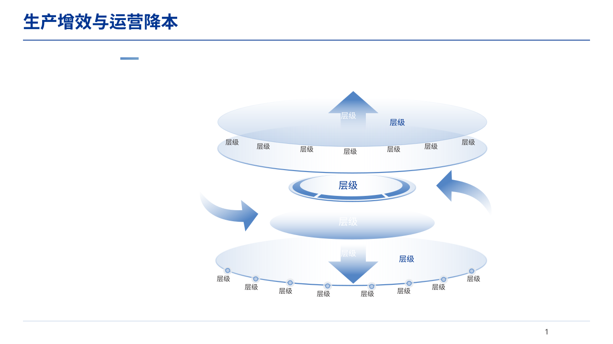

# 生产增效与运营降本

来源为立体结构逻辑图1122.pptx#4。

## 结构与适用场景

顶智能生产增效上箭头；中智能/连接两椭圆；底运营降本下箭头；左右弧箭头

降本增效双向赋能

上下能力清单与增效/降本方向独立；可改经营机制但需事实支撑

固定节点、圆弧、扇区、分面和连接表达定性关系。数量比较、趋势或占比使用数据驱动图表，源页中已登记的微图槽可接收实际数据。

## 预览



## 调用

将下列完整page对象放入schema_version=1、template_id=business-blue-v1的pages数组，替换各节点内容。nodes键对应原文本框或已明确拆分的语义分段，字段角色及source_ref、segment见下表。

```json
{
  "id": "spatial-04",
  "family": "source-spatial",
  "variant": "page-04",
  "content": {
    "title": "生产增效与运营降本",
    "nodes": {
      "shape_30": "层级",
      "shape_31": "层级",
      "shape_32": "层级",
      "shape_33": "层级",
      "shape_34": "层级",
      "shape_35": "层级",
      "shape_36": "层级",
      "shape_37": "层级",
      "shape_38": "层级",
      "shape_39": "层级",
      "shape_40": "层级",
      "shape_41": "层级",
      "shape_42": "层级",
      "shape_43": "层级",
      "shape_44": "层级",
      "shape_45": "层级",
      "shape_46": "层级",
      "shape_47": "层级",
      "shape_54": "层级",
      "shape_55": "层级",
      "shape_56": "层级"
    }
  },
  "config": {
    "show_source": true,
    "show_page_number": true
  }
}
```

config支持show_source、show_page_number、image_fit与image_position。image_fit可选contain或cover，image_position为xMin/xMid/xMax与YMin/YMid/YMax组合的九个焦点，默认为xMidYMid。字体、颜色、全局区和固定字阶取自tokens，节点数与连接结构由variant确定。

## 字段合同

每个业务节点required=true、min=1，max按具体框体登记。字符按规范化后的Unicode码点计数，空格标点换行均计入。build会以实际字体测量宽高，字符数通过后仍可能需要调整文字。

| 字段 | 节点角色与源标签 | 最短/最长 | 字阶 | 框体px | 原框引用 | 分段 | 旋转° | 垂直锚点 |
|---|---|---|---|---|---|---|---|---|
| nodes.shape_30 | 中右节点，源标签“智慧 / 管网” | 1/22 | diagramCompact | [952.0637, 289.3682, 70.0787, 47.4997] | slide:30 |  | 0.0 | t |
| nodes.shape_31 | 中右节点，源标签“智慧 / 矿车” | 1/22 | diagramCompact | [874.1226, 298.0853, 70.0787, 47.4997] | slide:31 |  | 0.0 | t |
| nodes.shape_32 | 中中节点，源标签“智能 / 安全” | 1/22 | diagramCompact | [705.421, 308.7424, 70.0787, 47.4997] | slide:32 |  | 0.0 | t |
| nodes.shape_33 | 中中节点，源标签“能效 / 优化” | 1/22 | diagramCompact | [614.6606, 304.0163, 70.0787, 47.4997] | slide:33 |  | 0.0 | t |
| nodes.shape_34 | 中中节点，源标签“智慧 / 变电站” | 1/22 | diagramCompact | [523.9002, 298.0853, 70.0787, 47.4997] | slide:34 |  | 0.0 | t |
| nodes.shape_35 | 中中节点，源标签“智慧 / 运检” | 1/22 | diagramCompact | [458.7783, 289.3682, 70.0787, 47.4997] | slide:35 |  | 0.0 | t |
| nodes.shape_36 | 中中节点，源标签“智能” | 1/7 | compactBody | [704.7458, 376.3683, 70.3607, 30.2535] | slide:36 |  | 0.0 | t |
| nodes.shape_37 | 中中节点，源标签“连接” | 1/7 | compactBody | [704.7458, 452.378, 70.3607, 30.2535] | slide:37 |  | 0.0 | t |
| nodes.shape_38 | 下中节点，源标签“降本” | 1/7 | caption | [711.8734, 519.8928, 52.4735, 27.5187] | slide:38 |  | 0.0 | t |
| nodes.shape_39 | 下中节点，源标签“数字化运营” | 1/13 | caption | [809.7015, 531.7036, 99.6484, 27.5187] | slide:39 |  | 0.0 | t |
| nodes.shape_40 | 下右节点，源标签“智慧 / 营销” | 1/18 | diagramCompact | [967.3186, 575.1267, 61.447, 41.4233] | slide:40 |  | 0.0 | t |
| nodes.shape_41 | 下右节点，源标签“数字化 / 班组” | 1/18 | diagramCompact | [894.2744, 592.5011, 61.447, 41.4233] | slide:41 |  | 0.0 | t |
| nodes.shape_42 | 下中节点，源标签“移动 / 协同” | 1/18 | diagramCompact | [821.6918, 600.6542, 61.447, 41.4233] | slide:42 |  | 0.0 | t |
| nodes.shape_43 | 下中节点，源标签“新能源 / 运营” | 1/18 | diagramCompact | [745.5709, 606.5767, 61.447, 41.4233] | slide:43 |  | 0.0 | t |
| nodes.shape_44 | 下中节点，源标签“综合能源 / 服务” | 1/22 | diagramCompact | [648.7684, 606.5767, 71.5315, 41.4233] | slide:44 |  | 0.0 | t |
| nodes.shape_45 | 下中节点，源标签“零碳 / 园区” | 1/18 | diagramCompact | [574.7072, 600.6542, 61.447, 41.4233] | slide:45 |  | 0.0 | t |
| nodes.shape_46 | 下中节点，源标签“破资产 / 管理” | 1/18 | diagramCompact | [503.2013, 592.5011, 61.447, 41.4233] | slide:46 |  | 0.0 | t |
| nodes.shape_47 | 下中节点，源标签“生态 / 协同” | 1/18 | diagramCompact | [444.9762, 575.1267, 61.447, 41.4233] | slide:47 |  | 0.0 | t |
| nodes.shape_54 | 上中节点，源标签“增效” | 1/7 | caption | [711.8734, 231.7669, 52.4735, 27.5187] | slide:54 |  | 0.0 | t |
| nodes.shape_55 | 上中节点，源标签“智能生产” | 1/13 | caption | [790.2675, 245.8425, 99.6484, 27.5187] | slide:55 |  | 0.0 | t |
| nodes.shape_56 | 中中节点，源标签“全真互 / 联产线” | 1/22 | diagramCompact | [796.1814, 304.0163, 70.0787, 47.4997] | slide:56 |  | 0.0 | t |

全局title必填、2至32码点，使用统一标题框。section_name可选0至24码点，source可选0至64码点。所有可编辑文本通过独立原生carrier导出，页码为派生文字。

## 来源处理

原生PPTX源件保存于用户材料目录，分发包仅含用户资产衍生的几何、字段和说明。原始逐框文字、源框与标准化框在page-catalog.json的variant.fields中。

源标题引用为`slide:2`，原文为“助力企业数字化转型和低碳绿色发展”。模板默认标题依据真实结构设置。

密集全景中的diagramCompact为14px、diagramMicro为12px。适用于体系概览或附录局部标签，现场关键结论用统一标题与正常正文字阶表达。

源画布边界裁切已烘焙为可编辑Bezier几何，3D顶面、侧面与前面通过tokens配色的相对明暗保留。

