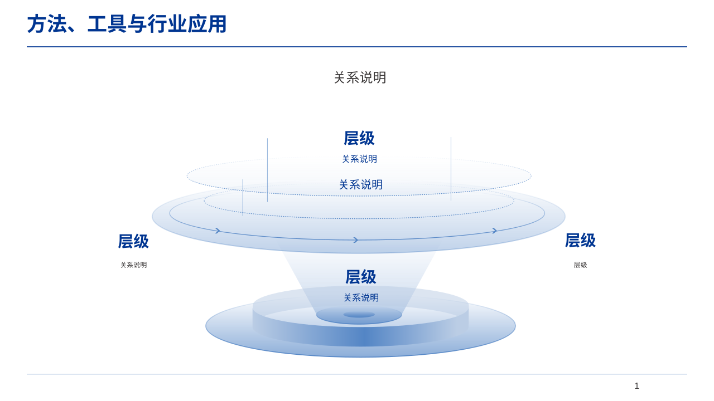

# 方法、工具与行业应用

来源为立体结构逻辑图1122.pptx#5。

## 结构与适用场景

上技术与行业/体系支持同一大圆盘，下方法论圆柱底座，中倒锥连接

方法论-工具-行业应用体系

核心盘与底座必须可分层；外侧角色不能压成正文

固定节点、圆弧、扇区、分面和连接表达定性关系。数量比较、趋势或占比使用数据驱动图表，源页中已登记的微图槽可接收实际数据。

## 预览



## 调用

将下列完整page对象放入schema_version=1、template_id=business-blue-v1的pages数组，替换各节点内容。nodes键对应原文本框或已明确拆分的语义分段，字段角色及source_ref、segment见下表。

```json
{
  "id": "spatial-05",
  "family": "source-spatial",
  "variant": "page-05",
  "content": {
    "title": "方法、工具与行业应用",
    "nodes": {
      "shape_39": "层级",
      "shape_40": "关系说明",
      "shape_51": "层级",
      "shape_52": "关系说明",
      "shape_53": "关系说明",
      "shape_54": "层级",
      "shape_55": "关系说明",
      "shape_56": "层级",
      "shape_57": "层级",
      "shape_31": "关系说明"
    }
  },
  "config": {
    "show_source": true,
    "show_page_number": true
  }
}
```

config支持show_source、show_page_number、image_fit与image_position。image_fit可选contain或cover，image_position为xMin/xMid/xMax与YMin/YMid/YMax组合的九个焦点，默认为xMidYMid。字体、颜色、全局区和固定字阶取自tokens，节点数与连接结构由variant确定。

## 字段合同

每个业务节点required=true、min=1，max按具体框体登记。字符按规范化后的Unicode码点计数，空格标点换行均计入。build会以实际字体测量宽高，字符数通过后仍可能需要调整文字。

| 字段 | 节点角色与源标签 | 最短/最长 | 字阶 | 框体px | 原框引用 | 分段 | 旋转° | 垂直锚点 |
|---|---|---|---|---|---|---|---|---|
| nodes.shape_39 | 下中节点，源标签“科学的经营方法论” | 1/30 | heading | [455.7662, 482.5701, 382.6105, 52.031] | slide:39 |  | 0.0 | t |
| nodes.shape_40 | 下中节点，源标签“DEEPLINK+PLTV” | 1/53 | caption | [455.7662, 526.1385, 382.6105, 34.9707] | slide:40 |  | 0.0 | t |
| nodes.shape_51 | 上中节点，源标签“科学的产品技术” | 1/30 | heading | [452.7135, 233.37, 382.6105, 52.031] | slide:51 |  | 0.0 | t |
| nodes.shape_52 | 上中节点，源标签“DEEPLINK+PLTV” | 1/53 | caption | [452.7135, 276.9384, 382.6105, 34.9707] | slide:52 |  | 0.0 | t |
| nodes.shape_53 | 中中节点，源标签“直通车丨万象台数超级直播 / 引力魔方丨UD丨达摩盘” | 1/82 | compactBody | [460.2776, 321.0286, 371.5783, 53.0647] | slide:53 |  | 0.0 | t |
| nodes.shape_54 | 中右节点，源标签“与品牌打造经营样板间” | 1/33 | diagramMicro | [950.7949, 469.3256, 179.8093, 28.5659] | slide:54 |  | 0.0 | t |
| nodes.shape_55 | 中左节点，源标签“快消丨服饰时尚丨食品丨消费电子” | 1/39 | diagramMicro | [132.973, 469.3256, 212.6644, 28.5659] | slide:55 |  | 0.0 | t |
| nodes.shape_56 | 中右节点，源标签“科学的平蓄促收体系” | 1/30 | heading | [849.3895, 416.8696, 382.6105, 52.031] | slide:56 |  | 0.0 | t |
| nodes.shape_57 | 中左节点，源标签“科学的行业经营解决方案” | 1/30 | heading | [48, 418.6471, 382.6105, 52.031] | slide:57 |  | 0.0 | t |
| nodes.shape_31 | 上中节点，源标签“用领先的经营方法论和先进的经营技术保障确定性增长” | 1/57 | body | [335.2815, 126.6803, 618.4309, 37.4631] | slide:31 |  | 0.0 | t |

全局title必填、2至32码点，使用统一标题框。section_name可选0至24码点，source可选0至64码点。所有可编辑文本通过独立原生carrier导出，页码为派生文字。

## 来源处理

原生PPTX源件保存于用户材料目录，分发包仅含用户资产衍生的几何、字段和说明。原始逐框文字、源框与标准化框在page-catalog.json的variant.fields中。

源标题引用为`slide:32`，原文为“阿里妈妈经营科学”。模板默认标题依据真实结构设置。

密集全景中的diagramCompact为14px、diagramMicro为12px。适用于体系概览或附录局部标签，现场关键结论用统一标题与正常正文字阶表达。

源画布边界裁切已烘焙为可编辑Bezier几何，3D顶面、侧面与前面通过tokens配色的相对明暗保留。

