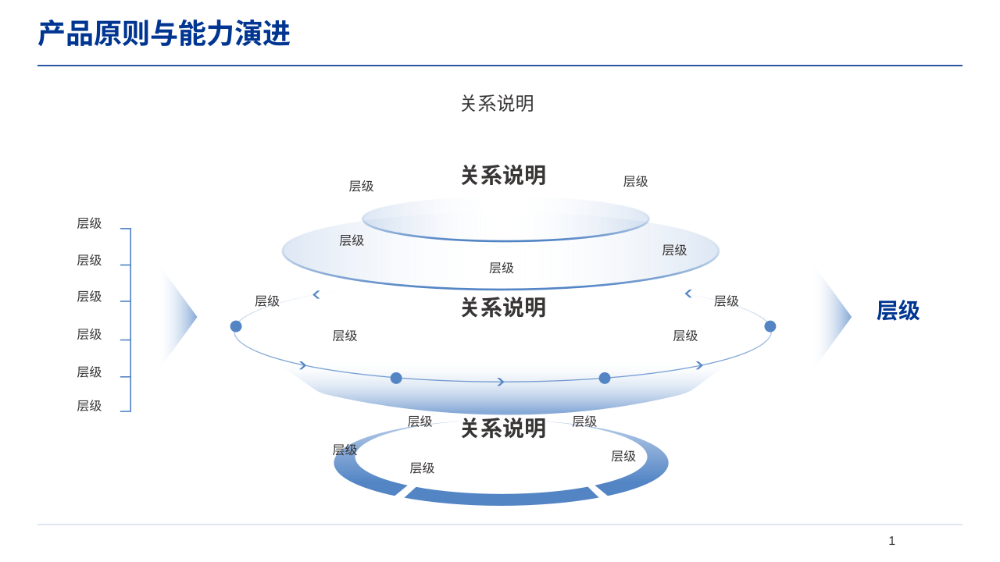

# 产品原则与能力演进

来源为立体结构逻辑图1122.pptx#6。

## 结构与适用场景

卓越/安全/开放3层悬浮椭圆；中间环路节点；左需求到IP6步骤；右版本输出

产品能力演进与原则

原标题与实际VM4.2例文不一致；按实际三原则结构说明，避免借用品牌结论

固定节点、圆弧、扇区、分面和连接表达定性关系。数量比较、趋势或占比使用数据驱动图表，源页中已登记的微图槽可接收实际数据。

## 预览



## 调用

将下列完整page对象放入schema_version=1、template_id=business-blue-v1的pages数组，替换各节点内容。nodes键对应原文本框或已明确拆分的语义分段，字段角色及source_ref、segment见下表。

```json
{
  "id": "spatial-06",
  "family": "source-spatial",
  "variant": "page-06",
  "content": {
    "title": "产品原则与能力演进",
    "nodes": {
      "shape_10": "层级",
      "shape_11": "层级",
      "shape_12": "层级",
      "shape_13": "层级",
      "shape_14": "层级",
      "shape_15": "层级",
      "shape_23": "层级",
      "shape_24": "层级",
      "shape_25": "层级",
      "shape_26": "层级",
      "shape_27": "层级",
      "shape_28": "层级",
      "shape_29": "层级",
      "shape_30": "层级",
      "shape_31": "层级",
      "shape_32": "层级",
      "shape_33": "层级",
      "shape_34": "层级",
      "shape_35": "层级",
      "shape_36": "层级",
      "shape_37": "关系说明",
      "shape_38": "关系说明",
      "shape_39": "关系说明",
      "shape_50": "层级",
      "shape_51": "关系说明"
    }
  },
  "config": {
    "show_source": true,
    "show_page_number": true
  }
}
```

config支持show_source、show_page_number、image_fit与image_position。image_fit可选contain或cover，image_position为xMin/xMid/xMax与YMin/YMid/YMax组合的九个焦点，默认为xMidYMid。字体、颜色、全局区和固定字阶取自tokens，节点数与连接结构由variant确定。

## 字段合同

每个业务节点required=true、min=1，max按具体框体登记。字符按规范化后的Unicode码点计数，空格标点换行均计入。build会以实际字体测量宽高，字符数通过后仍可能需要调整文字。

| 字段 | 节点角色与源标签 | 最短/最长 | 字阶 | 框体px | 原框引用 | 分段 | 旋转° | 垂直锚点 |
|---|---|---|---|---|---|---|---|---|
| nodes.shape_10 | 上左节点，源标签“用户需求” | 1/14 | caption | [61.5466, 277.6886, 105.6494, 28.5835] | slide:10 |  | 0.0 | t |
| nodes.shape_11 | 中左节点，源标签“方案设计” | 1/14 | caption | [61.5466, 324.9853, 105.6494, 28.5835] | slide:11 |  | 0.0 | t |
| nodes.shape_12 | 中左节点，源标签“数据开发” | 1/14 | caption | [61.5466, 371.4916, 105.6494, 28.5835] | slide:12 |  | 0.0 | t |
| nodes.shape_13 | 中左节点，源标签“模块开放” | 1/14 | caption | [61.5466, 419.9048, 105.6494, 28.5835] | slide:13 |  | 0.0 | t |
| nodes.shape_14 | 中左节点，源标签“收益维护” | 1/14 | caption | [61.5466, 468.2488, 105.6494, 28.5835] | slide:14 |  | 0.0 | t |
| nodes.shape_15 | 下左节点，源标签“知识产权” | 1/14 | caption | [61.5466, 511.5242, 105.6494, 28.5835] | slide:15 |  | 0.0 | t |
| nodes.shape_23 | 上中节点，源标签“模块更丰富” | 1/16 | caption | [404.46, 230.2042, 116.2608, 28.5835] | slide:23 |  | 0.0 | t |
| nodes.shape_24 | 中中节点，源标签“精度更高” | 1/16 | caption | [392.1394, 299.6228, 116.2608, 28.5835] | slide:24 |  | 0.0 | t |
| nodes.shape_25 | 中左节点，源标签“开发保护者” | 1/16 | caption | [283.9804, 377.3506, 116.2608, 28.5835] | slide:25 |  | 0.0 | t |
| nodes.shape_26 | 中中节点，源标签“私有加密” | 1/16 | caption | [383.3756, 421.8117, 116.2608, 28.5835] | slide:26 |  | 0.0 | t |
| nodes.shape_27 | 下中节点，源标签“模块开放” | 1/16 | caption | [383.3756, 567.97, 116.2608, 28.5835] | slide:27 |  | 0.0 | t |
| nodes.shape_28 | 下中节点，源标签“流程开放” | 1/16 | caption | [479.4807, 531.5515, 116.2608, 28.5835] | slide:28 |  | 0.0 | t |
| nodes.shape_29 | 下中节点，源标签“界面开放” | 1/16 | caption | [482.346, 591.2874, 116.2608, 28.5835] | slide:29 |  | 0.0 | t |
| nodes.shape_30 | 下中节点，源标签“二次开发开放” | 1/20 | caption | [724.5106, 576.0718, 147.344, 28.5835] | slide:30 |  | 0.0 | t |
| nodes.shape_31 | 下中节点，源标签“框架开放” | 1/16 | caption | [690.1966, 531.5515, 116.2608, 28.5835] | slide:31 |  | 0.0 | t |
| nodes.shape_32 | 中中节点，源标签“加密狗共享” | 1/16 | caption | [819.2918, 421.8117, 116.2608, 28.5835] | slide:32 |  | 0.0 | t |
| nodes.shape_33 | 中右节点，源标签“多数据加密” | 1/16 | caption | [871.7954, 377.3506, 116.2608, 28.5835] | slide:33 |  | 0.0 | t |
| nodes.shape_34 | 上中节点，源标签“交互更优秀” | 1/16 | caption | [755.6037, 224.0784, 116.2608, 28.5835] | slide:34 |  | 0.0 | t |
| nodes.shape_35 | 中中节点，源标签“效率更高” | 1/16 | caption | [805.331, 312.141, 116.2608, 28.5835] | slide:35 |  | 0.0 | t |
| nodes.shape_36 | 中中节点，源标签“耗时更稳定” | 1/16 | caption | [583.8852, 334.9347, 116.2608, 28.5835] | slide:36 |  | 0.0 | t |
| nodes.shape_37 | 上中节点，源标签“更卓越 / more outstanding” | 1/30 | heading | [545.3522, 209.8509, 195.5003, 81.2847] | slide:37 |  | 0.0 | t |
| nodes.shape_38 | 中中节点，源标签“更安全 / more secure” | 1/30 | heading | [545.3522, 379.2575, 195.5003, 81.2847] | slide:38 |  | 0.0 | t |
| nodes.shape_39 | 下中节点，源标签“更开放 / more open” | 1/30 | heading | [545.3522, 534.0413, 195.5003, 81.2847] | slide:39 |  | 0.0 | t |
| nodes.shape_50 | 中右节点，源标签“VM4.2” | 1/10 | heading | [1081.1873, 383.2787, 137.2662, 41.3686] | slide:50 |  | 0.0 | t |
| nodes.shape_51 | 上中节点，源标签“用领先的经营方法论和先进的经营技术保障确定性增长” | 1/58 | body | [319.2825, 120, 632.5033, 38.3156] | slide:51 |  | 0.0 | t |

全局title必填、2至32码点，使用统一标题框。section_name可选0至24码点，source可选0至64码点。所有可编辑文本通过独立原生carrier导出，页码为派生文字。

## 来源处理

原生PPTX源件保存于用户材料目录，分发包仅含用户资产衍生的几何、字段和说明。原始逐框文字、源框与标准化框在page-catalog.json的variant.fields中。

源标题引用为`slide:52`，原文为“阿里妈妈经营科学”。模板默认标题依据真实结构设置。

密集全景中的diagramCompact为14px、diagramMicro为12px。适用于体系概览或附录局部标签，现场关键结论用统一标题与正常正文字阶表达。

源画布边界裁切已烘焙为可编辑Bezier几何，3D顶面、侧面与前面通过tokens配色的相对明暗保留。

