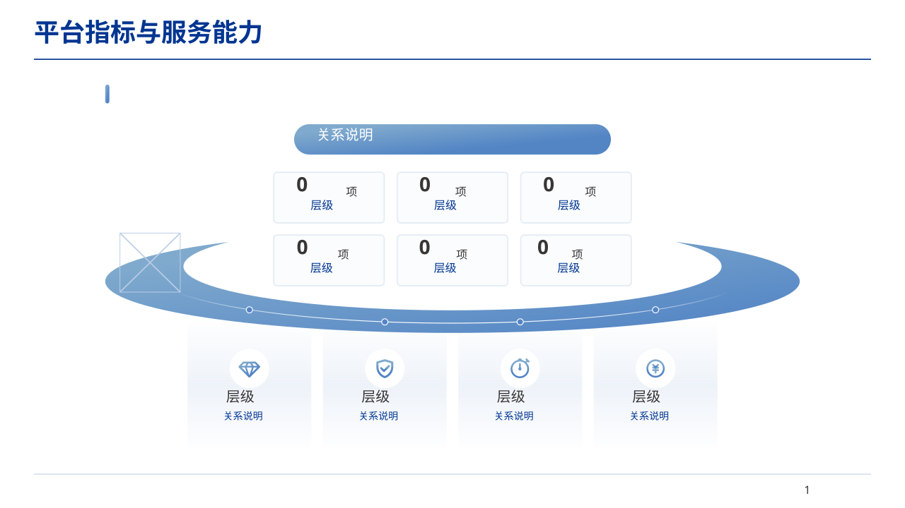

# 平台指标与服务能力

来源为立体结构逻辑图1122.pptx#7。

## 结构与适用场景

6指标2×3卡置于立体环上；下方4项能力收益

平台能力与运营指标

指标值/单位与4收益分开；仅布局示例不作为当前业务事实

固定节点、圆弧、扇区、分面和连接表达定性关系。数量比较、趋势或占比使用数据驱动图表，源页中已登记的微图槽可接收实际数据。

## 预览



## 调用

将下列完整page对象放入schema_version=1、template_id=business-blue-v1的pages数组，替换各节点内容。nodes键对应原文本框或已明确拆分的语义分段，字段角色及source_ref、segment见下表。

```json
{
  "id": "spatial-07",
  "family": "source-spatial",
  "variant": "page-07",
  "content": {
    "title": "平台指标与服务能力",
    "nodes": {
      "shape_90": "关系说明",
      "shape_91": "层级",
      "shape_92": "关系说明",
      "shape_95": "层级",
      "shape_96": "关系说明",
      "shape_97": "层级",
      "shape_98": "关系说明",
      "shape_101": "层级",
      "shape_102": "关系说明",
      "shape_119": "层级",
      "shape_120": "0",
      "shape_122": "项",
      "shape_123": "层级",
      "shape_124": "0",
      "shape_125": "项",
      "shape_126": "层级",
      "shape_127": "0",
      "shape_129": "项",
      "shape_130": "层级",
      "shape_131": "0",
      "shape_132": "项",
      "shape_133": "层级",
      "shape_134": "0",
      "shape_136": "项",
      "shape_137": "层级",
      "shape_138": "0",
      "shape_139": "项"
    }
  },
  "config": {
    "show_source": true,
    "show_page_number": true
  }
}
```

config支持show_source、show_page_number、image_fit与image_position。image_fit可选contain或cover，image_position为xMin/xMid/xMax与YMin/YMid/YMax组合的九个焦点，默认为xMidYMid。字体、颜色、全局区和固定字阶取自tokens，节点数与连接结构由variant确定。

## 字段合同

每个业务节点required=true、min=1，max按具体框体登记。字符按规范化后的Unicode码点计数，空格标点换行均计入。build会以实际字体测量宽高，字符数通过后仍可能需要调整文字。

| 字段 | 节点角色与源标签 | 最短/最长 | 字阶 | 框体px | 原框引用 | 分段 | 旋转° | 垂直锚点 |
|---|---|---|---|---|---|---|---|---|
| nodes.shape_90 | 上中节点，源标签“优于同行业水准的支付+结算的金融能力” | 1/42 | compactBody | [447.6535, 179.4348, 384.6844, 32.7537] | slide:90 |  | 0.0 | t |
| nodes.shape_91 | 下左节点，源标签“专业水准” | 1/11 | compactBody | [301.098, 550.5014, 103.3633, 32.7537] | slide:91 |  | 0.0 | t |
| nodes.shape_92 | 下左节点，源标签“对齐行业水准 / 提升平台专业性” | 1/52 | diagramCompact | [268.1711, 581.1933, 169.2084, 46.6486] | slide:92 |  | 0.0 | t |
| nodes.shape_95 | 下中节点，源标签“安全可控” | 1/11 | compactBody | [492.5782, 550.5014, 103.3633, 32.7537] | slide:95 |  | 0.0 | t |
| nodes.shape_96 | 下中节点，源标签“操作更便捷，成本更低 / 更加合规” | 1/52 | diagramCompact | [459.6513, 581.1933, 169.2084, 46.6486] | slide:96 |  | 0.0 | t |
| nodes.shape_97 | 下中节点，源标签“高效周转” | 1/11 | compactBody | [684.0585, 550.5014, 103.3633, 32.7537] | slide:97 |  | 0.0 | t |
| nodes.shape_98 | 下中节点，源标签“解决买卖双方资金问题 / 缩短资金周转期” | 1/52 | diagramCompact | [651.1316, 581.1933, 169.2084, 46.6486] | slide:98 |  | 0.0 | t |
| nodes.shape_101 | 下右节点，源标签“无忧退款” | 1/11 | compactBody | [875.5387, 550.5014, 103.3633, 32.7537] | slide:101 |  | 0.0 | t |
| nodes.shape_102 | 下右节点，源标签“保障物流运输 / 解决交易纠纷 / 提前结算贷款” | 1/78 | diagramCompact | [842.6205, 581.1933, 169.2084, 66.8067] | slide:102 |  | 0.0 | t |
| nodes.shape_119 | 中中节点，源标签“支持国家” | 1/11 | caption | [423.1034, 280.4505, 85.1456, 29.4792] | slide:119 |  | 0.0 | t |
| nodes.shape_120 | 指标主值，与右侧独立单位配对，源值“100+”，最多1行，按实际字体宽度拒绝折行输入，输入格式 `^(?:T[+-])?[+-]?[0-9]+(?:[.,][0-9]+)?[+%]?$` | 1/7 | heading | [406.8089, 244.5176, 77.2312, 49.1262] | slide:120 |  | 0.0 | t |
| nodes.shape_122 | 指标单位，与左侧数值配对，源单位“个”，最多1行，按实际字体宽度拒绝折行输入，输入格式 `^[^\r\n]+$` | 1/4 | caption | [490.0401, 261.5051, 35.1012, 27.8419] | slide:122 |  | 0.0 | t |
| nodes.shape_123 | 中中节点，源标签“支持币种” | 1/11 | caption | [597.8733, 280.4505, 84.9637, 29.4792] | slide:123 |  | 0.0 | t |
| nodes.shape_124 | 指标主值，与右侧独立单位配对，源值“12”，最多1行，按实际字体宽度拒绝折行输入，输入格式 `^(?:T[+-])?[+-]?[0-9]+(?:[.,][0-9]+)?[+%]?$` | 1/4 | heading | [599.8744, 244.5176, 38.7255, 49.1262] | slide:124 |  | 0.0 | t |
| nodes.shape_125 | 指标单位，与左侧数值配对，源单位“种”，最多1行，按实际字体宽度拒绝折行输入，输入格式 `^[^\r\n]+$` | 1/4 | caption | [644.5999, 261.5051, 35.1012, 27.8419] | slide:125 |  | 0.0 | t |
| nodes.shape_126 | 中中节点，源标签“支付工具” | 1/11 | caption | [772.8338, 280.4505, 84.9637, 29.4792] | slide:126 |  | 0.0 | t |
| nodes.shape_127 | 指标主值，与右侧独立单位配对，源值“15+”，最多1行，按实际字体宽度拒绝折行输入，输入格式 `^(?:T[+-])?[+-]?[0-9]+(?:[.,][0-9]+)?[+%]?$` | 1/5 | heading | [766.5273, 244.5176, 55.6005, 49.1262] | slide:127 |  | 0.0 | t |
| nodes.shape_129 | 指标单位，与左侧数值配对，源单位“家”，最多1行，按实际字体宽度拒绝折行输入，输入格式 `^[^\r\n]+$` | 1/4 | caption | [828.1278, 261.5051, 35.1012, 27.8419] | slide:129 |  | 0.0 | t |
| nodes.shape_130 | 中中节点，源标签“结算周期” | 1/11 | caption | [422.7482, 369.425, 84.9637, 29.4792] | slide:130 |  | 0.0 | t |
| nodes.shape_131 | 指标主值，与右侧独立单位配对，源值“T+1”，最多1行，按实际字体宽度拒绝折行输入，输入格式 `^(?:T[+-])?[+-]?[0-9]+(?:[.,][0-9]+)?[+%]?$` | 1/5 | heading | [419.1792, 333.4922, 53.2355, 49.1262] | slide:131 |  | 0.0 | t |
| nodes.shape_132 | 指标单位，与左侧数值配对，源单位“天”，最多1行，按实际字体宽度拒绝折行输入，输入格式 `^[^\r\n]+$` | 1/4 | caption | [478.4147, 350.4797, 35.1012, 27.8419] | slide:132 |  | 0.0 | t |
| nodes.shape_133 | 中中节点，源标签“手续费” | 1/9 | caption | [605.6784, 369.425, 68.6345, 29.4792] | slide:133 |  | 0.0 | t |
| nodes.shape_134 | 指标主值，与右侧独立单位配对，源值“1%”，最多1行，按实际字体宽度拒绝折行输入，输入格式 `^(?:T[+-])?[+-]?[0-9]+(?:[.,][0-9]+)?[+%]?$` | 1/4 | heading | [597.6134, 333.4922, 42.4245, 49.1262] | slide:134 |  | 0.0 | t |
| nodes.shape_136 | 指标单位，与左侧数值配对，源单位“起”，最多1行，按实际字体宽度拒绝折行输入，输入格式 `^[^\r\n]+$` | 1/4 | caption | [646.0379, 350.4797, 35.1012, 27.8419] | slide:136 |  | 0.0 | t |
| nodes.shape_137 | 中中节点，源标签“直接到账” | 1/11 | caption | [772.288, 369.425, 84.9637, 29.4792] | slide:137 |  | 0.0 | t |
| nodes.shape_138 | 指标主值，与右侧独立单位配对，源值“0”，最多1行，按实际字体宽度拒绝折行输入，输入格式 `^(?:T[+-])?[+-]?[0-9]+(?:[.,][0-9]+)?[+%]?$` | 1/2 | heading | [776.7504, 333.4922, 18.9128, 49.1262] | slide:138 |  | 0.0 | t |
| nodes.shape_139 | 指标单位，与左侧数值配对，源单位“停留”，最多1行，按实际字体宽度拒绝折行输入，输入格式 `^[^\r\n]+$` | 1/4 | caption | [801.6632, 350.4797, 50.5555, 27.8419] | slide:139 |  | 0.0 | t |

## 可替换图片

在content.visuals提供下列槽位对象，省略时显示中性空槽。每项含path和可选alt，path为--assets目录下的相对本地路径，1至260码点，alt为0至200码点。原案例照片、界面或品牌保留来源引用，默认页使用空槽。

- `visuals.picture_145`用于品牌或形象，框体为`[169.6416, 330.3476, 85.2669, 83.6643]`，源引用为`['slide:145']`。

```json
{
  "visuals": {
    "picture_145": {
      "path": "assets/replacement.png",
      "alt": "品牌或形象"
    }
  }
}
```


全局title必填、2至32码点，使用统一标题框。section_name可选0至24码点，source可选0至64码点。所有可编辑文本通过独立原生carrier导出，页码为派生文字。

## 来源处理

原生PPTX源件保存于用户材料目录，分发包仅含用户资产衍生的几何、字段和说明。原始逐框文字、源框与标准化框在page-catalog.json的variant.fields中。

源标题引用为`slide:81`，原文为“京东国际B2B平台支付结算能力”。模板默认标题依据真实结构设置。

密集全景中的diagramCompact为14px、diagramMicro为12px。适用于体系概览或附录局部标签，现场关键结论用统一标题与正常正文字阶表达。

源画布边界裁切已烘焙为可编辑Bezier几何，3D顶面、侧面与前面通过tokens配色的相对明暗保留。

