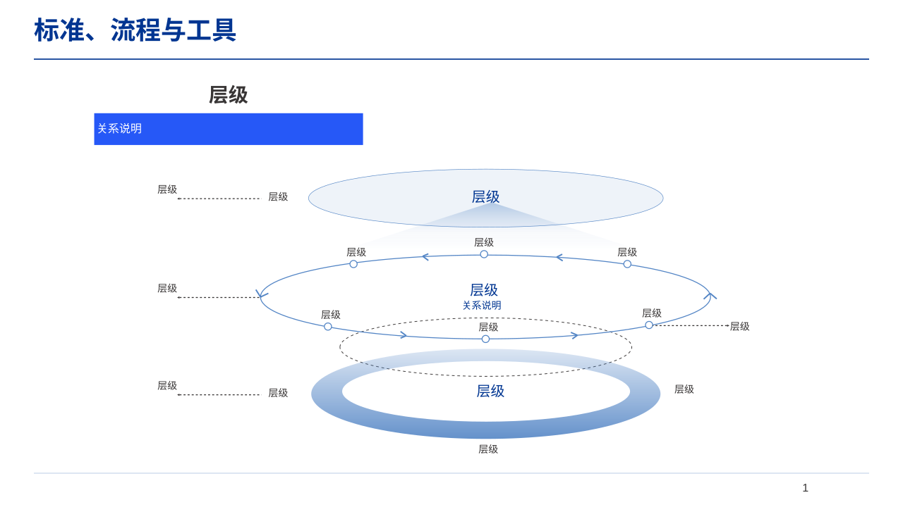

# 标准、流程与工具

来源为立体结构逻辑图1122.pptx#8。

## 结构与适用场景

标准模型底部环→机制中间环循环→测试工具顶部盘；中间任务/测评/分析闭环

问题-动作-反馈，标准-流程-工具

源标题会员与实际易用性流程混杂，选择依据是实际流程；环内步骤和反馈方向需保留

固定节点、圆弧、扇区、分面和连接表达定性关系。数量比较、趋势或占比使用数据驱动图表，源页中已登记的微图槽可接收实际数据。

## 预览



## 调用

将下列完整page对象放入schema_version=1、template_id=business-blue-v1的pages数组，替换各节点内容。nodes键对应原文本框或已明确拆分的语义分段，字段角色及source_ref、segment见下表。

```json
{
  "id": "spatial-08",
  "family": "source-spatial",
  "variant": "page-08",
  "content": {
    "title": "标准、流程与工具",
    "nodes": {
      "shape_5": "层级",
      "shape_8": "关系说明",
      "shape_110": "层级",
      "shape_111": "层级",
      "shape_120": "层级",
      "shape_121": "层级",
      "shape_122": "层级",
      "shape_47": "层级",
      "shape_48": "关系说明",
      "shape_51": "层级",
      "shape_52": "层级",
      "shape_56": "层级",
      "shape_91": "层级",
      "shape_95": "层级",
      "shape_99": "层级",
      "shape_118": "层级",
      "shape_124": "层级",
      "shape_43": "层级",
      "shape_126": "层级",
      "shape_132": "层级"
    }
  },
  "config": {
    "show_source": true,
    "show_page_number": true
  }
}
```

config支持show_source、show_page_number、image_fit与image_position。image_fit可选contain或cover，image_position为xMin/xMid/xMax与YMin/YMid/YMax组合的九个焦点，默认为xMidYMid。字体、颜色、全局区和固定字阶取自tokens，节点数与连接结构由variant确定。

## 字段合同

每个业务节点required=true、min=1，max按具体框体登记。字符按规范化后的Unicode码点计数，空格标点换行均计入。build会以实际字体测量宽高，字符数通过后仍可能需要调整文字。

| 字段 | 节点角色与源标签 | 最短/最长 | 字阶 | 框体px | 原框引用 | 分段 | 旋转° | 垂直锚点 |
|---|---|---|---|---|---|---|---|---|
| nodes.shape_5 | 上左节点，源标签“会员体系的本质” | 1/21 | heading | [295.8584, 120, 265.8328, 35.0] | slide:5 |  | 0.0 | t |
| nodes.shape_8 | 上左节点，源标签“THE ESSENCE OF MEMBERSHIP SYSTEM.” | 1/57 | caption | [136.9197, 174.0717, 410.9407, 20.0] | slide:8 |  | 0.0 | t |
| nodes.shape_110 | 下中节点，源标签“易用性度量模型” | 1/23 | compactBody | [590.7361, 544.816, 209.4455, 25.0] | slide:110 |  | 0.0 | t |
| nodes.shape_111 | 下中节点，源标签“易操作性” | 1/12 | diagramCompact | [652.3075, 630.5, 79.8707, 17.5] | slide:111 |  | 0.0 | t |
| nodes.shape_120 | 下右节点，源标签“易学性” | 1/17 | diagramCompact | [956.0059, 545.384, 111.6333, 17.5] | slide:120 |  | 0.0 | t |
| nodes.shape_121 | 下左节点，源标签“易见性” | 1/8 | diagramCompact | [380.4007, 550.5875, 50.4004, 17.5] | slide:121 |  | 0.0 | t |
| nodes.shape_122 | 下左节点，源标签“建标准” | 1/8 | diagramCompact | [223.2029, 540.2095, 50.4004, 17.5] | slide:122 |  | 0.0 | t |
| nodes.shape_47 | 中中节点，源标签“可落地易推行的SOP流程” | 1/23 | compactBody | [581.451, 401.3911, 209.4455, 25.0] | slide:47 |  | 0.0 | t |
| nodes.shape_48 | 中中节点，源标签“统一标准·专业输出·改进闭环” | 1/30 | diagramCompact | [586.6835, 426.3033, 191.7943, 17.5] | slide:48 |  | 0.0 | t |
| nodes.shape_51 | 中右节点，源标签“统计分析” | 1/11 | diagramCompact | [853.4642, 350.7752, 71.6786, 17.5] | slide:51 |  | 0.0 | t |
| nodes.shape_52 | 中中节点，源标签“易用性报告” | 1/11 | diagramCompact | [650.3345, 336.8089, 71.6786, 17.5] | slide:52 |  | 0.0 | t |
| nodes.shape_56 | 中中节点，源标签“问题解决闭环” | 1/12 | diagramCompact | [465.3009, 350.7752, 79.8707, 17.5] | slide:56 |  | 0.0 | t |
| nodes.shape_91 | 中中节点，源标签“制定任务” | 1/12 | diagramCompact | [429.0312, 439.5635, 79.8707, 17.5] | slide:91 |  | 0.0 | t |
| nodes.shape_95 | 中中节点，源标签“制定任务” | 1/12 | diagramCompact | [652.5783, 457.1857, 79.8707, 17.5] | slide:95 |  | 0.0 | t |
| nodes.shape_99 | 中右节点，源标签“实施测评” | 1/12 | diagramCompact | [884.2016, 437.3486, 79.8707, 17.5] | slide:99 |  | 0.0 | t |
| nodes.shape_118 | 中右节点，源标签“PEM / 云产品易用性量表” | 1/17 | diagramCompact | [1034.8321, 456.2057, 111.6333, 31.25] | slide:118 |  | 0.0 | t |
| nodes.shape_124 | 中左节点，源标签“定机制” | 1/8 | diagramCompact | [223.2029, 402.0074, 50.4004, 17.5] | slide:124 |  | 0.0 | t |
| nodes.shape_43 | 上中节点，源标签“测试工具test” | 1/14 | compactBody | [623.1757, 268.9051, 131.0933, 25.0] | slide:43 |  | 0.0 | t |
| nodes.shape_126 | 上左节点，源标签“搭工具” | 1/8 | diagramCompact | [223.2029, 261.6581, 50.4004, 17.5] | slide:126 |  | 0.0 | t |
| nodes.shape_132 | 上左节点，源标签“易见性” | 1/8 | diagramCompact | [380.4007, 272.0264, 50.4004, 17.5] | slide:132 |  | 0.0 | t |

## 保留的原装饰

本页保留用户原模板的结构图标或装饰图片，逐项身份见source-field-coverage.json中本页retained_source_images。其中图片内固化的字形随整图编辑，可在PowerPoint中原生替换整图；nodes字段控制已登记的可编辑文字。参数图片替换使用本页image_slots列出的槽位。


全局title必填、2至32码点，使用统一标题框。section_name可选0至24码点，source可选0至64码点。所有可编辑文本通过独立原生carrier导出，页码为派生文字。

## 来源处理

原生PPTX源件保存于用户材料目录，分发包仅含用户资产衍生的几何、字段和说明。原始逐框文字、源框与标准化框在page-catalog.json的variant.fields中。

源标题引用为`slide:4`，原文为“AMAP LOGO”。模板默认标题依据真实结构设置。

密集全景中的diagramCompact为14px、diagramMicro为12px。适用于体系概览或附录局部标签，现场关键结论用统一标题与正常正文字阶表达。

源画布边界裁切已烘焙为可编辑Bezier几何，3D顶面、侧面与前面通过tokens配色的相对明暗保留。

